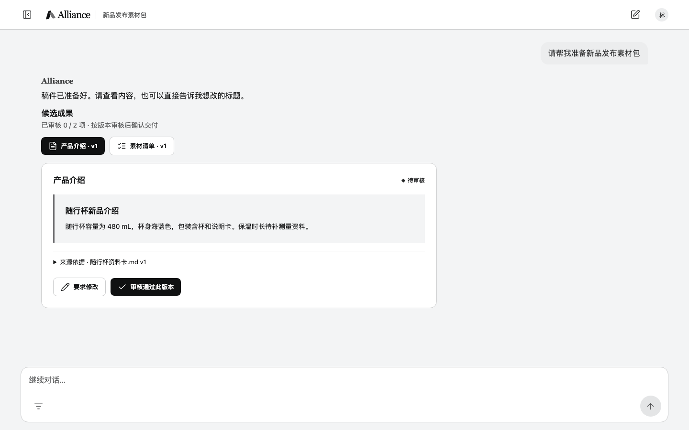
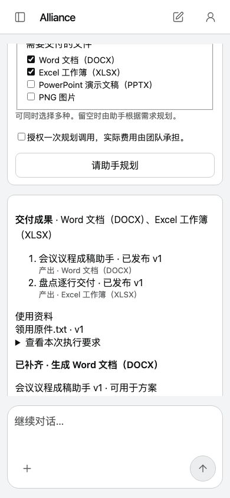
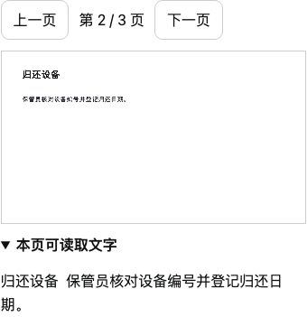

<div align="center">

# Agent Alliance

**从一句业务需求，到可审核、可交付的成果。**

面向企业自部署的开源 Agent 工作空间

[](https://github.com/slientwind/agent-alliance/releases/tag/v0.1.1)
[](LICENSE)
[](#快速开始)

[快速开始](#快速开始) · [使用手册](docs/USER-GUIDE.md) · [Open API](backend/internal/services/openapi.json) · [产品与技术文档](#文档)

</div>

给团队一个对话入口，用自己的模型和资料完成工作。成员可以复用一个 Agent，也可以把多个 Agent 组装成协作方案。平台记录资料、Agent 和成果版本，让人能核对依据、处理反馈并确认交付。

**描述需求 → 选用或创建 Agent → 确认方案 → 执行 → 审核与交付**

<p align="center">
  
  <br />
  <sub>交互原型 · 新品发布素材的逐项审核</sub>
</p>

## 能做什么

| 从这里开始 | 可以完成的事 |
| --- | --- |
| **Agent 能力库** | 根据任务推荐已发布 Agent。用自然语言创建草稿，试运行、验收后发布。已有外部 Agent 可通过 A2A Agent Card 接入。 |
| **资料与工具** | 固定资料版本，做原文检索和带出处的问答。用 CSV 受控计算、识图、生图和文档工具制作 Word、Excel、PowerPoint 或 PNG。 |
| **多人协作** | 配置步骤依赖，核对执行范围。成果可按版本审核、分配修改、局部重跑并打包交付。 |
| **可复用服务** | 将单个 Agent 或协作方案发布成独立网页对话和 Open API。飞书可进入服务和待办。 |
| **运行与治理** | 查看进度、阻塞、调用费用和 Trace。管理员配置模型、管理成员和查看用量。密钥由部署企业管理。 |

例如，上传照片和设备说明，让识图 Agent 核对标签，再由文档 Agent 将结果排成 Word。审核人可以对照原件、提出修改，并下载已确认的交付包。

<p align="center">
  
  &nbsp;
  
  <br />
  <sub>浏览器集成演示 · 确认方案与审核成果</sub>
</p>

## 快速开始

本地体验需要 Docker、Docker Compose、Make 和 OpenSSL。首次构建需拉取基础镜像和锁定的依赖。

```bash
git clone --branch v0.1.1 https://github.com/slientwind/agent-alliance.git
cd agent-alliance
make configure
docker compose --env-file .env.local \
  -f deploy/compose.yaml -f deploy/application.yaml up -d --build
```

1. 打开 [http://127.0.0.1:18485](http://127.0.0.1:18485)，用本机 `.env.local` 中的 `BOOTSTRAP_TOKEN` 创建首位管理员。
2. 在「我的工作区 → 企业管理」接入团队可用的模型，验证连通。需要邀请同事时，从用户管理创建限时邀请。
3. 打开新对话，描述任务并选择 Agent。遇到能力缺口时，可用样例创建、验证和发布一个新 Agent。

开发模式使用 **Go 1.27、Node.js 22 和 Docker Compose**。分进程启动、模型配置、HTTPS、备份恢复和企业登录见[使用手册](docs/USER-GUIDE.md)及[企业备份与恢复](docs/17-enterprise-recovery.md)。

## 架构

前端采用 **React、TypeScript 和 Node.js**。**Go API** 负责身份、权限、版本和账本，独立 **Worker** 执行任务。**Temporal** 保存持久化的协作流程，**Eino** 组织模型与工具调用，**PostgreSQL** 管理业务状态。文件保存在实例的私有对象目录，受控计算和 Office 处理由独立工具进程承担。

## 文档

- [操作手册](docs/USER-GUIDE.md) · Agent、模型、渠道、部署和验收
- [产品方案](docs/10-product-blueprint.md) · 对话、协作、审核与交付
- [技术方案](docs/11-technical-blueprint.md) · 模块、数据、执行与恢复
- [重建与验证记录](docs/15-rebuild.md) · 合成数据走查、已实现范围和待验证项
- [版本记录](CHANGELOG.md) · 0.1.1 发布范围

**0.1.1 是早期版本。** 浏览器、集成和交付样例使用合成资料。参考图编辑与选区修改为实验功能，真实供应商账号、模型质量及计费需在目标环境验证。

## 开源许可

项目原创代码与文档按 [Apache License 2.0](LICENSE) 授权。上游研究快照和第三方组件各自保留原作者的版权和许可，详见 [NOTICE](NOTICE)。
