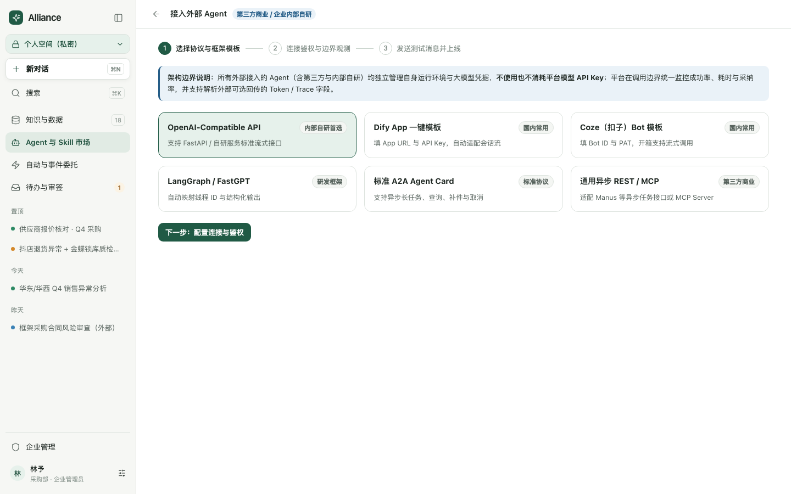

<div align="center">

<br />

# Agent Alliance

### 面向企业自部署的开源 Personal Agent 与团队空间协同平台

*让不懂 AI 的业务员工像用 ChatGPT / Claude 一样顺手干活；以「个人空间 + 团队空间」深度融合企业知识库、ERP/CRM/电商活数据、多人协同与全局安全治理。*

<br />

[](https://github.com/slientwind/agent-alliance/releases/tag/v0.2.1)
[](docs/18-vnext-product-ia.md)
[](LICENSE)
[](#快速开始)
[](#系统架构)

<br />

[核心能力](#核心能力) · [界面预览](#界面预览) · [系统架构](#系统架构) · [快速开始](#快速开始) · [演进路线](#当前版本与演进路线) · [文档体系](#文档体系)

<br />


<sub>vNext 1.2 实屏 · 团队空间自动挂载知识库与业务语义层：页码级制度溯源、OBO 行级权限查抖店/金蝶库存、套用集团官方 PPT 母版及 L2 系统写回预览确认</sub>

</div>

<br />

---

## 为什么选择 Agent Alliance？

大多数开源 Agent 工具停留在“面向开发者的编排画布”或“无企业上下文的套壳聊天框”。而在真实企业中，绝大多数一线业务员工既不懂 Prompt 也不懂 SQL，他们真正把一件事办成需要三样底座：**公司的制度经验（企业知识库）**、**活的经营系统数据（ERP / CRM / 电商）**、以及**公私分明的协作边界（个人空间与团队空间）**。

**Agent Alliance** 将这些能力原生收敛在一套清爽的自部署工作台中：

> **个人私密空间 L0 直达 ⇄ 团队空间共享知识·口径·母版 ⇄ ERP/CRM/电商受控联查与 L2 写回确认 ⇄ 业务事件主动唤醒与全局 DLP 治理**

---

## 核心能力

<table>
  <tr>
    <td width="50%" valign="top">
      <h3>1. 三级空间管理与岗位无感交接</h3>
      侧栏一键切换<b>个人私密空间</b>（管理员默认不可窥探私聊）、<b>部门/专项团队空间</b>与自动继承的<b>全企公共底座</b>。切入团队空间即自动挂载本组知识库、数据源、口径与母版；员工调岗/离职时严格执行<b>个人隐私隔离封存 + 团队资产原子继承</b>。
    </td>
    <td width="50%" valign="top">
      <h3>2. 企业知识库、混合检索与缺口雷达</h3>
      支持飞书/钉钉/Confluence 目录级增量同步与<b>跨页复杂表格保真切分</b>；采用 <code>BM25 + BGE 向量 + Rerank</code> 三路混合检索，实时遵循文档 ACL 权限并压制作废旧制度，支持页码级高亮溯源与<b>高频知识缺口/制度冲突雷达</b>。
    </td>
  </tr>
  <tr>
    <td width="50%" valign="top">
      <h3>3. ERP / CRM / 电商打通与业务语义层</h3>
      连接金蝶/用友/SAP、CRM、抖店/千牛/聚水潭与只读数仓。通过<b>受控业务语义视图 + 企业黑话/指标口径词典</b>杜绝模型裸猜表名算错毛利；<b>OBO 身份行权限透传</b>保障仅查本人名下数据，<b>读 L0 直达、写回强制 L2 变更预览确认与幂等对账</b>。
    </td>
    <td width="50%" valign="top">
      <h3>4. 通用沙箱执行、官方母版套版与事件唤醒</h3>
      底层由通用 Agent Loop + Docker Compose <b>断网隔离沙箱</b>驱动，生成 Word / PPT / Excel 时<b>原生套用公司官方品牌母版</b>免二次排版；支持定时委托与 <b>ERP/CRM/电商 Webhook 异常事件主动唤醒</b>（从“人找 AI”升级到“事找人”）。
    </td>
  </tr>
  <tr>
    <td width="50%" valign="top">
      <h3>5. 团队多人同屏协同与非研发构建器</h3>
      任意任务可一键<b>拉同事分配补件/审核角色</b>，在右侧共享 Canvas 发起<b>表格行/段落评论与 <code>@同事</code> 派单</b>（同步飞书待办）；非研发员工通过<b>左聊右测 + 标杆文件反推 + 指哪改哪</b> 5 分钟自建助手，个人私有零审批即用。
    </td>
    <td width="50%" valign="top">
      <h3>6. 外部 Agent 解耦接入与 DLP 脱敏护栏</h3>
      内置 <b>Dify / Coze / FastGPT / LangGraph / A2A / Webhook</b> 模板；外部 Agent 独立管理自身模型、<b>不走平台 Key</b>。跨边界调用外部商业 Agent 时，内置 <b>DLP 护栏</b>自动将手机号/底价做可逆掩码脱敏保护并留存合规账本。
    </td>
  </tr>
  <tr>
    <td width="50%" valign="top">
      <h3>7. 正规渠道 Skill &amp; Agent 生态扫描市场</h3>
      定期自动扫描官方 MCP Registry、主流正规 <code>SKILL.md</code> 仓库、A2A 目录与企业内网 Git，自动完成<b>开源许可识别与静态安全体检</b>；管理员准入后按 <b>SHA-256 固化至企业私有库</b>，员工可一键自主加载到个人或团队空间。
    </td>
    <td width="50%" valign="top">
      <h3>8. 全局模型网关、双轨监控与黄金回归体检</h3>
      <code>/admin</code> 集中管理 6 档逻辑能力路由、3 秒主备 Fallback 与精确微元单价；提供<b>双轨质量大盘</b>（轻量隐式有效完成率 vs 协作审签采纳率）与 OTel Trace 瀑布流，并支持换模型/改知识前一键运行<b>黄金回归体检集</b>。
    </td>
  </tr>
</table>

---

## 界面预览

> 视觉与交互规范全面对标 **ChatGPT / Claude / Gemini**，采用暖灰白纸面 + 深墨绿强调色，原生支持 **浅色 / 深色双主题** 与 `⌘K` 全局检索。可直接打开零依赖单文件原型体验完整交互：[打开 vNext 1.2 离线交互原型 (vnext-prototype.html)](docs/uiux/vnext-prototype.html)。

<table align="center">
  <tr>
    <td align="center" width="50%">
      
      <br />
      <sub><b>空间感知首屏</b> · 侧栏顶栏一键切换个人/团队空间，自动继承知识库、数据源与母版</sub>
    </td>
    <td align="center" width="50%">
      
      <br />
      <sub><b>知识与业务数据台</b> · 多源知识库、知识缺口与冲突雷达、ERP/CRM/电商连接及口径母版</sub>
    </td>
  </tr>
  <tr>
    <td align="center" width="50%">
      
      <br />
      <sub><b>团队多人同屏协同</b> · 角色分工、共享 Canvas 表格行级 <code>@同事</code> 派单与版本审签</sub>
    </td>
    <td align="center" width="50%">
      
      <br />
      <sub><b>非研发构建器 Studio</b> · 左聊右测、标杆文件反推规范、指哪改哪与个人私有免审批</sub>
    </td>
  </tr>
  <tr>
    <td align="center" width="50%">
      
      <br />
      <sub><b>Skill &amp; Agent 生态市场</b> · 定期扫描正规渠道、许可安全体检与员工自主一键加载</sub>
    </td>
    <td align="center" width="50%">
      
      <br />
      <sub><b>企业级监控大盘</b> · 双轨有效完成率、四阶漏斗、Token 趋势与 Agent 效能榜单</sub>
    </td>
  </tr>
  <tr>
    <td align="center" width="50%">
      
      <br />
      <sub><b>外部 Agent 接入向导</b> · 一键模板适配自研与商业 Agent，独立模型 + 边界观测</sub>
    </td>
    <td align="center" width="50%">
      
      <br />
      <sub><b>全局模型网关（深色模式）</b> · 6 档能力路由主备切换与 Input/Output/Cache 精准单价</sub>
    </td>
  </tr>
</table>

---

## 系统架构

单企业独立部署一套完整实例，所有企业知识、业务连接凭据、模型密钥与运行账本均留在企业自有基础设施内：

<p align="center">
  
  <br />
  <sub><a href="docs/architecture/vnext-architecture.svg">查看高清矢量图 (SVG)</a> · <a href="docs/archive/architecture/platform/enterprise-platform.html">历史工程全景详图</a> · <a href="docs/20-vnext-technical-architecture.md">完整架构规格书</a></sub>
</p>

| 分层 | 核心技术栈 | 关键职责与边界 |
| :--- | :--- | :--- |
| **多端与事件入口** | React 19 · TS · 飞书/钉钉 · Webhook | 个人/团队空间工作区、知识与业务数据台、IM 移动卡片协同、ERP/CRM/电商事件主动触发 |
| **控制面与空间治理** | Go 1.26 · HTTP/SSE · OIDC · OBO | 三级空间隔离与公私分离交接、冷热分离 SSE 网关、团队锚点协同、L2 写回确认门禁 |
| **编排、检索与网关** | Temporal · Go Worker · Hybrid RAG | 持久工作流与事件防抖唤醒、空间上下文自动装配、内部 6 档位 LLM Gateway、混合检索、外部 DLP 脱敏网关 |
| **沙箱与业务连接层** | Docker Compose · MCP · Semantic Views | 断网沙箱套用官方母版、多源知识目录增量同步、金蝶/用友/CRM/抖店连接器与只读数仓语义层 |
| **数据与可观测合规** | PostgreSQL + pgvector · 对象卷 · OTLP | 空间账本与混合索引、术语口径词典、L2 幂等写回单、SHA-256 固化 Skill、双轨监控与黄金体检集 |

---

## 快速开始

本地体验仅需 **Docker**、**Docker Compose**、**Make** 与 **OpenSSL**：

```bash
git clone --branch v0.2.1 https://github.com/slientwind/agent-alliance.git
cd agent-alliance
make configure
docker compose --env-file .env.local \
  -f deploy/compose.yaml -f deploy/application.yaml up -d --build
```

1. 浏览器访问 [http://127.0.0.1:18485](http://127.0.0.1:18485)，使用 `.env.local` 中的 `BOOTSTRAP_TOKEN` 初始化首位企业管理员。
2. 按初始化引导接入首个企业可用模型供应商（自动映射 6 档能力路由）、选择生态扫描源并邀请团队成员。
3. 打开工作区即可发起对话、拉同事协同、加载正规生态 Skill 或接入外部专业 Agent。

> 开发环境使用 **Go 1.26+、Node.js 22 与 Docker Compose**。分进程调试、HTTPS、OIDC、飞书/钉钉/Slack 渠道接入、密钥平滑轮换（`RESOURCE_PREVIOUS_KEYS`）及多副本 Redis 热流（`HOT_STREAM_REDIS_URL`）配置请查阅 [操作手册](docs/USER-GUIDE.md) 与 [企业备份与恢复](docs/17-enterprise-recovery.md)。

---

## 当前版本与演进路线

> **项目透明声明**：仓库已完成通用 Agent Loop、Docker Compose 断网沙箱、内部 6 档位模型网关、冷热分离 SSE、团队协同、对话式构建器与生态扫描市场等核心底座实现（部分端到端验收使用本地替身与合成数据，真实供应商账单与企业 IM 租户需在目标环境实测）。当前正按 vNext 1.2 蓝图推进 **Phase 5–6 企业知识、业务系统语义打通与三级空间纵深能力**：

| 阶段 | 状态 | 核心演进目标 | 详细清单 |
| :--- | :--- | :--- | :--- |
| **Phase 1–4** | ✅ 核心已就位 | **Personal Agent 与协同/生态底座**：6 档模型网关、双轨监控大盘、仿三巨头双主题工作台、团队同屏协同、通用 Loop + 断网沙箱、左聊右测构建器、多协议外部接入与生态定期扫描市场 | [查看已完成项](docs/22-vnext-roadmap-todo.md) |
| **Phase 5** | 🚀 规划就绪 | **三级空间、企业混合知识库与标准资产库**：个人/团队/全企三级空间与公私分离交接、多源目录增量同步与跨页表格保真切分、`BM25+向量+Rerank` 检索、知识缺口雷达、企业口径词典与官方母版套版 | [查看 Phase 5 任务](docs/22-vnext-roadmap-todo.md) |
| **Phase 6** | 🚀 规划就绪 | **ERP/CRM/电商语义打通、事件唤醒、DLP 与体检**：金蝶/用友/CRM/抖店与只读数仓语义视图、OBO 行级权限、L2 两阶段幂等写回确认、Webhook 事件主动唤醒、外部 Agent 可逆 DLP 脱敏与黄金回归体检集 | [查看 Phase 6 任务](docs/22-vnext-roadmap-todo.md) |

---

## 文档体系

项目以 **vNext 1.2 活文档** 为单一真源（全部入口见 **[文档总索引](docs/README.md)**）：

| 文档 | 内容说明 |
| :--- | :--- |
| **[vNext 产品方案与信息架构](docs/18-vnext-product-ia.md)** | 六大核心支柱：三级空间、知识库与 ERP/CRM/电商打通、口径母版、团队协同、生态市场与信息架构 |
| **[vNext 专项调研增补](docs/19-vnext-research-addendum.md)** | 构建器、模型网关、协同、生态市场、企业空间/RAG/语义层对照及 10 场景非技术员工可用性测试方案 |
| **[vNext 技术架构演进规格](docs/20-vnext-technical-architecture.md)** | 空间隔离、混合检索与缺口雷达、业务系统语义层与 L2 幂等写回、事件触发器、DLP 脱敏与回归体检设计 |
| **[vNext 交互与视觉设计规范](docs/21-vnext-uiux-spec.md)** | 双主题 Design Tokens、空间切换器、知识与数据工作台规范及[零依赖交互原型](docs/uiux/vnext-prototype.html) |
| **[代码 Review 与研发 TODO List](docs/22-vnext-roadmap-todo.md)** | 全栈基线追踪与 Phase 1–6 全量模块研发完成清单 |
| **[全功能集中浏览器测试与验收规格书](docs/23-vnext-browser-test-plan.md)** | 覆盖 14 大测试域、80 条端到端浏览器验收用例（`TC-001`～`TC-080`） |
| **[操作手册](docs/USER-GUIDE.md) · [Open API](backend/internal/services/openapi.json) · [版本记录](CHANGELOG.md)** | 自部署运维指南、API 契约与各版本迭代详情 |

---

## 开源许可

本项目原创代码与文档遵循 [Apache License 2.0](LICENSE) 开源许可。上游调研快照与第三方组件各自保留原作者版权与许可协议，详见 [NOTICE](NOTICE)。
