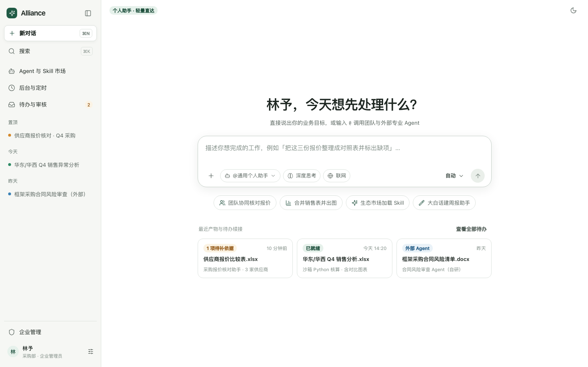
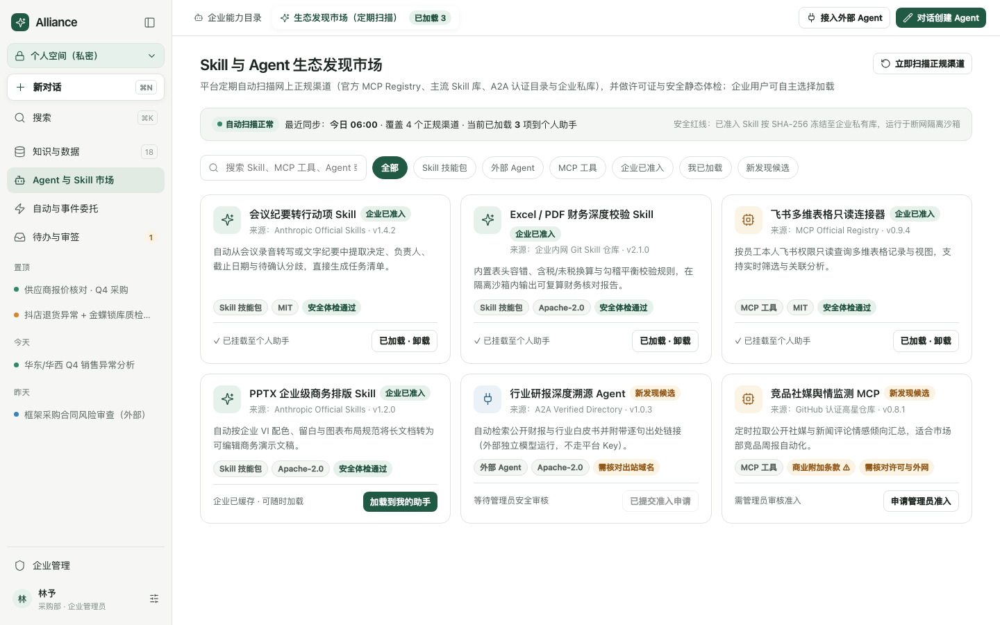

<div align="center">

<br />

# Agent Alliance

### 面向企业自部署的开源 Personal Agent 与团队协同平台

*让不懂 AI 的业务员工像用 ChatGPT / Claude 一样顺手完成工作，让企业统一掌控团队协同、外部 Agent、生态市场与可观测治理。*

<br />

[](https://github.com/slientwind/agent-alliance/releases/tag/v0.1.2)
[](docs/22-vnext-roadmap-todo.md)
[](LICENSE)
[](#快速开始)
[](#系统架构)

<br />

[核心能力](#核心能力) · [界面预览](#界面预览) · [系统架构](#系统架构) · [快速开始](#快速开始) · [演进路线](#当前版本与演进路线) · [文档体系](#文档体系)

<br />


<sub>vNext 交互设计实屏 · 对标 ChatGPT / Claude / Gemini 的桌面工作台：可折叠思维链、动态分栏 Canvas、团队拉人分工与行内 <code>@同事</code> 协同</sub>

</div>

<br />

---

## 为什么选择 Agent Alliance？

大多数开源 Agent 框架面向开发者，而企业内部真正每天处理报价、报表、合同、周报与跨部门交付的，是**不懂 AI 也不懂技术的业务员工**。

**Agent Alliance** 将 **Personal Agent 的顺手体感** 与 **企业级团队协同、外部开放接入及全局监控治理** 融合在一套可自部署实例中：

> **个人助手轻量直达（L0 免审批） ⇄ 一键拉同事多人协同审签 ⇄ 非研发大白话构建助手 ⇄ 外部 Agent 与生态市场统一治理**

---

## 核心能力

<table>
  <tr>
    <td width="50%" valign="top">
      <h3>1. 对标 Personal Agent 的通用执行力</h3>
      日常问答、表格核算、图表绘制与 Word/Excel/PPT 生成遵循 <b>L0 轻量直达</b>，免立项免打扰；底层以通用 Agent Loop + Docker Compose <b>断网隔离沙箱</b> + 标准 MCP 工具支撑，并支持基于 Temporal Schedule 的后台定时委托。
    </td>
    <td width="50%" valign="top">
      <h3>2. 团队多人协同完成同一项任务</h3>
      企业工作很少由单人闭环。任意对话顶部可一键<b>拉同事协作</b>并明确分工（补件 / 审核 / 终审），多人同屏共看右侧 Canvas，支持表格/文档<b>行内评论与 <code>@同事</code> 派单</b>、飞书待办实时同步及按版本审签打包交付。
    </td>
  </tr>
  <tr>
    <td width="50%" valign="top">
      <h3>3. 面向非研发的自然语言构建器</h3>
      采用<b>「左聊右测」</b>对话式构建，支持拖入 1–3 份过去做得最好的<b>标杆文件</b>反推规范，试聊不满意直接<b>「指哪改哪」</b>自动更新规则。<b>个人私有助手零审批保存即用</b>，团队共享与全企上架按需分层治理。
    </td>
    <td width="50%" valign="top">
      <h3>4. 开放的外部 Agent 多协议接入</h3>
      内置 <b>OpenAI-Compatible（Dify / Coze / FastGPT / LangGraph）</b>、<b>A2A Agent Card</b> 与通用异步 Webhook 模板，3 步向导 1 分钟上线 Beta。外部 Agent 独立管理自身模型凭据、<b>不走平台 Key</b>，平台在边界提供耗时/状态监控与可选用量回传。
    </td>
  </tr>
  <tr>
    <td width="50%" valign="top">
      <h3>5. Skill &amp; Agent 正规生态定期扫描市场</h3>
      定期自动扫描官方 MCP Registry、主流正规 <code>SKILL.md</code> 仓库、A2A 目录与企业内网私库，自动体检<b>开源许可与安全风险</b>；企业管理员准入后按 <b>SHA-256 固化到私有库</b>，员工可自主一键加载到个人助手或发起准入申请。
    </td>
    <td width="50%" valign="top">
      <h3>6. 企业级全局模型网关与监控大盘</h3>
      独立全屏 <code>/admin</code> 后台集中管理 6 档逻辑模型路由、主备容灾与精确微元单价；监控大盘提供<b>双轨质量口径</b>（轻量隐式有效完成率 vs 协作审签采纳率）、Token 趋势、Agent 效能榜单、OTel Trace 瀑布流与飞书告警。
    </td>
  </tr>
</table>

---

## 界面预览

> 视觉与交互规范全面对标 **ChatGPT / Claude / Gemini**，采用暖灰白纸面 + 深墨绿强调色，原生支持 **浅色 / 深色双主题** 与 `⌘K` 全局快捷检索。可直接下载或打开零依赖单文件原型体验完整交互：[打开 vNext 离线交互原型 (vnext-prototype.html)](docs/uiux/vnext-prototype.html)。

<table align="center">
  <tr>
    <td align="center" width="50%">
      
      <br />
      <sub><b>新对话首屏</b> · 常驻折叠侧栏、<code>@</code> 呼出 Agent、快捷场景与最近产物续接</sub>
    </td>
    <td align="center" width="50%">
      
      <br />
      <sub><b>非研发构建器 Studio</b> · 左聊右测、标杆文件反推规范、指哪改哪与个人私有免审批</sub>
    </td>
  </tr>
  <tr>
    <td align="center" width="50%">
      
      <br />
      <sub><b>Skill &amp; Agent 生态市场</b> · 定期扫描正规渠道、许可安全体检与员工自主一键加载</sub>
    </td>
    <td align="center" width="50%">
      
      <br />
      <sub><b>外部 Agent 接入向导</b> · 一键模板适配自研与第三方 Agent，运行完全解耦</sub>
    </td>
  </tr>
  <tr>
    <td align="center" width="50%">
      
      <br />
      <sub><b>企业级监控大盘</b> · 双轨有效完成率、四阶漏斗、Token 趋势与 Agent 效能榜单</sub>
    </td>
    <td align="center" width="50%">
      
      <br />
      <sub><b>全局模型网关（深色模式）</b> · 6 档能力路由主备切换与 Input/Output/Cache 精准单价</sub>
    </td>
  </tr>
</table>

---

## 系统架构

单企业独立部署一套完整实例，所有业务数据、模型凭据与运行账本均留在企业自有基础设施内：

<p align="center">
  
  <br />
  <sub><a href="docs/architecture/vnext-architecture.svg">查看高清矢量图 (SVG)</a> · <a href="docs/archive/architecture/platform/enterprise-platform.html">历史工程全景详图</a> · <a href="docs/20-vnext-technical-architecture.md">完整架构规格书</a></sub>
</p>

| 分层 | 核心技术栈 | 关键职责与边界 |
| :--- | :--- | :--- |
| **前端工作区** | React 19 · TypeScript · Vite · Lucide | 常驻折叠侧栏 + 动态分栏 Canvas + 团队协同工作台 + 独立全屏 `/admin` 后台，浅/深双主题 |
| **控制面 & 协同** | Go 1.26 · HTTP/SSE · OIDC | 身份认证与 L0–L2 门禁、**冷热分离 SSE 网关**（`HotStreamBus` + 冷事实 PG 游标）、团队多人协同与锚点评论 |
| **编排与执行内核** | Temporal · Go Worker · Eino | 持久工作流与 Schedule 定时委托、通用 Agent Loop / Harness、内部 6 档位 LLM Gateway、生态定期扫描器 |
| **隔离沙箱与外部接入** | Docker Compose · MCP · A2A / OpenAI-Compat | 断网隔离沙箱池（`sandbox-internal`）、多线程高可信财务/预览容器、标准 MCP Client、外部 Agent 完全解耦适配层 |
| **数据与可观测** | PostgreSQL + pgvector · 对象卷 · OTLP | 业务事实、不可变版本与幂等账本、SHA-256 固化 Skill 对象卷、小时预聚合监控表与 OTel Trace（兼容 Langfuse） |

---

## 快速开始

本地体验仅需 **Docker**、**Docker Compose**、**Make** 与 **OpenSSL**：

```bash
git clone --branch v0.1.2 https://github.com/slientwind/agent-alliance.git
cd agent-alliance
make configure
docker compose --env-file .env.local \
  -f deploy/compose.yaml -f deploy/application.yaml up -d --build
```

1. 浏览器访问 [http://127.0.0.1:18485](http://127.0.0.1:18485)，使用 `.env.local` 中的 `BOOTSTRAP_TOKEN` 初始化首位企业管理员。
2. 进入「企业管理」接入企业可用模型并验证连通，按需通过限时邀请链接或 OIDC 接入同事。
3. 打开新对话，直接用大白话描述任务，或进入 Agent 市场体验自建助手与外部 Agent 接入。

> 开发环境使用 **Go 1.26+、Node.js 22 与 Docker Compose**。分进程调试、HTTPS、OIDC、飞书/钉钉/Slack 渠道接入及备份恢复演练请查阅 [操作手册](docs/USER-GUIDE.md) 与 [企业备份与恢复](docs/17-enterprise-recovery.md)。

轮换业务资源加密密钥时，先让 API 和 Worker 都能通过 `RESOURCE_PREVIOUS_KEYS` 读取备用密钥，再切换 `RESOURCE_KEY`。该变量可配置最多四个以英文逗号分隔的 64 位十六进制密钥。切换后新写入内容使用当前密钥。历史发布版本、在途任务和旧备份仍可能需要原密钥，请在密钥管理系统中保留对应版本。

单机部署默认由 Worker 将实时草稿发送到 API 的进程内流。部署多个 API 副本时，在 API 和 Worker 设置相同的 `HOT_STREAM_REDIS_URL` 以共享 Redis Streams。Redis 中的草稿短期保留并以资源密钥加密。正式成果、运行记录和访问权限由 PostgreSQL 保存。

---

## 当前版本与演进路线

> **项目透明声明**：当前代码基线为早期演进版本（已实现身份权限、撤权、版本审签、A2A 接入、受控财务汇总、Office/图像生成与 OTLP 导出等企业底座；部分集成验收使用合成数据与本地替身，真实供应商账号质量与计费需在目标环境实测）。vNext 架构设计与高保真交互原型已全部定版，正按以下 4 阶段平滑演进：

| 阶段 | 核心演进目标 | 详细清单 |
| :--- | :--- | :--- |
| **Phase 1** | **底座换血**：内部 6 档位模型网关、原生 Tool Calling、小时预聚合监控大盘、双轨有效率与多线程连接器修复 | [查看 Phase 1 任务](docs/22-vnext-roadmap-todo.md) |
| **Phase 2** | **前端重构与团队协同**：拆除 `<dialog>` 后台、落地仿三巨头外壳与双主题、团队拉人分工与 Canvas 行内 `@同事` 评论、全屏 `/admin` 监控 | [查看 Phase 2 任务](docs/22-vnext-roadmap-todo.md) |
| **Phase 3** | **通用执行与构建器**：通用 Agent Loop + L0–L2 门禁、Docker Compose 断网隔离沙箱、MCP Client、冷热分离 SSE、左聊右测构建器 | [查看 Phase 3 任务](docs/22-vnext-roadmap-todo.md) |
| **Phase 4** | **开放生态与自动化**：多协议外部 Agent 接入向导（Dify/Coze/LangGraph/A2A）、正规渠道 Skill/Agent 定期扫描与自主加载市场、后台定时委托 | [查看 Phase 4 任务](docs/22-vnext-roadmap-todo.md) |

---

## 文档体系

项目已建立以 **vNext 活文档** 为单一真源的完整文档体系（全部文档入口见 **[文档总索引](docs/README.md)**）：

| 文档 | 内容说明 |
| :--- | :--- |
| **[vNext 产品方案与信息架构](docs/18-vnext-product-ia.md)** | 企业版 Personal Agent 五大核心支柱、L0–L2 自主分级、团队协同、生态市场与信息架构 |
| **[vNext 专项调研增补](docs/19-vnext-research-addendum.md)** | 非研发构建器、企业模型网关、团队 AI 协同、生态市场对照及 7 场景非技术员工可用性测试方案 |
| **[vNext 技术架构演进规格](docs/20-vnext-technical-architecture.md)** | 通用 Loop、Docker Compose 断网沙箱、冷热分离 SSE、模型网关、外部适配与预聚合监控设计 |
| **[vNext 交互与视觉设计规范](docs/21-vnext-uiux-spec.md)** | 双主题 Design Tokens、Lucide 图标规范、三巨头逐帧对照与[统一交互原型](docs/uiux/vnext-prototype.html) |
| **[代码 Review 与研发 TODO List](docs/22-vnext-roadmap-todo.md)** | 全栈代码瓶颈诊断、历史未闭环项、vNext 新增模块、逐文件重构清单与 4 阶段排期 |
| **[操作手册](docs/USER-GUIDE.md) · [Open API](backend/internal/services/openapi.json) · [版本记录](CHANGELOG.md)** | 自部署运维手册、API 契约与各版本迭代详情 |

---

## 开源许可

本项目原创代码与文档遵循 [Apache License 2.0](LICENSE) 开源许可。上游调研快照与第三方组件各自保留原作者版权与许可协议，详见 [NOTICE](NOTICE)。
