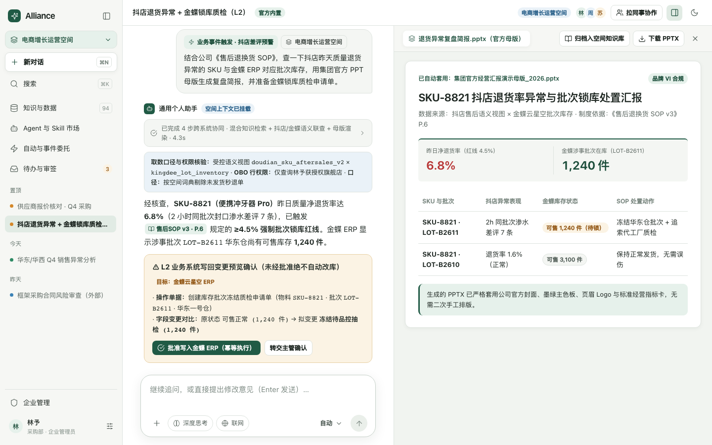
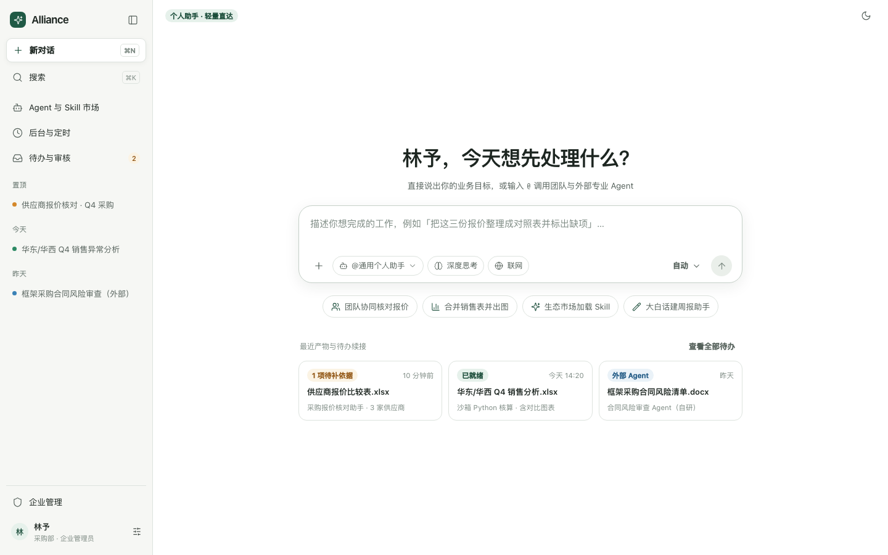
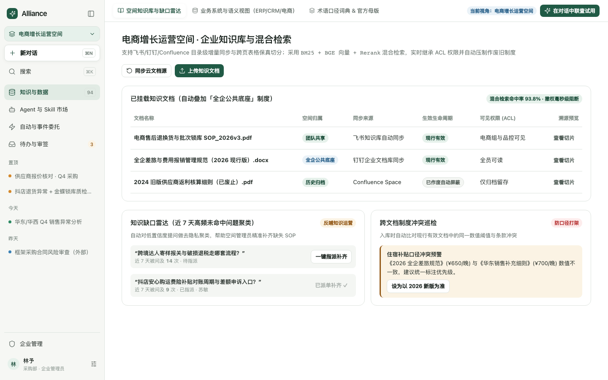
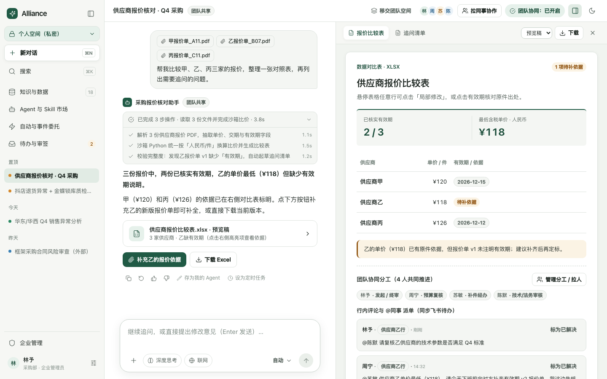
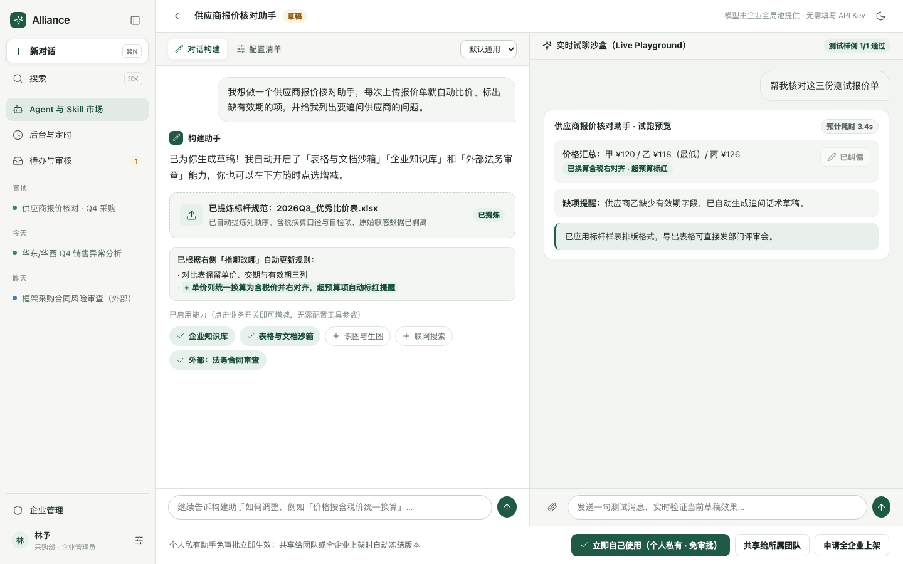
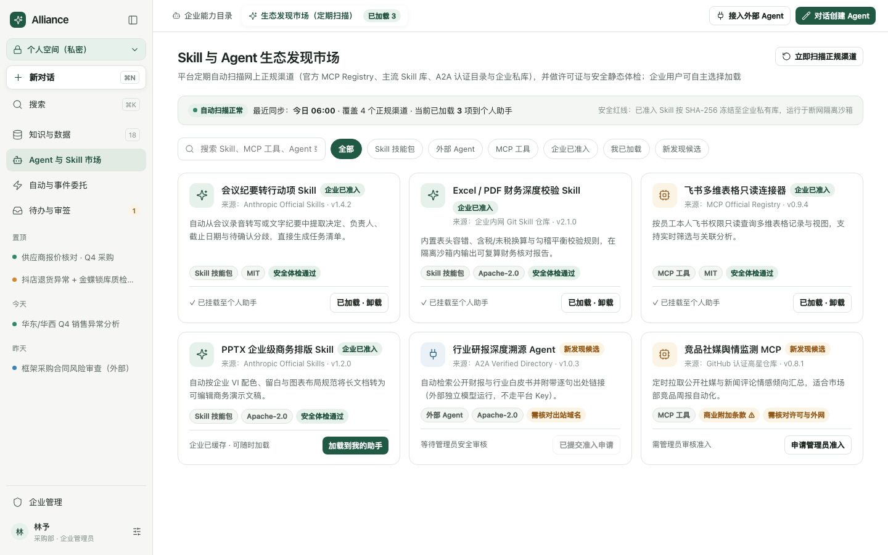
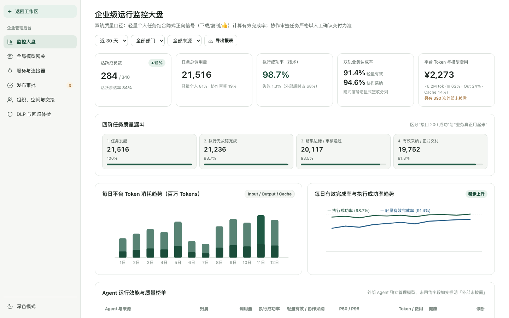
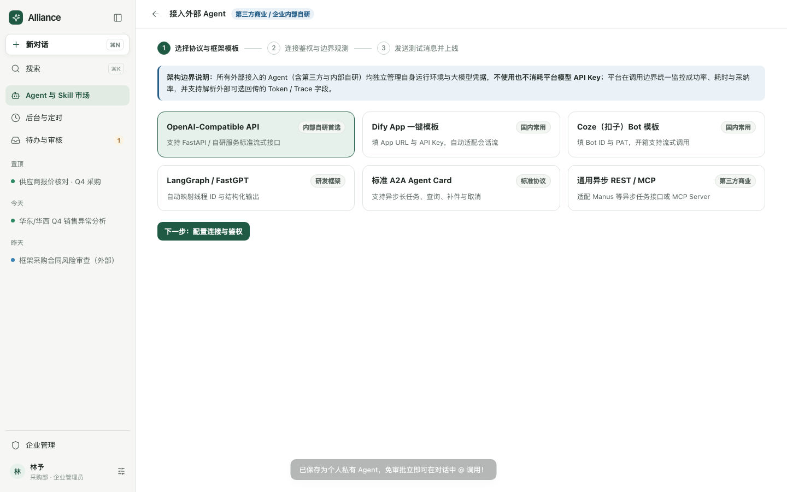
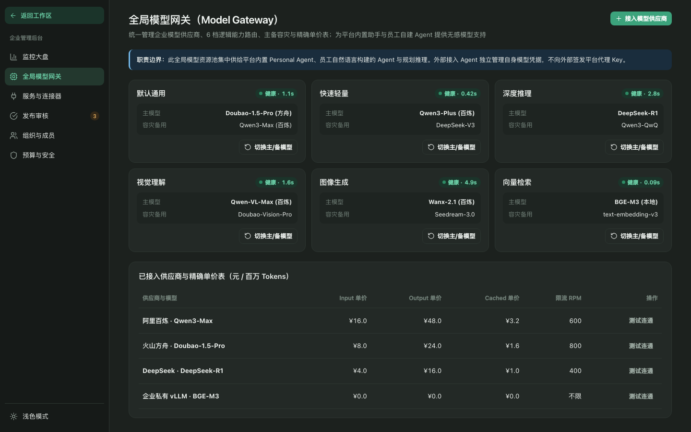
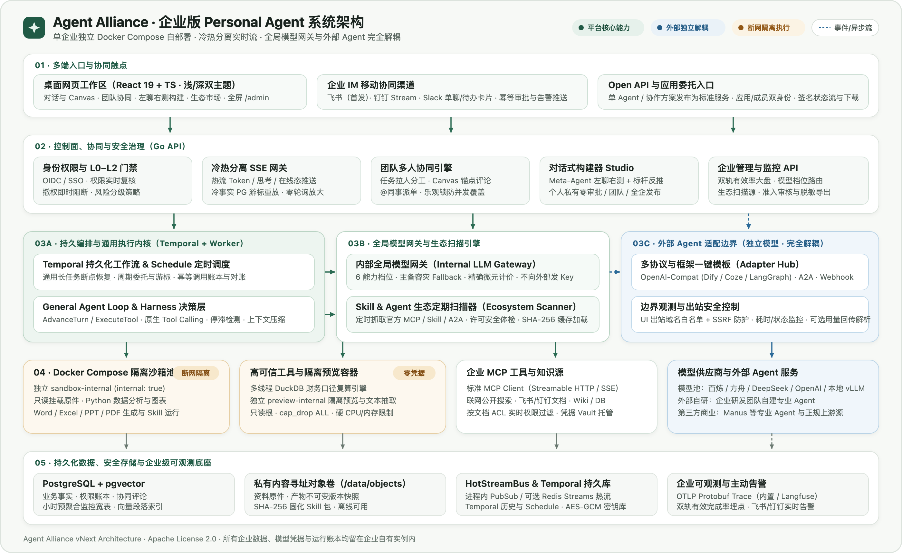

<div align="center">

<br />

# Agent Alliance

### 面向企业自部署的开源 Personal Agent 与团队空间协同平台

*让不懂 AI 的一线业务员工像用 ChatGPT / Claude 一样顺手干活；以「个人空间 + 团队空间」深度融合企业知识库、ERP/CRM/电商活数据、多人协同、DLP 脱敏护栏与全局可观测治理。*

<br />

**[English](README.md)** · **简体中文** · **[在线免部署交互 Demo](https://slientwind.github.io/agent-alliance/)** · **[llms.txt](llms.txt)**

<br />

[](https://github.com/slientwind/agent-alliance/releases/tag/v0.2.1)
[](LICENSE)
[](#快速开始)
[](#系统架构)
[](#核心能力)

<br />

[为什么选择我们](#为什么选择-agent-alliance) · [核心能力](#核心能力) · [同类平台对比](#同类开源商业平台选型对比) · [界面预览](#界面预览) · [系统架构](#系统架构) · [快速开始](#快速开始) · [常见问题](#常见问题-faq) · [文档体系](#文档体系)

<br />



<sub><b>v0.2.1 桌面工作台</b> · 团队空间自动挂载知识库与业务语义层：页码级制度溯源、OBO 行级权限查抖店/金蝶库存、套用集团官方 PPT 母版及 L2 系统写回预览确认</sub>

</div>

<br />

---

## 为什么选择 Agent Alliance？

大多数开源 AI Agent 项目停留在“面向开发者的 DAG 编排画布”或“无企业上下文的套壳聊天框”。而在真实企业中，绝大多数业务员工既不懂 Prompt 也不懂 SQL，他们真正把工作办成、办稳、办合规，离不开三样底座：**公司的制度经验（企业知识库）**、**活的经营系统数据（ERP / CRM / 电商）**、以及**公私分明的协作边界（个人空间与团队空间）**。

**Agent Alliance** 基于 **Go 1.26 + Temporal + PostgreSQL/pgvector + Docker Compose + React 19** 打造，一套实例独立自部署在企业内网，所有业务知识、连接凭据、模型密钥与审计账本 100% 留在企业可控边界内：

> **个人私密空间 L0 直达 ⇄ 团队空间共享知识·口径·母版 ⇄ ERP/CRM/电商受控联查与 L2 写回确认 ⇄ 业务事件主动唤醒与可逆 DLP 护栏**

---

## 核心能力

<table>
  <tr>
    <td width="50%" valign="top">
      <h3>1. 三级空间管理、空间角色自治与岗位无感交接</h3>
      侧栏一键切换<b>个人私密空间</b>（管理员默认不可窥探私聊）、<b>部门/专项团队空间</b>（支持按团队指派 <code>空间管理员</code> 自治维护）与自动继承的<b>全企公共底座</b>。个人成果支持一键<b>快照移交至团队空间</b>（自动剥离私聊上下文）；调岗与离职在同一事务内完成<b>个人隐私封存 + 团队资产原子继承</b>，撤权/停用毫秒级即时阻断会话。
    </td>
    <td width="50%" valign="top">
      <h3>2. 企业知识库、权限感知混合检索与缺口雷达</h3>
      支持<b>飞书知识库/云盘、钉钉文档、企微微盘、Confluence、SharePoint、S3</b> 目录级增量同步与<b>跨页复杂表格/章节面包屑保真切分</b>；采用 <code>BM25 + pgvector BGE-M3 + Cross-Encoder</code> 混合检索，实时遵循 ACL 权限并压制作废旧制度，支持页码/行号可点击溯源、<b>终审成果一键归档入库</b>，以及<b>知识缺口聚类派单与制度冲突消歧雷达</b>。
    </td>
  </tr>
  <tr>
    <td width="50%" valign="top">
      <h3>3. ERP / CRM / 电商打通与受控业务语义层</h3>
      原生支持<b>金蝶云星空、用友 BIP、SAP、纷享销客、Salesforce、飞书客户、抖店、千牛、聚水潭、OpenAPI 及只读数仓</b>（MySQL/PG/ClickHouse/StarRocks，内置 SQL AST 只读防注入拦截）。通过<b>受控业务语义视图 + 取数口径说明卡</b>杜绝裸猜表名；<b>OBO 员工行级权限</b>保障零跨人越权；<b>读 L0 直达，写回强制 L2 变更预览确认</b>（收件箱直达聚焦）+ 幂等回执对账。
    </td>
    <td width="50%" valign="top">
      <h3>4. 术语口径词典、官方母版套版与事件主动唤醒</h3>
      统一维护企业黑话缩写与标准指标公式（支持从聊天纠偏一键<b>沉淀至团队口径词典</b>），双向注入检索与查数。在 <b>Docker Compose 断网隔离沙箱</b>中只读挂载公司官方 <code>.pptx / .docx / .xlsx</code> 母版原生套版。支持定时委托与 <b>HMAC 验签业务事件 Webhook 触发器</b>（CEL 筛选 + 防风暴合并），实现从“人找 AI”到“事找人”。
    </td>
  </tr>
  <tr>
    <td width="50%" valign="top">
      <h3>5. 团队多人同屏协同与非研发对话式构建器</h3>
      任意任务可一键<b>拉同事分配补件/审核/终审角色</b>，同屏展示在线头像栈与共享右侧 <b>Artifact Canvas</b>，支持行/段/页级 <code>@同事</code> 与 <code>@Agent</code> 局部改稿、乐观锁防覆盖及 ZIP + <code>manifest.json</code> 正式交付。非研发员工用<b>左聊右测 Studio</b>（拖入标杆文件反推、动态可用档位、指哪改哪 Diff）5 分钟自建助手，<b>个人私有零审批即用</b>。
    </td>
    <td width="50%" valign="top">
      <h3>6. 外部 Agent 解耦接入与可逆 DLP 脱敏护栏</h3>
      内置 <b>OpenAI-Compatible（Dify / Coze / FastGPT / LangGraph）、A2A 0.3.0、异步 Webhook 与 MCP</b> 3 步向导，支持 UI 动态域名白名单与 SSRF 防护。外部 Agent 独立管理自身模型、<b>绝不共享平台 Key</b>；外发商业 Agent 自动经过 <b>DLP 可逆掩码脱敏护栏</b>（手机号/身份证/底价自动替换占位符，绝密级直接拦截并留存审计账本）。
    </td>
  </tr>
  <tr>
    <td width="50%" valign="top">
      <h3>7. 正规渠道 Skill &amp; Agent 生态定期扫描市场</h3>
      定期自动扫描官方 MCP Registry、主流 <code>SKILL.md</code> 仓库、A2A 认证目录与企业内网 Git，自动完成<b>开源许可识别与静态安全体检</b>；管理员准入后按 <b>SHA-256 哈希固化至私有对象卷</b>，员工在断网沙箱内一键自主加载或卸载，上游新版变更不静默破坏在用任务。
    </td>
    <td width="50%" valign="top">
      <h3>8. 内部全局模型网关、双轨监控与黄金回归体检</h3>
      独立全屏 <code>/admin</code> 后台集中管理 6 档逻辑模型路由、3 秒主备 Fallback、精确微元单价与三级静默预算；监控大盘提供<b>双轨质量口径</b>（轻量隐式有效完成率 vs 协作审签采纳率）与 OTel Trace 瀑布流；换模型或改知识前支持一键跑批<b>黄金回归体检集</b>对比通过率与口径偏差。
    </td>
  </tr>
</table>

---

## 同类开源/商业平台选型对比

| 核心维度 | **Agent Alliance** | Dify / Coze | Open WebUI / LibreChat | Glean *(海外 SaaS)* |
| :--- | :---: | :---: | :---: | :---: |
| **核心面向人群** | **不懂 AI 的一线业务员工 + 企业 IT** | AI 应用开发者 / 提示词工程师 | 个人极客与轻量团队 | 企业员工 |
| **完全开源自部署（Apache-2.0）** | **是（单套 Docker Compose）** | 部分功能商业版闭源 | 是 | 否（闭源 SaaS） |
| **个人私密空间 + 团队空间自治** | **原生三级空间 + 空间管理员委派** | 工作空间级 | 基础文件夹 | 以搜索为主 |
| **ERP / CRM / 电商 OBO 行级权限** | **原生 OBO + 业务语义视图 + SQL AST 防护** | 需自行开发插件 | 无 | 只读连接为主 |
| **写回业务系统 L2 预览确认 + 幂等回执** | **内置变更对比卡 + 网页/飞书审批对账** | 需手工拼工作流 | 无 | 有限动作 |
| **断网沙箱 + 官方 PPT/Word/Excel 母版** | **原生只读挂载母版生成交付件** | 仅代码节点 | 仅代码解释器 | 无 |
| **外部商业 Agent 可逆 DLP 脱敏护栏** | **内置手机号/底价可逆掩码 + 绝密阻断** | 无 | 无 | 企业级 DLP |
| **员工调岗/离职公私分离交接** | **单事务封存个人隐私 + 平移团队资产** | 手工处理 | 手工处理 | IT 后台 |
| **非研发免 DAG 画布自然语言建助手** | **左聊右测 + 标杆文件反推 + 指哪改哪** | 节点连线画布 | Prompt 预设 | 助手构建 |

---

## 界面预览

> 视觉与交互规范全面对标 **ChatGPT / Claude / Gemini**，采用暖灰白纸面 + 深墨绿强调色，原生支持 **浅色 / 深色双主题**、桌面与窄屏响应式自适应及 `⌘K` 全局命令面板。  
> **无需安装，浏览器 1 秒体验完整交互**：**[打开在线交互 Demo](https://slientwind.github.io/agent-alliance/)**（离线单文件源码：[vnext-prototype.html](docs/uiux/vnext-prototype.html)）。

<table align="center">
  <tr>
    <td align="center" width="50%">
      
      <br />
      <sub><b>空间感知首屏</b> · 侧栏顶栏一键切换个人/团队空间，自动继承知识库、数据源与母版</sub>
    </td>
    <td align="center" width="50%">
      
      <br />
      <sub><b>知识与业务数据台</b> · 多源知识库、知识缺口与冲突雷达、ERP/CRM/电商连接及口径母版</sub>
    </td>
  </tr>
  <tr>
    <td align="center" width="50%">
      
      <br />
      <sub><b>团队多人同屏协同</b> · 角色分工、共享 Canvas 表格行级 <code>@同事</code> 派单与版本审签</sub>
    </td>
    <td align="center" width="50%">
      
      <br />
      <sub><b>非研发构建器 Studio</b> · 左聊右测、标杆文件反推规范、指哪改哪与个人私有免审批</sub>
    </td>
  </tr>
  <tr>
    <td align="center" width="50%">
      
      <br />
      <sub><b>Skill &amp; Agent 生态市场</b> · 定期扫描正规渠道、许可安全体检与员工自主一键加载</sub>
    </td>
    <td align="center" width="50%">
      
      <br />
      <sub><b>企业级监控大盘</b> · 双轨有效完成率、四阶漏斗、Token 趋势与 Agent 效能榜单</sub>
    </td>
  </tr>
  <tr>
    <td align="center" width="50%">
      
      <br />
      <sub><b>外部 Agent 接入向导</b> · 一键模板适配自研与商业 Agent，独立模型 + 边界观测</sub>
    </td>
    <td align="center" width="50%">
      
      <br />
      <sub><b>全局模型网关（深色模式）</b> · 6 档能力路由主备切换与 Input/Output/Cache 精准单价</sub>
    </td>
  </tr>
</table>

---

## 系统架构

单企业独立部署一套完整实例，所有企业知识、业务连接凭据、模型密钥与运行账本均留在企业自有基础设施内：

<p align="center">
  
  <br />
  <sub><a href="docs/architecture/vnext-architecture.svg">查看高清矢量图 (SVG)</a> · <a href="docs/20-vnext-technical-architecture.md">完整架构规格书</a></sub>
</p>

| 分层 | 核心技术栈 | 关键职责与边界 |
| :--- | :--- | :--- |
| **多端与事件入口** | React 19 · TS · 飞书/钉钉 · Webhook | 个人/团队空间工作区、知识与业务数据台、IM 移动卡片协同、ERP/CRM/电商事件主动触发 |
| **控制面与空间治理** | Go 1.26 · HTTP/SSE · OIDC · OBO | 三级空间隔离与空间角色治理、公私分离交接、冷热分离 SSE 网关、团队锚点协同、L2 写回确认门禁 |
| **编排、检索与网关** | Temporal · Go Worker · Hybrid RAG | 持久工作流与事件防抖唤醒、空间上下文自动装配、内部 6 档位 LLM Gateway、混合检索、外部 DLP 脱敏网关 |
| **沙箱与业务连接层** | Docker Compose · MCP · Semantic Views | 断网沙箱套用官方母版、多源知识目录增量同步、金蝶/用友/CRM/抖店连接器与 AST 保护只读数仓语义层 |
| **数据与可观测合规** | PostgreSQL + pgvector · 对象卷 · OTLP | 空间账本与混合索引、术语口径词典、L2 幂等写回单、SHA-256 固化 Skill、双轨监控与黄金体检集 |

---

## 快速开始

本地一键部署仅需 **Docker**、**Docker Compose**、**Make** 与 **OpenSSL**（无需 K8s）：

```bash
git clone --branch v0.2.1 https://github.com/slientwind/agent-alliance.git
cd agent-alliance
make configure
docker compose --env-file .env.local \
  -f deploy/compose.yaml -f deploy/application.yaml up -d --build
```

1. 浏览器访问 [http://127.0.0.1:18485](http://127.0.0.1:18485)，使用 `.env.local` 中的 `BOOTSTRAP_TOKEN` 初始化首位企业管理员。
2. 按首次引导接入首个模型供应商（自动映射 6 档能力路由）、选择生态扫描源并签发 48 小时团队邀请凭证。
3. 切换「个人空间 / 团队空间」，在「知识与数据」绑定文档库、业务系统、术语口径与官方母版，即可开箱体验。

> **开发与运维**：Go 1.26+、Node.js 22、Docker Compose。分进程调试、OIDC、飞书/钉钉/Slack 渠道接入、密钥零中断轮换（`RESOURCE_PREVIOUS_KEYS`）及多副本 Redis 热流（`HOT_STREAM_REDIS_URL`）请查阅 [操作手册](docs/USER-GUIDE.md) 与 [企业备份与恢复](docs/17-enterprise-recovery.md)。

---

## 版本状态（`v0.2.1`）

**Phase 1–6 全量企业能力已完成开发并通过浏览器端到端验收**（详见 [80 条集中浏览器测试规格书](docs/23-vnext-browser-test-plan.md) 与 [CHANGELOG.md](CHANGELOG.md)）：

- ✅ **Phase 1–2**：内部 6 档模型网关、双轨预聚合监控大盘、仿三巨头双主题工作台、团队同屏协同与 Canvas 行内评论。
- ✅ **Phase 3–4**：通用 Agent Loop、Docker Compose 断网沙箱、标准 MCP Client、冷热分离 SSE、左聊右测构建器 Studio、多协议外部接入向导与正规渠道生态扫描市场。
- ✅ **Phase 5–6**：三级空间管理与空间管理员自治、ACL 混合检索与知识缺口/冲突雷达、ERP/CRM/电商连接与受控语义层 + OBO 行级权限 + L2 写回确认、企业口径词典与官方母版套版、Webhook 事件唤醒、外部可逆 DLP 脱敏、黄金回归体检集及公私分离调岗/离职交接。

> *透明说明：自动化回归测试中外部云供应商与 IM 租户使用本地确定性测试桩验证协议与账本逻辑；建议在生产目标环境接入真实云模型账号与企业 IM 租户复核实收账单。*

---

## 常见问题（FAQ）

<details>
<summary><b>1. 怎么防止员工共用 AI 助手时越权查出别人的 CRM 客户或 ERP 数据？</b></summary>
<p>平台业务连接器原生支持 <b>OAuth2 OBO 员工身份透传</b>与运行时强制注入的行级权限（RLS）谓词，并非依赖大模型 Prompt 约束；只读数仓另配<b>受控业务语义视图</b>与 SQL AST 只读防注入拦截，销售 A 即使在对话中蓄意套话也绝不会查出销售 B 的客户行。</p>
</details>

<details>
<summary><b>2. AI 助手会不会未经同意就乱改金蝶 ERP 库存或自动给电商客户退款？</b></summary>
<p>绝不会。平台实行严格的读写分离：查数、查制度属于 <b>L0</b> 免打扰直达；凡涉及写回 ERP / CRM / 电商单据一律锁定 <b>L2 强制门禁</b>，工作流自动挂起并在网页待办收件箱与飞书卡片展示「原值 → 拟变更值」对比预览卡，必须由有权责任人点击确认后才携带幂等键写入并回填下游正式单号。</p>
</details>

<details>
<summary><b>3. 接入第三方外部商业 Agent（如 Manus / Coze / Dify）如何防止泄露手机号和采购底价？</b></summary>
<p>所有外部 Agent 与平台模型网关完全解耦（不签发平台模型 Key）。外发前经过内置 <b>DLP 可逆掩码脱敏护栏</b>，自动识别手机号、身份证、银行卡与自定义底价字段并替换为可逆占位符（返回后在企业内本地还原），标记为「严格保密」的数据直接阻断外发并写入审计账本。</p>
</details>

<details>
<summary><b>4. 员工调岗或离职时，个人隐私聊天和团队共享资产怎么处理？</b></summary>
<p>管理员在成员管理发起单事务「办理调岗」或「办理正式离职」交接预览：员工<b>个人空间</b>私聊、私有草稿与 OBO 个人令牌立即隔离封存并吊销会话（绝不泄露给管理员或继任者）；其在<b>团队空间</b>维护的共享知识库、连接器绑定、事件触发器、团队助手与待审任务原子平移给继任同事，业务不断档。</p>
</details>

---

## 文档体系

全部活文档统一索引于 **[docs/README.md](docs/README.md)**：

| 文档 | 内容说明 |
| :--- | :--- |
| **[vNext 产品方案与信息架构](docs/18-vnext-product-ia.md)** | 六大核心支柱、三级空间模型、L0–L2 自主分级与信息架构 |
| **[vNext 技术架构演进规格](docs/20-vnext-technical-architecture.md)** | 空间隔离、混合检索与缺口雷达、业务语义层与 L2 幂等写回、事件唤醒、DLP 与回归体检 |
| **[vNext 交互与视觉设计规范](docs/21-vnext-uiux-spec.md)** | 双主题 Design Tokens、空间切换器、知识与数据工作台规范及[离线交互原型](docs/uiux/vnext-prototype.html) |
| **[vNext 专项调研增补](docs/19-vnext-research-addendum.md)** | 构建器、网关、协同、空间/RAG/语义层横向对照及 10 场景非技术员工可用性测试方案 |
| **[代码 Review 与研发 TODO List](docs/22-vnext-roadmap-todo.md)** | 全栈基线追踪与 Phase 1–6 全量模块研发完成清单 |
| **[全功能集中浏览器测试与验收规格书](docs/23-vnext-browser-test-plan.md)** | 覆盖 14 大测试域、80 条端到端浏览器验收用例（`TC-001`～`TC-080`） |
| **[操作手册](docs/USER-GUIDE.md) · [Open API](backend/internal/services/openapi.json) · [版本记录](CHANGELOG.md)** | 自部署运维指南、API 契约与各版本迭代详情 |

---

## 开源许可

本项目原创代码与文档遵循 [Apache License 2.0](LICENSE) 开源许可。上游调研快照与第三方组件各自保留原作者版权与许可协议，详见 [NOTICE](NOTICE)。
