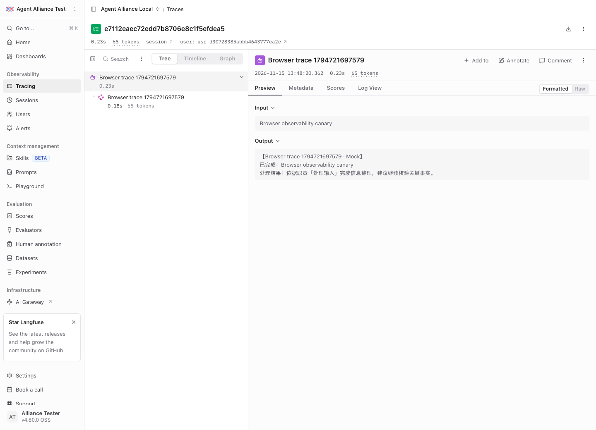
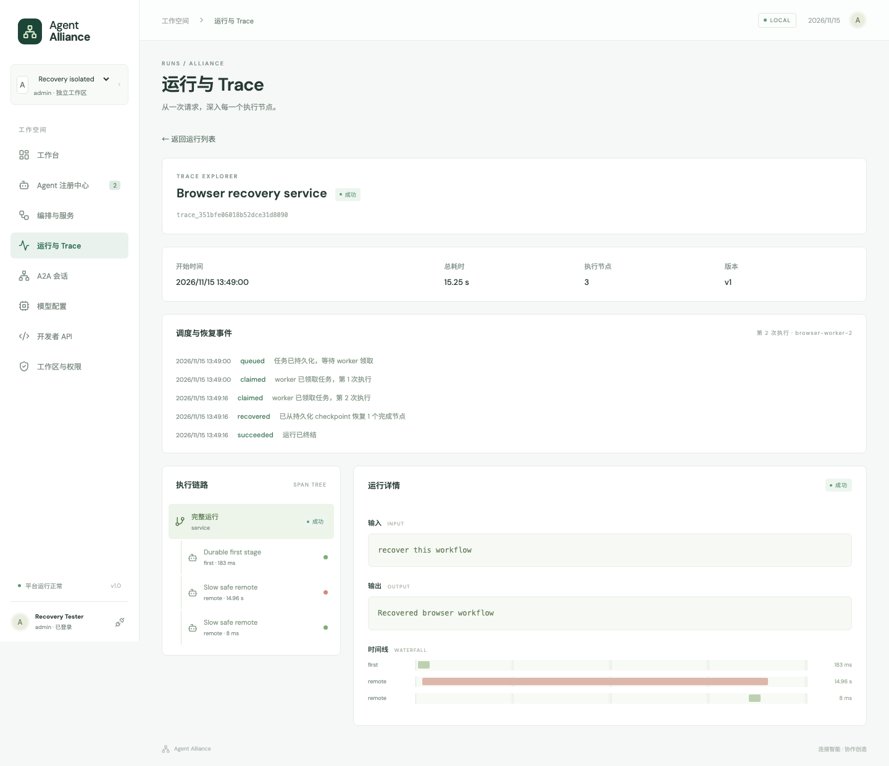

# 生产化验收报告

验收日期：2026-11-15。对应 [生产化方案](07-production-architecture.md) 与 [用例清单](04-test-plan.md)。本次使用真实 Go API、PostgreSQL、多 worker 和 Chromium；模型与外部业务 Agent 使用可控 HTTP Mock，不消耗付费模型额度。Langfuse 使用真实本地 v4.80.0 服务。

## 执行结果

| 检查 | 结果 | 证据与覆盖 |
| --- | --- | --- |
| Go 测试及 race detector | 通过，50.011 秒，语句覆盖率 67.0% | 真实数据库事务、租户隔离、凭据迁移、队列竞争、租约 fencing、超时/取消、重试、实际进程故障、A2A 与 Langfuse |
| `go vet ./...` | 通过 | 后端静态检查 |
| 前端生产构建 | 通过 | Vite 构建真实 React 页面 |
| Chromium 浏览器 | 34/34 通过，83.8 秒，无跳过与重试通过 | B01–B24、P01–P05、A01–A03、O01、R01 |
| Docker 生产镜像与 Compose | 通过 | 独立 release project，账号注册 → Mock Agent → invoke → worker 成功，静态前端正常 |
| 数据库备份恢复 | 通过 | `pg_dump` → 全新数据库；用户、工作区、任务均各 1 条；相同 master key 启动恢复后的 API，健康检查成功 |

浏览器覆盖注册/登录、Agent 增删改查与自然语言生成、模型配置、独立 Agent 凭据轮转与清除、DAG 校验、发布快照、独立 API、失败与取消、Trace、搜索筛选、响应式页面、租户越权、成员角色、平台 key 撤销、最后管理员保护、A2A 生命周期、真实 Langfuse 和故障接管。

O01 从控制台保存工作区 Langfuse 配置、执行 Agent、等待持久化导出，再登录真实 Langfuse 页面查看 trace；不是伪造图表。R01 在浏览器提交编排服务后实际终止执行 worker，由另一 worker 接管，断言已完成节点没有重复执行，最终页面显示恢复事件和成功状态。

## 本轮修复

- 修正官方 alpha SDK 的 Go module 路径、v0/v1 protobuf descriptor 冲突、0.3 task list 适配及规范 JSON 枚举、安全方案和版本错误码。
- 修正 REST 上下文与 gRPC metadata 传播，避免多 transport 调用丢失身份或目标信息。
- 远端 A2A 保存 task checkpoint，worker 接管继续查询原任务，避免重新发送或因 worker 停止误取消远端任务。
- 补齐持久化 outbox、冻结凭据脱敏、Langfuse v4 摄入与 Observations API 核对，明确跨系统去重边界。
- 浏览器撤销凭据测试等待明确的“已撤销”状态；之前仅等按钮禁用，会把请求进行中误判为已完成，导致偶发失败。
- 更新测试中新增设置表格后的定位范围、运行按钮定位及本地 seed 脚本的会话认证。
- 故障恢复测试与截图路径改为相对测试文件解析，修复从仓库根目录运行时寻找后端程序失败的问题。

## 复现与证据保留

按 [部署文档](08-deployment.md) 启动开发环境及 Langfuse，再运行 `./scripts/test.sh`。浏览器用例自动创建测试账号；故障测试使用隔离 schema 和自有进程。

本机 `artifacts/full-verification.log` 保留后端 race/coverage、前端构建以及首次浏览器运行（31 通过、1 个时序失败、2 未执行）；中间一轮从仓库根目录执行时有 33 通过、1 个路径失败，修正路径后再次完整回归。最终浏览器结果单独保存在 `artifacts/browser-verification.log`、`artifacts/browser-results.json` 和 `artifacts/browser-report/`。镜像构建记录在 `artifacts/docker-build.log`，Compose 冒烟结果在 `artifacts/release-smoke.json`。备份、运行凭据和完整测试 trace 不上传；仅精选不含秘密的测试截图进入仓库。

## 验收边界

通过上述测试不等于官方 A2A 认证或大规模负载认证。可选 mTLS/OAuth 授权流程、签名验证、文件模型执行、SSO/密码找回、自动保留策略和跨系统 exactly-once 不在当前实现承诺中，具体矩阵见方案。工作区 JSONB 写入仍串行；生产部署需要 TLS ingress、独立秘密与运维备份策略。
