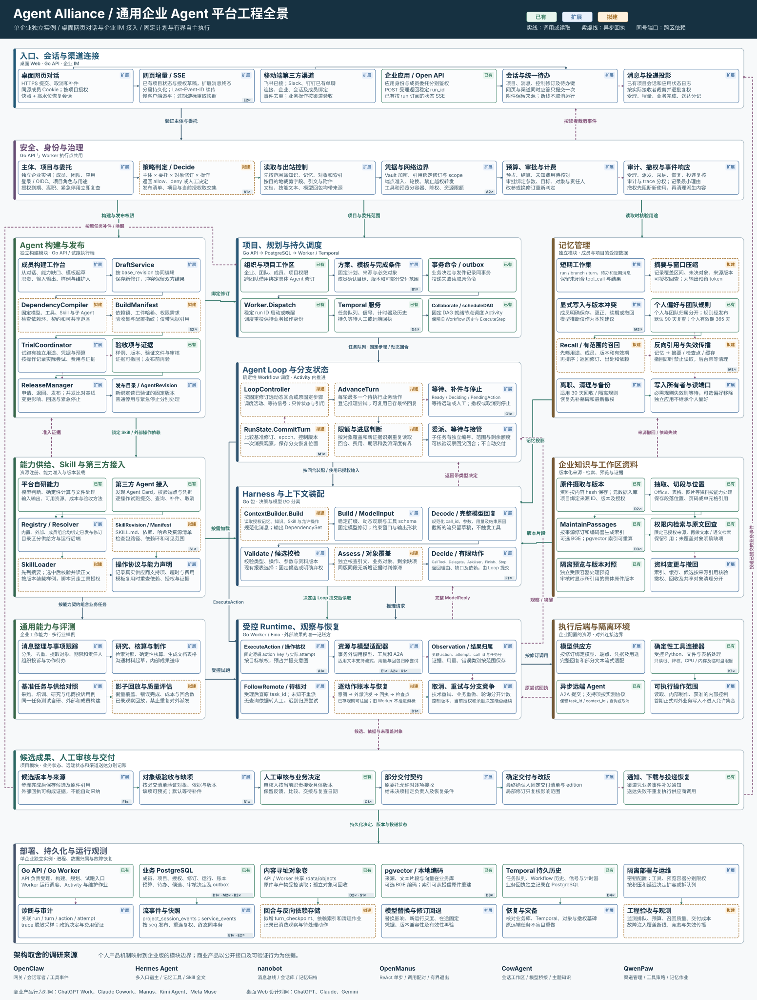
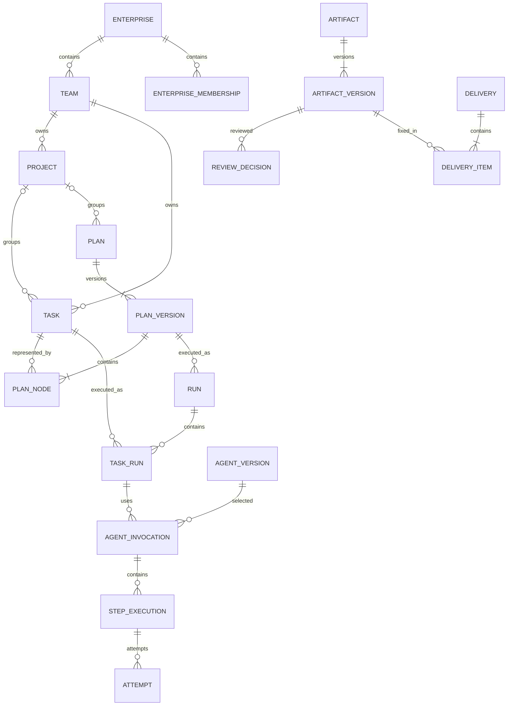
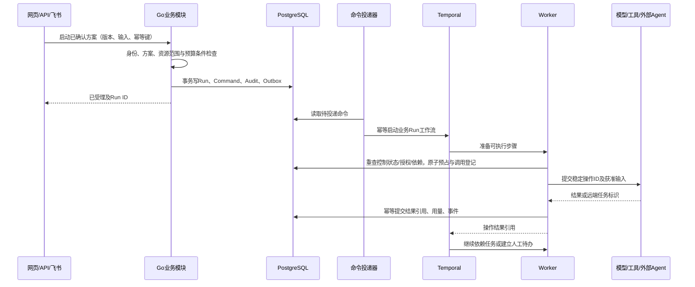
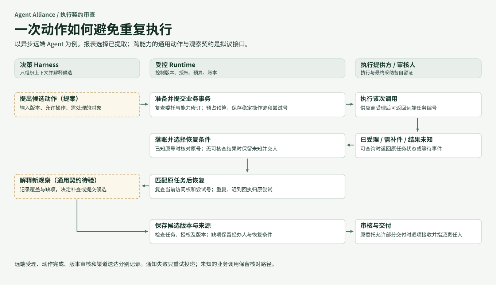

# Agent Alliance 第一期技术方案

版本 v33 · 2026 年 11 月 24 日。

依据：[产品方案与资源配置矩阵](10-product-blueprint.md)。本文是当前技术设计入口，不代表已实现、已部署或已通过验收。第1—8节的架构、模块接口与数据库关系原则，以及任务启动、人工审核、局部修改和故障恢复时序边界均已确认；具体字段、协议路径和实现参数仍须设计验证。第9节记录确认与待验证项，第11—12节运行与 R10 边界已确认；具体 SDK、接口字段、版本和参数仍待验证。最新复核见第13节，部署方向确认见第14节，身份权限确认见第15节，运行契约确认见第16节，资源定版确认见第17节；四项规格合并复核与剩余验证统一见第18节。旧 [初始技术方案](03-architecture.md)、[生产化增补](07-production-architecture.md) 保留为既有实现历史，不能覆盖当前产品规则。

现行部署单位是一家企业的一套独立实例。发行方提供软件及维护支持，企业负责部署、运维及备份恢复。首次管理员、注册、管理权限与成员维度观测见[第19节](#instance-management-contract)。第13—18节保留原规格与验证历史，其中的托管方分工、统一开通和仅邀请入驻由第19节更新。团队项目授权、版本绑定、重试与恢复规则继续适用。

产品 D01—D17、Q01—Q09、R01—R10 共36项原则均已确认，最新合并基线见产品第24节。第11节中与 R10 对应的运行边界同步确认，接口名和字段仍为设计建议，不表示适配或验收完成。

[自研、接入和构建契约](#agent-supply-contract)共用操作目录与运行治理。工作能力与运行契约的映射、兼容方式及评审用例见[第20节](#execution-contract-design)。

已确认的单画布工程架构是本版组件与接口基线。第 2 节说明模块归属、跨模块端口和失败处理。第 20.2 节明确收件去重、事项归并和人工确认的交界。第 26 节记录迁移顺序、当前代码落点与待验证参数，第 26.6 节细化候选证据如何进入逐项审核。第 22–25 节保留委托执行、动作恢复、Personal Agent 对照及专项接口设计。[单画布工程架构](architecture/platform/enterprise-platform.html) · [工程模块职责](#approved-platform-engineering) · [关键交界与成对端口](#paired-platform-ports) · [收件与事项归并](#message-intake-contract) · [迁移与实现进度](#enterprise-platform-master) · [代码落点](#platform-module-code) · [Agent Loop 与 Harness](#loop-harness-contract) · [安全、Agent 构建与记忆管理](#platform-domains)

第 21 节补充[执行事实、人工接续与供给准入](#execution-evidence-contract)，说明对象级校验、进展检测和回执映射。

## 1 已确认的架构决定

- Node.js 前端工程，TypeScript/React 界面；Go 模块化业务后端与独立执行 Worker。业务权限、预算和状态规则统一在 Go，前端不持有供应商密钥。
- Temporal 承担持久化协作编排、等待和恢复；Eino 承担平台创建 Agent 的内部模型与工具运行。框架具体版本、适配和检查点恢复必须验证，不以框架功能声明替代产品验收。
- PostgreSQL 保存业务状态、修订、账本及原件引用。当前 API 与 Worker 共享内容寻址对象卷 `/data/objects`，保存原件和产物。来源切段按版本保存，启用语义检索时可用 BGE 编码并写入 pgvector。Temporal 单独持有工作流历史。生产替换对象存储时须保持版本定位、授权读取和备份恢复契约。
- 工具执行独立隔离：计算、浏览器、文件转换及开源外部 Agent 可采用各自运行环境，不改变平台后端 Go 的约束。
- API 与 Worker 独立部署，业务模块先保持模块化单体；Redis 可选，不作为唯一任务事实源；第一期不额外引入 Kafka。
- 协作采用版本化任务图、人工决策节点和有界修改批次。权限、预算、审核、版本与交付是平台对象，不只存在于 Agent 对话上下文。
- 独立管理执行、等待原因、远端状态、成果审核和交付状态。资源恢复不自动解除人工暂停或审核等待。
- 持久化后派发、幂等与核对并用、预算原子预占；工作流历史和 Trace 尽量仅保存标识和必要摘要，敏感正文通过受控内容引用访问。
- 模型、工具、外部 Agent 方向按产品第19—21节。微信本期不接入。普通停用、紧急停止、删除及凭据轮换不得绕过当前授权。

## 2 已确认的部署和业务模块边界

[全景审查与搜索](architecture/platform/enterprise-platform.html) · [单页可编辑图源](architecture/platform/enterprise-platform.drawio) · [原模块所有者视图](architecture/agent-kernel/alliance-components.svg) · [展开 Worker 中的 Agent Loop 与 Harness](architecture/agent-kernel/alliance-kernel.svg) · [委托执行与投递路径](architecture/enterprise-execution.svg)

上图按工程模块展开，在各区标题标明进程或数据所有者。中央为项目、调度、Loop、Harness 与 Runtime，两侧为独立构建、供给、记忆、知识和执行后端；审核交付与基础设施位于下方。图例记录架构评审时的建设状态，当前发行版本的实现范围以第 26.2 节为准。模型、工具与外部 Agent 在运行时共用授权、预算和回执检查。[部署拓扑](#execution-architecture-review) · [实现基线](#platform-implementation-baseline)

下表使用全景图的分区名。每行指定可以写入哪类事实、下游能凭什么继续。分区是代码和数据的责任边界。首期仍以 Go API、独立 Worker 和隔离执行端部署，构建与记忆各自拥有独立模块。

| 全景分区 | 拥有的状态、输入和输出 | 必须守住的交界 | 验收用例 |
| --- | --- | --- | --- |
| 入口、会话与渠道连接 | 桌面 Web、签名 Open API、企业 IM 映射到主体、项目、会话和同一待办。桌面命令走 HTTPS，订阅消费有序事件。 | Open API 按运行号订阅状态。桌面已有可恢复的项目更新和本人授权的草稿流。飞书和 Slack、钉钉单聊已接入部分操作，分别验收权限、正式补件和主动通知。 | EA06、EA07 |
| 安全、身份与治理 | 将企业、成员、团队、可选部门、项目角色、应用委托、对象修订与用途共同判权。管理凭据引用、出站范围、审批、预算、计费修正及审计。 | 读取、派发、恢复、投影和交付分别复核。管理权限与业务审核权分授。预算预占、结算和未知费用核对由受控调用路径写账。 | EA03、EA04、EA10 |
| Agent 构建与发布 | 构建模块保存草稿修订、依赖锁定清单、样例、试跑与验收证据。比较发布基线后产生不可变 Agent 修订。 | 试跑使用独立授权与预算。目录供新任务绑定已发布修订。在途按原清单运行，紧急停用在使用点生效。 | EA04 |
| 项目、规划与持久调度 | API 固定方案、输入来源、任务图、依赖、预算和完成条件。命令与 outbox 同事务提交。Worker 用稳定 run ID 启动或唤醒 Temporal。 | 确定性 Workflow 安排就绪节点、信号、计时器与等待。模型、工具、数据库副作用在 Activity 或受控执行端完成。 | EA02 |
| 记忆管理 | 短期工作集按运行、分支、回合保存未决对象和调用配对。长期条目按个人或团队管理范围、显式写入、修订、到期和撤回。 | 召回先筛授权与用途，再排序。压缩保留来源范围和未闭合调用。撤回先禁止使用，再清理依赖该条目的摘要、缓存与检查点投影。 | EA03 |
| Agent Loop 与分支状态 | `AdvanceTurn` 读取分支检查点和未消费观察。每轮至多提交一个待执行业务动作，也可等待、转人工或结束。控制修订和写入代次隔离并发推进。 | 有新证据才算进展。回合、成本、时间和委派深度有界。恢复后一次消费已记账观察。Finish 产生候选。 | EA01、EA02 |
| 能力供给、Skill 与第三方接入 | 目录统一解析自研、外部及成员构建的已发布操作。第三方按提交、查询、补件、取消分别留试跑证据。Skill 注册包清单、依赖和哈希。 | 先给 Harness 可见摘要，选中后核验固定修订、按需装载正文。Skill 中的脚本仍需作为独立工具授权。远端声明与已验证操作分别记录。 | EA04、EA05 |
| Harness 与上下文装配 | Build 装配规则、授权记忆、知识片段、Skill 与工具表并记录依赖。Decode 解析完整回复，Validate 核对操作与参数，Assess 检查对象覆盖，Decide 返回有类型的决定。 | 输出明确的操作、澄清、候选或停止理由。截断文本只进入草稿。模型请求和业务动作的实际派发、费用和回包均归 Runtime。 | EA01、EA03 |
| 企业知识与工作区资料 | 原件按哈希和来源修订存放，抽取后按页、段落或单元格切段。授权内检索返回可回查的引用和未覆盖对象。 | 索引可从原件重建。来源更新、撤回时核对受影响的引用与候选。个人偏好和团队规则由记忆模块管理。 | EA03、EA10 |
| 通用能力与评测 | 消息归单、事项跟踪、研究比对、确定性核算、材料起草与文件制作均定义输入、产物和对象级判据。 | 同题可替换不同供给。回放复用已录观察，统计覆盖、误报完成、回合和成本，外部派发数应为零。 | EA05、EA09 |
| 受控 Runtime、观察与恢复 | 将推理和业务动作分别记账。执行前按固定修订核权、预占、落意图，事务外派发。Observation 关联逻辑动作、实际尝试、用量、证据和远端任务号。 | 已存回包复用。效果未知先核对原调用，无法查证转人工。迟到回包归原尝试，旧 Worker 无权推进已取消或已接管的分支。 | EA02、EA05 |
| 执行后端与隔离环境 | 模型端点、确定性工具、异步远端 Agent 分用适配器。工具与预览容器分开限权，凭据由受控执行端按引用取用。 | 按供应方与操作记录协议、健康、超时、数据去向和能力修订。首期只开放获准的读取、内部制作与平台控制操作。 | EA05、EA10 |
| 候选成果、人工审核与交付 | 按对象和版本保存候选、引用、覆盖缺口与审核决定。最终确认人固定交付清单。渠道消费独立的通知投递记录。 | 默认缺项等待。部分交付核对原约定、接受版本和剩余责任。反馈仅重开受影响版本。通知失败仅重投原通知。 | EA07、EA08、EA09 |
| 部署、持久化与运行观测 | PostgreSQL、对象卷、可重建索引、Temporal 历史各有恢复责任。受控 Trace 串联 run、turn、action、attempt。运维关注等待积压、质量、费用及备份恢复。 | 先恢复最新授权和撤回记录，再恢复读取与运行。业务审计与诊断分权。扩容和拆队列以压测结果决定。 | EA10 |

### 2.1 一次运行跨模块时固定哪些记录

1. **受理与绑定。** API 将主体、用途、项目、计划修订、能力及来源版本、必交对象和控制修订落入业务库。构建清单固定 Agent、Skill、操作和策略修订及其依赖。每次真实读取与派发仍复核当前授权。项目命令和 outbox 在一次事务提交。
2. **装配与决定。** Workflow 调度固定步骤或有界回合。Activity 从已获准的工作集、显式记忆、知识片段和 Skill 修订构造可追溯输入。Harness 按完整回复校验并生成有类型的决定。分支比较预期检查点和控制修订，将决定与待办入库后才推进。
3. **派发与恢复。** Runtime 将模型推理与业务动作分别标识，先保存意图和预占，再事务外派发。回包按实际尝试结算并登记观察。重复调度先查原意图。可能已执行而回执缺失时按原请求核对，查不到则保留待核对状态及原费用归属。
4. **订阅与交付。** 业务事件只发布已提交的决定。文本分段按运行、步骤、尝试、偏移重组，客户端按游标恢复并处理授权快照。完整结果经对象级校验进入候选审核。正式交付清单与渠道通知使用各自的版本和回执。
5. **资料撤回与灾备。** 读取先看当前授权和来源有效性，清理作业按依赖移除失效派生内容。恢复时用 PostgreSQL 的业务事实、独立的 Temporal 历史和对象卷校验版本与回执，再应用最新撤权与删除记录。知识索引按获准来源重建。

[回合状态与事务](architecture/agent-kernel/loop-harness.md#recovery) · [各域读写端口](architecture/agent-kernel/platform-domains.md) · [跨模块验收](13-acceptance-spec.md#approved-platform-evals)

### 2.2 贯穿模块的接口约束

调用方和接收方按表中的对象与修订对账。接口名称沿用全景图，字段代表逻辑契约。已发布路径见第 26.2 节。

| 交界 | 写入顺序及成功依据 | 验收 |
| --- | --- | --- |
| Agent 构建、Skill 与能力目录 → 项目 | 试跑绑定构建清单和固定依赖，操作证据绑定对应修订与授权范围。发布事务重新核验清单、证据和基线后更新目录。项目受理持久化采用的 Agent、Skill 和能力修订；在途按绑定版本运行，各次调用复核当前许可。 | EA04、EA05 |
| 项目与 Temporal → Loop、Harness、Runtime | 项目决定与 outbox 一起提交。Workflow 用运行和步骤标识安排活动。Loop 取得分支检查点，在 Activity 内装配授权输入，并从 Runtime 获得已登记尝试的完整模型回复。Harness 解析并校验，返回有类型的决定。Loop 比较检查点和控制修订后提交决定。执行已提交的业务动作时，Runtime 再核权、预占、写意图，事务外派发，按实际尝试落回执。只有仍获准且尚未消费的观察可推动对应分支。 | EA01、EA02 |
| 安全、记忆与知识 → 输入、外送和结果 | 工作集记录实际使用的来源、规则、个人偏好及版本。召回先筛范围，装配返回依赖集合。派发、继续读取、回包采纳和订阅输出分别复查；授权变化先阻断新读取与采纳，再按依赖清理派生副本。执行端按目的地和操作取得凭据及裁剪后的输入。 | EA03、EA10 |
| 人工待办或第三方 Agent → 原运行 | 本地决定按运行、待办和控制修订去重。涉及远端补件时再绑定远端任务、会话及当前问题修订，经出站授权后派发。提交回执与对方是否接受分别登记。回执缺失时沿原任务核对或转人工。超时、重复信号及恢复不会另建业务动作。 | EA02、EA05、EA07 |
| 运行及执行记录 → Web SSE、Open API、企业 IM | 先持久化后投影。目标会话流按事件序号续传，文本增量另按消息、实际尝试和偏移组装。过期游标取授权快照并从其高水位衔接。Web 与 Open API 各自检查受众；IM 投递引用原业务事件。订阅连接关闭只终止读取。 | EA06、EA07 |
| 候选、审核与交付 → 通知、下载及灾备 | 候选保存来源与覆盖。交付事务核对审核版本、原委托缺项策略、后续负责人和最终确认权，固定版本清单，再生成通知。补发沿用原交付。实例恢复时独立核对业务账本、原件哈希、Temporal 历史并应用最新撤权记录。 | EA08、EA09、EA10 |

**SSE 与快照。** 桌面命令通过 HTTPS 提交，项目读取沿用 `/api/projects/{id}/session-events`。当前 Worker 已为启用流式返回的适用成员文本步骤写入草稿分段。项目流用 `project_session_events` 保存有序变化，`project.changed` 提示前端重新查询业务记录，`draft.delta` 按运行、步骤、实际尝试和 UTF-8 字节偏移重组。成员用同源会话订阅，服务端按批次复权，`Last-Event-ID` 绑定项目、序号及授权视图。游标过期或视图变化时，`session.snapshot` 提供当前允许查看的草稿及高水位，浏览器替换原草稿并刷新业务状态。失去项目读取权时结束订阅并收起受限内容。连接断开、心跳超时和读者退出只影响投影。已完成答复、审核版本与正式交付从原业务记录读取。后续扩展会话终态事件和更多模型适配，签名 Open API 继续提供独立的运行状态流。[发行基线和测试](#platform-implementation-baseline) · [SSE 专项接口](architecture/agent-kernel/README.md#web-event-contract) · [断线和撤权验收](13-acceptance-spec.md#platform-handoff-evals)

**流式投影的交界。** 模型适配器把分段关联到原尝试。对于有回包检查点的步骤，完整回复经复权、校验并采纳后，由项目变化提示客户端读取正式版本。增量重复时按已收到的字节区间去重，片段缺口或授权视图变化时用新快照替换本地草稿。代理端验证逐段转发和空闲心跳，慢读者可以退出并从其已收到的事件游标续传。会话流按项目和成员范围投影，Open API 按服务和运行范围投影。真实代理和高并发读者的时延及续传窗口通过 EA06 定值。[项目流实现](../backend/internal/projects/session_events.go) · [网页草稿合并](../frontend/src/live-drafts.tsx) · [WHATWG SSE 的事件 ID 和重连](https://html.spec.whatwg.org/multipage/server-sent-events.html)

### 2.3 步骤等待、运行控制与恢复条件

调度器分别读取步骤是否就绪、运行是否允许派发，以及成果是否可审核或交付。步骤级等待只冻结该步骤及等待它的后继。独立分支在当前授权和剩余额度内继续，汇合步骤等齐其声明的依赖。运行级控制约束整个任务的后续派发，已派发操作的费用、迟到回执和核对入口继续归原尝试。候选和交付状态由业务模块独立计算。

| 情况 | 等待范围与恢复条件 | 已发布实现 |
| --- | --- | --- |
| 远端明确要求补件 | 绑定本地运行、步骤、尝试、远端任务与会话、具体问题修订及当前控制版本。验证过的补件提交只更新该待办，由匹配回执唤醒该步骤。 | 新版多步骤运行在远端任务号、会话号及补件操作证据齐备时启用。历史工作流沿用其原有等待路径。[远端等待](../backend/internal/runtime/remote.go) · [补件决策](../backend/internal/projects/remote_inputs.go) |
| 本地原文问答或金额核算缺少证据 | 人工补件绑定运行、步骤、当次问题修订、当前控制版本、来源修订和原句位置。独立步骤继续，获准后继按依赖消费结果。 | 0.1.24 为包含并行分支的新运行启用。确认通过专用回执写入步骤，并按序投递定向唤醒。旧运行和线性方案沿用原补件路径。[补件实现](../backend/internal/projects/calculation_receipt.go) · [作用域迁移](../backend/internal/database/schema/130_step_source_receipts.sql) |
| 完整模型回复提出补件问题 | AskUser 记录发问尝试和原方案已预留的续答。后继步骤等待一份按待办修订确认的原句，复核仍可读的原有依据后才可调用。 | 0.1.39 为明确启用补件和续答的原文问答开放，线性与并行方案均按目标步骤接续。[问题移交](../backend/internal/runtime/lookup_question.go) · [重放与撤权验证](../backend/internal/runtime/lookup_question_db_test.go) |
| 原文问答等待语义索引 | 固定计划、步骤和等待修订。索引就绪、手动复查和补件竞争同一个等待。选词沿用首轮，复查结果在原资料中校验位置和摘要。 | 0.1.25 按步骤等待和唤醒，超时保留独立待办。历史等待和线性方案沿用运行级门禁。[索引等待](../backend/internal/runtime/lookup_index.go) · [查询和控制](../backend/internal/projects/lookup_index.go) |
| 步骤限定的必需规则失效 | 规则修订固定适用 Agent。首次调用前可按等待修订确认同一规则的有效版本。已经使用的失效规则按实际依赖撤下候选，并按[关联批次恢复方案](#rule-branch-recovery)核对影响和授权。 | 0.1.26 支持首次调用前的定向唤醒与审核阻断。0.1.27 根据获准范围创建关联批次，保存原成果版本、回执与账本，重新派发受影响和尚未执行的工作。[规则作用域](../backend/internal/database/schema/132_step_rule_scope.sql) · [关联批次迁移](../backend/internal/database/schema/133_rule_branch_rebuilds.sql) |
| 首次派发前能力或费用条件不成立 | 按方案、当前 Agent 修订、步骤和待办修订冻结。项目负责人提交复查后写定向唤醒。再次派发前检查原能力、实时权限与实际预算，仍有缺口时产生新待办。 | 0.1.38 支持新并行运行。变更批次、既有调用及旧工作流各自沿原核对路径。[运行等待](../backend/internal/runtime/dispatch_wait.go) · [复查事务](../backend/internal/projects/dispatch_wait.go) |
| 远端效果未知、需要人工核对 | 保留原动作、尝试和费用。先查原任务，查不到交有权人员；以查实的结果决定恢复哪个步骤及其候选是否可采纳。 | 未确认的补件回包或未推进的远端问题进入既有运行级核对。已验证的步骤级补件与运行级核对分开显示。[回执处理](../backend/internal/runtime/remote.go) |
| 主动暂停、取消或紧急撤权 | 以当前运行控制版本和授权守住实际派发与采纳。继续执行须有相应授权和有效命令；取消后迟到观察仅用于原尝试的核对、审计与结算。 | 已有运行级控制和检查点。新分支路径沿用同一授权、预算及控制版本，保留旧工作流历史兼容。[运行控制](../backend/internal/projects/controls.go) · [调度](../backend/internal/runtime/dag.go) |

状态投影同时携带等待范围、原因、负责角色及目标版本。渠道通知只引用业务待办。确认时复核服务端的当前状态，再按需要唤醒相应步骤或整次运行。验收分别检查独立分支是否前进、汇合是否等齐、过期决定是否被拒绝，以及补件影响范围是否准确。[等待范围验收](13-acceptance-spec.md#wait-scope-evals) · [桌面状态](14-uiux-design.md#approved-platform-interaction)

### 2.4 全景图中的成对端口与数据归属

用端口编号在[全景图](architecture/platform/enterprise-platform.html)搜索可定位接口两端。表中是目标契约。现行接口和已覆盖的执行路径见[发行基线](#platform-implementation-baseline)。同一运行可用计划修订、运行与步骤、逻辑动作和尝试、来源依赖、会话游标及交付版本串起证据。

| 图中端口 | 哪个模块保存事实，以及何时提交 | 接收方可依赖的引用与失败处理 |
| --- | --- | --- |
| B2、S1、B1 · 构建与交付约定 | Builder 将不可变依赖、清单哈希、有效样例和发布指针写入 PostgreSQL。Skill 包原文、参考资源和可共享的样例工件按哈希保存。确认方案时另写本任务的必交对象、来源、规则和部分交付约定。 | Registry 返回固定的 Agent／能力修订。SkillLoader 先读获准清单，再按当前任务匹配并校验所选正文和依赖。验收器凭确认方案上的对象判据及候选版本核对覆盖。新版本通过新绑定生效；依赖失效时定位具体条目及适用范围。 |
| D2、D3、M2、M1 · 知识、记忆和失效 | 知识管理来源修订、内容哈希、段落位置及按编码器修订生成的向量。Memory 管短期观察与读取水位、个人偏好和团队规则，按作用域保存显式修订和撤回记录。 | 装配先过滤当前授权和有效期，再检索或排序。窗口裁剪保留未闭合调用配对、未决对象和出处。以实际使用的来源、规则和 Skill 修订定位摘要、检查点与候选的影响；同步阻断失效引用，后台作业按事件及投影去重清理。 |
| D4、D1、C1 · 调度与恢复 | Temporal 历史持久保存调度、信号和计时器。PostgreSQL 保存控制修订、已提交待办、逻辑动作、实际尝试、预占、观察及检查点；业务回执先入账，再唤醒。 | Workflow 传标识并调度 Activity。AdvanceTurn 恢复原决定或取完整回复；CommitTurn 比较检查点、写入代次和控制修订，消费观察后推进一次。旧信号只提示重读，旧 Worker 的迟到回包按原尝试入账。 |
| A1、A2、K1 · 核权与执行端 | Runtime 按发布清单、用途、数据接收方与当前授权复核并原子预占，提交意图后再调用；资源适配器解析指定作用域的凭据引用。 | 模型、隔离工具和外部 Agent 各按实测操作处理请求。发出后回执不明时查原操作或原远端任务，有明确未执行依据才允许技术重试，需人承担未知风险的重做形成关联意图。只在当前获准范围采纳观察。 |
| E1、E2、F1 · 决定、网页与交付 | 允许显示的增量写会话日志。Loop 通过检查点校验后提交 Finish，候选及核对提示随成果版本保存。审核人与最终确认人分别作版本化决定，交付事务固定清单并生成通知。 | 网页按项目序号、尝试及偏移恢复。签名应用独立订阅运行，IM 通过通知和待办投影。截断回复只保留可见草稿。交付确认、下载和补发通知各自检查受众与版本。[证据交接](#requirement-evidence-contract) |

全景图的推理、决定与派发连线表明数据移交关系。Loop 调度授权范围内的模型推理，按检查点和控制修订提交 Harness 的决定。Runtime 只执行已提交且当前获准的业务动作。完整模型回复仍须经过解析、校验和对象覆盖检查。来源中出现的指令按外来内容处理，候选工具和接收方受已批准的清单约束。隔离工具按授权的时限和范围取得所需输入和凭据引用，执行记录保留实际访问与费用。授权已经撤回时，仍保留必要回执及用量，业务读取与再采纳另行复核。[回合提交与恢复](architecture/agent-kernel/loop-harness.md#recovery) · [安全执行点](architecture/agent-kernel/platform-domains.md#security)

**回放与现场运行用同一判据。** Harness 以冻结的授权快照和完整回复做 Build、Decode、Validate、Assess、Decide；离线用记录的观察推进，供应商请求数为零。线上对每个动态分支维持至多一个已提交待执行业务动作，推理单独记账。独立分支可并行，固定查询分组逐项消费，汇合按依赖的有效结果推进。试跑、影子回放和真实运行分别保存输入版本、费用、覆盖与错误完成数。[专项协议](architecture/agent-kernel/loop-harness.md) · [端到端验收](13-acceptance-spec.md#architecture-review-runs)

### 2.5 从工作约定定位工程记录

以下是全景图各交界要维持的逻辑契约。开发可沿已有表和活动收口；以第 26.2 节判断哪些接口已开放。以同一次三方报价对比为例，成员确认两个交付物以及三份授权原件，编排检索、核算和撰写三个操作。售后补证和培训反馈使用相同的记录关系。

| 跨越的模块 | 主记录与写入责任 | 重放、换版或失败时如何继续 |
| --- | --- | --- |
| 能力供给、Skill、第三方 Agent → Agent 构建 → 项目 | 能力目录登记操作契约和逐操作验证。Builder 固定 Agent、模型、外部操作和 Skill 修订及证据。项目受理事务绑定实际采用的清单、输入版本、必交对象与预算。 | 目录发布新修订供新委托采用，在途项目读取已绑定清单。依赖失效时标明需复查的步骤和对象。试跑和正式执行各自使用对应的授权、费用与验收记录。 |
| 身份、记忆和知识 → Harness | 安全执行点返回当前读和出站范围。记忆维护短期等待及明确写入的偏好、规则。知识管理原件版本、切段和向量。上下文装配记录本次实际采用的版本、摘录位置、观察与依赖。 | 可选偏好失效后重新装配，必要依据缺失时绑定待办等待。复权失败先停止受影响的读取和采纳，依赖清理可异步。 |
| 项目、Temporal → Agent Loop、Harness、Runtime → 执行端 | 项目受理落库并派生调度命令。Loop 用分支检查点与控制修订提交决定。Runtime 在实际派发前复权、预占并固化动作意图，完成后按尝试记费用和观察。 | 重试先读现有意图与回包。未知效果先核对原请求或远端任务。回执只能由原尝试入账，满足提交条件的分支可消费一次。工具和预览容器各自验证目录、网络及资源边界。 |
| 待办与过程回执 → Web、签名 Open API、企业 IM | 业务模块拥有待办和决定。渠道适配器拥有身份绑定、会话映射、入站去重及出站投递。网页保存呈现位置，服务端事件流给有权读者当前投影。 | 重复事件和换入口按原业务标识定位。旧修订刷新当前状态。网页断线从授权快照或游标恢复，IM 投递失败沿原通知补发。 |
| 对象覆盖 → 候选、审核、交付 → 存储和恢复 | 项目保存覆盖缺口、候选及逐版本审核。最终确认事务固定交付清单，另生成通知。PostgreSQL 保存业务事实和对象引用，对象卷持有原件及产物，Temporal 持有编排历史。 | 必交项按原委托策略判定交付。下载按交付清单和当前权限取件。恢复先核对快照、哈希与原账本，补上最新撤权和删除记录，再恢复任务、索引与读取。 |

[产品工作约定](10-product-blueprint.md#capability-work-contract) · [网页及渠道状态](14-uiux-design.md#workspace-command-receipts) · [同一运行的验收记录](13-acceptance-spec.md#architecture-acceptance-record)

## 3 模块契约与一致性（边界已确认）

### 3.1 状态归属与事务

PostgreSQL 是业务决定、当前权限、版本、费用和待办的权威来源；Temporal 是执行调度历史的权威来源。调度事实投影到业务运行视图，不能从工作流缓存推断审核已通过。Temporal 工作流逻辑保持确定性，外部模型、数据库访问和系统交互在 Activity 或受控 Worker 操作中执行。

API 先提交业务事务（对象变更、审计、命令及 outbox），成功才返回受理结果。投递器以至少一次方式启动或通知工作流，双方按命令 ID 去重，不使用跨 PostgreSQL/Temporal 的分布式事务。工作流标识与业务 run 固定关联；再次启动同一 run 不能创建第二次业务执行，已结束 run 也不得通过重投递重开。投递失败保持待派发并可核对，不能伪装已运行。

Worker 通过幂等业务操作提交结果；提交数据库成功但 Activity 回执丢失时，恢复先读取已提交结果引用，不重复调用供应商。内部业务事件与外部通知分别投递和确认，通知失败不回滚已发生业务决定。

同步操作负责校验、查询和短事务；模型调用、转换、索引、验证、运行及删除走异步受理。前端通过查询与 SSE 等增量接口获取变化，断线后用事件游标补取或重新读取快照；不靠聊天流是否结束判定交付。

### 3.2 内部模块接口

以下是职责级契约名，不是实现代码或最终接口定义。模块化单体优先使用 Go 内部接口，跨执行环境才使用网络协议。

| 所属模块 / 操作 | 关键输入 | 结果及写入边界 |
| --- | --- | --- |
| 授权：AuthorizeAction | 已验证主体链、企业、团队/项目范围、对象、动作、用途 | 允许或拒绝及原因；动作执行时重查，不返回永久通行证 |
| 资源供给：ResolveBinding / PublishResourceRevision | 模型、工具或外部操作修订、绑定、使用范围与预期版本 | 返回非密钥配置及凭据引用，维护连接健康、操作级验证与准入记录 |
| Agent 构建：Compile / RunTrial / Publish | 草稿修订、固定依赖、授权样例、试跑预算、验收证据与预期发布指针 | 构建模块产出可复验的清单。发布事务重查权限、证据和版本，目录暴露已发布 Agent 修订 |
| 记忆：Recall / SaveExplicit / Revoke | 主体、用途、范围、条目修订及来源依赖 | 返回授权内的条目及版本。显式写入或撤回后更新有效性并传播失效 |
| 项目：ConfirmPlan | 简报/计划版本、预期修订号、确认人 | 固定可执行计划版本；不直接派发模型调用 |
| 执行：StartRun / ControlRun | 服务或计划版本、输入引用、主体、幂等键/控制原因 | 运行及命令受理记录、outbox；返回受理不等于执行完成 |
| 执行：PrepareOperation | 稳定操作 ID、配置版本、输入引用、预期运行修订号 | 核对当前状态、依赖、授权及预算；事务建立调用与预占，不冻结未来访问权 |
| 适配器：Submit / Query / Cancel | 授权作用域内配置、操作 ID、远端 ID | 统一已受理/完成/失败/未知结果；不自行选择新供应商或无限重试 |
| 成果：CommitCandidate | 操作 ID、基准版本、文件引用和来源 | 幂等保存候选及引用关系；竞争版本不静默覆盖 |
| 审核：SubmitDecision | 待办 ID、成果/清单版本、审核要求版本、预期修订号 | 原子记录决定、解决对应待办并写事件；冲突则拒绝或要求重新查看 |
| 修改：PrepareChangeSet / ConfirmChangeSet | 明确反馈、基准、影响范围、资源费用变化 | 修改批次草稿或获准执行批次；普通评论不自动产生付费任务 |
| 资料：Retrieve / RequestDeletion | 查询与有效数据范围/对象与删除范围 | 可追溯来源引用/异步清理任务；检索出口与内容读取均校验权限 |
| 费用：Reserve / RecordUsage / Reconcile | 操作 ID、预算范围、估算或未知授权、供应商记录 | 预占、用量、费用修正分别留账；幂等关联，不能把失败自动当退款 |
| 交付：ConfirmDelivery | 固定版本清单、审核要求、最终确认人 | 检查可访问和必要审核后固定交付记录；不覆盖旧交付 |

调用方身份与实际用户身份分开保存；API 传来的用户名不是有效委托。共享发布、资源授权、业务审核等操作分别检查角色。

### 3.3 对外接口形态建议

统一 `/api/v1` 的业务契约，可按以下资源组织：方案版本确认、任务运行、运行控制命令、待办决定、修改批次、成果版本与预览、交付、资源验证和服务发布。此处不冻结具体路径，也不要求 Open API 首期覆盖全部管理操作。

写请求带幂等键和必要的预期修订号；服务调用另提供调用系统业务请求标识。数据库幂等范围含企业、归属团队、调用主体/授权应用、动作和目标；同键同内容返回原受理结果，同键不同内容返回冲突。保留窗口至少覆盖该业务运行及重放需求，具体期限后续冻结；不能短期清除记录后无提示再次收费执行。

跨渠道通过统一对象和 action ID 处理同一待办；回调验签、来源映射、事件 ID 去重并检查状态，不以卡片上的旧权限决定当前操作。服务版本可识别，SSE 和通知只提供事件提示；查询接口返回当前业务状态及最后同步标识。

## 4 核心数据库关系（边界已确认）

### 4.1 业务与执行关系

图仅展示主干，不穷举所有约束。简单任务可无显式项目，通过内部单节点执行计划复用调度，不要求用户填完整项目表单；人工任务可没有 AgentInvocation。计划节点有独立稳定标识，跨版本通过逻辑节点标识关联，不覆盖旧节点。

| 实体关系 | 关键字段与约束建议 |
| --- | --- |
| Enterprise / User / EnterpriseMembership / Team / TeamMembership / Department | 企业隔离，账号与成员关系分开，部门可选；自报企业字段不构成认证 |
| ExternalIdentity / ApplicationPrincipal / Delegation | 稳定身份映射；应用自主与成员委托分开，记录主体链和有效范围 |
| RoleAssignment / ScopedGrant / ProjectGrant / ResourceGrant / SourceAccessState | 跨团队显式授权，角色、有效期、源权限及撤权状态独立 |
| PersonalPreference / TeamRule / Revision / ContextManifest | 显式保存、发布与采用版本、有效期和依赖；个人企业成员范围与团队范围分开 |
| AgentCheckpoint / CheckpointDependency | 受控内容引用、上下文清单、操作账本、格式兼容和恢复有效性 |
| Plan / PlanVersion / PlanNode / PlanDependency | 版本号、确认记录、节点输入输出及依赖类型；边两端属于同一版本，应用层验证无环和输入输出匹配 |
| Run / TaskRun | 固定 plan/service 版本、启动依据、输入、control_revision、状态与等待原因；复用成果显式关联而非伪造再次执行 |
| Agent / AgentVersion / ResourceBinding | 定义及绑定的版本不可覆盖；运行固定配置身份，凭据通过引用解析；当前授权每次执行重查 |
| Resource / ResourceVersion / CredentialRef | 模型端点能力及计价依据、凭据逻辑标识、当前有效密钥修订；同账号同范围轮换不复制密钥进历史快照，账号/范围变化形成显式变更 |
| StepExecution / Attempt / ExternalOperation | 稳定 logical_operation_id、attempt_no、远端任务 ID、未知状态、执行和核对时限、控制代次；区分安全重试与风险确认后新执行 |
| SourceVersion / IndexGeneration / Citation | 源内容版本、向量模型维度、分段与索引版本、实际引用位置；索引不保存独立于资料的永久访问权限 |
| ArtifactVersion / Preview / DependencyReference | 基准版本、对象存储引用、生成操作、实际来源引用、预览绑定源版本；来源引用与任务调度边分开 |
| Feedback / ChangeSet / ChangeSetItem | 评论类型、定位及版本、明确修改指令、影响评估、变更项与执行关系；反馈关闭由对应职责处理 |
| ReviewRequirement / ReviewDecision / ActionItem | 要求版本、审核角色、成果或成果包清单版本、决定理由及待办修订号；审核通过仅覆盖对应范围 |
| Delivery / DeliveryItem | 最终确认人和时间、固定成果版本清单、访问与保留条件；后续补交另建关联记录 |
| ValidationRun / ValidationResult | 配置版本、验证类型、案例、全部运行结果、未覆盖范围、业务审核结论；不与生产运行通过率混算 |
| ServiceVersion / TemplateVersion / ChannelBinding | 不变发布定义、输入输出及审核约定、各渠道状态；模板复用重新授权，不复制私有凭据 |
| Usage / Cost / BudgetReservation | 操作与尝试标识、资源承担方、供应商账单引用、币种及金额精度、估算/未知/确认状态；修正追加不抹历史 |
| Command / Outbox / Inbox / AuditEvent | 命令幂等键、事件 ID、聚合对象修订号、处理回执与重投状态；最小审计不保留敏感正文 |
| ResourceIncident / DeletionJob / RetentionPolicy | 故障影响、修复版本及证据；删除范围、派生项、备份待清除及部分失败 |

### 4.2 一致性约束和索引

- 业务实体均带 enterprise_id，团队所有对象另带 owner_team_id。重要外键约束同企业；同企业跨团队引用须通过显式授权和受控模块契约，不能要求全部关联 team_id 相同。项目内版本再约束对象归属，同团队也须鉴权。数据库行级策略可补充，不能代替业务授权。
- 版本唯一性采用对象 ID 与版本号；稿件 current 指针、任务控制和待办采用修订号条件更新，失败返回冲突，禁止最后写入覆盖。
- 唯一约束覆盖命令幂等键、消费者 inbox 事件、操作尝试序号、供应商账单标识（按供应商账户作用域）及同一操作的结果提交。单靠前端防重复点击不成立。
- 多预算原子检查和预占采用固定锁顺序或等价条件更新；金额用十进制类型，未知金额不填零；次数/用量预授权与金额预占分开。重试有新增消耗时建立对应预占，释放与结算幂等。
- 高频索引按企业＋团队/对象/状态/更新时间建立；维护待办按负责人状态截止时间，outbox 按待投递时间，远端核对按状态和下一核对时间。具体查询计划和容量通过测试确定，不预先宣称性能。
- 关键关系、版本、状态、权限和金额使用明确列；供应商差异配置可用 JSONB 并有 schema_version。禁止把所有实体塞入单一无约束 JSON。
- 删除使用显式生命周期任务，外键通常保护元数据关系，不用级联删除抹去交付和审计；原文、索引、预览与诊断内容按范围清除，保留允许的最小标识。软删除不是内容已清除。

## 5 任务启动时序（边界已确认）

授权和撤销不能与供应商受理做全球原子事务：调用提交前尽可能重查；提交后发生撤权属于在途操作，按 D11 限制后续访问和核对，不承诺已发请求瞬间消失。已受理任务引用普通停用资源时按产品规则判断原授权有效性，不能将普通停用误当紧急停止。

对象文件先写临时或待确认区，校验完整性后事务登记版本引用；数据库提交失败的孤立对象由清理任务处理，不存在跨对象存储数据库的假原子事务。Agent 只提交候选成果，人工及业务模块决定当前采用版本。

## 6 人工审核时序（边界已确认）

1. 成果提交事务创建具体版本候选、必要审核要求和待办，通过 outbox 通知；编排记录等待，释放实际执行资源，不保持 HTTP 请求等人。
2. 用户查看该版本及权限范围内的资料。提交包含 action_id、artifact/manifest_version、requirement_version、expected_revision 和明确结论。
3. 审核模块在事务内重查当前身份、职责、目标版本、待办及审核要求。过期卡片或已变更对象返回已处理/冲突信息，不能把旧决定自动套到新版。
4. 有效决定写 ReviewDecision，更新对应待办及审核状态，并写 Audit/Outbox。审核不通过通常进入修改等待，不当作运行错误自动重试。
5. 投递器通知 Temporal。工作流按事件去重，推进前通过业务操作重查必要审核及当前 control_revision；批准后又发生修改或撤权时不能仅凭旧事件继续。
6. 最终交付独立调用 ConfirmDelivery，核对清单版本、必要审核、当前可访问性及最终确认人，固定交付记录。简单任务也保存一次明确采纳；可在满足条件的同一业务操作中完成采纳与交付，不增加无意义重复点击。

审批事件丢失由 outbox 重投；通知失败不撤销决定；多个渠道重复批准只形成一次有效处理。管理员接管先显式承担职责，不直接写通过状态。

## 7 局部修改时序（边界已确认）

1. 反馈绑定基准版本和位置，普通意见先保存，不直接付费执行。明确且有权的修改指令可在既有资源预算内转为已授权 ChangeSet，无须所有修改都再确认一次。
2. 影响评估分别读取任务依赖、成果引用和共享事实引用；将范围分为确定需改、需关联检查、可复用、不确定需复核。无法证明无影响时不要静默认为全部无关。
3. ChangeSet 保存基准、理由、范围、预期审核变化和费用影响。超出原方向/权限/预算时先建立待办；变更审核要求独立留记录。
4. 创建关联 Run/TaskRun 或新执行批次，只执行获准受影响部分，显式引用复用成果版本；新计划版本不覆盖原运行计划。
5. Worker 提交新候选时带基准版本和当前修订条件。如果人工已提交更新版，保留两份候选并标冲突，不将 Agent 结果覆盖人工编辑。合并结果是新候选，需要对应检查。
6. 更新的成果对应审核需重新满足，无关版本的审核保留；反馈逐项关联修改结果，由有权审核职责确认关闭。引用新图片的素材包预览需要刷新，未引用变化的文案不重做。
7. 新交付固定新版清单，关联旧交付而不改写旧包。取消修改批次不等于撤销原已交付成果。

第一期影响判断采用显式引用和规则为主，模型建议为辅；不承诺自动理解任意专业文件的全部语义依赖。

### 7.1 已使用的必需规则失效后，按关联批次恢复

这是全景图中记忆失效、分支恢复和版本化交付的联合设计。0.1.27 已支持桌面网页与签名 Open API 在固定方案内预览、授权并核对关联批次。真实租户与供应商的跨渠道验证仍按 EA02、EA03、EA08 记录。

1. **核对范围。** 预览从确实使用失效规则的步骤及其依赖后继计算重做集合。按固定计划列出需要重做的步骤、仍合法且可沿用的成果及确切版本、尚未完成的独立步骤。同一规则的新修订须对当前 Agent、团队和用途有效。无法证明已完成成果仍合法时，保留待处理项。存在效果未知或尚在途的调用时，先核对原回执及费用。
2. **确认与受理。** 确认绑定项目、原运行的控制修订、固定计划、范围和拟替换规则，以及本批获准新增调用上限。服务端事务中重新计算范围并核对授权、额度与预览修订；发生变化时返回新的核对要求。同一确认请求幂等地返回同一关联批次。若原运行尚在调度，先落运行控制，禁止它再派发。
3. **执行与续审。** 关联批次保留原项目和计划。对仍获准可沿用的步骤引用实际成果版本及其来源尝试，沿用其原账本。只调度已授权重做和仍待执行的步骤，汇合读取各自当前有效的输入。相关候选完成后用新版本审核；历史回执和已固定的交付清单可审计。替换期间再次发生撤权或版本变化时，在读取、派发和采纳点复核。

[产品接续规则](10-product-blueprint.md#execution-experience) · [桌面对话操作](14-uiux-design.md#affected-branch-interaction) · [关联批次验收](13-acceptance-spec.md#rule-branch-evals)

## 8 故障恢复时序（边界已确认）

### 8.1 统一恢复顺序

恢复 Worker 或收到资源修复事件后，先读取业务控制状态、当前授权、固定配置及已保存结果，再决定核对、等待或调度。旧 Worker 的结果提交携带操作和控制代次，迟到结果可登记但不能越过新控制决定推进下游。

| 故障窗口 | 恢复动作 |
| --- | --- |
| 业务事务已提交，命令尚未投递 | outbox 重投，固定 workflow 标识防重复启动 |
| 工作流已受理，投递回执丢失 | 核对已有工作流/命令并补回执，不另建 Run |
| 调用准备完成但是否已发出未知 | 不能只因未存响应认定未调用；查询远端或凭供应商可靠幂等机制核对 |
| 远端已受理且有任务 ID | 当前授权允许时查询原任务，不重新提交 |
| 远端完成，业务结果已保存，Activity 回执丢失 | 返回已保存引用，不重做已完成操作 |
| 无法核实是否完成 | 标记未知，独立核对窗口；超期交负责人决定，不盲目重试 |
| 同配置临时故障修复或同范围凭据轮换 | 必要复验及当前条件通过后按原规则继续，保留尝试计数 |
| 必须换供应商/账号范围/关键模型配置 | 新配置验证、迁移影响确认和权限预算检查后关联执行，旧任务不静默改写 |
| 用户暂停、取消或等待人工 | 保持相应业务状态；取消后继续另建关联执行 |

### 8.2 重试与检查点

产品的“默认最多两次自动重试”由持久化逻辑操作计数统一执行，首次之外最多两次，按能力可降低。Temporal/SDK/Eino/连接器不得叠加隐藏重试。建议对产生外部副作用的单次 Activity 显式禁止框架自动重试，由编排读取业务账本后判断是否能发起下一次；只读核对及幂等数据库写入可采用独立、有限的技术重试，不触发新的业务调用。具体映射必须通过崩溃窗口测试。

Eino 不被包成失败即整体重跑的长 Activity。模型与工具调用分别通过统一控制入口，重要边界保存检查点引用和已确认结果；复原仍必须核对操作账本。检查点版本固定且不能恢复已删正文或已撤权限，缺失可恢复状态时明确限制，不宣称全程无损。

暂停停止新派发，在途结果保存但不自动推进。取消先提交业务控制决定，再尽力通知远端；不使用直接强制结束工作流作为唯一取消机制，以免丢失迟到结果核对和费用收尾。工作流可在取消后保留有限的收尾流程，业务状态仍为取消；紧急止损按权限处理。

### 8.3 资源故障与调用前检查

资源故障按影响合并 ResourceIncident，关联绑定与任务。修复生成检查或配置修订记录；验证通过不直接把所有任务置为运行。每个任务分别检查当前暂停、审核、预算、版本及授权。凭据轮换重新解析当前合法凭据，不重放历史密钥；撤权后无合法查询权限则保持待人工核对，不能借管理员身份查询。

## 9 决策记录与后续验证

2026年11月15日，用户认可接口与时序边界：业务事务先落地再派发；所有写操作具备必要的版本和幂等约束；人工决定绑定具体版本；局部修改以修改批次承接；恢复先核对已有事实，再决定继续或重试。业务数据库与 Temporal 状态分工、同步校验/异步命令、核心关系及四条时序按第3—8节执行。

后续仍需明确并验证：

- Temporal/Eino/SDK 固定版本、供应商适配、Workflow 代码升级与历史兼容、长运行历史分段和检查点格式；不复用旧实现的协议版本承诺。
- 工作流与业务数据同步的对账周期、重投告警、幂等保留窗口、控制事件排序与并发取消测试。
- PostgreSQL migration 细节、索引与行级防护、预算锁竞争和查询性能；不在本轮生成 SQL 或实现代码。
- 账号身份委托、字段级诊断分享、对象存储访问代理或短链接撤权机制、密钥管理产品和隔离工具部署。
- 普通停用与紧急停止、未知费用、预览失效、全链路删除及备份恢复的联合验收；工作流历史不落敏感正文的实际验证。
- 三类测试独立报告；先固定预期再执行，不把本方案描述当测试通过。

## 10 官方依据

以下文档用于核对组件能力；本文事务、实体和时序是本平台的设计，不是这些项目自动保证的行为；已确认运行边界见第11—12节，具体适配仍待验证。

- [Temporal Go 工作流消息传递](https://docs.temporal.io/develop/go/workflows/message-passing)：工作流与外部事件衔接的 SDK 能力。
- [Temporal 重试策略](https://docs.temporal.io/encyclopedia/retry-policies)：需显式协调框架重试与业务重试。
- [Eino 官方概览](https://www.cloudwego.io/docs/eino/overview/)：Go Agent、模型工具和中断恢复相关能力。
- [PostgreSQL 约束](https://www.postgresql.org/docs/current/ddl-constraints.html)：关系、唯一性及数据约束的实现依据；具体索引和事务仍需设计验证。
- [A2A Go SDK](https://github.com/a2aproject/a2a-go)、[MCP Go SDK](https://github.com/modelcontextprotocol/go-sdk)：协议适配候选，版本兼容需实际测试。

## 11 Temporal、Eino 与统一调用控制（边界已确认，适配待验证）

本节运行边界随 R10 确认，回合职责按全景设计更新。字段和接口名表示逻辑契约，通用 SDK 适配与故障注入按 EA01–EA02 验收。已验证路径见第 26.2 节。遵循 D11 的有限重试、独立核对窗口和 D12 的版本固定规则。

### 11.1 职责及执行粒度

| 部分 | 拥有的职责 | 不做什么 |
| --- | --- | --- |
| 业务模块/PostgreSQL | 权限、预算、版本、审核、控制决定、操作账本、检查点索引 | 不凭聊天内容自动批准，不与 Temporal 各自决定审核结论 |
| Temporal | 依赖调度、持久化计时等待、人工事件衔接、选择何时推进/核对/安全重试 | 不运行模型推理或把原文放在工作流历史，不将重放等同重做外部调用 |
| Eino 运行适配层 | 恢复指定 Agent 状态、消费已有结果、形成下一步动作、报告中断或完成 | 不自带独立重试循环，不自行迁移供应商或批准业务待办 |
| 统一调用控制层 | 稳定操作标识、授权预算、适配器调用、结果账本、费用、停止及核对记录 | 不冒充外部服务具备查询取消或幂等能力 |
| 模型/工具/A2A 适配器 | 实际协议、状态、错误和可用控制能力映射 | 不隐藏自动重试，不修改产品业务状态或偷偷回退供应商 |

建议一个协作 Run 对应一个主工作流，TaskRun 按需要使用子工作流；不为每个 token 建工作流，不为每个 Agent 永久占用进程。长等待交 Temporal，Worker 释放资源；外部异步任务提交后保存远端标识，由可控查询或回调推进。

以“运行片段推进—调用意图—单次外部操作—结果持久化—继续推进”为边界。Eino 通过平台模型和工具适配层访问资源，先登记操作意图和输入引用，再由 Temporal 调度 Activity 执行。恢复时读取已保存的观察。模型推理和业务动作分别记录费用。需要并行的工作通过独立的 DAG 步骤或明确委派的子分支推进，各自绑定稳定动作标识、观察和依赖。

这需要验证 Eino 当前版本的中断/恢复和自定义组件能否承接所需边界；不能假设框架原生在任意位置自动保存完整状态。首期可采用显式 Eino 节点及可序列化状态完成边界，不以不透明的全自动 Agent 循环冒充可恢复实现。具体 API 组合通过适配试验后冻结。

同一契约如何承接按观察选择工具的步骤、跨渠道待办及业务完成断言，见[第20节](#execution-contract-design)。

### 11.2 运行契约建议

| 契约 | 输入 | 结果 |
| --- | --- | --- |
| AdvanceAgent（全景中的 `AdvanceTurn`） | 运行与分支、固定 Agent 和运行契约版本、checkpoint ID、已提交观察或人工决定引用、控制修订 | 每轮返回一个有类型的决定。至多提交一个待执行业务动作，也可等待、形成完成候选或终止。返回相应检查点引用。 |
| Prepare/ExecuteOperation | operation ID、输入与配置引用、允许动作、当前授权/预算依据 | 已完成结果、远端受理标识、明确失败或提交状态未知 |
| ObserveOperation | 操作及远端标识、当前合法控制授权 | 远端状态与证据，不启动新业务操作 |
| RequestStop | 操作、当前控制代次、停止原因及合法控制授权 | 不支持、请求已发、请求失败、远端明确停止或状态待核对 |
| CommitProgress | 检查点、结果引用、已消费操作、基准检查点及控制代次 | 条件提交；落后版本可归档但不取得继续调度权 |

人工补充/批准通过业务模块事务形成 decision ID，再关联到对应 interrupt ID 和检查点。普通聊天消息不能直接调用 Eino ResumeWithParams 绕过审核；一个中断获批不解除其他中断。提交凭据或恢复资源也不是用户主动暂停的继续指令。

### 11.3 检查点内容与保存边界

检查点是“可恢复的 Agent 进展”，操作账本是“外部调用实际发生到哪里”，两者不能互相代替。建议包含：

- 企业、归属团队、Run/TaskRun/Invocation ID、检查点序号、父检查点、格式版本与完整性校验。
- 固定 Agent、计划、资源绑定及 Eino/适配层版本；当前节点、迭代计数、并行分支及等待原因。
- 消息和可恢复状态的受控内容引用、已确认输入及资料版本、已完成操作 ID 与结果引用、待执行意图和稳定操作 ID。
- 中断 ID 与正式待办关联、已消费决定标识、候选成果引用、控制代次和恢复兼容条件。

不保存密钥明文、数据库连接或内存指针，不将供应商未提供的模型内部推理状态当作能保存的数据。必要对话状态可能包含敏感资料，按内容权限加密存储并关联删除范围；Temporal 只接收引用和最小摘要。

在已完整保存模型响应后、工具结果被确认后、进入等待前及提交完成候选前建立安全检查点。调用前先提交稳定意图；不能在远端可能已经执行后才首次生成操作标识。流式片段可显示进展，但未完成响应不能充当成功检查点或触发未经完整校验的工具参数。

保存采用先写受控对象、后事务登记完整检查点并条件移动当前指针；未登记对象清理。调用结果可先于检查点持久化，恢复时从账本补入；不强求对象存储和数据库跨系统原子提交。检查点不得声称已消费不存在的结果。

Agent 恢复经过重放路径时，运行适配器使用已持久化的调用意图/工具调用映射定位原操作，不仅用输入哈希生成 ID：相同输入可能是合法的两次操作。新重试、同一远端任务的核对和风险确认后的新执行分别标识。预算次数及逻辑操作身份不因新 Temporal execution、Worker 接管或检查点切换重置。

### 11.4 恢复流程及不能恢复的情形

1. 校验业务当前状态、控制代次、人员及资源权限、显式记忆有效性和删除依赖；暂停、取消、人工等待维持原条件。
2. 读取最新完整且兼容的检查点，校验输入/成果引用仍可访问；不默认回滚到会恢复已删资料的旧状态。
3. 对照操作账本：已完成则复用；已受理则查询；结果未知进入核对；可证明未提交才可按条件执行。
4. 将尚未被检查点消费的已完成结果补入运行状态，按固定版本恢复 Eino，所有新调用仍走统一控制。
5. 检查点丢失或版本不兼容时停止自动恢复，说明可复用成果及需要重新执行的部分；不能静默升级运行时、重新生成或重试所有工具。

Eino 的显式中断恢复不等同于进程在任意指令处崩溃都可恢复。SDK/运行时升级保留旧运行所需兼容环境或提供经验证的迁移，业务 Agent 版本与 Worker 代码版本分别管理。检查点和正文保留遵守产品策略，人工等待期间所需内容到期按策略提醒延长/处理，不能静默无限保留，也不能承诺删除后仍完整恢复。

### 11.5 三类调用的统一记录与能力声明

统一记录 logical_operation_id、attempt ID、输入版本、配置版本、资源及费用承担方、供应商请求/远端任务标识、控制代次、时间、状态、结果/用量及错误证据。向编排返回标准结果，同时保留原始错误码的脱敏信息。

| 调用类别 | 统一要求 | 特有边界 |
| --- | --- | --- |
| 模型 | 调用前授权预算、结果用量记录、有限重试、流式与最终响应区分 | HTTP 断开或流式中断不证明供应商未执行；无查询能力时只能说明未知及费用风险 |
| 工具/MCP/HTTP | 声明只读/制作成果/其他副作用、查询取消能力及限制，权限检查和操作账本 | 只读也可能收费或消耗配额；本地终止可控进程不保证外部动作已撤销 |
| 外部 Agent/A2A | 固定服务版本条件、远端 task/context 标识、状态及成果映射 | Task 等待输入/认证映射平台待办，外部 completed 只代表执行结束；不等于平台审核或交付 |

能力描述建议包含：同步/异步、流式、查询支持、远端取消支持、幂等支持及作用域/期限、可重试条件、实际副作用、输入输出契约、费用确定性、执行/核对期限。未验证能力按未知处理，不能因协议支持可选功能就认为端点支持。

调用控制层将提交状态与结果状态分开记录：prepared、可能已提交/已受理、running、completed、明确失败、outcome_unknown；取消请求与远端是否停止单独记录。错误类别区分认证授权、余额配额、限流临时故障、输入配置、质量不达标、未知结果及主动取消。适配器提供事实，平台规则判断下一步。

### 11.6 重试、轮询与取消

- 自动业务重试默认最多两次，首次之外最多两次且可降低，计数绑定稳定逻辑操作；只在暂时故障、安全可重复/可靠幂等、授权预算及期限有效时执行。认证缺失、输入错误、审核不通过、未知远端结果不作为普通重试。
- 单次外部提交不允许 Temporal/Eino/SDK/HTTP 库暗中多次调用；活动层显式配置一次尝试，由业务调度决定下次业务尝试。连接库的透明重发行为亦需核查。技术重试限于有明确幂等性质的账本写入或受控观察，不掩盖实际远端提交次数。
- 查询、等待通知与重新提交是不同操作。轮询有独立次数/频率/核对期限和用量控制，不消耗“重新执行两次”的名额，也不因不计该名额就允许无限调用。状态查询若收费，照样记录并受预算约束。
- 分别管理活动存活/心跳、供应商调用期限、任务执行期限、远端核对窗口及人工待办期限。心跳只证明 Worker 近期活动，不证明供应商存活或未完成；心跳状态不是唯一检查点。
- 暂停先递增业务控制修订，禁止新意图派发及重试，通知运行适配层在可确认边界停下；无法暂停的在途调用可完成并留结果，但不推进下游。
- 取消先固定业务状态与控制代次，再尝试远端停止并有限收尾。RequestStop 返回“已发请求”不是“已停止”；关闭客户端连接不等于撤销执行或退款。取消收尾/核对由仍存活的受控流程承担，不能只取消父上下文后期待同一上下文成功清理。
- 迟到回调按事件 ID 与操作代次登记，已取消结果不自动转为正式候选或交付。被协议要求忽略的取消后响应不作为业务成功消费；可保留允许的最小事件证据，内容是否接收留存按授权策略处理。
- 撤权时仅在剩余合法控制权限下查询或停止，不用历史密钥或其他账号绕过。供应商替换独立建新配置并明确迁移，不包装成自动重试。

### 11.7 验证门槛与官方依据

冻结适配方案前，需通过真实集成或明确标识的故障注入验证：Eino 模型/工具边界能持久化并恢复；同一意图不会因 replay 重复收费；Worker 在提交前后、结果入库前后和检查点指针提交前后退出；并行结果部分完成；旧 Worker 迟到；流式中断；凭据撤销；取消与完成竞争；运行时升级不兼容；检查点内容到期删除。外部不支持查询或取消时必须如实呈现。Mock、真实集成与真实能力分别报告。

- [Eino 中断恢复架构](https://www.cloudwego.io/docs/eino/core_modules/eino_adk/agent_hitl/)描述 CheckPointStore、检查点及定向恢复；本节的账本、版本、权限与崩溃一致性由平台补齐，不是 SDK 自动提供。
- [MCP 2025-11-25 取消规范](https://modelcontextprotocol.io/specification/2025-11-25/basic/utilities/cancellation)区分一般请求取消通知与任务增强请求的任务取消，接收方可能因已完成或无法取消而忽略通知。此处核对语义，不据此承诺首期全部实现该版本特性。
- [A2A 规范](https://a2a-protocol.org/latest/specification/)提供任务查询、取消及多轮状态约定；具体版本、端点支持和授权需验证，不能将协议声明当业务保障。
- Temporal 重试与消息传递依据见第10节。框架取消、Activity 超时及实际供应商终止必须分别测试。

## 12 R10 企业组织、权限、显式记忆与运行恢复对齐（已确认）

确认日期：2026年11月15日。企业作为隔离边界，权限和显式记忆恢复时重新核验，调用账本与检查点配合，未知结果不盲目重试。第1—8节状态归属、事务与时序保留，第4节已同步修正企业/团队关系，第11节对应运行边界同步确认。具体 SDK、字段及存储实现须验证后冻结。本轮不写代码。

### 12.1 企业、团队与主体

建议 Enterprise 为隔离边界，Team 为企业内归属和授权范围，Department 为可选人员组织，ProjectGrant 承载同企业跨团队项目职责。User 登录账号与 EnterpriseMembership、TeamMembership 分开；ExternalIdentity 以身份源、发行方/应用、外部租户和稳定主体关联，不凭姓名邮箱合并。ApplicationPrincipal 与 Delegation 区分应用自主和成员委托，保存实际应用、成员、执行身份、费用承担与有效范围，不把前端传入企业或用户标识当认证。

业务实体、检查点、调用、事件和对象引用均带 enterprise_id；团队所有对象带 owner_team_id，团队归属不能代替访问授权。数据库关系先约束同企业；跨团队关系只通过显式授权和受控模块契约创建，项目内部版本等再校验对象归属。同企业引用获准共享资源可成立，不能沿用所有外键必须相同 team_id 的旧假设。缓存、向量检索、对象存储、事件订阅、导出和回调同样隔离，存储路径不代替鉴权。首期不强制每企业一套数据库或 Temporal namespace；内部运维界面不能直接作为企业可见控制台。

### 12.2 授权决策与模块归属

身份授权模块管理 RoleAssignment、ScopedGrant、Delegation、SourceAccessState 及授权修订；统一决策输入为已验证主体链、动作、对象企业范围、用途及当前状态，输出允许/拒绝、可见字段、有效来源与义务。成员委托取应用范围和成员权限交集；应用自主调用取自身授权并保留业务责任人。Agent 可用资源按合法执行身份及资源授予检查，不因发起者或平台账号拥有大范围权限就全量读取。检索/输出受众另检查，不把使用权等同查看或分享原文权。

API、飞书及网页共用契约；派发前、资料读取、结果访问及导出时重新核验，角色快照仅用于追溯。正文、汇总、费用、诊断及导出分别授权；返回 DTO 前筛选，不把隐藏字段发客户端。部门不隐式继承正文权。撤权更新授权修订并发事件清缓存，但关键动作仍查权威状态，不能仅靠事件及时送达保证撤权。控制变更条件提交避免旧 Worker 推进，无法收回已发外部请求的限制据实记录。

### 12.3 显式偏好和团队规则

记忆模块管理 PersonalPreference、TeamRule、条目修订、有效期和派生引用。现有偏好与规则读写可封装为记忆端口，知识模块继续持有原件、片段和来源授权。Harness 记录每回合实际采用的上下文清单与依赖，恢复时据此向所有者重验。个人条目绑定企业成员及适用助手或任务类型，团队规则绑定团队和发布版本。创建、确认、续期、停用、删除均是显式业务操作。[记忆管理契约](architecture/agent-kernel/platform-domains.md#memory)

每次新运行组成上下文清单：已确认任务要求、适用且已发布团队规则、本人获准偏好、当前可用知识引用；记录实际采用版本和作用范围，权限和必要规则优先。人工审批、预算授权不作为模型可自行覆盖的文本。恢复默认沿用原上下文版本，但重查当前有效性和来源授权；偏好变更不静默改写已有计划。

默认90天复查、365天有效、30天回收和正式清除后最多30天备份依 R04 执行，调用不刷新期限。平台定时生命周期任务处理过期与清理，记忆有效性不能仅靠前端显示。长期等待可由持久化计时器唤醒，但使用前仍查有效状态。

删除/撤权检查原条目及其副本、摘要、模型响应和检查点依赖。若检查点的历史消息已包含不可再用内容，不只从下一轮新提示中移除引用；将受影响检查点标为不可恢复，清理受控正文，寻找可证明未含该内容的安全进展，或阻塞并要求明确重建上下文/新执行。不保证删除后原链路完整可恢复。团队必要规则失效不能通过直接丢弃规则继续运行。

### 12.4 Temporal、Eino、数据库与调用控制

- PostgreSQL 保存业务对象、当前授权、审核、预算、版本、操作账本和检查点索引，对象卷保存受控内容。Temporal 持久化编排历史、信号、计时器与调度。Eino 在 Worker 内承接模型与工具适配，平台按分支检查点与动作账本判定恢复位置。
- 一个业务 Run 对应协作主工作流，必要时任务子工作流。业务 run_id 与 Temporal execution/run ID 分开；Continue-As-New、Worker 接管或历史重放不改变业务调用身份、累计预算和重试次数。
- 工作流逻辑仅处理确定性调度及最小引用；数据库、模型和工具操作在 Activity 等受控边界。所有模型工具和外部 Agent 访问必须经过统一调用层，含规划、检索向量及验证产生的调用，不只包裹用户可见工具。
- 在支持动态回合的已发布修订中，AdvanceTurn 调用 Harness 形成决定，平台条件提交待办动作，Temporal 调度 ExecuteAction，经 Runtime 核权派发。已入账的观察由下一回合消费。旧固定步骤保留原入口。Eino 适配与检查点格式按选定版本验证。[回合协议](#loop-harness-contract)
- CheckPointStore 可对接持久化存储；框架检查点、中断和 ResumeWithParams 作为运行机制，不直接作为审核 API。业务模块先持久化决定、待办版本与 outbox，再把合法决定定位到具体 interrupt，不能一句聊天批准全部等待。

依据：[Eino HITL 架构](https://www.cloudwego.io/docs/eino/core_modules/eino_adk/agent_hitl/)说明中断状态存储及定向跨实例恢复；[Temporal 工作流执行](https://docs.temporal.io/workflow-execution)说明依据历史恢复执行。这里的企业授权、调用账本和内容生命周期是平台设计，不是框架自动保障。

### 12.5 检查点与统一调用闭环

检查点记录企业/归属团队、业务运行与 invocation、父序号、格式及运行时版本、计划Agent资源版本、上下文清单、完成结果引用、待调用稳定ID、并行分支、interrupt/待办、已消费决定、控制代次及完整性。正文在可清理受控存储，不进入工作流历史或无限保留诊断；密钥、进程指针、未公开模型内部状态不存。完整结果后、工具结果确认后、等待前和完成候选前保存安全点；不把流式半响应视为完整动作或可恢复成功。

外部调用流程：持久化动作意图及稳定逻辑ID → 当前状态授权与预算原子预占 → 标记提交尝试 → 受控适配器调用 → 记录结果/远端ID/未知状态和用量 → 条件提交检查点及候选 → 推进。意图ID不是纯输入哈希，相同输入可有两次合法操作；业务重试另有 attempt。对象先写后登记，结果可先于检查点入库；响应丢失时先从账本补入，未登记孤立对象清理，不伪造跨存储原子性。

收到回调先验签身份及企业操作对应，按事件去重，不信任请求自报企业。提交前后崩溃不一定可知远端是否执行；若无法证明未提交则保留未知，有查询/幂等能力时按已验证范围核对，无能力时交有权人员处理风险，不承诺外部 exactly-once。

### 12.6 有界重试、取消与恢复

[Temporal 重试文档](https://docs.temporal.io/encyclopedia/retry-policies)说明 Activity 默认会自动重试，因此外部提交 Activity 要显式设为一次尝试，排查 Eino、SDK、HTTP 库隐含重发；业务默认首次外最多两次安全重试由统一控制计数。内部幂等账本操作可技术重试，观察查询另设次数频率费用预算，不占重做名额但不无限轮询。质量未达标走修改批次，换供应商走配置迁移，不包装成普通重试。

取消暂停先提交控制状态/代次，阻止后续派发，再在剩余合法权限下停止可控本地进程及请求远端取消；清理核对使用独立受控流程，不能取消整个上下文后依赖其完成清理。取消已请求、平台不再推进、远端已停止分别呈现；迟到结果仅按权限留存，不覆盖已取消状态或交付。认证失败、未知远端结果等不盲重试，费用不自动归零。

恢复顺序为当前控制授权和删除状态 → 兼容完整检查点 → 对账外部操作 → 复用完整结果或查询在途 → 未提交动作才可执行 → 正式决定解除相应等待后继续。检查点缺失、不兼容或包含禁用内容即停止自动恢复。权限/预算恢复不自动解除主动暂停和审核，恢复不重置累计限制。

平台灾备不同于普通 Worker 接管：先禁止新派发和外部通知，在隔离环境核对 PostgreSQL、Temporal 历史、对象版本和删除撤权依据。不同恢复点可能留下历史已完成而账本缺失，或账本完成而历史未确认；缺口纳入待核对，不从旧历史自动重建正文授权或再次收费执行。建议恢复代次隔离旧 Worker/投递器，核对后按范围恢复。未知窗口若无法取得证据，明确人工处理和数据缺口，不保证无损续跑。

### 12.7 冻结前验证门槛

先做适配和故障验证，再冻结框架版本与执行粒度。必要项含：跨企业及同企业跨团队授权；应用委托及成员停用；正文导出隔离；个人偏好显式写入、到期和派生检查点清理；模型/工具每个提交与结果入库断点；并行部分完成；重复回调及旧Worker迟到；暂停取消完成竞争；独立限额重试和收费查询；审核决定版本冲突；检查点/运行时升级兼容；PG/Temporal/对象不同点恢复及删除撤权核对。保留全部结果、用量与失败；Mock 不代替真实框架适配和调用证据。

已确认企业隔离与授权模型、显式上下文治理、运行分工、检查点/账本边界及恢复顺序；具体 SDK API、数据库结构、存储产品、参数和证据仍待验证。确认方案不等于授权开始代码实现。

## 13 R01—R10 与产品技术基线合并复核

复核日期：2026年11月15日。D/Q/R 共36项原则已确认。产品第24节统一维护范围、排除项及验证顺序；本节不复制保留期限和资源数值，避免不同章节漂移。

| 对齐项 | 检查结果 |
| --- | --- |
| R01/Q01 托管部署 | API、Worker、Temporal、工具由平台维护，不要求企业自行安装。大陆部署方向已按第14节确认，具体配置和指标待验证；供应商数据路径另声明 |
| R02—R03/Q02/Q05 身份权限 | 第2—4节补入企业成员、应用委托、项目授权，修正全部关系同团队的旧约束；企业隔离、团队归属和访问授权分开 |
| R04/Q09/D14 记忆保留 | 偏好、规则和运行状态分开，恢复重验当前有效性及派生内容；保留证据不等于无限保留正文，等待不延长使用权 |
| R05—R06/Q03/D08 资源操作 | 29项矩阵仍待具体配置验证；调用控制涵盖规划、向量及验证。外部 Agent 内部不可见调用仅声明边界，不虚构完整 Trace 或费用 |
| R07/D10—D11 预算限制 | 原子预占与稳定操作计数配合，轮询有界且可能收费；当前撤权/紧急停止优先，普通参数版本变化不静默迁移旧任务 |
| R08/D12—D14 恢复升级 | 普通接管与灾备分开，数据库/Temporal/对象不同恢复点先核对；恢复代次隔离旧 Worker，删除撤权依据不随旧业务备份回滚 |
| R09/Q08/D17 验收 | Mock、真实集成、真实能力与企业价值分别报告，失败介入成本保留；候选容量指标不因方案确认就成为承诺 |
| R10/现有架构 | 保留 Node.js/React、Go、模块化单体及独立 Worker、PostgreSQL/pgvector、Temporal/Eino；运行边界确认，具体 SDK/字段及适配待验证 |

技术验证按产品第24.4节 V01—V09交接：固定配置、样例预期、负责人、全部结果、限制和复验条件。优先核验企业权限及删除恢复、统一调用与检查点故障窗口，再验证真实默认组合与操作深度，继而冻结容量灾备参数。框架适配、性能、故障注入和灾备演练本轮均未执行，文档检查不算测试通过。

## 14 第一期部署配置方向（原托管参考拓扑，企业自部署见第19节）

确认日期：2026年11月15日。用户认可大陆托管部署方向，具体版本、容量、费用及恢复指标验证后冻结。本节细化 R01/R08 与产品 V01/V07；不表示已经采购、部署或完成演练，不授权开始代码实现。

### 14.1 地域与拓扑

阿里云华东2上海为主地域，同地域至少两个可用区部署；华北2北京为跨地域备份候选，需验证可售服务、复制、清理及密钥恢复后冻结。首期为单地域服务加异地备份恢复，不建设双活，不承诺地域故障自动切换。模型供应商与平台云解耦；模型、飞书及外部 Agent 端点数据流另行说明。

生产采用 ACK 托管集群 Pro 版，云厂商维护约定控制面，平台维护节点容量、业务应用、Temporal、工具与升级。HTTPS 公网仅开放网页/API及必要回调，业务、编排与数据服务在私网；管理入口受控，不向企业开放云或 Temporal 管理控制台。无状态业务跨可用区多副本；Temporal服务、Go Worker/Eino、事件通知生命周期任务分别配置工作负载和资源限制。

浏览器、转换、受控计算及外部 Agent 使用专用执行节点或沙箱，限制出网、文件、资源及时间，不访问宿主管理接口、云元数据凭据及其他企业目录。namespace 不能作为唯一隔离手段。首期不自建GPU，不默认引入 Kafka、Redis、Elasticsearch；必要新增依赖需验证说明。

### 14.2 数据库、对象与密钥

采用 RDS PostgreSQL 高可用系列跨可用区部署，生产业务与 Temporal 分实例。业务实例保存业务事实及首期 pgvector 知识检索，限制索引构建和重查询；Temporal 实例的 Persistence 与 Visibility 分数据库和账号。具体数据库内核、pgvector、Temporal/SDK兼容及容量验证后固定，不能根据组件支持声明推导性能。企业隔离不要求每企业独立实例。

OSS 私有存储按业务正文、运行正文、临时处理、备份分开权限和生命周期。平台成果版本使用独立对象引用，OSS版本控制仅辅助恢复。下载先校验当前权限；要求立即撤销的内容使用受控代理，短期签名链接声明有效期内撤销限制。删除覆盖历史版本、删除标记、预览、导出、临时文件及备份；不对所有正文设置与清除期限冲突的长期不可删除锁。

KMS 与凭据管理承接平台及企业资源秘密，业务库保存引用、归属、授权范围及修订记录；工作负载身份按最小范围获取，企业权限先由平台判断。每Agent独立绑定不等于独立供应商账号。秘密不进入前端、提示词、日志、Trace和检查点，沙箱不继承核心Worker广泛权限；第三方轮换能力逐项验证。灾备验证解密依赖，轮换、撤销及合法历史解密分别处理。

### 14.3 观测与环境隔离

OpenTelemetry统一采集，托管Prometheus保存指标，SLS保存结构化日志；兼容OTel的大陆托管Trace服务为待验证候选，具体产品未冻结。基础设施、运行机制、业务交付分别观测；业务进度和费用以业务账本为准，不依赖采样Trace补全。默认仅标识、状态、耗时、脱敏错误和用量，正文受控引用；企业经平台权限查看。高基数任务标识不默认作为指标标签。全天自动监控不等于全天人工支持。

开发使用合成数据、Mock和专用低额度账号；测试/预发布与生产分开集群、数据库、存储、Temporal、渠道应用及凭据；生产采用独立云账号或资源目录成员账号及独立VPC。开发测试可共非生产云账号，但不能仅按命名隔离。真实验证资料需明确授权，不整库复制生产。生产备份演练在受保护隔离环境，不导入普通开发测试环境。固定镜像逐级晋升，配置分环境，数据库及工作流兼容另验，镜像回退不等于数据回退。

### 14.4 备份恢复与责任

备份覆盖业务/Temporal数据库、文件及检查点正文、版本引用清单、部署配置镜像、能力包和企业定制、密钥恢复依赖。最小删除撤权停用依据独立于业务回滚点保存；依据缺失继续隔离。恢复顺序：隔离恢复、核对数据引用、应用当前删除撤权、核对在途调用、关键功能验证、按范围开放。主备可用性、同地域恢复、异地灾备分别验收。

R08的RPO15分钟、4个支持工作小时恢复仍为候选，适用故障范围须冻结，不自动覆盖整个地域故障；备份滚动窗口与正式删除后最长残留同时约束。核验复制延迟、历史版本清除及备用地域解密，不因云服务提供备份功能就宣称平台达到恢复目标。

云厂商负责所购产品约定范围，平台运维负责部署容量告警备份演练故障及维护通知，研发发布负责应用/Temporal兼容、数据变更、工具隔离和修复回滚。企业资源负责人负责账号余额授权轮换，知识业务负责人负责资料规则和业务确认。平台统一受理故障并说明供应商影响，不能让企业自行诊断基础设施。人工支持沿用R01工作时段，自动恢复仅执行已验证受限动作。生产操作留记录；破坏性恢复、密钥销毁、大范围权限变更双人复核，运维接管不自动获得正文或业务审核权。具体人员排班及替补须上线前落实。

### 14.5 定版门槛与依据

待冻结配置至少包括服务SKU/区域可用区/版本、数量及资源、网络路径与身份、存储加密保留、备份密钥依赖、告警收件和支持日历、成本构成与上限处理、责任人及演练证据。具体报价、容量、可用性和恢复承诺尚未产生；公网正式服务上线条件另由平台运营落实。

官方能力依据仅说明选型可行方向，不替代适配验证：

- [ACK托管职责](https://help.aliyun.com/zh/ack/ack-managed-and-ack-dedicated/product-overview/what-is-ack)
- [RDS多可用区](https://help.aliyun.com/zh/rds/apsaradb-rds-for-postgresql/create-an-apsaradb-rds-for-postgresql-instance-1)、[pgvector](https://help.aliyun.com/zh/rds/apsaradb-rds-for-postgresql/pgvector-use-guide/)
- [Temporal Visibility存储](https://docs.temporal.io/self-hosted-guide/visibility)
- [OSS版本删除](https://help.aliyun.com/zh/oss/manage-objects-in-a-versioning-enabled-bucket)、[KMS凭据访问](https://help.aliyun.com/zh/kms/key-management-service/user-guide/secrets-faq)
- [Prometheus地域](https://www.alibabacloud.com/help/en/prometheus/product-overview/managed-service-for-prometheus-supported-regions)、[跨地域备份](https://www.alibabacloud.com/help/en/cloud-backup/use-cases/cross-region-data-backup)

## 15 身份权限规格边界（企业账号角色及注册入口见第19节）

确认日期：2026年11月15日。采用分层角色加对象授权，使用权与分享权分开，应用调用与成员委托分开，显式记忆按当前有效性使用并可追溯清理。承接R02—R04/R10及既有D/Q决定；不是实现或验收完成记录，本轮不写代码。

### 15.1 组织角色与授权

企业管理成员身份、团队、应用和策略；团队管理成员职责、能力规则资源归属及费用；项目管理参与分工、方案成果审核交付。部门不自动继承正文权限。角色可以兼任，资源有归属团队，跨团队通过显式项目/资源授权，不通过请求字段切换身份。

| 默认角色 | 职责范围 | 不自动具备 |
| --- | --- | --- |
| 企业管理员 | 企业配置、邀请停用、团队和管理职责 | 全部正文、个人偏好、业务确认 |
| 团队管理员 | 本团队成员职责与配置 | 资源授权、预算追加、发布和全部项目内容 |
| 资源授权负责人 | 凭据配置轮换撤销、资源使用范围 | 项目审核、密钥明文回显 |
| 预算负责人 | 授权范围预算与必要费用 | 业务正文和取消审核 |
| Agent/知识维护者 | 草稿维护、获授权试运行和质量维护 | 项目正文诊断、底层资源授权和共享发布 |
| 发布负责人 | 发布获验证能力、规则、模板、服务 | 扩大资源授权或替代业务验收 |
| 项目发起人/负责人 | 方案分工、推动修改、范围内取消 | 超预算使用及绕过最终确认 |
| 项目参与者 | 获准内容、评论、分工执行修改 | 全项目管理、最终交付和任意导出 |
| 指定审核人 | 指定版本审核及对应反馈 | 最终确认与资源授权 |
| 最终确认人 | 分歧处理、固定成果包确认 | 跳过必要审核或读取未授权资料 |
| 管理观察者 | 显式授权汇总、明细、费用 | 正文、Trace、导出和业务操作 |

成员可建自己的Agent/规则草稿，不因此编辑别人共享版本。项目发起人默认兼任最终确认人，转交须接收生效，前任责任在生效前保留；管理员接管显式承担业务职责并实际审核。

授权至少记录主体、动作、对象企业团队项目范围、有效期、用途限制、授予人依据、是否可继续授予、状态及修订。使用权不等于转授权权。首期正向授权可叠加，统一失效/禁止条件优先，不提供任意复杂策略编辑器；成员/应用身份停用、源权限失效、企业隔离、紧急停止不得被其他授权抵消；资源普通停用仍按D12允许条件有效的已受理任务继续，不能混同紧急停止。撤销某条授权时展示其他仍有效授权来源，不能虚报完全撤权。

执行资源使用、原文查看、成果分享、诊断正文及导出分别判断；来源授权限制派生输出受众，不能把生成视为解除限制。无法确认分享条件时限制受众并等待处理。后端返回前按权限过滤，前端隐藏不作为防护。

### 15.2 应用身份与成员委托

应用自主调用使用企业登记的应用身份和自身服务资源授权，指定责任人与费用团队，不冒充员工、不读取创建者个人偏好、不完成要求人工采纳的审核。成员委托来自可信登录授权，取应用与成员当前权限交集，不信任请求自报user_id；限定企业、应用、动作、对象和期限。

委托区分任务发起查询、适用个人偏好使用、提交成员明确作出的业务操作。最终确认须绑定成员真实明确决定、成果及审核要求版本，不允许模型猜测后批准。应用停用、成员停用、委托撤销到期等均重新检查。长任务不保存原始登录令牌作为永久通行证，恢复查持续执行授权依据；到期停止新受限操作，等待重新授权。事件与费用保留实际应用、成员、执行身份和承担团队。

### 15.3 显式记忆访问与生命周期

个人偏好绑定企业成员及适用范围，默认本人查看编辑、明确保存续期；管理员可按数据管理权限清理及看状态但不因此读正文或转交。助手明确获准且范围清楚可保存并显示结果，不机械重复询问，不自动积累。应用自主调用不继承任何个人偏好，委托调用需包含适用用途。团队规则由维护者管理共享草稿、有权者发布，成员可建自己的草稿，正文范围单独授权；必要受限规则仅展示可见名称影响及处理人。

有效性与清理状态分开：个人默认90天复查、365天有效；到期立即停止新使用并进入30天回收，离职立即停止并一次30天隔离回收，正式清除后备份最长30天。停用不暂停计时，使用登录不续期；团队规则90天提醒不自动到期。实际读取时核验有效性，不能依赖清理定时任务准时执行。

删除分别处理记忆本体/历史/检索缓存、运行消息摘要响应检查点依赖、独立业务记录。受影响运行状态禁止继续注入或恢复重启；原聊天成果不因删除偏好自动全部删除，但仍遵守自身期限、当前权限及来源删除要求。必要规则失效不取消审核，阻塞相关步骤。回收恢复核对当前身份、权限和原有效期，过期内容明确续期才重新使用；不从历史聊天重建、不将离职偏好自动转交。最小追溯不保留被删正文。

### 15.4 验证门槛

权限矩阵需覆盖正反向企业隔离与跨团队、管理员无默认正文/交付权、委托不能提权、授权多来源撤销、成员停用及旧渠道操作、导出链接失效范围、清理延迟仍到期禁用、检查点/摘要/日志/备份不复活内容、最终确认固定版本。具体权限点名称、令牌协议、字段和页面仍待设计验证，未执行测试。

## 16 运行契约规格边界（已确认，SDK与格式待验证）

确认日期：2026年11月15日。采用有界推进，先保存检查点与调用意图，统一账本、分层幂等，未知结果先核对，恢复重查当前条件。承接第11—12节及身份权限规格；以下是平台内部职责契约，不是已验证SDK API，不开始代码实现。

### 16.1 标识与接口

run_id为业务运行，task_run_id为节点执行，invocation_id为Agent执行，operation_id为逻辑调用，attempt_id为实际提交尝试，checkpoint_id为完整恢复状态，decision_id为正式人工决定，control_revision为控制修订。Temporal执行标识另存，恢复不重置预算、重试次数及人工等待。业务库为授权控制审核费用账本权威，Temporal为调度历史权威，受控对象存储为正文载体，Eino内存不是唯一事实源。

| 平台契约 | 输入与责任 | 输出/提交边界 |
| --- | --- | --- |
| StartRun | 确认计划/服务版本、输入、身份、幂等键 | 事务保存运行审计及派发命令，返回已受理 |
| AdvanceAgent | 完整检查点、未消费结果/决定、固定版本和控制修订 | 有界形成意图、等待或完成候选，不直连供应商 |
| CommitAdvance | 基准/新检查点、意图集合、已消费事件、控制修订 | 条件原子登记检查点索引、意图及派发命令，成功后才调用 |
| PrepareOperation | 操作、输入配置及执行身份 | 核状态权限依赖预算，建尝试及预占 |
| SubmitOperation | 获准尝试、稳定操作标识 | 单次提交，返回完成/受理/明确失败/未知 |
| ObserveOperation | 原操作、远端ID及当前合法查询权 | 查询原操作，不新启动业务执行 |
| RecordObservation | 提交/查询/回调证据 | 去重保存状态结果用量，不自行推进下游 |
| RequestStop | 操作、控制修订、原因与权限 | 记录请求及实际远端停止状态 |
| SubmitDecision | 待办、成果和审核要求版本、明确成员决定 | 业务验证持久化后通知对应等待 |
| ControlRun | 暂停/继续/取消/紧急停止、预期修订 | 保存控制，阻止旧Worker越过新状态 |

CommitAdvance细化第11节CommitProgress在产生调用意图时的原子边界，最终命名可统一；Prepare与Submit拆分第11节Prepare/Execute职责。Eino模型推理同样产生受控模型调用；所选SDK不能承接则采用显式节点适配，不允许不透明循环绕过账本。

### 16.2 状态与检查点

业务执行、等待原因、调用提交、调用结果、远端停止、审核与交付分别建模。提交状态区分未提交/提交中/受理/未知，结果状态区分待结果/完成/明确失败/未知；正在提交的Worker崩溃不得直接回退未提交。执行完成不等于已审核交付，最终枚举待字段规格冻结。

检查点记录固定计划Agent适配器资源版本、上下文/记忆及来源依赖、节点分支计数等待、已消费结果决定、待操作ID、控制修订、格式完整性及受控正文引用，不含密钥或未公开模型内部状态。先写完整正文，再以业务事务校验基准和控制修订并登记索引、意图、消费事件及outbox，成功才派发；跨对象存储无假原子性，孤立对象清理。结果可先于下一检查点入账，恢复注入已存结果。并行分支分别持久化且只消费一次，不整体重跑已完成分支。

### 16.3 幂等与重试

业务幂等按主体动作目标及键，内容相同返回原结果、不同冲突；命令事件去重、逻辑操作去重、结果和费用提交去重分别处理。供应商幂等仅在实际端点作用域期限验证后使用，不用输入哈希替代操作身份。租约及控制修订保护平台状态，不证明远端恰好执行一次；租约过期不能直接重发。

默认首次外最多两次自动重试、能力可降低，须错误可恢复、明确未执行或具备可靠防重复、权限预算时限有效且未暂停取消。业务重试统一控制，不叠加SDK框架重发。未知先核对；无查询能力时保留未知与费用风险，有权人员决定风险重做则创建关联新执行，原操作不伪造失败。轮询独立限制次数频率期限预算，不因不占重做名额而无限免费。

### 16.4 恢复与人工控制

业务受理未派发则重投原运行；意图已存且明确未调用则重查后派发；可能已发而响应丢失则查询等待不重发；结果已存检查点未推进则注入；进展提交回执丢失则返回已提交状态；并行保留完成分支；人工决定通知丢失则重投并重验当前版本。权限记忆失效检查派生依赖，缺失或不兼容检查点停止自动恢复。灾备还需核对业务库、Temporal、对象及最新删除撤权依据，不依旧历史直接派发。

暂停阻止新派发，合法在途结果可保存但不推进；取消先控制再有限收尾，迟到结果不能将取消变成功，费用证据按权限保留。取消后继续新建关联执行。正式审核固定待办成果要求版本，只解除对应等待，不从聊天猜测或批准所有后续动作。

### 16.5 验证要求

SDK方法、状态枚举和序列化格式须通过提交前后崩溃、结果与检查点提交缺口、并行汇合、事件重投、旧Worker/租约过期、重复回调、暂停取消竞争、授权记忆到期及灾备恢复验证后冻结。保留调用用量与全部失败，Mock不代替真实适配。本轮仅记录决定，未执行任何适配测试。

## 17 资源定版规格边界（已确认，实际配置待验证）

确认日期：2026年11月15日。按资源修订定版、按操作声明能力，企业实际配置决定可用状态，验证证据绑定版本，变更按影响复验。承接产品第21节29项资源矩阵及R05/R06；本节不冻结未经验证的模型ID、组件版本或费用，也不表示资源已接通。

### 17.1 配置分层与版本记录

平台适配版本记录代码协议、构建镜像及操作能力；资源修订记录模型ID/组件版本、端点、参数和限制；企业配置记录账号、凭据引用、范围、预算及数据授权；Agent版本绑定指定修订及企业配置。平台支持、企业连通、Agent可用、协作通过分别判断。

定版记录包含来源许可、发布版本/提交号、镜像摘要及依赖、适配器版本、端点地域认证、输入输出/错误契约、逐操作能力、参数容量限制、数据接收方与范围、费用单位及依据日期、执行/核对时限及安全重试条件、验证样例全部结果和四类责任人（维护、授权、业务验收、发布）。未知字段明确标注，不用空值冒充完成。

供应商仅提供浮动模型别名时，明确上游不可完全锁定，保存可观察版本及变更证据并回归，不声称完全复现。模型/接口/账号范围/关键参数变化形成新修订；同账号同范围凭据轮换更新受控引用，不复制密钥入历史，也不自动视为无需复验。每次运行固定绑定版本，恢复重验当前授权和兼容。

### 17.2 三类资源定版

模型沿用百炼默认文本、视觉、图像、向量；重排条件启用；方舟验证具体能力替换、DeepSeek文本补充、自定义端点逐操作验兼容。文本、结构化输出、工具调用分别通过；图片生成和修改能力分别声明；向量模型维度及索引绑定，替换验证重建。模型验证分连通认证、接口契约、业务能力、恢复行为，供应商替换须验证Agent质量费用及旧任务隔离。

工具沿用产品矩阵候选，固定源版本、依赖与构建摘要，按操作白名单开放。文件解析含OCR及来源定位，搜索含来源失效，浏览器含域名动作会话隔离，飞书含具体API和身份，文档表格课件含修改及导出精度，DuckDB/表达式含资源网络和数值规则，预览转换含字体临时文件及访问校验。动态工具发现不扩大已批准范围，新增工具及关键参数能力形成修订；能运行不等于跨企业隔离通过。

外部Agent登记服务/代码版本、维护主体许可部署、Card来源摘要时间、协议技能认证、远端任务/输入等待/查询取消/成果下载、内部依赖及可观测费用范围。Card为能力声明而非证明，身份技能变化触发差异复验；维护或替代选择仍待落实，协议样例不替代业务质量证据。远端completed仅为执行完成，成果进入平台候选审核；不可见内部调用费用如实标未知。首期至少一条真实业务外部Agent链路。

### 17.3 适配契约与统一调用衔接

| 职责契约 | 边界 |
| --- | --- |
| DescribeCapabilities | 返回经过验证的操作、限制、计量及控制能力，并保留声明与证据差异 |
| ValidateConfiguration | 本地检查完整性版本及参数，不默认发起付费操作 |
| ProbeConnection | 明确范围验证认证连通，可能收费时进入调用账本 |
| SubmitOperation | 执行获准单次尝试，不内部重试或替换供应商 |
| ObserveOperation | 查询原操作，不支持时明确返回，不伪造结果 |
| RequestStop | 返回不支持、已请求、已停止或未知等事实 |
| FetchArtifact | 校验授权、目标地址、格式大小完整性，取回并保存成果引用 |

这些为第16节调用层调用的适配器职责，不另建绕过授权/账本的同名入口。统一响应含操作/远端标识、状态、结果引用、用量及脱敏错误证据；供应商差异以受约束扩展字段声明，不强行抹平。连接探测、查询、成果获取等实际出网操作纳入权限、用量和有界控制；同步本地配置校验无需虚构供应商调用费用。成果链接不是可信授权，不未经目标与范围检查直接下载。

### 17.4 验证、发布与变更

验证按来源构建、配置连通、逐操作契约、隔离控制、Agent任务、协作闭环分层；证据固定资源修订、适配器、实际配置、样例和环境，记录全部尝试及费用。旧版本证据不得自动套用新版本，测试环境通过不自动证明生产授权连通。部分业务能力通过只开放相应操作，隔离删除及未知处理必要项不能降级绕过。

发布状态（草稿/冻结待测/已发布/普通停用/紧急停止）、验证状态（未验证/通过/部分通过/失效）、企业配置健康和实际可用操作分别管理；可用性按当前条件计算。普通停用阻止新采用，条件有效的已受理任务按D12继续；紧急停止按影响范围即时限制。升级新修订展示Agent服务索引及任务依赖影响，旧任务不静默迁移；回滚重查旧端点权限数据与运行环境。验证90天复查提醒不自动停用，关键变化或必要证据失效影响相关操作。

## 18 部署、身份、运行与资源四项规格合并复核

复核日期：2026年11月15日。第14—17节方向与职责边界均已确认，具体配置和验收证据尚未完成。本节为当前技术验证入口，承接产品第24.4节V01—V09，不新增产品范围，也不重开D/Q/R决定。

### 18.1 已确定规格与交叉结论

| 检查项 | 合并规格与结论 |
| --- | --- |
| 部署与资源地域 | 上海主地域、北京备份候选，ACK及RDS/OSS/KMS方向确认；企业外部模型工具端点另登记数据路径，不能将平台大陆托管等同全部处理在大陆 |
| 企业与环境隔离 | 企业是业务隔离边界，团队项目显式授权；生产与非生产资源凭据分开，namespace、对象前缀和资源归属不能代替鉴权 |
| 权限与工作负载身份 | KMS工作负载身份解决平台如何取得凭据，业务授权解决本次谁可用；必须同时满足。沙箱不继承广泛云权限，应用调用不继承个人偏好 |
| 固定版本与当前条件 | 运行固定Agent/适配器/资源修订及上下文版本，授权/记忆/来源有效性在恢复及新使用时重查；固定版本不是永久使用许可，轮换不回放旧密钥 |
| 调用层与适配器 | 第16节负责授权预算账本，第17节负责协议事实映射；提交/查询/停止/取成果等使用统一控制，探测及验证不走收费旁路 |
| 检查点与幂等 | 检查点索引、意图、已消费事件和outbox按事务提交，正文先写后登记；结果可先于检查点保存。对象/数据库及外部请求不存在假原子性，未知先核对 |
| 可用性与停用 | 发布、验证、企业配置及健康分开；本次修正第15节泛称停用，明确身份停用和资源普通停用不同，紧急停止另处理。复查提醒不是证据自动失效 |
| 内容与观测 | 业务事实账本不依赖采样Trace；正文引用受权限保留清理约束，记忆删除检查派生运行状态。既有独立成果按自身生命周期处理，不自动全删也不形成恢复旁路 |
| 下载与撤权 | 外部成果取回检查目标与授权；平台立即撤权需求用受控访问，短签名链接如实说明残余有效窗口，不能同时承诺不可撤销链接立即失效 |
| 备份与运行恢复 | 数据库/Temporal/对象恢复点先核对当前撤权删除、密钥和未知调用；普通Worker接管与灾备分开，恢复不重置重试预算或解除人工等待 |
| 版本晋升与证据 | 同镜像晋升不等于环境配置授权一致；验证记录绑定环境，生产还需配置连通及适用回归；模型浮动别名不宣称完全可复现 |
| 权责与费用 | 平台维护基础设施适配和运行，企业提供授权并负责业务验收；平台基础设施费用与企业外部资源费用分开，运维身份不自动获正文和业务确认权 |

未发现必须推翻现有边界的冲突；本次明确停用语义、适配器与调用层关系以及环境证据适用范围，避免重复模块或隐含提权。平台和资源版本回滚均受当前授权和实际兼容限制，不承诺无损续跑。

### 18.2 剩余待设计、定版与验证

| 顺序/关联 | 待完成项 | 牵头职责 | 必须交付的证据或规格 |
| --- | --- | --- | --- |
| P0 / V01 | 云SKU、可用区、节点拓扑、网络与出网规则、Trace产品、密钥和灾备地域依赖、成本及支持日历 | 平台运维/运营 | 配置清单、数据流、责任人员、费用口径；候选参数与承诺分开 |
| P0 / V02 | 权限动作对象矩阵、委托协议、字段过滤、转授权范围、生命周期与源权限核验 | 身份技术/产品、企业授权负责人 | 字段交互规格与正反向测试；跨企业跨团队、停用到期、旧卡片导出、记忆及备份删除 |
| P0 / V03 | Temporal/Eino/SDK固定版本、检查点序列化、命令响应状态枚举、租约控制、幂等记录期限及历史兼容 | 运行时后端/测试 | 契约与状态转移表；所有提交窗口、并行重投、租约及取消竞争真实验证 |
| P0 / V04 | 29项矩阵具体模型ID、提交号/镜像依赖、操作白名单、企业账号授权、外部Agent维护/替代 | 集成维护、企业资源、验收发布负责人 | 冻结资源修订、逐操作证据、实际可用范围；默认组合与业务外部Agent真实链路 |
| P1 / V05/V08 | 中文检索、数值导出精度、预览编辑深度、飞书与网页范围、跨场景和异常 | 能力渠道维护/产品/业务审核 | 固定样例门槛及全部结果；限制可见有效，反馈修改审核交付完整 |
| P1 / V06 | 并发公平性、文件计算及隔离限制、时限预算、权限缓存同步与提醒 | 运维性能/资源预算负责人 | 容量超限测试、实际生效参数与告警；R07数值验证后冻结 |
| P1 / V07 | 跨存储恢复、独立撤权删除依据、历史对象清除、密钥可恢复、升级兼容和退出期限 | 运维数据/发布负责人 | T0备份T1删除撤权T2恢复演练、未知账本核对、实际RPO/RTO和缺口；地域灾难单独声明 |
| P2 / V09 | 企业样例、人工基线、人员预算、质量成本时延门槛及日期 | 产品试点/企业业务资源负责人 | 提前冻结正式计划、全部批次和持续使用结果；准备可提前，不代替平台验收 |

优先级是依赖及冻结顺序，非可省略项。具体责任人、版本、账号与日期仍待填，不把职责占位当承诺。先定测试规格与候选配置，获得实现任务后开展适配验证；通过后发布，失败保留并复验。Mock、真实集成、真实能力及企业价值分别报告，不把文档检查算通过。完整证据仍受D14/R04保留删除约束，不永久保存敏感正文。

本轮只更新技术文档并做一致性和格式检查，未编写实现、采购部署、调用付费资源或执行验收。

2026年11月20日补充。V02/V03 的字段、请求与状态转换，以及 V01—V09 的首批验证输入和预期见[接口规格与验收工作底稿](13-acceptance-spec.md)。企业试点暂无团队，现阶段采用合成样例准备验收。

V02/V05/V07 补充实测。[中文检索与撤权恢复报告](13-acceptance-spec.md#10-中文知识检索撤权与隔离恢复v02v05v072026年11月20日)记录了低权限阅读、旧索引和数据库恢复行为。凡要求“重新核验当前权限”的关键操作，其读取必须能看见最近已提交的撤权。沿用 REPEATABLE READ 旧快照会读到此前有效的授权。在读取正文、派发或交付边界使用新的权威读取，并按运行控制修订条件提交。已经发出的外部操作仍按账本核对。

V03/V06 预算账本补充。资源适配器声明供应商账单给出增量还是累计值、如何识别最终结算，以及稳定的账单身份。阶段费用进入实际支出并冲减相应预占；收到可核验的最终结算后释放剩余预占。无法判断是否结清时保留待核对状态。对累计值保存供应商账期、版本与上次已计金额，再按确认差额记账；重投、冲突和显式修正各自留痕。业务取消与会计结算分别推进。并发及分段账单的数据库结果见[预算实验](13-acceptance-spec.md#11-预算竞争迟到账单与分段结算v03v06)。

V03 接管与重复命令补充。各渠道将同一有效待办、成果版本及审核要求修订解析到同一业务对象。相同决定的回执返回已登记的决定号；已关闭待办上的相反决定或过时版本应显示冲突及当前状态。业务事务登记决定和待投递命令；工作流收到重复投递时，按决定号和基准检查点验证是否已消费，再推进后续节点。独立意见来自不同审核人时仍分别留存。该规则同时适用于文档审核、数据报表复核、内容素材确认等场景。现成样例实测表明，相同编号的两次新信号可触发两个独立活动；在 Worker 离线时取消请求可先被服务受理，待 Worker 接管才进入终态。[运行验收第14节](13-acceptance-spec.md#14-调度服务重启worker-接管与重复信号v03)

V03/V04 核对能力须绑定到资源修订、操作及企业配置。分别登记提交前已知的关联键、首次响应才返回的任务号、查回结果所需权限与留存、相同内容重投的范围和期限，以及异内容冲突的实际响应。在账本中分列逻辑操作、每次网络请求、远端任务、结果版本及账单行；仅在关联证据充分时合并到原操作。旧账号的查询责任不会随模型替换自动转到新账号。来源核对、本地A2A实测和跨场景业务判据见[验收底稿第16节](13-acceptance-spec.md#16-回执缺失时模型工具与外部-agent-如何核对v03v04v06)。

V05/V07 恢复开放条件补充。独立处置记录同时保留企业与项目范围、逻辑资料及修订、派生关系、已知物理版本、处置修订和时间。预览、索引重建及导出任务在发布前重新核对来源和处置修订；恢复期间限定写入，检查复制及重建进度，再按逻辑来源枚举可访问副本。无法标明来源的迟到对象继续隔离。对已获准独立保留的成果逐项核对，不按文件名或相同摘要横向清除。恢复放行证据同时覆盖旧版本、旧下载入口、含原文的包及应当保留的对照文件。[对象存储恢复实测](13-acceptance-spec.md#17-版本化文件恢复旧下载地址与迟到写入v02v05v07)

V01/V07 采购与恢复条件补充。上海、北京候选配置需逐项取得两套 RDS 实例的跨地域备份资格和可恢复时段；业务库验证 pgvector，Temporal Visibility 验证 btree_gin 及列表与精确运行历史的一致性。北京 OSS 加密对象的恢复读取，以及北京 KMS 对业务凭据的有效访问，分别使用目标地域身份验证。恢复时按当前权限、文件依赖及调度依据分别开放已交付文件阅读、任务进度和新增执行。[配置核查与两库恢复对照](13-acceptance-spec.md#18-上海主地域北京备份候选的配置核查v01v07)

V03/V04 受控计算的回执约束。适配器执行前按采用的来源修订、当前授权、字段实际存在性、允许的筛选值及参与运算的单位核对请求。调用账本中的成功回执关联分组键、度量、数值、精度和单位。表格和可核算摘要直接引用相应结果；二次运算作为新的显式计算。模型可解释趋势，包含数字的事实陈述须可核对到相应组和修订。缺回执、来源失效、单位不合或结果不一致时，仅阻塞受影响的成果及依赖，保留修复入口。工具调用成功、数值核对完成、业务人员采纳分别记录。[跨场景探测及反例](13-acceptance-spec.md#21-数据分析-agent-的工具选择数值交付与阻塞v03v04v08)
V04/V08 演示文稿的验证分为模型稿、实际可编辑文件和绑定该修订的预览。记录批准的来源修订、目标页或内容块、基准文件、模板与转换器版本；核对实际页数、受影响页和保留部分。对已验证能定位的简单文字页，可只提交目标内容，工具核对基准后替换。原生文字、渲染及其他文件成员的比对各有用途；重生成发生意外分页时应展示受影响页并重新审核。定位不可靠的文件沿用整件对比或外部编辑回传约定。[课件生成与修订验收](13-acceptance-spec.md#22-可编辑课件的生成局部修订与草稿试用v04v08)

用户描述生成的草稿保存业务指令和需用的目录操作。平台在实际步骤中另行绑定获准的工具、该步骤的输入输出格式和验证条件。例如课件作者返回逐页正文，文件适配器接收可解析的页内容再生成与预览。产生工具调用示例或无法识别的正文时记录该步失败，保留诊断材料；通过封装类型检查后还需比对文件与业务要求。[两种配置的草稿试用结果](13-acceptance-spec.md#22-可编辑课件的生成局部修订与草稿试用v04v08)

外部 Agent 的适配器分别持久化平台节点、远端任务及会话、协议状态、远端问题和可供下游消费的成果。同一远端等待态须区分业务补充和身份授权，答复仍指向原任务；恢复时核对当前权限、输入修订和任务状态。状态正文出现数值但远端仍在等待，继续保留待核对。远端已完成但正文为拒绝，则按操作的输出契约标记能力不匹配。通过成果核对后只唤醒受影响的下游节点一次。当前实现已验证正常传递，业务追问到项目恢复仍有缺口。[实测记录](13-acceptance-spec.md#23-外部-agent-注册实际协作与补充输入v03v04v08)

资料节点交接选定来源及可核对片段，写作节点产出候选稿，检查节点登记指向该稿件修订的意见。审核读取原件须再次校验使用范围。对直接引句核对来源修订、位置及文字；转述核对含义；对于缺项记录已检查的资料范围。运行完成时按方案指定的交付项汇集稿件与附件，将检查意见附到对应版本。末节点只输出意见时，服务仍应能返回候选稿与其审核状态。[文本协作验收](13-acceptance-spec.md#24-资料写作与检查助手的协作验收v04v06v08)

## 19 企业独立实例、初始化和管理权限契约

一个生产实例绑定一个企业标识，认证配置、数据库、对象存储、密钥、备份和监控均由该企业控制，测试与生产分别配置。团队及项目是实例内部的授权范围。安装向导检查环境、记录实例标识并引导首位管理员完成初始化。企业运维负责验证备份可恢复、执行升级与回退；发行方给出受支持环境、版本兼容及演练步骤。上海主地域及北京备份为大陆参考拓扑，安装时核实实际部署条件和数据路径。

| 边界 | 设计约束 |
| --- | --- |
| 初始化 | 使用仅在企业安装端交付的一次性凭证。锁定实例初始化记录，在同一数据库事务中创建首位成员、授予管理员、写入审计并封存初始化。并发只能有一次成功；事务失败可重试，提交后响应丢失时查询现有状态再登录。普通建号、外部身份回调在封存前均不得抢先创建成员。 |
| 身份与权限 | 成员持有实例标识、稳定成员标识、账号状态、管理员或普通用户角色和权限版本。已验证的外部身份绑定成员；角色在服务端赋值，注册参数、邀请或渠道声明均不能赋予管理员。对象授权独立记录角色、资源、范围、到期与授予者。 |
| 管理动作 | 提升、降级、停用、删除及恢复走统一鉴权和审计。按实例串行检查变更后的可用管理员数，同事务提交变更、权限版本递增、审计和通知意图。鉴权按当前状态与权限版本处理旧会话；停用立即拒绝访问和后续委托。运行继续遵循固定版本和当前授权检查。 |
| 管理查询 | Go 服务端分别校验企业汇总、按人汇总、资源明细、正文和导出。普通用户直接访问管理 API 同样被拒绝；获授项目管理范围者由项目入口查询。分页、过滤、导出任务及下载均复核范围。密钥写入企业密钥存储，以不可回显引用绑定资源修订。 |
| 观测归属 | 运行保存业务发起成员、调用应用、委托关系和承担团队，调用账本记录尝试、资源、计量及费用确定性。任务按根任务标识去重，调用按尝试统计，费用按账本条目汇总。纯应用显示在独立分组；审核操作保留实际操作者。汇总查询可脱离 Trace 正文权限运行。 |
| 恢复 | 正常恢复核对初始化封存记录、最新角色变更、成员停用和撤权记录后再开放流量。管理员失联走企业运维的独立本地恢复流程，重获控制后保留恢复事件和旧凭证失效记录。具体身份核验、恢复介质与支持环境在部署演练中定版。 |

产品操作与可见范围见[产品第25节](10-product-blueprint.md#enterprise-instance-admin)。实施证据按[验收第25节](13-acceptance-spec.md#instance-management-tests)记录。

### 19.1 企业全域汇总授权的实现

管理授权在当前企业数据库中只绑定一个对象。数据库约束校验企业、团队和部门三者恰有一个，已有团队及部门记录升级后保留原范围。创建授权、自授权、变更成员归属和账号变更按成员编号顺序锁定操作者与接收者，在事务内复核管理员身份。重复的有效企业授权在数据库中受到唯一约束。

企业报表按管理事件和费用视图在固定时间窗口内聚合，部门或团队报表在各自归属范围内查询。大盘可请求服务端实际采用的起止时间，与本人的有效企业导出授权一起返回。原有按人用量接口继续提供数组。成员筛选不提供企业导出操作。生成文件时按当前授权选择字段，下载时重新核验申请者、同一授权和有效期，并登记审计。企业全域只适用于单企业数据库。发布时应先升级 API 再使用全域授权，旧版 API 缺少企业范围的识别与统计能力。[实现与验收](15-rebuild.md#企业全域汇总与导出)

### 调用费用快照与下载核验

财务导出按调用发生时间取左闭右开区间，从管理大盘使用的同一视图读取执行、连通检查、规划和验证调用。团队按账本承担方，部门按调用发起时捕获的归属，企业全域包含归属未知的历史操作。一次数据库语句生成逐行数据及合计，入账记录按记账时间排序，金额采用十进制字符串。缺少账本的调用保留空值；缺少报价且仍待结算的调用标为未知。

财务文件和汇总文件共用有有效期的快照存储，各自核验导出权。创建时锁定所属授权并核对有效成员，记录目的、接收方、请求指纹与审计事件。下载核验原申请人、当前授权、文件类型和有效期。关闭某一类导出时，同一事务清除该类旧文件内容。文件修复沿用线上有效权限，隔离备份只供核对。

部署新版本时，API 和负责文件过期清理的 Worker 一起升级后开放财务导出。较早的 Worker 只识别汇总导出权，无法正确保留仅有财务权限的有效文件。

### 19.2 企业网页登录与身份绑定

单企业 API 按当前部署选择基础登录、可选 OIDC 或强制 OIDC。数据库在维护窗口记录生效的签发方、客户端、回调、应急管理员和模式。切换时清理不再符合要求的会话与待完成的登录。已启用强制登录的实例丢失配置时拒绝启动。部署步骤与密钥管理见[企业接入说明](USER-GUIDE.md#接入企业单点登录)。

登录意图最长保留五分钟。回调凭一次性 state 和浏览器专用 cookie 原子领取意图，使用 PKCE S256 和客户端凭据向身份源兑换代码，再核验签名、issuer、audience、azp、有效期及 nonce。平台保存签发方、客户端和稳定 subject 的绑定，签发独立的本地会话。邀请核销、创建普通成员、绑定及审计同事务提交。已有成员绑定时核对平台密码和发起登录的有效会话。解除绑定同时使该绑定签发的全部会话失效。强制模式的应急入口需要预先指定的管理员、有效密码和原因。来源账号、平台角色和项目内的业务权限分别核验。

身份源由企业部署者配置。当前集成采用授权码和 RS256，未实施目录推送或全局登出。身份源侧独立变更的时效由其 token 期限及本地会话上限共同决定。平台停用则直接结束登录权。恢复旧备份仍须经过隔离演练和当前身份核对。

### 项目资料检索的实现规格

Go 知识模块对项目成员开放 `GET /api/projects/{id}/retrieval?q=…`。数据库迁移 082 为当前可读资料版本分段，记录资料标识、版本、字符起点和原文。换版、回收与撤权在业务事务中同步移除过期段落。恢复采用新资料标识，既有方案继续固定其原始引用。旧的连续原词搜索接口维持兼容。

默认查询采用 PostgreSQL 原词匹配及 pg_trgm 词句相似度。启用本地向量服务后，Worker 在事务外分批推理，按资料、版本、位置和原文一致性写回 512 维向量及编码器修订。查询时按当前项目成员和资料可读状态筛选，原词优先，再对两路候选按名次融合。Markdown 标题支持原词查找，相关正文承担语义依据。返回片段与字符位置供用户核对。保存方案仍须明确选择资料版本，语义命中本身不会启动任务。

本地编码器依赖和模型文件摘要由独立服务固定。服务断开时原文查询仍可用，页面显示运行模式及已覆盖段数。当前版本采用精确向量距离计算；企业语料规模下的时延、百炼向量与重排、索引切换仍需单独验证。[实测结果](15-rebuild.md#项目资料检索与引用)

### 资料回收与原件清理

项目详情先展示资料版本与引用范围，处理请求携带资料版本和方案所在项目修订号。API 在同一事务核对当前成员、项目职责与版本。移入回收区立即撤销旧编号的访问并登记截止时间。此前已有的逐版分发决定追加一次待核对事件，保存原决定与原因。恢复操作复制完整版本记录至同项目的新资料编号，沿用原有撤权限制。旧方案、运行和交付仍能定位原编号及版本。

工作库清除首先解除版本到对象的引用，擦除提取文本、向量及文件名，将受影响的摘要列入持久清理队列。Worker 核对其他资料、成果、调用及能力验证的文件引用，再清理对象卷。相同摘要的上传与清理持有同一事务锁，新的清理请求独立收取。备份先取得共享锁，再取得业务库快照和对象原件。文件系统失败时队列保留错误状态，后续轮次重试。企业按归档策略轮换已经生成的备份。恢复演练继续用当前正式库核对允许修复的交付文件。[部署与操作](USER-GUIDE.md#回收恢复和清除项目资料)

### 审核意见与成果分发权限

项目详情、资料历史和成果版本在响应前核验当前成员身份。运行采用的资料撤权后，项目发起人、当前项目审核人及对全部已撤权输入均负有资料维护职责的创建人可读取相应审核文字。其他参与者仍能看见意见状态、版本及操作者。应用内管理员身份本身不增加审核正文权限。恢复成果分发后，版本正文按该版分发决定返回，内部核对说明继续按审核权限返回。

一条意见分配给多个目标时，按提交编号和意见序号核验所有目标。拆成不同意见的文字可分别授权，整份原始反馈须满足所有目标的权限。按同一约束处理未采纳候选的预览和下载、已采纳修订的说明，以及包含正文的修订 Trace 查看和导出。网页刷新项目权限后同步清理已打开的版本和资料历史，再按当前身份取数。资料原件读取继续独立核验。

### 项目借用其他团队的 Agent 修订

项目成员从自己所在团队提出一项已验证且已发布的 Agent 修订。每份授权固定项目、Agent 修订、绑定资源及其操作，记录对项目公开的用途、承担团队、有效期和调用次数。资源管理员需属于提供方团队，预算决策由该团队当前预算负责人作出。兼任两种职责的人也需分别作出两项决定。每次审批校验授权版本并记录处理依据。

候选推荐和方案编辑按成员当前权利取数。仅借用者可读取业务说明、操作、验证摘要及估价。运行时使用提供方的服务端凭据，调用意图、项目授权次数与承担方预占在同一事务提交。每个新调用独立占用一次额度。授权变化后，原回执可保存供核对，继续提交成果前重新核验。旧项目可针对此前正式获准且仍满足验证要求的修订重新申请，两项决定都须重新确认。企业管理员发布服务时仍需独立具备对来源的复用权限。

项目创建、内置工具登记及外部 Card 登记均在写入事务内锁定目标团队的成员关系。旧客户端省略团队参数时沿用企业默认团队，仍须具有该团队的成员身份。新修订校验原 Agent 的团队，登记接口拒绝通过修订迁移归属。异步外部任务使用固定修订的凭据核对原编号。人工申请重新核对时校验执行人当前的项目及资源权限，Worker 派发查询或取消前再次核验。已获回执的业务调用可继续核对，额度与费用账本仍指向原业务提交。

### 模型供应商分批替换与回退

管理员从已加入团队的模型修订发起批次，明确目标修订、凭据代次、相关助手及其发布代次、替换依据和目标团队凭据授权。后端锁定团队成员关系、目标资源及所选助手。批次、全部草稿和审计记录在同一事务写入，按助手标识排序获取锁。相同请求键和相同选择返回已有批次。待处理的企业定制草稿会使整批请求返回冲突，管理员可以重新选择范围。

新草稿继承原发布修订的任务描述、验收样例及验收人，每个样例重新产生证据。发布及回退都重新核验当前权限和资源状态。发布指针实际变化时递增代次，即使再次指向相同修订，先前的替换决定也需重新核对。回退仅恢复助手的发布指针。原模型不可用、证据失效或发布代次已变化时，页面说明阻塞原因。已受理的运行、既有服务版本、审定成果和费用账本各自保留原绑定。

批次界面按当前权限显示两版样例与输出，复用能力库的试运行、指定验收人和费用授权。凭据轮换查看依赖团队密钥的服务和项目。供应商替换还需计入使用独立密钥的助手。项目统计限定在当前成员可访问的项目。

### 审核待办的时钟与通知记录

迁移 079 将成果当前版本、反馈状态和最终交付候选版本组成可审核事项。成员资格、审核权及临时授权按读取时的有效状态计算。转交反馈只改变责任人。时钟保留起点和原截止时间，延长时校验时钟修订号并记录原因。团队和项目设置的时限以连续小时计。项目内串行更新时钟。迁移 080 在退出审核的事务内关闭该项目的活动时钟。两次扫描之间即使重新进入审核，也只会生成新一轮的待办。反馈关闭和版本替代后，可执行事项视图随之更新。

网页版从 /api/projects/review-reminders 读取处理和协调责任。飞书投递按绑定身份、时钟、时钟修订与提醒阶段去重。平台先持久化通知标识与尝试次数，再发送单聊入口。发送前核验账号、绑定和当前待办，摘要中已失效的条目单独标记。每份通知最多自动尝试三次，网络结果不明时沿用同一 UUID。超过本地 55 分钟重试窗口后留待人工处理。个人手动补发创建引用前一通知的新摘要。已经由渠道受理的消息，其链接在打开时重新读取登录成员当前的处理和协调责任。解除绑定会使待发通知失效。管理员的渠道健康接口仅返回汇总数量。

飞书单聊的资料预览按租户、成员、会话和发起消息关联，一次保留一个附件。签名确认事件在同一事务中消耗预览、保存带版本的读取任务和待回复记录。后台按租约领取任务，在读取前核验当前绑定、服务修订、审核人和能力授权。通过飞书消息资源接口限长读取，以统一服务入口校验 UTF-8、固定原件版本并受理运行。服务受理和释放待发送回复在同一事务中提交。临时读取失败可在确认有效期内重试，读取操作与计费调用分别记录。重复事件、过期租约、解除绑定和较新的项目切换分别核对。待处理记录在终结后清除附件引用。[飞书消息资源接口](https://open.feishu.cn/document/server-docs/im-v1/message/get-2)

飞书发起预览按服务修订保存原文问答和金额核算的等待选项，成员确认后写入运行。补件预览和发起预览共用同一会话槽位。补件固定发起人、运行、控制修订、步骤、类型、原句及文件标识。确认前核对当前选中的项目；已确认的读取任务继续按其固定项目处理。读取前及提交前复查当前绑定与运行许可。补件复用原任务的资料登记、引用定位、方案更新、控制回执及唤醒事务，沿用同一运行标识和剩余调用额度。旧版发起预览与已确认读取任务保留原选项。[飞书补件](../backend/internal/channels/run_receipts.go) · [预览与读取任务迁移](../backend/internal/database/schema/103_feishu_run_receipts.sql)

飞书任务卡按私聊身份和项目待办生成。跳转值携带项目及当前成果或反馈的定位标识，网页登录时重新读取当前任务，SSO 保留受支持的同源路径。群卡只带项目链接。可采纳的短答复以明文组件完整展示。回调令牌绑定签发回复、答复及项目修订，确认消息标识后才可使用，默认有效 15 分钟。新版交互回调验证签名、租户、绑定、会话、消息及当前项目访问权，再复用网页的答复采纳事务。首次采纳与令牌收据原子提交。有效重复回调读取已采纳结果，重试回复沿用相同 UUID。过期令牌清除后保留正式采纳审核记录。[卡片回调规范](https://open.feishu.cn/document/event-subscription-guide/callback-subscription/receive-and-handle-callbacks)

### 成果与原句的比较及带引用的反馈

业务 API 支持按项目、成果、当前成果版本和资料标识读取原方案引用的具体修订。读取时核验项目成员、成果分发权限及资料撤权状态。纯文本、与本成果工具回执一致的 Word 正文和固定版式 PPTX 可参与比较；外部课件的文字摘要不足以确定页内内容。对 Office 资料，读取器保存的段落、页或单元格标签单独展示，参与比较和插入的内容只包含原件正文。位置沿用提取文本内从 1 开始的 Unicode 字符序号。

资料按换行或句末标点分段。比较整句，合并连续空白，识别问句与陈述句；用词重叠只用于提示相关页。重复原句可命中多个页，候选分数并列时交由用户选择。可按未出现的原句筛选，每次读取最多 12 条，比较操作不发起模型调用。

反馈的资料标识、修订、字符范围与摘要在创建反馈的事务中核对并登记。重新读取时验证当前项目权限、成果可读性、反馈正文权限、资料状态和摘要。反馈表不另外复制所引用的原文。课件编辑器将取回的文字放入用户选中的范围，用户确认才提交新修订。API 返回的原句和对照结果均禁止缓存。[数据库关系](../backend/internal/database/schema/088_feedback_source_quotes.sql)

### 资料问答的运行边界

方案保存时将用户选定的一个文本模型修订固定为检索和回答两个节点，使用既有依赖图、调用账本、来源版本和费用授权。第一次模型调用只获取任务、来源名称与版本、已采用的规则或偏好，以及方案为该步骤明确绑定的前序成果。模型返回至多六个检索词，Worker 对授权版本执行本地只读查找。最多保留六段、每段最多 320 个 Unicode 字符，先覆盖相关文件，再按命中词数补足。Office 资料的引文与审核使用同一套段落定位。

检索结果与第一步成果在事务中提交。下一次调用前重新核验现行授权、来源和额度，并按来源序号、版本、字符范围和原文重开引文。第二次模型可引用其中的编号、要求补充，或依据观察到的信息追加一次本地查询。越界引用提交原文供审核。检索未得到可核对的引文时，Worker 根据运行选项等待补件或记录跳过检查点，此时实际调用账本只含第一步。Trace 记录工具选择和执行结果，正文权限沿用原项目。发布成服务时固定两个节点的职责和同一 Agent 修订，新调用使用调用方另附的资料。[检索与引用核对](../backend/internal/runtime/source_lookup.go) · [运行集成](../backend/internal/runtime/runtime.go)

组合方案接受按业务步骤编号选择原文检索。每个选中的步骤展开为同修订的检索和回答两个执行节点，前置依赖连到检索节点，下游依赖引用回答节点。服务发布保留展开后的图，执行上限沿用每份方案 12 个节点。首轮未命中时产生的待补说明也有固定版本，后续排版可交接这份说明。模型输出带明确单位的金额、温度、百分数时，运行器在所引原句中精确匹配数值和单位；币种、摄氏与华氏、百分数与百分点分别比较。无法对应时回显原文供人工核对。该检查的范围限于已识别的量纲，陈述是否符合业务语义仍需审核。

### 规划时选择资料和执行方式

规划请求可携带资料 ID 与版本。服务端规范化顺序并核验项目、可读正文和撤权状态，用固定版本的文件名在实例内统计 CSV 数量。发给规划模型的资料概况只有两个计数。文本 Agent 的撰写与原文核对作为独立行动提供给模型，计算候选声明可交付的表格。行动编号仅在本次请求内有效。后端将编号还原为实际 Agent 修订和检索步骤，再核对能力、资料格式与展开后的调用数。执行要求保留用户原问题、补充消息及建议目标，用户确认前可查看。

规划幂等键与项目版本、模型修订、规范化资料集合共同核验。旧版未声明资料与新版明确空集分别处理。规划完成与采纳时再次检查可读状态，撤权后遮盖历史答复、原建议失效。规划后的附件选择只向发起人恢复。新修订与源版本独立，已选旧版继续遵守当前访问授权。方案内缺口插入可改变步骤位置，采纳时按最终顺序映射检索标记。规划调用与执行调用各自授权、记录和计费。[资料选择与行动校验](../backend/internal/planner/inputs.go) · [数据库迁移](../backend/internal/database/schema/091_planning_sources.sql)

原文核对继续使用方案所选版本。较长汉语检索词在所有候选句子中均未逐字命中时，可按多个汉字片段找到原句。孤立的双字重合只有在同一文件还有不同词的依据，或同一句分别包含多个检索词的片段时才进入候选。混合标识符、数字和短词使用原有整词规则。排序后仍限制引文数和字符数，引用和金额按原文独立复核。[检索词匹配](../backend/internal/runtime/lookup_terms.go)

### 待确认方案中的原位换 Agent

原位替换沿用方案保存事务。请求携带原方案版本，以及原步骤和新步骤的业务序号。数据库按项目修订和发起人授权受理，并在同一事务核验候选修订是否已发布或由项目获准固定、成果操作是否一致、课件输入约定是否相同。原文核对的回答节点归入前面的检索步骤，执行方式由方案保存条件校验。前端替换草稿沿用原步骤标识和依赖，并显示受影响的后续步骤。保存产生待确认的新方案版本，后续执行须核对新的调用授权。[方案替换校验](../backend/internal/projects/plan_replacements.go)

### 服务默认版本回退

新发布版本从同一服务的最大历史版本号递增。发布及回退均持有服务行锁并递增路由修订。管理员比较历史合同后提交当前版本、路由修订、目标版本、原因及幂等键。事务内重查目标确认人、固定 Agent 和备选工具的验证与资源状态，以及目标合同对当前成员和在用应用的授权范围。成功后写入回退回执和审计，并切换默认指向。受理保持明确的服务版本、步骤和依赖。网页与飞书按当前默认版本核对新确认，签名 API 按请求指定的已发布版本受理。旧库只回填迁移时已知的默认显示名，其他历史版本继续保有原执行约定。[回退实现](../backend/internal/services/rollbacks.go) · [迁移](../backend/internal/database/schema/110_service_rollbacks.sql)

### 带金额核算的原文问答

方案的 `calculationSteps` 只能选择已启用原文检索的文本 Agent 业务步骤。新修订保存 `search → answer_calc`；原有项目和服务的 `search → answer` 继续按原约定执行。网页和服务复制同一组步骤。每次模型提交沿用原调用账本，恢复与交付重新检查固定的资料、Agent 修订、成员授权和预算。

金额核算是本地只读操作。运行器只从已核对位置的引文枚举金额，按分保留整数精度，再把编号提供给模型。可执行的计算是两至六个不同编号的同币种加法，或按指定顺序取两个编号的差额。运行器生成结果、公式和引文。可核对的同币种金额不足两项时，在派发第二次模型请求前保存补充提示；非法编号或重复操作数保留已用的调用，停止计算。币种换算、自动判断能否报销和整份流水的完整性核对各有独立业务要求。按资料位置的核算只覆盖被选中的引文。

### 在同一运行补充核算依据

网页项目启动时，发起人可确认在金额不足时等待补件。系统在核算步骤派发模型调用前保存待办，保留已完成的检索成果。运行中断或 Worker 重启后仍可处理。启动时将等待选项固定到运行记录。已发布的核算服务可在网页或 Open API 启动时单独授权，省略选项的历史请求沿用原有行为。

补件接口要求运行发起人同时是项目所有者。一次提交绑定运行、步骤、控制版本、原件版本、原句、可选的起始字符和幂等键。它在同一事务内复制已确认方案的节点、依赖、规则、偏好与原资料绑定，追加本步专用的引文位置，将原运行切换至新方案版本，并记录操作人及审计事件。重复提交可取回结果。取消、原件变更或使用了另一项目的文件时，服务会拒绝请求。

网页提交已有项目原件的固定版本。等待补件时，原发起人可在当前授权下按页查看原件中的金额原句；长段落按金额分段显示，保留 Office 位置。网页提交所选文字及其起点。Open API 的 submit_receipt 动作接收一份 UTF-8 原件，可随原句传入 excerptStart（从 1 起，按 Unicode 码点）。服务端逐字核对位置、完整金额与币种。省略位置时沿用唯一原句查找与原有幂等签名。应用身份及成员委托须与原运行相符，网页服务和应用服务均复核当前项目和团队授权。用原文摘要检查重复文件，通过校验后在同一事务内保存补件、方案修订、运行控制回执及服务事件。客户端依据当前控制修订查询原运行，保留原调用预算、审核人和交付路径。

每一步派发前先复核所有绑定资料的可读状态，再按步骤过滤补件。核算只读取确认的原句。下游使用已生成的算式之前也需复核补件授权。相关的后续 Agent 通过显式依赖获得算式与引用。原件的打开权限由项目独立核验。现有检索成果继续有效，复验预算、规则和权限通过后才发起剩余调用。交付清单将补件所在步骤、方案版本和字符位置固定下来。[补件入口](../backend/internal/projects/calculation_receipt.go) · [数据迁移](../backend/internal/database/schema/094_calculation_receipts.sql)

### 对话中的工具草稿与项目缺口

对话与项目规划共用内置工具操作及配置。对话向 `agents/tools` 提交本人可用的团队，项目缺口使用现有 `PUT /api/projects/{id}/suggestions/{request}/gaps/{slot}` 的 `tool` 模式。后者在事务内锁定项目，核对建议、发起人以及绑定版本，从项目读取承担团队，再创建工具修订和缺口绑定。并发替换或重复提交会返回版本冲突。草稿、验证、共享发布及实际运行分别有自己的回执。

在本次上传资料对应的有效候选为零时，规划助手可提出待补能力或询问交付目标。服务端仍校验所有推荐编号和已选版本。无候选的缺口方案沿用用户原委托作为目标。Agent 列表按当前团队资格及创建人返回可恢复草稿，生图的指定验收人继续沿用原授权。Office 连接器返回文件时核对文件名、媒体类型、压缩包目录及对应主文档入口；缺件或错格式的试运行记为失败。原件内容和业务可用性另经样例与人工审核。[工具注册与调用](../backend/internal/resources/tools.go) · [缺口事务](../backend/internal/planner/gaps.go)

### 规划请求与成果格式

原有参数 `requiredOutput` 表示单一原生文件。当前也可通过 `requiredOutputs` 提交完整集合；两者均留空时由业务描述决定。迁移 095 将历史请求的显式约束初始化为空。幂等键同时绑定项目、调用修订、资料版本和显式格式，重放读取已有结果，更改其中的格式要使用新意图。服务端保存模型识别并经核对的 `outputFormat` 和仍需制作该成果时的 `outputGap`。用户显式指定的格式优先。

候选操作区分文本、格式制作和受控计算。文件制作方案可保留撰稿、原文查证和计算步骤。去掉无关的文件制作步骤时同步更新查证位置、核算位置、缺口插入位置和选择理由。成果类型按已发布修订的实际操作判定。项目补齐该格式缺口时核对修订操作及已选输入，直接提交采用建议的请求也要核对所选修订。文件格式验证不能证明业务内容正确，内容检查仍按试运行和具体成果的审核流程办理。

### 规划中的多项交付要求

规划接口可接收 requiredOutputs 数组，也兼容已有的单值 requiredOutput。明确指定的格式集合排序、去重后参与请求幂等核对。已存单值请求保留原键和原结果。项目读取同时提供上次选择的完整集合。模型返回的格式只作为识别结果，发布修订的实际操作、固定资料和成员授权决定该步骤能否产出所需文件。

推荐结果按缺口保存对应格式。绑定时核对指定修订的操作及输入条件，采用方案的事务再次检查每一种交付格式均有可执行的产出步骤。独立制作仅在成员选择、已固定原件且均为 Word 或逐行 Excel 排版时使用，两个节点各自拥有空依赖列表。修改、审核、费用和交付复用现有节点与成果版本记录。

### Agent 职责修订与原样例复测

模型 Agent 的职责修改按基础修订检查并发，保留固定模型与专用凭据。专用密钥在事务内按新版作用域重新加密，操作回执只含 Agent 标识与修订。通过证据绑定原版；新版继承必要检查及指定审核人。项目内修改同时校验建议、缺口绑定版本与 Agent 修订，在一次事务内保存新草稿和新绑定。独立试运行的样例通过单独读取接口返回，访问时核对试运行发起人、当前团队资格、证据状态与费用记录所属项目。

项目发起人可在新建文本模型草稿时明确共享样例并要求整段输出逐字一致。平台将该样例建立为团队必要检查，后续修订按原输入和预期重新取证。采纳新规划建议时，执行要求保留本次业务请求和后续补充，确认前可查看完整文字。已受理任务继续使用原方案。

### Agent 发布申请

申请按 Agent 和修订登记，写入时锁定 Agent 并核验申请人所在团队、当前草稿及必要证据。并发提交合并为同一个待处理申请，重新提交需携带最新退回记录 ID。新修订在同一事务中结束旧版待处理申请，并保留原记录。管理员处理时重新核验当前管理员身份、团队成员资格、申请态及目标修订；同一事务使用既有发布逻辑复查资源和证据并变更发布版本。退回须填原因，发布及退回可追溯。目录读取与试运行详情继续分别按照各自授权范围返回。已有计划和服务沿用各自绑定的发布修订。

### 方案内按目标选择汇总工具

方案在已有 DAG 中固定一个可独立开始的文本步骤，以及一个依赖它的 XLSX 汇总步骤。汇总步骤绑定两个同团队、已验证的原生汇总修订。Temporal 沿依赖推进。Eino 的选择步骤从模型取得限定 JSON，只接受候选号，以同一事务持久化选择、调用回执和事件。无效结果进入阻塞，发起人或应用任务的指定最终确认人可对原候选作一次明确选择，保留模型原判。应用凭据可查待办及网页入口。

最终派发根据运行内固定的选择解析 Agent，沿用统一账本、当前授权、验证证据、确定性工具和原件校验。追踪、费用归属和编辑依据使用实际修订。服务版本复制候选配置及依赖，要求本次 CSV，重用服务时对本次输入重新选择。资源停用和候选失效沿用既有入场及在途策略。

规划阶段把兼容汇总口径编成一个可选行动。模型通过行动编号推荐，平台展开固定的选择 Agent 和一个实际汇总步骤，并保留另一个候选及资料修订。模型紧接着重复列出该行动里已绑定的汇总工具时，平台合并重复步骤并调整后续依赖和缺口位置。采纳接口从已保存建议核对选择步骤、主候选、备选及执行要求，重新检查三者的发布版本。手动调整通过独立的方案编辑入口提交，待确认方案仍需显式启动。规划输入只包含数据概况和已发布能力，CSV 表头继续由运行时选择阶段按授权读取。

### 多文件汇总字段补正

受控计算返回一次结构化的输入拒绝，收集同一调用中所有可修正的缺列，保留原件 ID、固定版本、字段用途和可选列。缺列期间不签发工作簿。确认沿用原运行、步骤、调用批次和控制修订，一次写入整批映射及一次调用授权。按源标识排序生成幂等指纹，重复提交和调整文件顺序复用原决定。以前的单文件回执和请求保持兼容。恢复时核对所有资料的可读范围和预算，再执行已确认的计算。工作簿经独立重读校验，记录每份原件的字段对应。清理一份原件时，待确认表头回执整批撤下，历史决定只移除该原件的列名副本。回滚到单文件版本前，将已有批量记录的在途任务留在支持批量的版本处理。[运行控制](../backend/internal/projects/call_recovery.go) · [兼容与清理迁移](../backend/internal/database/schema/104_csv_batch_corrections.sql)

### 字段建议的执行约束

字段建议使用原任务固定的项目规划模型，绑定运行、步骤、调用批次、控制修订及密钥代次。输入限于已授权的待核对表头及用途，模型输出用资料、字段和原列的序号表示。服务端核对索引范围、字段及列的一对一关系，允许只提供已能判断的部分。结果只保存索引，读取时再核对对应原件与调用状态。提交意图、模型额度和审计同事务登记。重复提交查询同一回执，收到响应后复查调用、权限、密钥及原件。项目费用与监控统一从调用账本读取。建议在空白项中带入，重算沿用原有的确认、费用授权和执行控制。[模型调用](../backend/internal/planner/column_suggestions.go) · [受理、归属与账本](../backend/internal/database/schema/105_column_suggestions.sql)

### 已发布服务的多原件与字段恢复

服务入口接收单份原件或有界的原件列表，保留旧单文件请求的幂等指纹。多文件请求按顺序纳入原件名称与摘要，原件入库、计划固定与运行受理共用事务。状态接口对原委托返回可核对的列名、原件版本和调用批次。字段建议与浏览器共用请求意图和账本，回收回复时复核原凭证和委托。补正共用字段校验、控制修订和调用账本，按资料标识规范化整批映射，关键事件流只记录操作状态。

应用自主运行的当前审核人具备归属团队权限时，可在网页确认明确拒绝的汇总字段。此职责绑定项目、运行和步骤，执行器只对字段补正记录采用对应权限，并在实际派发时核对当前职责。远端结果未知等其他重试沿用原权限。受理的字段确认仍须经过资料版本、资源和预算检查。[签名运行接口](../backend/internal/services/lifecycle_api.go) · [运行前核权](../backend/internal/runtime/runtime.go) · [接口契约](../backend/internal/services/openapi.json)

确认人在重算持久派发前失去职责时，同一个明确拒绝的尝试可以由具备当前权限的成员重新确认。事务锁定运行与项目，核对仍关联当前尝试、旧确认授权已失效、原服务授权和资料版本有效。历史记录指向接替它的新决定，每次尝试仅有一条有效重算决定。运行唤醒和字段映射读取使用当前决定，执行器在写入重算意图前再次核对职责。暂停中的重新确认只保存决定，恢复执行另走控制动作。应用进度继续返回人工处理入口，`columns_reconfirmed` 事件可追溯重新确认。历史调用、费用和原审核记录继续保留。[数据库迁移](../backend/internal/database/schema/107_column_reconfirmation.sql) · [确认事务](../backend/internal/projects/call_recovery.go)

### 网页服务与签名 API 的文档入件

请求保留单件或多件原件结构，服务读取返回 `allowDocumentAttachments`。汇总修订仍采用 CSV，其他支持文档的服务使用项目资料的同一私有解析服务。先核验凭据与服务入件条件，已受理请求可以直接重放。新请求在数据库事务外解析文档，整批文档读取总时限为 30 秒。临时不可用返回 503，损坏、无文字或内容超限返回 422。

解析完成后重新核验当前凭据、团队权限、服务与 Agent 修订，再按原幂等键串行受理。将原件字节、已读文字和位置记录保存在同一资料版本，和原计划、运行及出队记录一同提交。调用模型和生成成果使用已固定版本，服务交付须由有权限的业务人员完成版本审核。每次请求的原件合计最多 8 MiB。包含文档时，采用和运行时一致的 96 KiB 资料上下文检查。自管反向代理转发发起请求时应允许包含 Base64 和 JSON 开销的 12 MiB 请求体。飞书及签名补件操作继续按各自契约处理文本附件。[受理流程](../backend/internal/services/services.go) · [解析与准入](../backend/internal/knowledge/extraction.go) · [Open API](../backend/internal/services/openapi.json)

### 原文问答的补件与恢复

同一方案中的检索和回答维持各自的调用记录。启动可显式设置 awaitLookupReceipt。在有效检索没有引文、回答尚未提交时，Worker 保存问答补件待办，保留原检索调用和成果。服务通过 submit_lookup_receipt 状态提示和操作接收补件。既有金额补件的字段、指纹和处理保持兼容。

通用补件事务复核调用人、原件归属及当前版本、引用字符范围和幂等键。复制原确认方案的节点、依赖、规则和资料绑定，将补充原句作为指定回答步骤的资料追加。Worker 复查当前授权和预算后继续原运行。原句相同但位置不同的提交分别识别。归档清单按 lookupReceipt 保存新增原件所对应的步骤、方案和字符位置，金额核算继续使用 calculationReceipt。

### 原文问答的本地语义补查

已配置的本地向量服务仅在首轮有效选词无命中时补查。Worker 以方案问题作查询，限 160 个字符，给授权查询、编码和排序共三秒。候选限原运行固定、当前可读且仍有同版检索片段的资料。待索引片段最多 16 段时，允许在这一请求内直接编码，用与后台索引相同的模型契约和原文偏移。临时向量只在当次查询参与排序，后台任务仍负责持久索引。待索引数量超过单批时沿用已索引候选。若仍无命中，记录索引覆盖不足的检查点并在结果或补件待办中说明。

请求编码前和返回后分别校验运行、项目与委托权限。临时向量按资料、版本、位置和原句匹配当前授权的片段。排序候选限六条，再与已授权原文逐字核对。结果落到账本后，回答步骤执行读取和授权复核。补件段落只用于其明确授权的步骤。尝试语义补查遇到错误时，Trace 记录服务不可用。普通原词命中时跳过补查。[索引与运行检索](../backend/internal/knowledge/retrieval.go) · [引用校验](../backend/internal/runtime/source_lookup.go)

### 大批资料索引就绪后复查原任务

首轮已提交的选词调用和成果保持原样。回答步骤发现索引仍不完整时，在数据库登记与当前方案修订绑定的等待记录。Worker 在两分钟内分批检查对应资料版本的索引状态，到期后保留在原任务手动复查的入口。索引就绪后，在同一事务中解除等待、递增运行控制修订并写入现有唤醒记录。Temporal 收到信号后恢复原步骤。取消、提交补件或其他阻塞会收回这条索引等待的自动唤醒权。历史上因索引不足等待补件且尚未派发回答的任务随数据库升级补齐等待记录。

复查只使用当前计划和授权范围，记录资料版本、字符位置及引文指纹。回答步骤重新打开原文并核对指纹，然后按既有成员委托、预算和调用账本派发。源资料撤回、资源授权失效或预算不足均按原有阻塞处理。全部索引就绪后仍无依据时，按本次原有选项进入补件或提交缺项说明。[持久等待与唤醒](../backend/internal/runtime/lookup_index.go) · [历史运行升级](../backend/internal/database/schema/100_lookup_index_waits.sql)

### 协作模板与新项目

模板记录所有者、团队、草稿版本、发布申请及当前共享版本。每个修订保存取自已交付方案的步骤、前置依赖、操作、原文检索阶段及备选工具绑定，以及成员单独填写的可复用要求。模板记录来源方案用于追溯，目录与详情不输出来源项目标识或旧输入。跨团队借用的能力按查看者当前的访问范围返回可见名称及修订，权限不足时只返回步骤所需的操作。原项目的临时授权留在原项目。

保存及复用均绑定成员、请求摘要和幂等键。发布和归档核对团队成员资格、管理角色及目标版本。使用时创建新的项目、发起人和最终确认人，记录所用模板版本。模板步骤作为待调整的方案读取。Agent 修订与资源可用性重新计算；项目保存方案通过既有能力、版本、资料和团队规则校验。参照需要资料的模板运行前须绑定本项目可读原件。执行确认沿用方案版本、费用与调用授权，交付仍核对各个成果版本。发布新版本或归档时，已存在的项目继续使用其固定的模板信息及方案。[数据库迁移](../backend/internal/database/schema/108_workflow_templates.sql) · [目录、发布和复用接口](../backend/internal/projects/workflow_templates.go)

### 已有项目比较和采用新版模板

项目按成员对模板的当前访问范围计算可比较版本。对比接口只返回可读取版本、已遮盖的步骤元数据和发生变化的步骤位置。网页把原模板要求、当前保存方案与新版要求放在同一对比中，显示前置依赖和调用上限。业务人员先编辑候选方案，核对项目内的资料原件和已有偏好选择，再提交采用。

保存接口按项目、前后模板版本、项目修订及幂等键校验，在同一次项目行锁事务中确认尚无受理运行，复核模板版本可用性，沿用方案校验保存新修订，并追加模板采用记录。执行沿用新保存方案的费用检查和明确授权。初次创建项目使用的版本、历史方案及已受理运行具有独立引用。已受理项目可从对比打开新版目录并创建另一任务。109 版迁移以既有绑定作为默认读取结果。[采用记录与绑定视图](../backend/internal/database/schema/109_workflow_template_adoptions.sql) · [对比与采用接口](../backend/internal/projects/workflow_template_updates.go)

### 视觉理解的模型和资料契约

模型资源按修订声明 `vision`，与 `text`、`png` 分别配置、接通和复验。Agent 的输出契约是文本，输入契约包含固定版本图片。Go 统一调用层使用 OpenAI 兼容的 `image_url` Base64 数据表示和图片的实际 MIME 类型。上传时先检查类型、尺寸和可解码性，私有对象保存原字节，派发前核对版本、当前授权、长度和 SHA‑256。规划模型只收到图片数量及候选能力信息。普通文本步骤读取自身有权使用的文字及前序成果，视觉原件由确认的视觉步骤使用。兼容协议见[百炼视觉输入示例](https://www.alibabacloud.com/help/en/model-studio/vision)。

试运行幂等比较包含样例原件摘要和文件名。样例与验证记录关联，由试运行人及当前有权的指定审核人读取。服务描述的 `requiresPictures` 随服务版本固定。网页和 Open API 对同一组图片数量、大小和格式限制使用同一服务端校验。执行及改稿沿用调用账本和现有复核时序。资料新增修订需经过影响核对，只有显式授权的改稿使用该次选定的新版原图。撤权后新的输入读取被阻止，恢复按当时权限重新核对。

### 参考图编辑与选区修订

模型修订声明 `image-edit`，项目和服务只接受一张固定版本的 PNG 或 JPEG。适配器在同步 `images/generations` 请求中传入原件的带 MIME 类型 Base64 数据，核验 `b64_json` 中单张 PNG 的格式、大小和像素数。试运行包含样例摘要并保留输出原件，指定验收人查看样例和结果后才能发布。服务描述同时返回 `requiresPictures` 和 `editsImage`，客户端可据此校验所需图片数量。[百炼兼容协议](https://www.alibabacloud.com/help/en/model-studio/qwen-image-generation-and-editing-api-reference)

审核后发起改稿，将反馈修订、基准成果版本和可选的矩形像素坐标写入修改批次。Worker 派发前核对职责、成果版本和基准原件摘要。用户可编辑整图，或让平台仅从同尺寸候选中复制选区像素，选区外沿用基准。矩形需要完全在图内且小于整图，基准面积为 262,144 至 4,194,304 像素，长短边比例不超过 8:1。选区修改的候选图尺寸不符时，保留调用供核对，停在原成果版本。候选采用、并发冲突和最终交付沿用按版审核。[修改批次迁移](../backend/internal/database/schema/112_reference_image_edits.sql) · [图片适配与合成](../backend/internal/resources/image.go)

## 20 工作能力、渠道与受控执行的技术设计

本节承接[产品第 26 节](10-product-blueprint.md#work-capability-design)和第 11、16、19 节。以下为增量设计与评审建议，字段说明表示逻辑契约。既有固定节点、已发布服务、历史运行及三条渠道链路继续按其版本解释。实施前先用现有样例核对哪些字段和行为已有承载，再确定迁移或公开接口。

### 20.1 复用对象及责任

| 产品概念 | 技术承载与稳定标识 | 责任和边界 |
| --- | --- | --- |
| 用户委托及完成条件 | 固定方案版本、步骤、输入对象版本、必交项及其业务断言 | 规划器提出，成员确认；工具执行成功、断言通过、人工审核、最终交付分别记录 |
| 可复用能力 | 扩展已有资源／Agent 修订的操作声明：输入基数与类型、动作对象、作用范围、结果与错误类型、环境依赖、费用、必要验证和复查日 | 能力库发布具体修订。确定性工具、本地模型与外部 A2A 均可供给同类操作；声明只对已经验证的操作有效 |
| 工作事项与事实 | 项目内事项引用、诉求、关联对象、负责人、期限、来源版本及证据位置 | 建议首批由版本化结构化成果及既有待办承载；订单行、包裹等由模板解释。需要独立并发更新、跨项目查询时再评估业务表 |
| 渠道和实际执行身份 | 渠道事件号、服务版本、企业／项目、应用或成员委托、run、待办及控制修订 | 适配器验证身份和重放，业务模块再检查授权。来源中的发件人、买家及附件内的指令不取得运行控制权 |
| 运行与成果 | 复用第 11.2 节 AdvanceAgent、Prepare/ExecuteOperation、ObserveOperation、RequestStop、CommitProgress | 操作绑定步骤、回合、稳定动作键及尝试编号；成果和回执另有版本，诊断导出沿用既有权限及留存规则 |

建议将操作分为读取、工作区制作、内部控制和外部业务写入。执行时取已发布修订、项目确认、当前调用身份、资源及预算许可的交集。首期外部正式业务写入不进入可选集合。内部飞书提醒和经过授权的模型／A2A 请求继续按已有操作运行。模板中的规则、用户上传的指令或历史偏好均不能扩大此集合。

### 三条供给路径的技术契约

能力目录按“操作＋输入输出约束＋验收依据”描述可执行工作，单独记录提供方、执行位置、发布修订、依赖修订、授权范围和费用承担方。订单号、供应商报价号、培训课程号等领域标识由用例或适配器解释。平台内置操作也可被成员绑定为新 Agent，外部 Agent 也可进入成员创建的协作方案，保留每一层的版本和责任归属。

| 路径 | 特有的处理 | 进入统一执行层的条件 |
| --- | --- | --- |
| 平台自研 | 工具执行确定性计算或文件处理，模型负责需要判断的有限回合。发布每个操作的模式、资源限制、输出校验器和测试样例。 | 修订已发布，目标环境资源可用，计划中明确允许此操作。 |
| 第三方接入 | 当前以 A2A Agent Card、已准入的端点和独立凭据为入口。核对传输、输入输出、异步任务、补件、查询及取消等实际支持项，分别记录试运行原件与回执。端点变更时重新核对凭据授权。 | 将外部声明映射为已实测的操作与边界；以原任务号跟进，结果未知走既有核对流程。供应商内部模型或框架保持封装。[接入适配](../backend/internal/resources/external.go) · [公开协议互通样例](evidence/rebuild-public-hello/public-agent.json) |
| 成员构建 | 保存职责、模型或工具绑定、允许输入、预期输出、验收样例及维护者。组合方案另存步骤、固定修订、依赖与审核点。构建时校验必需输入、依赖及可见性，试运行逐项记账，按修订验收发布。 | 已发布构建产物沿用同一能力目录、预算、调用账本和交付审核。修改生成新修订；旧方案按原绑定运行，停用、撤权或证据失效进入既有复核路径。[修订与发布](../backend/internal/resources/release.go) · [必要检查](evidence/rebuild-agent-checks/agent-checks.json) |

技术评审应分别询问：内置操作是否有独立可查的结果，远端受理是否能继续跟进，成员能否构建并在新任务使用自己的修订。三者的混合编排再单独验证；公开 Hello World 样例只证明对应文本操作的协议互通。[验收用例](13-acceptance-spec.md#agent-supply-evals)

### 20.2 从渠道进入原任务

1. 网页、签名 Open API 与已接入的企业 IM 适配器按各自能力把输入转换为统一业务命令，例如发起委托、补充原件、确认某次待办、请求暂停或取消、查询状态及获取交付。新命令携带服务修订、当前身份、作用范围、请求键、参数摘要；修改已有事项另带目标与预期修订。复杂编辑和最终交付通过授权后的桌面网页办理。
2. 入站原消息与业务事项分别建关联。渠道去重范围包含企业、连接账号、渠道和事件号；跨渠道的两条相似消息按业务证据归并，语义相似不能直接充当幂等键。同一消息可产生两个案件，同一案件可累积多条原消息。相同键且参数改变返回冲突，不复用旧成功结果。
3. 一个补件或确认只作用于对应运行、事件和内容摘要。事务内检查当前职责、委托、资料可读性及版本。重复确认返回原回执；过期卡片只显示最新待办。先提交业务记录，再通过 outbox 唤醒原运行。回调和轮询都沿用原业务操作；临时离线后按游标获取有效状态。
4. 资料接入以获准原件或业务对象快照为输入，评测可分别提供订单、采购报价或课程记录。真实只读连接器应声明可读组织和对象范围、资料留存、游标、分页及凭据归属。设备离线、权限撤回、源数据已过期分别返回状态，允许的替代输入必须由有权用户显式选定。凭据保留在适配器，原文和附件按项目范围存取。

**2026 年 11 月 23 日渠道边界确认。** 自有交互层提供桌面网页对话和成果面板；移动流量来自企业启用的第三方适配器。飞书、Slack、钉钉各自映射渠道组织、连接账号、渠道用户、消息／线程、任务与待办；真实收件能力、交互回调及附件限制按连接修订登记。身份解除绑定、卡片过期或渠道不支持该操作时，只在原渠道返回可公开的状态与任务引用。有权用户可在电脑浏览器登录并从原任务接续。接口为同一业务动作保留唯一决定和回执，Open API 继续作为独立应用入口。Slack、钉钉的实际租户互通须分别验收。

#### 收件、归并与确认的写入边界

以下是全景图「入口、会话与渠道连接」「通用能力与评测」「候选成果、人工审核与交付」的目标接口。使用获准的项目资料或消息批次即可试跑归并；接入真实渠道还须验证该连接的事件键、附件和成员映射。

| 步骤 | 写入方、依赖与验收条件 |
| --- | --- |
| 收件与去重 | 渠道适配器核对来源及当前绑定，用企业、连接、渠道和原事件号定位收件事实，保存不可变来源引用及规范化业务参数摘要。相同键和摘要返回同一受理决定，读取结果仍须当前授权。相同键携带不同业务参数形成冲突；可验证的更正事件按自身事件号进入并保留与原事件的关系。 |
| 生成归并候选 | 计划固定本次批次、项目、来源修订、对象候选范围和操作修订。Harness 校验完整操作回包中的对象、诉求、每个关联的来源位置及未决项。每条输入记录都须能追到已关联事项或明确的未归属原因；一条输入可以关联多个事项。返回范围外对象或无法回查引用时留待核对。工具与远端 Agent 仍经 Runtime 核权、记账和恢复。 |
| 人工确认与接续 | 项目模块拥有事项修订与关联决定。归并意见带候选修订、原对象和来源；修改关联时复核当前授权、对象、来源及待办修订。只更新受影响的事项，保留原消息关联历史及可继续的其他事项。恢复时先读已提交决定，重复收件、重复确认和换入口可按原记录对账。 |
| 来源变更与交付 | 知识和数据授权决定能否继续读取原件。撤回先阻断新使用，按实际引用定位受影响的关联、摘要和候选；费用与回执留归原尝试。候选可预览，正式交付由原委托、逐项审核和最终确认控制。通知以及后来获得的外部受理或履约凭证各自归原事项。 |

PostgreSQL 保存收件、事项关联及决定的版本引用，对象卷保存获准原件，Temporal 以标识唤醒待办。具体表名、批次上限和对象匹配策略按实施与样例验证定版。先用采购、培训、售后的固定样例评价引用准确率和对象覆盖，再登记已验证的真实连接范围。[产品操作](10-product-blueprint.md#work-intake-review) · [关联核对界面](14-uiux-design.md#workspace-intake-review) · [EA09 验收](13-acceptance-spec.md#message-intake-evals)

### 20.3 Harness 如何决定下一步

调研中三种做法对应不同的可观察故障。OpenClaw 在压缩时保留调用与观察的配对，适合验证长任务中的引用丢失；Hermes 定时运行使用新会话，适合检验模板、个人偏好与处理游标的独立性；Manus 的待确认事件携带任务与事件标识，适合验证旧卡片是否误批新动作。Cowork 的本机依赖和云端会话状态分别可达，提示运行心跳不能证明资源仍在线。采用这些机制前，用本节末的对照方案测收益；商业产品披露的交互只作为行为参照。[机制与原始资料](16-personal-agent-execution.md)

Eino 适配层在一个已确认步骤中构造有限回合：固定目标／业务断言、有效规则与能力修订、当前允许的动作列表、输入版本引用、最近动作与观察、尚缺的事项、剩余预算。大原件按需读取，观察注明真实覆盖范围；摘要保留用户纠正、未决审批、失败路径、引用位置及成对的调用与结果。恢复或再次读取前重新检查来源。供应商隐藏推理内容不作为业务证据。

每轮只允许返回可解析的候选操作、需人补充、完成候选或终止原因。工具参数按能力修订校验；资源不匹配、超出范围、金额缺字段或重复无进展，均产生带动作 ID 的结构化观察。工具按输入声明返回处理过的对象版本、遗漏项、计量单位、错误类别及成果引用。可确定的计算、格式及引用检查交给独立代码，语义正确性和最终采纳交给对应审核人。模型声明完成时，逐项核验约定的完成条件；缺项只退回受影响的步骤。

保持确定性汇总等现有快路径。需要边读边判的节点才启用回合；分支以独立来源或独立产物为单位，子任务持最小读写权限，共享结果的最终提交由指定步骤负责。每个分支占用父预算，并有并发、回合、无进展及截止限制。具体数值随资源修订和验证数据设置。审批、设备等待、证据缺失分别交回 runtime，避免代理在等待期间空转。[已有受控工具选择](../backend/internal/runtime/tool_choice.go) · [引文金额核算](../backend/internal/runtime/source_calculation.go) · [固定来源检索](../backend/internal/runtime/source_lookup.go)

### 20.4 Runtime 如何保证恢复与核对

| 状态或中断位置 | 处理与可核查结果 |
| --- | --- |
| 尚未派发 | 在同一事务检查授权与预算、保存稳定动作键、参数摘要及预占。若已取消，禁止派发新动作。 |
| 已派发、结果未知 | 读取可限次重试；有远端编号时查询原编号，支持幂等写入的未来适配器沿用原键；无查询能力则保留未知，沿用第 8、16 节人工核对和按次授权机制。 |
| 结果已存，尚未推进 | 检查点只消费一次已记录观察，按控制版本条件提交。旧 Worker 或迟到响应可入原尝试的核对记录，不获得新一轮调度权。 |
| 等人、等设备或等索引 | 保存等待原因、责任人、恢复条件、期限及原决策引用；释放 Worker。收到匹配事件后复查授权、资料、已消耗额度与剩余时间。 |
| 成果待审、交付或取消 | 账本记录真实调用与费用；先验证文件和断言，再进入现有审核。取消尝试和外部已实际完成的动作分别记账，已完成版本保留来源和审核历史。 |

Temporal 持久化控制流与定时唤醒，外部 I/O 在受控活动中执行；PostgreSQL 是业务状态与决定的事实来源，版本化对象保存原件、证据包与成果。历史中仅保留必要标识和受控摘要。遵守 D11 的既有重试上限，总重试预算覆盖工作流、SDK 和适配器，防止层层重试放大调用。沙箱按操作裁剪目录、凭据、网络及运行时限；工具需要宿主桌面或站点登录时单列能力，未取得验证和当前授权时退回人工。恢复、备份和清理适用既有企业运维边界。[调用结果失联核对](../backend/internal/runtime/submission.go) · [A2A 远端核对](../backend/internal/runtime/remote.go) · [企业恢复](17-enterprise-recovery.md)

### 20.5 兼容、验证与整体技术评审

新契约先用于显式选择的操作修订；缺少动态动作声明的旧修订仍按固定步骤执行。对外 API 增量增加可选能力和等待原因；旧客户端仍可查运行、待办、项目入口和交付。已启动的任务固定其契约版本和输入，升级、停用或回退不自动迁移到其他模型或规则。按修订启停新执行路径，回退先停止新派发，在途运行继续按原版本核对；无法恢复时按现有阻塞流程交人。既有 Eino、Temporal、调用账本及渠道接口是本节的复用点；通用跨连接器 harness 属候选扩展。

| 端到端评审用例 | 验收断言与证据 |
| --- | --- |
| 多文件销售表，交换输入顺序，再缺一列 | 工作簿含所有固定来源和正确合计；字段对应由有权人确认；补件后复用成功步骤并单独记录重算。回归依据见[多表测试](evidence/rebuild-multi-csv/multi-csv-cases.json)。 |
| 原文问答、培训稿与反馈 | 找不到依据时补件或交付缺项说明；引用可定位，最终包匹配批准的 Word 版本。沿用[原文问答样例](evidence/rebuild-agent-lookup/agent-source-lookup-fixture.json)及[培训交付记录](evidence/rebuild-team-setup/team-setup.json)。 |
| 同一消息涉及两个对象并重复传入附件。用订单、采购询价单、培训课程分别测试 | 形成两个有来源的事项，正确关联业务对象；重复事件只处理一次，附件只对获准事项可见；歧义交经办人核对。属于待执行的跨行业用例。 |
| 飞书发起、网页补证、API 查询，期间撤权或三端重复确认 | 不串租户／店铺，不重复授权和占费；同一任务有一个有效决定。旧入口不能读取撤回资料，应用仍须以当前身份获取交付。真实租户通过条件单列。 |
| 买家草稿与平台证据包均已审核，模拟外部受理应答丢失 | 首期只产生内部交付，外部请求次数为零；未来写入适配器的独立契约试验中，按原号核对或保持未知，禁止把草稿或受理号当作裁决与履约。 |
| Worker 在派发前、提交后落账前、落账后推进前退出；两 Worker 争抢 | 检查意图、预占、实际外部请求次数、结果和控制版本；重复或迟到回执不驱动两次推进。模拟服务的真值独立于 Agent 自报。 |

质量评估固定资料、模型／工具修订、费用上限与判分程序，分别比较人工基线、确定性工作流和有界回合。报告通过任务数／全部任务、错归对象与漏项、错误完成次数／所有宣告完成次数、恢复后正确且无重复副作用的次数／注入中断次数、全批费用／成功交付数；零成功单列，人工等待和机器耗时分开。越权读取、重复外部动作和错版本交付应逐例复查并阻断相关能力扩面。仓库样例、真实供应商、真实企业三类证据分别记录，真实连接器与周期委托未取得的证据按待验证处理。[验收底稿](13-acceptance-spec.md) · [当前实施状态](15-rebuild.md)

## 21 执行事实、人工接续与供给准入

本节把第 20 节的控制原则落到可验证的数据与交互。下表是拟议逻辑字段，实施时映射既有运行、调用账本、成果、待办和通知，不要求新增五套服务。研究依据见[逐产品复核](16-personal-agent-execution.md#product-profiles)及[同题对照](16-personal-agent-execution.md#comparison-cases)。

### 21.1 记录各自可证明的事实

**已确认的交付约束。** 默认策略为必交项齐全。部分交付需要原委托修订显式允许、当前审核人接受对应版本、逐项存在未决事项及后续负责人，并满足既有最终确认要求。交付接口在提交时重新核对以上条件，保存策略修订、缺项、负责人、决定与成果版本。旧委托无该字段时按默认策略执行；并发补件或换版使旧决定待复核。读取投影区分「可预览」「已部分交付」「已交付」。

| 记录归属 | 最少能还原什么 | 何时允许推进 |
| --- | --- | --- |
| 步骤及对象清单 | 步骤绑定的能力修订、必交对象或成果、缺项处置策略、每项当前负责人与证据引用 | 完成候选由独立校验器核对对象集合、输入版本及可解析输出；允许部分交付时保留每一缺项与批准依据 |
| 动作和观察 | 运行、步骤、动作及尝试标识，规范化参数摘要，输入修订、页游标、观察覆盖范围、新增证据 | 比较结果是否改变；同一调用的网络重试共享业务动作键。新输入或下一页可以形成新的有效动作 |
| 人工待办 | 当前事件、预期作用、责任主体、参数摘要、对象版本、期限、提交结果与远端是否已消费 | 同一决定以当前身份和版本条件提交；远端未消费则维持等待或核对。替换对象、新的作用范围须新决定 |
| 成果与采纳 | 独立内容校验结论、批准人、确定版本与包内清单 | 最终确认按已批准版本固定交付包。子任务结束、HTTP 受理或生成文件均不能独立触发最终交付 |
| 渠道投递 | 通知指向的业务事件、接收渠道与成员、派发尝试、可验证的递送状态 | 发送失败只按原事件补发通知。渠道无送达回执时记录已派发／未知；项目交付状态不随通知重发回滚 |

例：远端专业 Agent 已返回三行报价，其中 B 行缺来源。业务库保留此次原始回执，校验器把 B 标为待补，其余两项仍可预览。执行器只为 B 产生新的合法观察或人工待办。若此时飞书提醒超时，成员仍可在网页补件；核对通知的 Worker 无权再次调用专业 Agent。此路径可用 Hermes 的子任务结果和通知状态、Manus 的确认事件分别构造合约反例。

### 21.2 哪些条件真的可以恢复模型回合

1. **进展检测。** 在同一能力修订内，由工具规范化参数和输入引用，保留排序有意义的列表、分页位置和业务时点。对无新证据的等价操作计数，同时检查剩余预算及截止。达到该修订的无进展上限后，记录原因，按缺口交人或以未完成结束。允许按规范退避的轮询由 runtime 安排唤醒；不为等待回执增加模型回合。用同参数改措辞、不同页相同检索词、输入换版三组轨迹成对验证。
2. **人工接续。** 入站适配器先验证通知来源、租户／实例和当前身份，再区分通知 ID、远端问题 ID 与本地待办 ID。通过第 20.2 节的版本条件保存一次决定。远端返回未接受时保存具体原因；若请求结果未知，按原号查询或转人工。此时界面仍可显示已提交的答案。重新派发有副作用的调用依既有授权与核对规则。
3. **可用资源。** 回合启动前分别检查授权有效性、凭据可用性、设备或连接器可达性、原件修订及预算。等设备恢复只唤醒被其阻塞的步骤，恢复时再查权限。跨项目记忆默认按已授权作用域检索；上下文压缩保留未解决的对象与版本引用。对照样例在另一个项目放入相似供应商及同名文件，交付中必须没有该文件或记忆。
4. **并行汇总。** 分支输入固定为对象、输入版本和可使用的操作；父步骤声明预期对象和允许缺项的条件。限制并发及父预算，保留各分支费用和出处，合并按对象标识校验缺失、重复和越界。在截止或取消后到达的结果留作原调用核对，不能覆盖后续已批准版本。

### 21.3 外部适配与成员构建怎样被验证

| 路径 | 准入核验与降级 | 接续和兼容 |
| --- | --- | --- |
| 内置工具 | 给能力修订声明输入模式、资源范围、输出模式和校验器，以边界样例验证缺项能够返回结构化观察 | 已发布固定流程继续走原入口；只有具备相应观察与校验器的修订可启用动态回合 |
| 第三方 Agent | 保留供应商声明与逐操作实测两份记录。用测试凭据验证同步／异步、等待、授权、查询、取消及成果取回；区分支持、受限和未验证 | 端点、凭据作用域或协议变更使受影响证明待复核。只支持同步文本的适配器仍可按其已验证范围运行；缺少查询且结果未知时转人工。A2A 样例、MCP 工具、厂商任务 API 分别测试 |
| 成员构建 | 固定职责、操作和依赖修订、示例授权、验收断言；检查下游输入可由上游提供，试跑原件与费用绑定草稿修订 | 发布后原任务需明确采用；改提示、模型、工具、模式或授权边界生成新修订并重验受影响样例。回退发布指针不撤销正在核对的远端动作 |

首个联调用同一组脱敏采购输入验证三种供给及组合。在「少一份来源」「旧卡重复」「远端收到但本地未落账」「交付后通知失败」「成员失去源文件权」五种干扰下，逐项比对独立真值、业务状态、调用数和向用户显示的动作。跨行业复测替换为课程资料或售后消息，保留相同的断言。审批通道不可达、远端不支持取消等限制进入能力目录和用户提示。实测结果按环境与修订记录；不预填成功率、回合上限或收益。[产品验收](10-product-blueprint.md#execution-experience) · [交互动作](14-uiux-design.md#execution-interaction)

## 22 工程架构审查：把回合决策从执行事务中分出

2026 年 11 月 24 日。建议沿用单企业独立实例、Go API 与 Go Worker 两个主要应用进程。在 Worker 内建立可独立测试的 Harness 边界；Temporal 负责任务何时可运行，Runtime 决定某次动作能否派发以及怎样核对，项目模块决定哪一版成果可以交付。首个报表工具选择路径已完成提取。通用动作、跨能力观察及分支级交付校验在本节列为提案，供审查后按修订推进。[总览图](architecture/enterprise-execution.svg) · [动作与恢复图](architecture/action-recovery.svg)

### 22.1 为什么调整这里

| 仓库中的现象 | 对执行效果的影响 | 本轮取舍 |
| --- | --- | --- |
| 一个 ExecuteStep 同时锁定运行、处理输入、追加规则、解释模型回复、预占预算并提交成果。检索、金额和报表路由各自有专门分支 | 调整一条模型规则时，开发者也要在长事务和迟到回执代码中确认影响范围；只测模型回复难以定位错误来自选错动作还是重复派发 | 先提取报表路由的上下文格式与回复判定为独立 Go 包，保留数据库事务及 Temporal Activity 边界。[步骤入口](../backend/internal/runtime/runtime.go) · [新 Harness](../backend/internal/harness/report_choice.go) |
| resources.Model.Generate 可转交模型、工具或外部 Agent。接入和成员构建已经有修订、试跑与发布；运行层同时关心授权和费用 | 将三种供给来源各建一套运行器会分散授权、计费和未知回执处理；按供应商分支扩张也会让成员组合更难核验 | 目录区分供给方，运行按已验证操作与固定修订选择适配器。远端保留其内部实现，接入时逐项验证实际协议能力。[调用分派](../backend/internal/resources/model.go) · [外部试跑](../backend/internal/resources/remote_trial.go) · [发布](../backend/internal/resources/release.go) |
| commitOutput 提交候选版本，并记录运行步骤是否完成 | 步骤数齐全可以与「三个供应商中只有两个有依据」同时成立 | 0.1.11 在交付前加入版本化必交项与覆盖核对。运行结束、部分交付、最终采纳、提醒送达分别留证。跨能力的自动覆盖判定按全景继续验证。[成果提交](../backend/internal/runtime/runtime.go) · [交付覆盖](../backend/internal/projects/delivery_coverage.go) · [产品规则](10-product-blueprint.md#execution-experience) |
| 发件记录、远端核对、到期或迟到回执各有路径，调度 Worker 与 API 的飞书通知处理职责已分开 | 把恢复简化为重试原步骤，可能让一条重复通知变成第二次供应商调用；外部系统接收确认与 HTTP 成功也可能不同步 | 恢复先找原业务动作、当前尝试和远端编号；缺证交经办人／维护人核对。渠道投递只引用已提交业务事件。[远端核对](../backend/internal/runtime/remote.go) · [迟到回执](../backend/internal/runtime/submission.go) · [通知链路](../backend/internal/channels/reminders.go) |

### 22.2 哪些个人 Agent 的设计可迁移

| 项目与可核实机制 | 企业版的工程决定 | 反例或验证方式 |
| --- | --- | --- |
| OpenClaw 为账号／会话绑定 Agent；nanobot 分开消息总线、会话与运行，且不同话题可能共享长期记忆 | 渠道适配器识别来源账号、成员、消息与线程；进入项目后用独立的任务 ID、资料版本和当前成员委托。记忆与资料读取受同一项目范围约束 | 同一群讨论两个采购项目；转发旧卡或换一个相似文件名均不能继承任务权限。[OpenClaw 绑定](https://docs.openclaw.ai/concepts/agent-bindings) · [nanobot 工作区](https://github.com/HKUDS/nanobot/blob/db0306b404954e48ffb82ceae70cbf6f73094348/docs/webui.md) |
| OpenManus 将模型决定与工具调用连为逐步循环；固定版本的停滞检测比较文本。Hermes 可约束子任务输出，结果返回后另行校验 | Harness 输出受限候选，调用端检查候选是否在当前修订的范围内。以后引入动态循环时，按动作、规范化参数、输入版本和新增证据判断进展 | 同一页重复三次、只改回复措辞，应停在同一缺口；翻到下一页有新资料时可继续。已有报表选择保持原候选顺序及拒绝语义。[OpenManus 实现](https://github.com/FoundationAgents/OpenManus/blob/3309bf4e416fb1c74b008f3e86494439a31bad53/app/agent/base.py) · [Hermes 委派](https://hermes-agent.nousresearch.com/docs/user-guide/features/delegation) |
| CowAgent 分开会话目录与 Agent 记忆；QwenPaw 把控制台会话和 Inbox 审批同步 | 成员构建时明确样例、依赖、所有者和授权，发布固定修订；渠道卡片、桌面待办和 API 查询引用同一个决定 | 从已完成任务提炼模板，只带走允许共享的样例；换审核人、旧卡重放、能力换版都复查。[CowAgent 架构](https://docs.cowagent.ai/intro/architecture) · [QwenPaw 控制台](https://github.com/agentscope-ai/QwenPaw/blob/b02e17b8cf3fdde484f33c6981321280a0417232/website/public/docs/console.en.md) |
| Hermes 区分作业运行与投递；Manus 公开接口区分准备成功、确认已被消费和任务继续等待 | 为外部适配器记录远端任务、交互事件和递送回执。供应商内部调度策略保留封装 | 答复已发出但远端仍等待时先核对；成果已交付但提醒失败时只重投通知。[Hermes 投递](https://hermes-agent.nousresearch.com/docs/developer-guide/cron-internals) · [Manus 确认事件](https://open.manus.im/docs/v2/task-lifecycle/confirmation-events) |

### 22.3 部署和依赖怎么划

| 边界 | 当前承载位置 | 数据与允许的依赖 |
| --- | --- | --- |
| 受理与控制 | Go API。桌面网页对话、签名 Open API、飞书适配；Slack／钉钉按连接器验收后开放 | 校验主体、项目和版本，按用途委托业务模块。成员构建、第三方注册与平台自研能力都通过资源发布；业务表和发件记录在 PostgreSQL。API 还承担已有规划、资源试跑和预览等入口。[API 装配](../backend/cmd/api/main.go) |
| 工作流与恢复 | Temporal 加 Go Worker。Dispatch 投递命令；Collaborate 保持确定性；ExecuteStep 执行业务活动；FollowRemote 跟进远端 | PostgreSQL 管账本、决定和控制版本，Temporal 管调度历史。调用提交后进程退出，由已有账本复查；供应商数据、原件和凭据留在受控活动一侧。[Worker 装配](../backend/cmd/worker/main.go) · [编排](../backend/internal/runtime/runtime.go) |
| 决策与能力调用 | Worker 中的 internal/harness、runtime 及 resources | 当期 Harness 仅依赖 Go 标准库，构造报表选择输入并解释回复。Runtime 装载已确认修订、提取合法表头、核权、预占、派发、提交与恢复。Eino 维持活动内调用入口，实际工具、模型、异步 Agent 按资源绑定路由。后续迁移检索或计算前应分别保留其现有补件与停机条件 |
| 资料、工具和预览 | 独立工具连接器、隔离预览容器、可选的本地检索服务。API／Worker 共享受控对象卷 | 文件原件按内容寻址，项目访问权、引用与版本在业务库。读取原件或检索片段先核验范围；索引只用于检索。外部凭据按团队与资源修订解析，不进入 Harness 输入。部署评审核对 Compose 资源限制、内网与卷挂载。[应用拓扑](../deploy/application.yaml) · [数据库与 Temporal](../deploy/compose.yaml) · [可选检索](../deploy/retrieval.yaml) · [对象存储](../backend/internal/knowledge/objects.go) |

三条供给路径在**绑定已发布修订**时会合。内置工具声明输入输出和独立校验方法；第三方 Agent 额外声明端点、凭据、补件、取消和查询等已验证操作；成员构建的 Agent 额外保存依赖、共享样例及维护团队。供给方身份与运行后端分开，例如成员创建的 Agent 也可以依赖外部能力。图中拆开的「后台投递」「Activity」「调用适配」是进程内职责。首轮实施沿用同一 Worker 镜像、同一业务队列及原有数据库。

### 22.4 单次动作的提交与恢复

1. **准备。** 当前报表选择按已确认方案取两个候选及其顺序。Runtime 投影 CSV 表头，Harness 按既有字段构造上下文；模型只可在两个已给定的位置中选择或弃权。返回未知编号、追加其他指令或重复键均进入原有的未选中流程。此处沿用已有提示、候选个数、费用记账与人工接管。
2. **派发。** Runtime 先以稳定操作键在事务中保存调用意图并预占，成功后才调用绑定提供方。一次模型回合可能付费，候选选择也须受预算约束。供应商迟到回执按原尝试落账；新的授权重做另记尝试和责任人。已有 Temporal Workflow 类型、Activity 名称、队列及序列化输入保持兼容，可继续恢复旧运行。
3. **观察。** 目标契约返回对象或来源版本、实际覆盖、输出引用及错误类别。明确业务拒绝交给对应经办人补件；远端已受理则跟进原号；派发后结果未知且缺乏可靠查询时保留未知。未经核对的操作不能触发另一笔外部写入。待办恢复再次核验职责、版本与剩余额度。[现有尝试记录](../backend/internal/runtime/submission.go) · [远端状态](../backend/internal/runtime/remote.go)
4. **交付。** 以“三份报价中乙缺有效期”为例，甲、丙可以预览。默认等待乙补件；原委托明确允许部分交付时，审核人接受具体版本并给未决项指定负责人，再由最终确认人固定清单。0.1.11 已提供服务端的按版本核对及部分交付记录。报价示例的自动证据覆盖判定与跨渠道实测仍按 EA07–EA09 验证。

### 22.5 迁移顺序和审查门槛

| 阶段 | 工程改动与回退 | 达到什么证据才推进 |
| --- | --- | --- |
| A · 本轮已落代码 | 在现有 ExecuteStep 中调用 internal/harness 的报表选项构造与解释，runtime 继续负责 SQL 装载／记录。没有数据库迁移；回退应用代码即可恢复原路径 | 测候选位置、越界和有歧义的回复；字节级比对传入模型的 JSON，覆盖 BOM、带引号表头、非 CSV、损坏表头及顺序。全后端 Go 测试、vet 和两个相关包的 race 测试通过。[Harness 测试](../backend/internal/harness/report_choice_test.go) · [Runtime 接线测试](../backend/internal/runtime/tool_choice_test.go) |
| B · 建议下一批 | 为一个已注册的只读检索或金额操作增加结构化观察和对象级验收；旧修订仍走原执行路径。先影子校验同一份已产生的回执，避免重复付费或派发。切回旧修订时保留在途核对 | 以采购、研究或培训样本冻结正确答案；比对漏项、错误完成、账本调用次数及成功交付成本。加入补件换版、撤权、两 Worker 争抢和迟到回执，检查有效决定唯一。待验证 |
| C · 按负载与接入证据扩展 | 新的 Slack／钉钉适配器和新远端 Agent 各自按操作准入。先测任务排队时间、发件最老年龄、远端待核对年龄、通知积压，再决定是否给慢任务或核对作业拆队列。单独扩容前验证工作流版本路由 | 同一待办在两个入口响应一次；超时查询原远端编号；已批准文件可下载且补发通知不增加业务调用。真实租户限制、接口账单和端到端延迟单列。待验证 |

**建议此次审查决定的范围。** 先确认进程内的 Harness／Runtime 权责，以及以对象和证据作为通用完成条件；下一批只迁移一个只读或计算操作。是否拆分独立 Worker 池、引入通用并行回合及增加新的长期记忆写入，可在取得负载和质量对照后分别决策。本次验证覆盖本地编译、自动测试与历史工作簿独立复核，未重新运行供应商模型、真实渠道租户及完整故障演练。

## 23 Personal Agent 内核与工程组件图集

[完整工程设计、源码依据与验收条件](architecture/agent-kernel/README.md)。六个 personal agent 按原调研固定版本核对；下列平台组件为评审提案，绿色为已实现，蓝色为已有基础待扩展，橙色虚线为拟新增。第 22 节描述已落地的报表选择拆分与委托执行路径。

| 审查问题 | 图纸 |
| --- | --- |
| 如何从主图定位 Agent 宿主、执行后端及数据所有者？ | [执行引擎模块主图](architecture/agent-kernel/alliance-components.svg) · [十二页可编辑图源](architecture/agent-kernel/alliance-architecture.drawio) |
| 六个 personal agent 实际怎样拆组件？ | [OpenClaw / Hermes](architecture/agent-kernel/references-1.svg) · [nanobot / OpenManus](architecture/agent-kernel/references-2.svg) · [CowAgent / QwenPaw](architecture/agent-kernel/references-3.svg) |
| API、Worker、基础设施的部署关系？ | [平台组件与部署](architecture/agent-kernel/alliance-overview.svg) |
| 回合在哪里运行，谁组装输入、调模型、派发工具、记录观察及恢复？ | [Agent Loop 与 Harness](architecture/agent-kernel/alliance-kernel.svg) |
| 短期状态、长期记忆、知识原件、索引各由谁管？ | [数据所有者和物理存储](architecture/agent-kernel/alliance-data.svg) |
| Skill 如何按需加载，内置、成员构建和远端 Agent 如何发布与绑定？ | [Skill 与 Agent 的扩展机制](architecture/agent-kernel/alliance-extensions.svg) |
| 移动渠道怎样接入，网页如何增量显示、断线续接及撤权？ | [渠道、网页 SSE 与事件存储](architecture/agent-kernel/alliance-stream.svg) |

## 24 安全、Agent 构建与记忆管理

平台主图将安全标为跨入口、读取、派发与交付的共用边界。构建模块拥有草稿、评测、发布工件和版本指针。记忆模块拥有工作集、持久条目、修订及失效传播。三个逻辑模块沿用企业实例的 Go API、Worker 和 PostgreSQL，外部调用与预算事务仍由 Runtime 掌握。[平台主图](architecture/agent-kernel/alliance-components.svg) · [完整设计和验收用例](architecture/agent-kernel/platform-domains.md) · [十二页可编辑图源](architecture/agent-kernel/alliance-architecture.drawio)

| 模块详图 | 接口和审查重点 |
| --- | --- |
| [安全架构](architecture/agent-kernel/alliance-security.svg) | 谁验证主体与委托、谁裁剪读取或外发字段、调用前后何时复权、凭据如何隔离、撤权与迟到结果如何处理。[安全契约](architecture/agent-kernel/platform-domains.md#security) |
| [Agent 构建架构](architecture/agent-kernel/alliance-builder.svg) | 草稿、依赖编译、版本清单、独立试跑、发布决定、运行解析。明确第三方接入、成员构建与 Runtime 的交界。[构建契约](architecture/agent-kernel/platform-domains.md#builder) |
| [记忆管理架构](architecture/agent-kernel/alliance-memory.svg) | 短期窗口、显式持久写入、范围召回、冲突、失效、清理及恢复；业务知识继续由来源模块管理。[记忆契约](architecture/agent-kernel/platform-domains.md#memory) |

**装配时的读写责任。** 短期工作集保存本轮使用的引用、观察和待办进度。窗口压缩保留未闭合的工具调用、被摘录的原始范围及来源修订。长期偏好和已发布的团队规则有各自的写入权、作用域和保留期，按授权和用途筛选后才参与排序。Harness 接收这些输入的授权投影及依赖集合。正文仍存放在有访问控制的业务记录或对象卷。来源撤权时先阻断读取、派发和采纳，再清理摘要、缓存与索引；已经记账的观察和费用按原尝试保留。可选偏好失效时从输入移除，必需规则失效时按受影响分支进入待处理。[规则失效后的恢复](#rule-branch-recovery) · [数据所有者与物理存储](architecture/agent-kernel/alliance-data.svg)

## 25 Agent Loop 与 Harness 的回合协议

[完整规格、报表代码走查与验收](architecture/agent-kernel/loop-harness.md) · [可编辑工程图源](architecture/agent-kernel/alliance-architecture.drawio)。

| 详图 | 本次明确的边界 |
| --- | --- |
| [Agent Loop 调度](architecture/agent-kernel/alliance-loop.svg) | Workflow 驱动已发布节点的有界回合；AdvanceTurn 组织一次决策，ExecuteAction 消费已提交的动作。等待、核对、取消和候选各有恢复条件。 |
| [Harness 组件](architecture/agent-kernel/alliance-harness.svg) | Build、Decode、Validate、Assess、Decide 处理已授权输入和完整回复；外部 I/O 与账本归 Runtime。首个报表选择维持原候选契约。 |
| [动作提交与恢复](architecture/agent-kernel/alliance-turn-recovery.svg) | 新路径分别标识分支、回合、逻辑动作和实际尝试。进程重启先对账，已存观察只消费一次；不确定的外部效果保留核对。 |

一次回合最多产生一个待执行业务动作，模型推理另记一次实际尝试。独立步骤仍可并行，汇合步骤等待有效前置结果。停止判断以对象覆盖、可定位的新依据、剩余额度及期限为输入。人工待办、远端回执或索引就绪先落业务事实，再唤醒对应分支。对已有尝试按原键恢复、入账及对账。只有通过验证、仍获授权的确定结果可以推进检查点或成为候选。[调度状态与停止条件](architecture/agent-kernel/loop-harness.md#loop) · [动作身份与事务边界](architecture/agent-kernel/loop-harness.md#recovery)

第一批建议在已录回执上影子评测一个只读检索 Agent，逐项验证相同证据下的动作、停滞判断及对象覆盖。真实供应商运行按新发布修订启用，既有固定路径继续兼容。

## 26 全平台工程架构总图

[单画布审查版](architecture/platform/enterprise-platform.html) · [完整矢量图](architecture/platform/enterprise-platform.svg) · [可编辑的单页 draw.io](architecture/platform/enterprise-platform.drawio)。三个文件表达同一组组件与接口。跨区长连接用成对标识表示，选择节点可查看另一端及其接口含义。旧版十二页工程图、扩展机制、委托执行、恢复契约和竞品架构依据均保留在[架构图集](architecture/agent-kernel/README.md)。

维护时以同一份[组件与契约清单](architecture/platform/model.py)更新全景，原有详图继续记录局部协议。全景发布前核对各组件所属模块、方向、已有／拟建标识、原设计注记与可编辑源一致性。

### 26.1 按现有实现迁移和验收

| 实施批次 | 从哪里开始，如何兼容 | 进入下一阶段前要看到的证据 |
| --- | --- | --- |
| 1 · 有限执行回合 | 从一个只读检索修订开始，用已录回包对照固定步骤与动态决定。计划绑定修订选择路径，旧 Temporal 历史继续走原步骤。 | 撤权、卡住、缺项、记账后重启、远端效果未知各有确定去向。前后有效调用数、账本与业务版本可核对。 |
| 2 · Web 会话事件 | 先接已持久化的业务状态，再为支持流式回复的模型接文本分段。已发布的 Open API 状态接口继续按运行号订阅。 | 中途断线、慢消费、过期游标、重新鉴权、双标签和中断回复均由服务端事件与授权快照复原。单独记录首段延迟和每次会话的写入量。 |
| 3 · 记忆与 Skill | 给同一 Agent 加入有范围的工作集、可撤回的长期条目及一份固定修订 Skill。以检索引用和依赖集合跟踪输入。 | 比较更正前后的结论、引用、上下文占用和成本。撤权、过期或换版本后，旧摘要和 Skill 均不能带入已失效的权限。 |
| 4 · Agent 构建与发布 | 在已有草稿、试跑、验收与发布请求上固化依赖清单，关联有效证据，比较发布基线并核对可复用范围。 | 过期的审批或失效证据会阻止发布。目录指针变化后，新旧运行各自绑定对应修订。 |
| 5 · 第三方接入、渠道与交付 | 同题替换为自研、成员构建和第三方 Agent。逐操作验证远端回执，在真实渠道测试身份绑定、幂等应答、撤权和投递。 | 受理后的远端工作按原号核对，跨入口只产生一项决定。正式交付和通知的计数能独立复算。 |
| 6 · 企业部署与运行质量 | 用业务库、对象卷与 Temporal 历史做隔离恢复，开展真实供应商和跨行业任务验证。 | 恢复后不重放已发生的业务动作，撤回后的正文不可读。按渠道、模型和任务记录延迟、成功交付成本、恢复时间及积压。 |

### 26.2 已发布实现与下一道验收

实现基线更新至 0.1.52。表中记录可复用的代码、已覆盖的验证及下一道验收。部署、真实供应商和渠道仍按各自的验收用例取证。[发行记录](../CHANGELOG.md)

| 模块 | 已发布并可复用的实现 | 下一道验收 |
| --- | --- | --- |
| Loop、Harness、Runtime | DAG 按完成回执推进，远端回执、人工补件、索引就绪和首次调用前的规则确认可按步骤唤醒。0.1.27 支持按获准范围恢复规则失效分支。0.1.28 分开保存观察与提交候选。0.1.29 支持最多三组只读补查。0.1.30 在原文问答中加入经授权的证据复核，查找、回答、复核及最终续答最多四次模型调用。后两次分别由各自上一阶段新增的可核对证据触发，必交项绑定终点。[观察与分组测试](../backend/internal/runtime/lookup_turn_db_test.go) · [复核条件和账本](../backend/internal/runtime/lookup_synthesis_db_test.go) · [规则恢复测试](../backend/internal/runtime/working_memory_db_test.go) | EA01–EA03 扩展至通用分支的独立回合、多类型受控动作和委派，独立核对各次付费意图、历史重放和真实供应商回执。 |
| 桌面 SSE 和 Open API | 自 0.1.15，桌面使用 `/api/projects/{id}/session-events` 订阅项目变化与获准草稿。PostgreSQL 提供一小时事件续传窗口。游标失效时重取授权草稿并查询业务快照。适用的独立成员文本步骤已有流式适配；原文问答、工具选择等执行回合目前沿完整回包处理。Open API 按运行号提供独立状态流。[桌面订阅](../frontend/src/main.tsx) · [会话路由与游标](../backend/internal/projects/session_events.go) · [执行入口](../backend/internal/runtime/runtime.go) · [SSE 集成测试](../backend/internal/runtime/text_drafts_db_test.go) | EA06 扩展会话事件和模型适配，在真实部署代理下验证保留期、慢消费者、断线及撤权。 |
| 短期工作集、长期记忆和知识 | 工作集按运行、步骤和尝试记录资料、显式偏好、团队规则、补件水位及上游结果引用。0.1.18 为项目规划增加有界上下文，保留完整最新用户消息，记录读到的消息序号和摘录范围，旧答复只能在其资料仍属于本次范围时被召回。发布、重放与采纳复核依赖。[工作集 schema](../backend/internal/database/schema/116_run_working_memory.sql) · [规划装配与测试](../backend/internal/planner/conversation_db_test.go) | EA03 扩展至分支观察游标、可重建语义摘要、派生依赖清理和恢复读权限。区分可移除的可选记忆与必须重新取得的团队规则。 |
| Skill 与独立构建 | 团队 Skill 和 Agent 发布固定依赖清单。0.1.19 支持按发布代次和目标清单恢复修订。0.1.20 为协作模板编译已有 DAG 与主要、备用 Agent 构建引用，发布时逐步骤复核，保存方案、启动与派发沿用方案固定的模板版本。用户可明确替换不可用依赖。[构建发布与恢复测试](../backend/internal/runtime/agent_build_db_test.go) · [组合构建与执行测试](../backend/internal/runtime/workflow_builds_db_test.go) | EA04 扩展嵌套子 Agent、组合回退与跨团队授权失效演练。 |
| 远端 Agent 与渠道 | 按修订记录 A2A 已验证操作。网页与飞书共用原任务和问题修订的补件回执。Slack 与钉钉已有单聊绑定、项目接续与步骤复查。0.1.46 增加已发布服务预览及跨入口一次性确认。[远端操作测试](../backend/internal/runtime/remote_operations_db_test.go) · [单聊和网页的服务确认测试](../backend/internal/channels/im_services_db_test.go) | EA05 验证多个远端供应商，EA07 按渠道核对真实租户、原生附件、正式补件、待办和主动投递。 |
| 对象级审核与交付 | 0.1.11 为每步保存必交项和可交付策略，0.1.21 将可复用必交项纳入模板清单，0.1.48 将必交项随固定服务修订带入运行。0.1.49 可展示逐项原文依据，0.1.50、0.1.51 分别加入成果原件与第三方任务回执。0.1.52 可核对汇合输入并按必交项登记上游依据。[原件证据测试](../backend/internal/runtime/delivery_file_evidence_db_test.go) · [汇合依据测试](../backend/internal/runtime/upstream_context_db_test.go) | 在不同供给和行业样本中核对证据、业务覆盖与接手责任，比较逐对象验收的准确率和返工率。[证据契约](#requirement-evidence-contract) |
| 通用消息整理与事项跟踪 | 已有渠道收件、项目会话、来源版本、待办与对象级审核可供复用。 | EA09 验证授权批次、逐条来源覆盖、对象和诉求关联、同一事件重送与冲突，以及只接续受影响的事项。[目标接口](#message-intake-contract) |
| 安全、部署和观测 | 授权、预算、日志和隔离执行已有各自的服务端落点，业务状态和对象卷支持独立实例运行。[现有部署](08-deployment.md) · [安全模块](architecture/agent-kernel/platform-domains.md#security) | EA10 核对统一策略执行点、恢复后的撤权与保留、在途回执、索引重建及受控诊断。 |

0.1.31 将既有报表选择契约扩展到固定候选的 Word、Excel 和 PowerPoint 制作。候选必须采用相同成果格式和输入约定。一个独立文本步骤根据任务要求、原件元数据及固定候选做选择。它的回执仍作为执行依赖，正文来自其他前置成果、获准原件或原执行要求。已选修订派发前复权。模型弃权或回复截断时，人工操作绑定等待步骤和控制修订。[方案绑定](../backend/internal/projects/tool_choices.go) · [Office 选择与恢复验收](../backend/internal/runtime/office_choice_db_test.go)

0.1.32 将工具人工选择接入独立分支等待。新并行工作流在首次派发前固定该模式。每个待办和控制回执分别定位运行及步骤，确认事务使用当前控制修订，唤醒命令只指向该步骤。全局控制仍作用于整次运行。迁移 138 单独保存步骤级待办，原先的运行级表和工作流历史保持兼容。[迁移 138](../backend/internal/database/schema/138_step_tool_choice_waits.sql) · [Temporal 调度与兼容测试](../backend/internal/runtime/dag_test.go)

0.1.33 为新运行的普通文本步骤装配有界上游工作集。128 KiB 是组装文本额度，预留任务要求、规则、资料、Skill 和必交项的空间后，再按步骤装配上游正文。需要裁剪时优先完整保留短结果，对较长结果保留逐字首尾。在数据库中按本次尝试保存上游来源和两段 UTF-8 字节区间。过载在预算预占前报告。已读取的整个上游结果仍参与权限与失效核对。[装配策略](../backend/internal/harness/upstream_context.go) · [工作集记录与迁移](../backend/internal/database/schema/139_upstream_context.sql)

0.1.34 为固定 Skill 修订增加可选的 `activationTerms`。Worker 使用已确认的计划要求或提交给服务的原始输入，从已授权的绑定中选择无条件的包、命中触发词或被点名的包。依赖沿固定清单去重并按顺序装载，正文和随包上下文文件读取时校验哈希及大小。发布证据须包含每个有触发条件的直接绑定实际装载且试跑通过的记录。运行按尝试记录实际使用修订，停用触发依赖失效检查。已有无条件的包沿用原装载和验证行为。[装载策略](../backend/internal/skills/activation.go) · [迁移 140](../backend/internal/database/schema/140_skill_activation.sql) · [端到端运行集成测试](../backend/internal/runtime/skill_activation_db_test.go)

0.1.35 为新 DAG 的普通文本和工具选择步骤增加推理回包检查点。AdvanceTextStep 先记录已返回的尝试和用量，按运行、步骤和尝试加密回包，Temporal 历史只携带引用。CommitTextReply 重新核对当前控制状态、委托、固定构建、来源和工作集；在同一事务中消费检查点、提交候选或工具选择并清除暂存正文。暂停时留待原步骤恢复；取消、已识别的输入失效和不合格回复按各自的条件清理。模型完成后重试活动可以读回原引用。已有固定执行、远端回执、局部改稿及原文问答继续使用各自的路径。[调度入口](../backend/internal/runtime/dag.go) · [回包检查点](../backend/internal/runtime/text_checkpoint.go) · [迁移 141](../backend/internal/database/schema/141_text_reply_checkpoints.sql)

0.1.36 将回包检查点用于已获准的原文回答、核算、证据复核和最终续答。AdvanceEvidenceStep 保存有序来源修订、提取内容指纹、许可的摘录范围和引文位置。核算另保存操作数顺序及币种语义的指纹。CommitEvidenceReply 按相同位置重开原文并复核权限，消费回包时在同一事务提交候选或加密的补查／计算决定。补查与核算在执行和消费观察时都重验相同的输入。若输入变化则阻断本次采纳，已发生的调用费用归原尝试。Temporal 用独立活动名称识别该契约，以区别普通文本载荷和历史回合。[证据重开](../backend/internal/runtime/lookup_reply.go) · [决定与恢复](../backend/internal/runtime/lookup_turn.go) · [集成测试](../backend/internal/runtime/lookup_reply_db_test.go)

0.1.37 支持在协作方案的固定步骤中分派两个文本候选。二者须属于同一项目团队并固定修订，第三方候选具备已发布且有效的文本操作证据。前置选择活动读取原任务及候选标签，只能提交固定位置。选中的候选使用原步骤的授权、资料和前置观察，选择回执在工作集中保留控制依赖。预估考虑两个候选中较高或未知的价格，资源限额计算对同一资源的同一步骤去重。执行前重新核权并按实际修订预占。弃权进入原任务人工待办，飞书进度指向原项目。已派发的 A2A 调用沿原尝试和远端号恢复。迁移 142 管资格，迁移 143 在新分派步骤进入调用账本前验证 Worker 支持对应契约。[方案准入](../backend/internal/projects/tool_choices.go) · [选择协议](../backend/internal/harness/agent_choice.go) · [分派集成测试](../backend/internal/runtime/agent_choice_db_test.go)

0.1.38 为新并行运行增加首次派发条件的独立等待。能力、构建、Skill、远端验证、项目资源授权和预算的相关拒绝可在调用意图前形成待办。同一事务记录等待、项目更新和服务事件。复查绑定原控制与待办修订，事务提交后仅唤醒目标步骤。迁移 144 校验新版运行的调用写入能力和未解除等待，启用新版前更换执行队列中的 Worker。实时授权、预算预占、既有回执和运行级控制仍由原执行点核对。[迁移 144](../backend/internal/database/schema/144_step_dispatch_waits.sql) · [复查事务](../backend/internal/projects/dispatch_wait.go) · [验证记录](13-acceptance-spec.md#wait-scope-evals)

0.1.39 将 AskUser 接入原文问答已获准的后续推理。新 Temporal 契约用独立活动处理完整的问题回复。提交事务保留原推理账目、冻结已读引文和可接续步骤、消费模型检查点。目标步骤沿用已有的原句待办、签名应用回执和定向唤醒。问题正文只在有权发起人的待办中显示，引用范围重新核对后才生成新候选。迁移 145 增加按原尝试与目标步骤查询的记录，处理或失效时清理问题正文。[回合实现](../backend/internal/runtime/lookup_question.go) · [迁移 145](../backend/internal/database/schema/145_lookup_question_handoffs.sql)

规划上下文和已发布团队规则共用现有 96 KiB 输入额度。装配采用最近 32 条项目消息、最近 8 条更早的用户消息以及首条和最新用户消息作为基本窗口，受字节额度和资料权限约束。迁移 125 按规划请求保存消息序号、读取水位、摘录标记和使用的正文前缀长度。[装配策略](../backend/internal/memory/conversation.go) · [消息依赖 schema](../backend/internal/database/schema/125_planning_context.sql)

0.1.40 从基本窗口之外、同一项目的至多 512 条早期用户消息查找相关记录。完整编号和重叠词组用于排序，较长消息在首尾各最多 8192 字符内匹配，最多装配四段可回查摘录。较早摘录作为规划背景，最新要求完整保留，原规则及原件访问继续按当前授权校验。迁移 146 按实际使用的 UTF-8 字节范围记校验值，投影、重放和采纳沿既有依赖链复查。该路径使用数据库进行候选筛选，不增加模型调用。[范围召回](../backend/internal/memory/conversation_recall.go) · [迁移 146](../backend/internal/database/schema/146_planning_recall_spans.sql)

0.1.41 为显式个人偏好增加 Agent 范围。保存方案时绑定偏好修订与适用 Agent，方案须包含主选或备用中的目标。派发使用有效步骤中的实际 Agent，并在采集调用依赖时核验当前范围、有效期和修订。失效的限定偏好在新调用中省略，曾使用的工作集及其派生依据仍按原修订核对。只读的 SSE、预览和采纳核对复用当前授权与工作集检查。限定绑定存入独立表，避免旧读路径把它作为项目全局输入。启用新版时一并更新 API 和执行队列的 Worker。[范围绑定](../backend/internal/projects/preferences.go) · [召回实现](../backend/internal/memory/recall.go) · [迁移 147](../backend/internal/database/schema/147_agent_scoped_preferences.sql)

0.1.42 从尝试及实际采用的上游工作集核对临时内容。网页读取和片段落库各自复核当前授权。Worker 启动和定期清理时按批处理失效的草稿、待消费加密回包、待执行的补查决定及观察、补件问题正文和未形成成果的中间结果。清理跳过占用执行事务锁的运行，稍后重查。清除暂存回包或问题正文时记录会话变化，调用用量、依赖元数据和业务成果各自保留原记录。[清理调度](../backend/internal/runtime/retention.go) · [迁移 148](../backend/internal/database/schema/148_retire_working_payloads.sql)

0.1.43 将个人偏好的失效核对延伸到未审核成果。版本读取、下载和审核沿创建尝试、实际上游与自动复制版本检查。已审核版本按交付和资料分发规则处理。确认审核时锁定候选实际使用的偏好记录，避免审核与撤回交错。网页事件游标纳入候选可见状态，自然到期后也重取当前授权视图。发起人可授权关联重做批次，原计划只召回仍有效的偏好修订。旧复制版本按系统原有原因与连续版本的相同正文补记来源。[迁移 149](../backend/internal/database/schema/149_preference_candidate_recovery.sql) · [分支确认](../backend/internal/projects/rule_branch.go) · [会话流](../backend/internal/projects/session_events.go)

0.1.44 增加 Slack 单聊适配器。验签后把事件按工作区、应用、消息和线程落库，确认回调与业务处理分开。绑定代次跟随消息，处理前及外送前各复核身份和项目授权。新建、留言和步骤复查复用网页业务入口，Slack 只保存原线程与项目的对应关系。出站意图先存后发，明确限流可延期重试，发送结果未知单独留档。附件、正式补件与审核交付由网页承接，真实 Slack 工作区和钉钉仍按 EA07 分别验收。[Slack 入口](../backend/internal/channels/slack.go) · [消息投递](../backend/internal/channels/slack_delivery.go) · [迁移 150](../backend/internal/database/schema/150_slack_channel.sql)

0.1.45 接入钉钉 Stream 单聊。API 主动注册并建立 WebSocket，接收企业内部文本回调，入站事务提交后返回确认。断连后重新注册并取得新凭证。Slack 和钉钉共享渠道绑定、任务关联、收件及回复处理，连接标识隔离两者。钉钉会话回复地址按原事件加密保存，过期或处理结束清除地址。项目正式补件及最终决定仍由原项目负责，两个渠道的真实租户按 EA07 各自验收。[Stream 接收](../backend/internal/channels/dingtalk_stream.go) · [会话回复](../backend/internal/channels/dingtalk.go) · [迁移 151](../backend/internal/database/schema/151_dingtalk_stream.sql) · [钉钉协议](https://open-dingtalk.github.io/developerpedia/docs/learn/stream/protocol/)

0.1.46 为 Slack 和钉钉共用入口增加已发布服务预览。预览固定绑定代次、会话、服务修订、路由代次、调用上限和加密目标。单聊复权后确认，或由同一成员在网页核对并附原件后确认。含第三方 Agent 的服务在网页展示可能接收数据的 Agent。接受事务锁定原预览，沿既有服务入口落项目、运行及 outbox，再清除临时目标、保存回执并更新原会话关联。重复确认读取原运行及项目，重建项目关联只发生在首次受理。过期、解绑、换版或换预览按当前权限处理。[服务受理与续接](../backend/internal/services/channel_launch.go) · [迁移 152](../backend/internal/database/schema/152_im_service_launches.sql)

0.1.47 为原文问答和证据复核增加两类目标明确的只读动作。Harness 依照本轮展示的原件和引文编号接受至多三项指定原件检索或相邻原句读取。完整决定随原模型回包的权限与版本快照保存。Runtime 按游标只派发当前项，复核原件修订和原句位置后保存观察。相邻读取以已提供的引文和该原件中的前后原句为界，单句补件仅在原获准片段中使用。观察消费与游标推进一并提交，末项才公开新依据和未命中记录。已预留的续答仅使用新增可核对依据。Temporal 按版本标记选择独立 Activity，运行和存储沿用现有业务记录。[Harness 决策](../backend/internal/harness/focused_evidence.go) · [Runtime 核对](../backend/internal/runtime/focused_evidence.go)

0.1.48 将必交项绑定到服务发布修订和实际产出步骤。发布者核对源方案修订及可向服务受众共享的条件，发布事务固化清单。网页、Open API 和企业 IM 的受理事务将清单随流程、运行及 outbox 一起写入。每次发起才确认是否允许部分交付。PostgreSQL 在运行写入及更换方案修订时核对完整清单，阻止旧 API 对新版服务遗漏交付条件。审批、接手人、候选和原件仍由原项目管理。[服务合同](../backend/internal/services/delivery_contract.go) · [迁移 153](../backend/internal/database/schema/153_service_delivery_requirements.sql)

0.1.49 在有必交项的原文问答和最终续答使用带版本标记的 Activity。回包检查点保存模型实际看到的必交项、摘录位置与校验值，接管时复核。迁移 154 将有效提示随候选版本提交。桌面只向有审核权的成员投影可重开的原句和缺项提示，并随当前权限刷新；人工覆盖决定与签收使用既有记录。旧回复格式和已记录的 Temporal 历史沿原路径恢复。[回合实现](../backend/internal/runtime/requirement_evidence.go) · [迁移 154](../backend/internal/database/schema/154_requirement_evidence.sql)

0.1.50 允许审核人在必交项下读取当前成果原件，确认单元格、段落、幻灯片或 PDF 页的文字。API 复核项号、成果版本及查看权限，按内容摘要读取原件，经隔离读取后再次核验。短时选择凭证绑定审核人、项目、方案、项号、运行及成果版本。人工确认时复核原文件归属和内容摘要，选取依据随原审核事务写入。[原件审核接口](../backend/internal/projects/delivery_file_evidence.go) · [迁移 155](../backend/internal/database/schema/155_delivery_file_evidence.sql)

0.1.51 为已验证的 A2A 文本操作登记带原任务号的完成回执。记录按运行、步骤、尝试和 Agent 修订保存，并区分提交时返回、查询原任务后返回和补件后返回。候选提交时核对实际采用的尝试、任务及正文摘要；只有对应正文的版本获得回执引用。审核人可在必交项内登记和回看。项目查看权、审核权和实际使用的工作集参与读权限判定，签名状态及交付清单沿用既有字段。[回执记录](../backend/internal/runtime/remote_receipt_evidence.go) · [迁移 156](../backend/internal/database/schema/156_remote_receipt_evidence.sql)

0.1.52 在有界汇合输入中记录原正文摘要，并将已采纳尝试绑定到成果版本。读取时按固定上游版本或执行尝试重开正文，校验授权、摘要和获准的 UTF-8 字节区间。自动沿用正文的候选按原版本链核对；上游换版时同时展示本次实际采用的版本和当前版本。审核人可把一个已校验的上游结果登记为当前必交项依据。[审核读取与登记](../backend/internal/projects/upstream_review_evidence.go) · [迁移 157](../backend/internal/database/schema/157_upstream_review_evidence.sql)

### 26.3 需要靠实测定版的参数

| 项目 | 本轮工程取值依据 |
| --- | --- |
| 回合、调用、费用、时间与并发上限 | 每个修订先声明硬上限，再以固定步骤对照与影子回放校准。按实际成功交付成本、停滞率及人工接管率选值。 |
| 会话流保留、快照和背压 | 先满足断线后可恢复、撤权及时生效及慢客户端可退出。按长任务、代理超时、并发订阅和业务库写入量确定时间窗。 |
| Slack／钉钉扩展与真实租户验收 | 两个单聊适配器均已有本地实现。根据企业真实租户、授权范围及待办和附件需求安排实测和开放顺序。飞书按既有首期承诺验收。 |
| 数据保留、恢复与扩容 | 沿用已确认的生命周期要求。用业务库、对象和工作流恢复演练确定实际恢复指标；以队列、跨地域恢复和负载数据决定扩容。 |

[回合与恢复规格](architecture/agent-kernel/loop-harness.md) · [存储、渠道与修订对照](architecture/agent-kernel/README.md) · [全景验收用例](13-acceptance-spec.md#approved-platform-evals)

### 26.4 模块实施与发版门槛

第 26.1 节给出依赖和上线次序。每次提交选择可独立验证的一项契约，从项目或渠道的真实入口走到 PostgreSQL 业务事实、Temporal 调度或最终投影。在已有等待机制上先验证[规则失效的分支恢复](#rule-branch-recovery)，其后沿只读能力验证通用回合。安全校验、回执、计费和版本兼容随对应功能验收。

| 模块交付 | 本次需同时核对的实现边界 |
| --- | --- |
| Loop、Harness、Runtime | 对纯决策用冻结输入及模型回复做单元回放；对派发、观察消费、并行、预算和恢复用持久化集成测试。固定执行器与新回合按受理时的契约选择。[EA01、EA02](13-acceptance-spec.md#approved-platform-evals) |
| Web SSE 与入口连接 | 对游标、文本偏移和身份映射做单元验证；用浏览器、真实事件库及代理验证断线、重连、慢读和撤权。项目状态与 Open API 各按既有受众验证兼容。跨渠道用同一待办修订。[EA06、EA07](13-acceptance-spec.md#approved-platform-evals) |
| 记忆、知识和 Skill | 对上下文裁剪、引用、召回范围、包清单和哈希做单元验证；用原件及检查点执行到期、撤回、重建和旧修订回归。[EA03、EA04](13-acceptance-spec.md#approved-platform-evals) |
| Agent 构建与第三方接入 | 对编译、发布基线和已验证操作做单元验证；通过样例试跑、并发发布、权限撤回、异步补件和未知回执复查验证可部署范围。[EA04、EA05](13-acceptance-spec.md#approved-platform-evals) |
| 通用能力与交付 | 同一操作跨行业对照对象覆盖、引用、费用和结果版本。复核提交、审批、下载、提醒重投的实际计数。真实供应商和渠道的证据随各操作单独登记。[EA07–EA10](13-acceptance-spec.md#approved-platform-evals) |

每个模块完成实现和单元测试后，更新 `VERSION`、对应版本清单及 `CHANGELOG.md`，记录涉及的迁移、兼容入口与验证范围，单独提交并推送。发版前补齐该模块涉及的持久化或浏览器验收，已确认的设计、已发布的能力和还需真实环境取证的操作在第 26.2 节分别记录。部署回退保留在途运行所需的旧执行器和原账本；数据库或对象恢复按一致性演练核实。[企业备份与恢复](17-enterprise-recovery.md)

### 26.5 代码入口与目标模块责任

下表给出从已确认全景到现有代码的实施入口。按模块交付时沿当前入口扩展，通过目标接口收敛写入责任。运行路径、接口名和迁移完成度以第 26.2 节的发行记录为准。

| 全景分区 | 现有代码入口 | 本模块实施时确认的边界 |
| --- | --- | --- |
| 入口、会话与渠道连接 | [桌面入口](../frontend/src/main.tsx) · [项目会话 SSE](../backend/internal/projects/session_events.go) · [签名 API](../backend/internal/services/lifecycle_api.go) · [飞书适配](../backend/internal/channels/feishu.go) · [Slack 与钉钉共用入口](../backend/internal/channels/im.go) | 网页、应用、IM 独立鉴权和投影。命令写原待办，回调按企业连接及事件去重。外部线程或单聊与业务任务的绑定保持稳定。 |
| 安全、身份与治理 | [身份与委托](../backend/internal/identity) · [资源凭据](../backend/internal/resources/credentials.go) · [计费与预占](../backend/internal/billing) | 身份、对象版本、用途和接收方参与判断。读取、派发、采纳、恢复、投递分别复核；回执、费用及审计保留原尝试归属。 |
| Agent 构建与发布 | [构建清单](../backend/internal/builder/manifest.go) · [资源发布](../backend/internal/resources/release.go) · [工作台](../frontend/src/agent-build.tsx) | Builder 管草稿、依赖编译、试跑及发布决定。目录提供固定可采用修订，试跑通过受控 Runtime，分别记录证据及费用。 |
| 项目、规划与持久调度 | [项目控制](../backend/internal/projects/controls.go) · [规划](../backend/internal/planner) · [DAG 调度](../backend/internal/runtime/dag.go) | 计划、依赖和受理属于业务层。Temporal 保存调度与等待历史，重复唤醒按已提交的业务事实继续。 |
| 记忆管理 | [短期工作集](../backend/internal/memory/working_set.go) · [规划上下文](../backend/internal/memory/conversation.go) · [范围召回](../backend/internal/memory/recall.go) | 分支工作集保留输入、已读水位、观察和未决对象；跨任务偏好与团队规则显式维护。按实际使用修订追踪摘要、候选与检查点的失效。 |
| Agent Loop 与分支状态 | [Workflow 与活动调度](../backend/internal/runtime/dag.go) · [只读回合](../backend/internal/runtime/lookup_turn.go) | Workflow 用标识、信号、计时器安排活动；目标回合按分支修订提交决定并一次消费观察，只保持一个未决业务动作。 |
| Harness 与上下文装配 | [纯决策包](../backend/internal/harness) · [执行输入组装](../backend/internal/memory/upstream.go) | 上下文来源各自授权并带依赖。Build、Decode、Validate、Assess、Decide 用冻结输入回放；真实推理、工具、计费由调用侧执行。 |
| 能力供给、Skill 与第三方接入 | [资源目录](../backend/internal/resources/catalog.go) · [Skill 匹配](../backend/internal/skills/activation.go) · [远端操作证据](../backend/internal/resources/remote_operations.go) | 已发布修订限定可选操作。Skill 根据任务选择后校验绑定与包内容；远端能力的提交、查询、补件和取消分别验收。 |
| 企业知识与工作区资料 | [资料与检索](../backend/internal/knowledge) · [本地语义编码](../retrieval) | 原件及切段带来源版本和定位，关键词与向量召回按授权缩小范围。索引可从仍获准的原件重建。 |
| 通用能力与评测 | [操作入口](../backend/internal/resources/tools.go) · [跨行业移植样例](evidence/phase1-agent-capabilities/transfer-cases.md) | 用对象、输入、操作和产物定义评测；供给来源可替换，业务正确性、实际成本、回执和恢复分别取证。 |
| 受控 Runtime、观察与恢复 | [运行入口](../backend/internal/runtime/runtime.go) · [回包检查点](../backend/internal/runtime/text_checkpoint.go) · [原尝试回执](../backend/internal/runtime/submission.go) | 写意图与预占后才派发，回复归原尝试。逐动作账本与检查点支持恢复，效果不明先核对原号。 |
| 执行后端与隔离环境 | [模型适配](../backend/internal/resources/model.go) · [外部适配](../backend/internal/resources/external.go) · [工具部署](08-deployment.md) | 每个操作绑定资源修订、凭据范围、允许的接收方和限额。隔离执行独立验证实际文件与网络访问。 |
| 候选成果、人工审核与交付 | [覆盖核对](../backend/internal/projects/delivery_coverage.go) · [交付修订](../backend/internal/projects/delivery_revisions.go) · [消息投影](../backend/internal/channels/task_cards.go) | 候选、审核、交付和渠道送达各有版本或回执，通知补发沿用已确定的交付清单。 |
| 部署、持久化与运行观测 | [API](../backend/cmd/api) · [Worker](../backend/cmd/worker) · [数据库迁移](../backend/internal/database/schema) · [恢复演练](17-enterprise-recovery.md) | PostgreSQL 持有业务事实、对象卷保存原件与产物、Temporal 保存编排历史。恢复按业务库和原件校验版本，应用撤权并按需重建索引。 |

实现评审以接口两端和实际写入记录为证据。同一变更要能说明哪个模块写事实、调用方在失败后读哪条记录、历史版本如何恢复，以及前端或渠道凭什么显示完成。[产品工作能力](10-product-blueprint.md#work-to-capability) · [交互状态核对](14-uiux-design.md#workspace-state-handoff) · [验收记录](13-acceptance-spec.md#architecture-acceptance-record)

### 26.6 必交项的证据、审核决定与交付清单

此规格细化全景图 B1「计划固定的必交对象」与 F1「Finish 进入业务校验」的交界。0.1.48 固定服务修订上的必交项及执行端点。0.1.49 在已有人工覆盖核对入口增加可回查的候选证据，适用于采用逐项回复的原文问答实际产出节点。检索、中途复核和等待各有回合结果。

| 记录 | 写入者与依据 | 下游如何采用 |
| --- | --- | --- |
| 本次必交项 | 项目计划以项目、计划修订和项号标识每项条件，并绑定实际产出步骤。服务受理事务按已确认的服务修订带入清单和本次策略。 | Harness 只收到当前步骤负责的条件。审核和交付按计划项号核对，标签用于展示。 |
| 候选核对提示 | Harness 按冻结的必交项和本轮可见证据解析完整回复。提示可定位获准的原句，可描述本次仍缺的材料，也可留待人工核对。Loop 和 Runtime 在采纳回包、检查控制修订和工作集后，将有效提示与候选版本一同提交。 | 提示关联候选版本、产出尝试和项号。引用保存来源修订、摘录范围和校验值。项目读取时复核当前查看权、工作集和原文范围，从原位置取仍获准的片段。若补件只授权一段原句，返回范围限于该段。 |
| 人工核对 | 项目在审核事务中校验当前计划项、运行控制、对应候选版本及审核权，存结论、说明和经办人。部分交付的缺项另有后续负责人和继续条件。 | 投影分别显示证据提示和人工决定。候选换版时核对新版本；沿用旧候选的关联批次核实实际版本和当前授权。 |
| 正式交付 | 最终确认事务读取原委托策略、已批准版本、逐项覆盖及缺项责任。部分交付须完成全部项的人工核对，至少一项通过、一项缺失，每个缺项均有有效接手人及继续条件。固定交付清单后另写通知。 | 下载和补发使用固定清单与当前受众权限。机器提示随审核视图读取；正式清单以人工核对和确认结果为准。 |

原文引用必须能在冻结的证据中重新定位，范围和内容校验一致。未知项号、重复项号、越界引用、截断回复以及缺乏原文支持的数值按现有回包规则校验，无法验证的项目保留人工核对入口。没有生成逐项提示的旧运行沿原审核路径。新路径沿已有推理额度和检查点执行，发布时保持已记录的 Temporal 活动契约可重放。若读取或采纳时发现源授权已撤回、固定版本已经替换或工作集失效，收起受影响的提示与原文，保留原尝试用量，按当前候选状态补件或重新核对。

桌面成果面板可读取模型的核对提示、选取成果原件内的位置，也可登记当前版本的第三方完成回执。保存依据与人工覆盖结论共用审核事务。第三方任务完成状态与审核结论分别显示。签名 Open API 和企业 IM 按各自的受众读取交付状态。[产品判据](10-product-blueprint.md#requirement-review-product) · [桌面交互](14-uiux-design.md#workspace-requirement-review) · [模块验收](13-acceptance-spec.md#requirement-evidence-evals)
