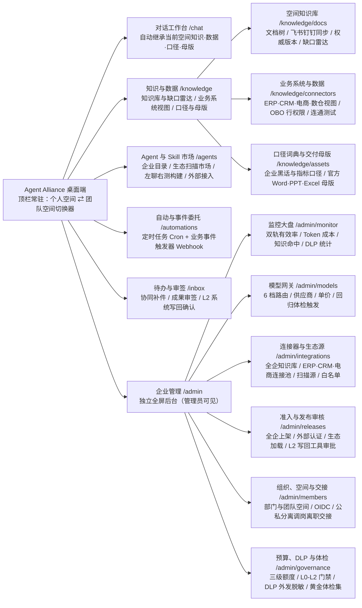

# Agent Alliance vNext 产品方案与交互信息架构（IA）

版本：vNext 1.2 · 2026 年 11 月 25 日  
定位：**企业版 Personal Agent、空间协同与知识/业务数据工作平台**（单一真源基线，用于统一产品、交互与工程演进）  
配套文档：[文档总索引](README.md) · [专项调研增补](19-vnext-research-addendum.md) · [技术架构演进](20-vnext-technical-architecture.md) · [交互与视觉规范](21-vnext-uiux-spec.md) · [统一高保真原型](uiux/vnext-prototype.html) · [全栈研发路线图](22-vnext-roadmap-todo.md)

---

## 1. 产品定位与基线收敛

### 1.1 一句话定位
**Agent Alliance 是面向企业自部署的 Personal Agent 与团队空间协同平台**：面向企业内绝大多数不懂 AI、不懂技术的业务员工，提供像 ChatGPT / Claude / Gemini 一样顺手、具备强自主执行力的个人 AI 助手；并以 **「个人空间 + 团队空间 + 全企公共底座」** 为统一组织容器，深度打通 **企业知识库、ERP/CRM/电商等核心业务系统、统一术语口径与官方交付母版、多人实时协同、外部 Agent 安全接入、正规生态发现市场与全局可观测治理**，让 AI 真正理解企业上下文并把事办稳、办合规。

### 1.2 从历史版本收敛的核心基线
历史文档（已统一归档至 `docs/archive/`，含 [产品方案 v76](archive/10-product-blueprint.md)、[技术方案 v33](archive/11-technical-blueprint.md)、[旧交互设计](archive/14-uiux-design.md)）曾偏向“重型立项与前置审批流”。当前 vNext 1.2 明确收敛原则如下：

| 维度 | vNext 1.2 统一基线 | 核心价值说明 |
| :--- | :--- | :--- |
| **部署形态** | **一家企业独立自部署一套实例**（Docker Compose 首发 / K8s 可选） | 业务数据、知识库、ERP/CRM 凭据、模型密钥与审计账本 100% 留在企业内网可控范围 |
| **工作台组织模型** | **三级空间容器：个人空间 + 团队空间 + 全企公共底座** | 个人空间默认私密零打扰；切入团队空间即自动挂载本部门共享知识库、业务数据源、黑话口径、母版与红线规则 |
| **知识与活数据融合** | **多源结构化知识库 + ERP/CRM/电商受控打通（含业务语义层）** | 告别“单次传附件 + 纯聊天幻觉”，同时用好静态制度文档与实时经营/订单/库存数据 |
| **默认交互与写回门禁** | **只读与沙箱计算 L0 免打扰直达；写回核心系统与正式交付强制 L2 确认** | 查知识、查订单、算报表秒级执行；修改 CRM、建 ERP 采购单、批量售后退款必经变更预览卡与幂等对账 |
| **主动工作范式** | **从“人找 AI 聊”扩展到“业务事件推着 AI 干”** | 支持定时任务与 ERP/CRM/电商异常事件 Webhook 自动唤醒空间 Agent，备好处置草稿推飞书请负责人拍板 |
| **视觉与交互范式** | **对标 ChatGPT / Claude / Gemini，统一暖灰白 + 深墨绿双主题** | 常驻可折叠侧栏（含顶部空间切换器）+ 动态分栏 Canvas + 独立全屏路由，向员工彻底屏蔽底层技术术语 |

### 1.3 已冻结的关键产品与工程决策
1. **个人空间绝对私密 + 个人私有 Agent 零审批即用**：员工在「个人空间」内的私聊正文与个人知识夹默认对企业管理员不可见；自然语言自建的个人 Agent 免审批立即可用，支持一键发布或移交至团队空间。
2. **外部 Agent 统一不走平台 API Key + 外发强制过 DLP 脱敏护栏**：所有外部接入的 Agent（含第三方商业 Agent 与内部研发团队自建 Agent）均独立管理自身模型与凭据，**平台绝不向外部签发模型网关 Key**；当任务上下文包含客户隐私（手机号/身份证）、采购底价或机密知识库片段时，调用外部商业 Agent 前自动触发 **DLP 脱敏掩码或 L2 显式拦截**。
3. **业务系统读写严格分离 + 身份权限透传（OBO / 行级权限）**：员工通过 AI 查询 CRM/ERP/电商数据时，严格按本人账号或角色行列级权限返回可见范围（绝不因共用 AI 越权查出他人底牌）；任何写入业务系统的操作一律属于 **L2 强制门禁**，须展示原值→新值预览卡并经人工确认后幂等执行。
4. **统一业务语义层（指标口径字典）防胡算**：数据库连接与核心系统取数通过受控「业务数据视图 + 企业指标口径字典」暴露给模型，禁止模型裸猜底层物理表名与财务公式。
5. **双轨制任务成功率 / 有效完成率口径**：
   - **轻量个人任务**：结合隐式正向信号（下载产物、复制回复、点 👍、继续深化且无负面重试）统计「有效完成率」；
   - **多人协作与正式审签任务**：严格以显式人工审核通过与最终交付（或 L2 业务写回确认）统计「审核采纳率」。
6. **生态扫描与受控加载分离**：市场定时扫描仅拉取正规渠道元信息、开源许可与安全静态体检报告，经管理员准入后按 SHA-256 固化至企业私有对象卷，员工自主选择加载。
7. **岗位变动公私分明无感交接**：员工调岗或离职时，个人空间私密对话隔离清理/封存，而其在各**团队空间**维护的知识库、业务系统自动化、事件触发器、待审单与团队 Agent 一键平移给继任同事，业务不断档。

---

## 2. 角色模型与空间权限边界

平台坚持**全局账号角色简洁 + 团队空间按需自治 + 内容与运维分权**：

| 角色 | 核心诉求 | 权限与空间边界 |
| :--- | :--- | :--- |
| **普通员工**（默认） | 在个人空间写稿算表；切入部门团队空间直接调用部门知识库、查自己权限内的 CRM/电商数据并套用公司母版干活 | 拥有独立私密的**个人空间**；可加入多个**团队空间**；个人私有 Agent 零审批即用；只读查询 L0 直达 |
| **团队空间管理员** *(部门主管 / 专项负责人)* | 管好本部门或专项组的共享知识库、绑定本组 ERP/CRM/店铺数据视图、维护部门口径词典、母版与回归体检集，处理组员岗位交接 | 管理所属**团队空间**成员（空间管理员 / 成员 / 跨部门协作者访客）、审核本空间共享 Agent、指派知识缺口补齐 |
| **业务协同 / 审核人** | 在多人协同任务中补充资料、在右侧 Canvas 划词 `@同事` 改稿、审核成果版本或确认 L2 业务系统写回单 | 按具体任务或团队空间角色生效；审核签收与 L2 系统写回必须绑定人工身份与具体版本号 |
| **研发 / 能力接入者** | 快速接入自研/第三方外部 Agent、配置企业 ERP/CRM/电商连接器与只读数据语义视图 | 使用外部接入向导与连接器配置台发布 `Beta 试用`；全企业范围开放或涉及 L2 写回能力须提交管理员审批 |
| **企业管理员** | 维护全企公共底座（公司制度库/官方品牌母版/全局术语表）、全局模型网关、DLP 脱敏策略、生态准入与全局监控 | 拥有独立全屏 `/admin` 权限；**默认不自动获得员工个人空间私聊正文与私有原件查看权** |

---

## 3. 六大核心产品支柱

### 支柱 A：三级空间管理 + 通用执行引擎 + 团队多人协同

#### 1. 三级空间容器（对标 Claude Projects / ChatGPT Projects 的企业增强版）
左侧导航栏顶部常驻**「空间切换器（Space Switcher）」**，让个人私密探索与部门规范作战彻底解耦又丝滑流转：

| 空间层级 | 典型示例 | 自动挂载的空间上下文 | 隔离与流转规则 |
| :--- | :--- | :--- | :--- |
| **个人空间** (`Personal Space`) | 「林予的个人空间」 | 个人显式偏好、个人知识夹（笔记/草稿参考）、我加载的个人 Skill、我的私有 Agent | 默认落地空间，绝对私密；对话成熟后可一键**「移交成果 / 发布助手到团队空间」** |
| **团队空间** (`Team Spaces`) | 「采购中心空间」 「抖店增长运营组」 「Q4 新品上市专项」 | **团队共享知识库** + **已绑定业务系统视图（ERP/CRM/店铺）** + **本组黑话/指标口径** + **团队专属母版与红线规则** + 共享协同任务与归档成果 | 空间内新建任何对话**默认具备上述全部部门上下文**，无需每次重新传文件、交代表格口径；支持跨部门邀请「协作者访客」 |
| **全企公共底座** (`Company Commons`) | 全公司自动继承层 | 全员通用制度库（财务报销/法务合规/HR 手册/产品总表）、全企官方品牌 PPT/Word 母版、公司级标准术语表、官方认证 Agent | 按员工部门/职级可见范围对所有空间自动兜底生效，由各职能部门与管理员联合维护 |

#### 2. 通用执行积木与风险分级自主权（L0–L2）
- **通用有界循环（General Agent Loop）+ Docker Compose 断网隔离沙箱 + 标准 MCP**：预装 Python 数据分析、图表绘制、中文字体与 Office 生成套件，配合高可信确定性财务复算工具。
- **扩展后的 L0–L2 自主权分级**：

| 自主等级 | 典型动作范围 | 执行与交互策略 |
| :--- | :--- | :--- |
| **L0 自主直达** | 权限内知识库检索、**本人行级权限内的 ERP/CRM/电商只读查询**、沙箱表格计算、套用公司母版生成草稿、公开网页调研 | **免前置审批、免费用弹窗直接执行**，实时展示可折叠步骤与取数/引用出处 |
| **L1 轻量确认** | 单次预计高消耗任务、大批量并发调研、调用外部收费商业 Agent、将脱敏后的内部摘要发往外部受控服务 | 对话内嵌轻量确认条，简明告知预计代价与数据去向，**一键确认后继续** |
| **L2 强制门禁** | **向 ERP/CRM/电商/OA 写回或变更业务单据**、对外发送邮件/客户消息、携带受限字段外发、**开启正式成果审签交付** | **强制弹出「变更预览对比卡」或进入多人协作审签流**，人工确认后按幂等键执行并留存回执 |

#### 3. 团队多人协同与业务事件主动唤醒
- **一键拉同事同屏协同**：任意对话顶部可拉同事分配角色（补件 / 审核 / 终审），同屏共看右侧 Canvas，支持表格行/文档段落锚点评论与 `@同事`（同步飞书待办）或 `@Agent` 局部改稿。
- **从“人找 AI”升级到“事找人”（业务事件触发器 Event Triggers）**：除定时 Cron 委托外，支持绑定业务系统 Webhook 事件自动唤醒对应团队空间的 Agent：
  - *电商异常守护*：某 SKU 连续出现差评或退货率突增 → 自动唤醒「电商运营空间」Agent 关联查询 ERP 批次质检单与退换货 SOP，生成预警分析与安抚方案草稿推飞书卡片；
  - *CRM 大单助攻*：CRM 新建重点商机 → 自动检索知识库同行业中标案例与竞品话术，生成《首访准备包》放入销售团队空间；
  - *ERP 库存预警*：原材料低于安全库存 → 自动拉取历史合格供应商名录与近期比价记录，起草采购补货申请单等待采购员 L2 确认提交。

---

### 支柱 B：企业知识库、核心业务系统打通与标准资产底座

把“文档知识 + 实时系统数据 + 统一口径 + 标准格式母版”四位一体收拢在当前空间的 **「知识与数据（Knowledge & Data）」** 中心：

#### 1. 企业知识库与权限感知混合检索（Enterprise KB & Hybrid RAG）
- **多源目录级活水同步**：
  - 本地精细解析：支持 PDF（含扫描件 OCR）、Word、PPT、复杂多 Sheet Excel、Markdown，**完整保留章节层级路径与跨页表格行列结构**；
  - 云端知识源同步：支持飞书知识库/云文档文件夹、钉钉文档库、企微文档、Confluence Space、Notion、SharePoint / S3 目录定时或 Webhook 增量同步；
  - **审签成果一键沉淀**：团队空间内经人工终审交付的优秀方案、复盘报告或核定报价表，支持一键「归档入团队知识库」。
- **检索精准度与防旧版误导**：
  - 采用 **`BM25 精确词匹配 + BGE 向量语义 + Cross-Encoder 重排`** 三路混合检索，兼顾合同编号/物料编码精确查找与自然语言问答；
  - **生命周期与权威度治理**：文档支持标记 `现行有效 / 历史归档 / 已作废` 及生效区间；检索默认优先引用现行有效官方版本，自动压制过期旧制度；
  - **实时 ACL 与毫秒级撤权阻断**：严格继承空间权限与源系统文档 ACL，权限撤回或文档作废立即阻断召回与摘要缓存；
  - **页码/表格行级可点击溯源**：回复内带 `[制度名 P.8]` 引用胶囊，点击直接在右侧分栏定位高亮原文段落。
- **「知识缺口与冲突雷达」（反哺知识运营）**：
  - 自动聚类统计本空间内的**高频未命中/低置信度提问**（自动隐去提问人隐私）以及**两份文档给出矛盾数字/条款的冲突提醒**，空间管理员可一键指派责任人补传或修订文档。

#### 2. 企业业务数据与核心系统打通（ERP / CRM / 电商 / 数仓）
- **四类打通覆盖全企业系统栈**：
  1. **核心业务套件预置连接器**：**ERP 与供应链**（金蝶云星空、用友 BIP/U8、SAP、聚水潭、旺店通）、**CRM 与客户**（纷享销客、销售易、Salesforce、飞书/企微客户管理）、**电商与售后工单**（抖店、淘系千牛、京东、拼多多、Shopify、有赞、客服工单系统）、**OA/HR**（飞书/钉钉审批、考勤日程）；
  2. **受控只读数据库 / 数仓连接**：支持 MySQL、PostgreSQL、ClickHouse、StarRocks 只读副本接入；
  3. **OpenAPI / REST 快速导入**：粘贴内部老系统 Swagger JSON 即可生成受控工具；
  4. **内网受控浏览器只读采集兜底**。
- **业务数据语义层（Semantic Views）**：研发或数据管理员将底层复杂表/接口封装成业务可读的**受控数据视图**（声明字段业务含义、时间粒度、关联主键与默认过滤口径），Agent 只在受控视图与预置连接器上查数，并在回复中附带**「取数口径说明卡」**（查询范围、时间窗、过滤条件一目了然）。
- **OBO 用户级行权限 + L2 写回预览确认**：查询自动携带当前员工身份过滤可见客户/店铺/部门行；需要写回 ERP/CRM/电商时，生成结构化**「系统变更确认卡」**（目标系统、单据类型、关键字段前后对比、回滚说明），人工点击批准后执行幂等写入并回填业务系统单号。

#### 3. 企业术语口径词典与官方交付母版库（Glossary & Brand Kit）
- **企业黑话词典与指标口径库（Enterprise Glossary & Metric Hub）**：
  - 在全企公共底座与各团队空间维护**内部缩写/代号同义词**（如“S 级核心池”“KA 二部”）与**标准业务指标公式**（如“净销售额”“核准毛利”“有效线索率”）；
  - 员工在对话中纠正口径后，可一键点击「沉淀至团队口径词典」，后续无论是搜知识库还是查 ERP/数仓均自动对齐同一口径。
- **官方交付母版与品牌规范库（Corporate Templates & Brand Kit）**：
  - 支持上传全企或部门标准的 **PPT 品牌母版（`.pptx`）、Word 公文/合同模板（`.docx`）、标准报价/财务周报样表（`.xlsx`）** 及品牌色/字体规范；
  - Agent 在隔离沙箱生成正式文档时直接套用指定空间母版，排版、表头、页眉 Logo 与公式区一次到位，免去员工手工调格式。

---

### 支柱 C：外部 Agent 开放接入 + DLP 敏感数据防泄漏护栏

1. **多协议一键模板（OpenAI-Compat / Dify / Coze / FastGPT / LangGraph / A2A / Webhook / MCP）**：3 步向导 1 分钟上线 `Beta 试用`，UI 动态维护出站域名白名单。
2. **运行完全解耦 + 边界监控与可选回传**：外部 Agent 独立管理自身模型凭据、不消耗平台模型 Key；平台监控调用边界耗时/成功率/有效完成率，并按需解析可选 `usage` / `X-Alliance-Trace-Url`。
3. **新增：DLP 敏感数据防泄漏与外发脱敏护栏（Sensitive Data Guardrails）**：
   - 打通知识库与 ERP/CRM 后，平台在外部调用边界内置实时敏感识别器（检测手机号、身份证、银行账号、合同底价、薪资及标记为「内部机密/绝密」的知识与业务字段）；
   - 发往**外部第三方商业 Agent** 前自动按空间/全局策略执行：**① 自动占位符脱敏替换**（如将真实客户名与手机号替换为可逆映射掩码 `[CLIENT_01]`，返回后再在内部还原）、**② 升级为 L2 人工审批**、或 **③ 直接阻断并提示改用内部自部署 Agent**，全程写入数据外发合规审计账本。

---

### 支柱 D：面向非研发的自然语言构建 + 企业回归体检评测集

1. **左聊右测对话式构建器（Conversational Studio）**：大白话对话生成 + **拖入 1–3 份标杆文件反推规范** + 右侧实时试聊**「指哪改哪」Diff 更新** + 从成功对话一键沉淀。
2. **空间感知的能力挂载与三层发布**：可一键勾选绑定「当前团队空间知识库」「本组业务数据视图」与「团队标准交付母版」；支持 `个人私有（零审批即用）→ 团队空间共享 → 全企业上架/API 发布`。
3. **新增：数字员工上岗回归体检集（Enterprise Eval & Regression Suite）**：
   - 团队空间管理员或构建者可将日常跑得好的 **10–50 条真实业务问答/取数/核对任务一键存为「黄金体检用例」**（含输入样例与期望关键结论/数字断言）；
   - 当企业管理员在网关切换主力大模型、或团队大幅更新知识库/业务口径时，可一键后台跑批体检，直观展示准确率与耗时前后对比，杜绝“换了新模型把老业务跑崩”。

---

### 支柱 E：Skill 与 Agent 生态发现市场（定期扫描正规渠道 + 自主加载）

- **定期自动扫描正规上游源**：每日/每周自动同步官方 MCP Registry、主流 `SKILL.md` 官方仓库、A2A 认证目录与企业私有 Git 库，自动输出**开源许可证分类**与**静态安全体检报告**。
- **企业 SHA-256 冻结准入 + 个人/团队空间自主加载**：管理员一键准入缓存至私有对象卷；员工可将已准入 Skill 加载到**个人空间**自用，或由空间管理员默认装配到**团队空间**让全组共享。

---

### 支柱 F：企业级全局资源供给、岗位无感交接与可观测监控

1. **内部全局模型网关（Model Gateway）**：6 档逻辑能力路由（通用/快速/深度/视觉/生图/向量）、主备 3 秒自动 Fallback、精确微元单价表与企业→部门/空间→个人三级静默预算。
2. **服务、业务连接器与生态源中心（Service & Connector Hub）**：集中纳管 Docker Compose 断网沙箱池、联网搜索、企业知识同步源、**ERP/CRM/电商连接器与只读数据语义层**、生态扫描源、IM 机器人及出站域名白名单。
3. **空间感知的调岗/离职资产无感交接（Space-Aware Handover）**：
   - 在 `/admin/members` 或团队空间设置中发起调岗/离职交接时，严格执行**公私分离**：员工**个人空间**内的私人对话与私有草稿自动隔离封存/按规销毁，绝不泄露个人隐私；而其在各**团队空间**名下的共享知识文档、业务系统定时/事件触发器、待审单与团队 Agent 一键事务级平移给继任同事。
4. **企业级可观测监控大盘（Enterprise Observability）**：
   - 除活跃率、Token/费用趋势、双轨有效完成率、四阶漏斗、Agent 效能榜单与 OTel Trace 瀑布流外，新增 **知识库命中率与缺口概览**、**业务连接器健康与 L2 写回审计统计**、以及 **DLP 外发拦截统计**。

---

## 4. 全局信息架构（IA）与路由规划

保持**仿 ChatGPT / Claude 极简常驻可折叠左侧栏 + 独立全屏路由**，将新增的空间、知识库、业务数据与标准母版高内聚收拢，不堆砌零散菜单：

### 4.1 左侧栏极简排布（展开 `248px` / 折叠 `56px`）
1. **顶部行**：Alliance 标志 + 折叠键；紧随其下为醒目的**「空间切换胶囊（Space Switcher）」**（一键切换 `🔒 个人空间` 或所属 `👥 采购中心空间` / `👥 电商增长空间` / `+ 新建团队空间`）；
2. **核心动作**：`+ 新对话 ⌘N`、`全局搜索 ⌘K`（支持跨对话、当前空间知识库、数据视图与 Agent 秒搜）；
3. **四大高频工作台入口**：`知识与数据`（展示当前空间文档数与已连业务系统）、`Agent 与 Skill 市场`、`自动与事件委托`、`待办与审签`（含 L2 系统写回确认红点）；
4. **当前空间的最近对话历史**：切换空间时自动切换对应空间的对话列表（团队空间可置顶共享重点任务，个人空间仅展示本人私密对话）；
5. **底部固定区**：`企业管理`（管理员可见）+ 个人账号菜单（浅/深色切换、个人偏好、IM 绑定）。

---

## 5. 前台业务术语降噪规范（含知识与数据新增项）

| 底层工程 / 数据术语 | vNext 前台面向员工文案 | 工程细节收口位置 |
| :--- | :--- | :--- |
| `BM25 + Dense Vector + Cross-Encoder Rerank` | `智能精准检索（兼顾编号与语义）` | 后台检索配置 |
| `ACL Filter / Document Revocation Tombstone` | `按你的权限展示 · 已失效制度自动屏蔽` | 知识库权限日志 |
| `Semantic Layer / Read-only SQL View` | `业务数据视图（已核对统计口径）` | 连接器配置页 |
| `OAuth OBO / Row-Level Security (RLS)` | `仅查询你名下/本部门有权限的数据` | 连接器安全说明 |
| `Idempotent Mutation Key / Two-Phase Writeback` | `变更预览确认（确认后写入系统并返回单号）` | L2 确认卡与审计账本 |
| `DLP PII Tokenization / Egress Redaction` | `敏感信息已自动脱敏保护` | 对话安全轻提示 / DLP 审计页 |
| `Eval Dataset / Pass@1 Regression` | `上岗体检集（换模型/改知识前自动验准）` | 构建器与治理后台 |

---

## 6. 与现有代码基线（v0.1.52+）的演进映射

| 领域 | 现有已具备底座 | 本轮企业深度能力增量 |
| :--- | :--- | :--- |
| **空间与组织交接** | `identity`、`teams`、`projects`、基础离职批量移交 `offboarding.go` | 显式建立 **Personal Space / Team Space / Company Commons** 三级容器、空间角色自治，以及调岗/离职**公私分离交接**（个人空间隔离清理 vs 团队空间资产继承） |
| **企业知识库与检索** | 单项目附件抽取 `knowledge/`、单篇飞书/钉钉/Confluence 同步 `knowledgesync/`、基础 `retrieval/` | 升级为**空间级持久知识库**、文件夹/知识空间级增量同步、跨页表格与章节层级保真切分、三路混合检索 + Rerank、有效/作废版本治理、页码级高亮溯源、审签成果一键入库与**知识缺口/冲突雷达** |
| **业务系统与语义层** | 静态 CSV DuckDB 聚合 `connectors/`、标准 MCP Client `mcphub/` | 新增 **ERP/CRM/电商/工单预置连接器与只读数据库语义视图层**、OBO 用户行级权限透传、取数口径说明卡，以及 **L2 业务写回变更预览确认 + 幂等回执对账** |
| **企业标准资产库** | 团队规则文本 `team_rules` | 新增**企业黑话与统一指标口径词典（Glossary & Metric Hub）**及**官方 Word/PPT/Excel 品牌交付母版库（Brand Kit）**，沙箱生成文档原生套用母版 |
| **主动自动化** | Temporal Schedule 周期定时委托 `automations/` | 新增**业务系统事件触发器（Event Webhook Triggers）**，支持签名验真、防抖去重、唤醒空间 Agent 生成处置草稿并推飞书拍板 |
| **数据合规与质量体检** | 出站策略审计 `policy/`、域名白名单 `egress/`、双轨监控 `monitor/` | 新增 **DLP 敏感数据识别与外部 Agent 可逆掩码脱敏护栏**，以及面向空间与自建 Agent 的**黄金回归体检集（Eval Suite）** |
