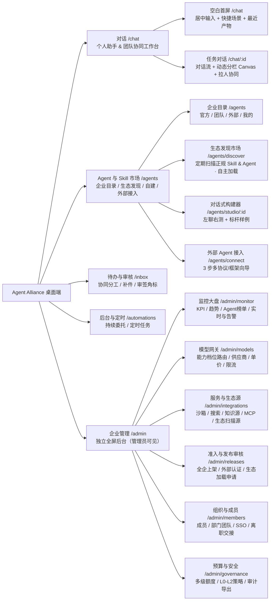

# Agent Alliance vNext 产品方案与交互信息架构（IA）

版本：vNext 1.1 · 2026 年 11 月 24 日  
定位：**企业版 Personal Agent 平台**（单一真源基线，用于统一后续产品、交互与工程演进）  
配套文档：[文档总索引](README.md) · [专项调研增补](19-vnext-research-addendum.md) · [技术架构演进](20-vnext-technical-architecture.md) · [交互与视觉规范](21-vnext-uiux-spec.md) · [统一高保真原型](uiux/vnext-prototype.html)

---

## 1. 产品定位与基线收敛

### 1.1 一句话定位
**Agent Alliance 是面向企业自部署的 Personal Agent 与团队协同平台**：面向企业内绝大多数不懂 AI、不懂技术的业务员工，提供像 ChatGPT / Claude / Gemini 一样顺手、具备强自主执行力的个人 AI 工作助手，并原生构建 **团队多人协同工作、外部 Agent 统一接入、非研发自然语言构建、正规渠道 Skill/Agent 生态发现市场、以及企业级全局资源供给与可观测监控** 五大核心支柱。

### 1.2 从历史版本收敛的核心基线（消除文档冲突）
历史文档（已统一归档至 `docs/archive/`，含 [产品方案 v76](archive/10-product-blueprint.md)、[技术方案 v33](archive/11-technical-blueprint.md)、[旧交互设计](archive/14-uiux-design.md)）在多轮迭代中积累了相互冲突的设定，且整体偏向“重型项目管理与前置审批流”。本基线明确如下收敛原则：

| 维度 | vNext 统一基线 | 继承与调整说明 |
| :--- | :--- | :--- |
| **部署形态** | **一家企业独立自部署一套实例**（Docker Compose / K8s） | 彻底废弃旧“平台集中托管”的矛盾表述，数据、密钥与模型接入均由企业掌控 |
| **默认交互范式** | **个人助手轻量默认（草稿优先），团队协作审签按需开启** | 日常工作免立项、免选团队、免前置方案审批、免手动勾技术开关，张口即跑；仅在多人审签或正式交付时平滑升档为协作模式 |
| **执行内核演进** | **通用 Agent Loop + 隔离沙箱工作区 + 标准 MCP 工具层** | 停止按单一小场景堆砌特化表与固定 Activity，对齐主流 Personal Agent 通用执行力 |
| **视觉与交互范式** | **对标 ChatGPT / Claude / Gemini 布局与交互，统一暖灰白 + 深墨绿双主题** | 淘汰纯黑白灰弹窗后台与半屏大输入框，采用常驻可折叠侧栏 + 动态分栏 Canvas + 独立全屏后台，支持浅/深色切换 |
| **不可妥协的企业底座** | 保留**权限实时复核、撤权即时阻断、不可变发布版本、状态分层、幂等账本与异常恢复** | 继承 v0.1.52 已验证的企业级治理长板，但彻底向普通员工隐藏底层工程术语 |

### 1.3 已确认的关键产品决策（2026-11-24 冻结）
1. **个人私有 Agent 零审批即用**：普通员工通过自然语言构建的私有 Agent，在个人预算额度内免审批立即可用；仅在共享给团队、全企业上架或发布 Open API 时进入样例测试与发布审核流。
2. **外部 Agent 统一不走平台 API Key（保持完全解耦）**：平台全局模型资源池专注为平台内置 Personal Agent、员工自然语言构建的 Agent、对话规划与元构建助手提供统一模型支持。**所有外部接入的 Agent（包括第三方商业 Agent 与企业内部自研团队开发的 Agent）均独立管理自身运行环境与模型凭据，不向外部签发平台模型网关 Key**；平台通过调用边界采集运行状态、耗时、错误与有效完成情况，并提供可选的标准用量/追踪回传字段供接入方按需上报。
3. **L0 个人任务默认自主直达 + 预算静默放行**：日常只读检索、沙箱数据处理、文件生成与文档写作在有效额度内免前置审批、免单次费用弹窗直接执行；系统在后台静默计量，仅当触及预警阈值或触发高风险 L1/L2 动作时才请求确认。
4. **双轨制任务成功率 / 有效完成率口径**：
   - **轻量个人任务**：结合**隐式正向信号**（下载产物、复制回复、点 👍、继续追问深化且无连续负面重跑/中途取消）统计「有效完成率」，避免员工看完即走导致显式采纳率严重失真；
   - **多人协作与正式审签任务**：严格以**显式人工审核通过与最终确认交付**为硬口径统计「审核采纳率」，两项指标在监控大盘分列展示、互不混淆。
5. **文档组织策略**：`docs/` 顶层仅保留当前生效的 vNext 活文档（`18`–`22` 号）、操作与恢复手册及最新架构图/交互原型；早期 `01`–`16` 号文档、旧架构图与旧原型统一移入 `docs/archive/` 归档，并在 [文档总索引](README.md) 中集中索引。
6. **生态扫描与受控加载分离**：市场定时扫描仅自动拉取正规上游渠道（官方 MCP Registry、主流开源 Skill 库、认证 A2A 目录等）的元信息、许可与安全体检摘要供浏览发现，**绝不静默自动执行未经核准的外部代码**；企业管理员可一键准入并冻结版本，员工可自主选择将已准入的 Skill/Agent 加载到个人助手中，或对新发现项一键发起加载申请。

---

## 2. 角色模型与权限边界

平台保持**账号角色简洁、业务职责正交、内容与管理分权**原则，不强迫员工在日常使用时理解复杂组织架构：

| 角色 | 核心诉求 | 核心权限边界 |
| :--- | :--- | :--- |
| **普通员工**（默认） | 像用 ChatGPT/Claude 一样搞定日常资料、表格、文档、调研与定时跟进；用大白话自建顺手的小助手 | 使用获授权的内置 / 外部 / 团队 Agent；**个人私有 Agent 零审批即用**；管理个人偏好与个人定时任务；费用默认静默归属主团队 |
| **业务协同 / 审核人** | 在复杂多成果项目中补充资料、划词改稿、按版本审核并最终签收交付 | 仅在开启协作模式或受邀进入的项目内生效；审核与最终交付绑定具体成果版本，不可由系统替代 |
| **研发 / 能力接入者** | 快速接入第三方商业 Agent、自研团队 Agent 或企业内部 MCP/API 工具并完成联调 | 进入外部接入向导注册、调试并上线 `Beta 试用`；全企业认证上架须提交管理员审批 |
| **企业管理员** | 统一配置全局模型池、服务与连接器资源、组织成员、预算限额、安全策略与审批全企上架 | 拥有独立全屏 `/admin` 后台的全局配置与监控汇总权；**默认不自动获得员工私聊正文、私有原件或项目签收权** |
| **业务管理者**（可选授权） | 掌握所辖部门/团队的 Agent 使用覆盖、任务有效完成率、Token 消耗与成本趋势 | 仅在获授权的组织范围内查看统计与明细；导出报表与查阅 Trace 正文须独立授权并留痕 |

---

## 3. 五大核心产品支柱

### 支柱 A：对标 Personal Agent 的通用执行能力 + 团队多人协同工作

参考 [Personal Agent 执行调研](archive/16-personal-agent-execution.md) 中的标杆机制，将平台执行层升级为对非技术员工完全透明的通用工作引擎，并原生补齐企业工作中最核心的**多人团队协同**能力：

1. **通用执行积木（不再按单场景堆特化功能）**
   - **有界自主循环（General Agent Loop）**：支持原生 Tool Calling、多轮思考、观察自修正、停滞检测（同一动作与输入无新增证据时及时止损并向人说明缺口）及上下文智能压缩（成对保留工具调用/结果、用户纠偏与来源引用）。
   - **隔离沙箱工作区（Workspace Sandbox）**：按任务按需拉起受控隔离容器（预装 Python、数据分析、图表绘制与 Word/Excel/PPT/PDF 生成转换能力），员工说一句“把这三张表合并去重并画出各区域对比柱状图做成 PPT”，由 Agent 在沙箱内一气呵成。高确定性财务核算能力作为内置 Trusted Tool 挂载，保证关键金额可独立重算。
   - **标准工具与协议层（MCP）**：通过 MCP 统一挂载联网搜索、浏览器自动化、企业知识库检索、只读业务数据库查询及内部办公系统工具。
   - **后台长任务与定时委托（Automations）**：基于 Temporal Schedule 支持周期性任务（如“每周五 17:00 汇总销售异常并推送飞书”）与事件触发任务，分别记录触发游标、执行结果与消息投递回执。

2. **风险分级自主权（Autonomy Tiers）**
   彻底解决“Personal Agent 要顺手”与“企业治理要安全”之间的张力：

| 自主等级 | 典型动作范围 | 执行与交互策略 | 典型业务场景 |
| :--- | :--- | :--- | :--- |
| **L0 自主直达** | 只读知识检索、沙箱代码与表格计算、撰写草稿、生成/修改 Office 与图片、联网公开调研 | **免前置审批、免费用弹窗直接执行**（后台静默扣减团队/个人额度），对话内实时显示可折叠思考与动作进度 | 日常问答、销售表汇总、做 PPT/Word、整理会议纪要、写周报 |
| **L1 轻量确认** | 单次预计消耗超阈值、批量并发子任务、调用标明外部收费的第三方 Agent、跨团队借用受限能力 | 对话内嵌轻量确认条，简明告知预计代价与数据去向，**一键确认后继续**（支持团队预授权免重复打扰） | 50 家竞品批量调研、调用外部付费法务审查 Agent |
| **L2 强制门禁** | 对外发送邮件/群消息、写入正式业务系统、**开启多人正式成果审签与交付签收** | **强制进入人机确认卡或协作审签流**，保留具体版本、原件出处与签收凭证 | 客户回复外发、采购比价/培训课件/新品发布包正式交付 |

3. **团队多人协同工作（企业核心特色：从单人助手一键升级为多人协同空间）**
   企业中大量真实工作（如采购定标、新品发布素材包、标书制作、培训课程研发、月度经营分析）天然需要多人分工接力。平台既保证单人日常任务零摩擦直达，又提供丝滑的团队协同能力：
   - **一键拉人 / 团队任务直起**：任意个人对话顶部点击「邀请同事协作」（或直接从协作模板发起），即可将同事拉入同一共享任务工作空间，实时展示协作成员头像栈与在线状态。
   - **清晰的任务内角色分工**：在任务内轻量指派谁是**发起人**、谁负责**补充资料/原件**（如财务补表、法务补条款）、谁负责**审核哪份成果**、谁是**最终交付确认人**；权限严格按当前任务生效，成员移出或撤权即时生效。
   - **同屏共享 Canvas + 行内评论与 `@同事` 指派改稿**：多位同事共享右侧成果工作区（文档/表格/PPT/图片），可在任意段落或表格行直接发起**评论并 `@同事` 或 `@Agent` 局部改稿**，系统记录每条意见的责任人、解决状态与受影响版本，并发修改时提供版本对照防止相互覆盖。
   - **分段接力与企业 IM 协同同步**：A 补完资料后自动触发受影响分支局部重跑并通知 B 审核；审核与补件待办实时同步到飞书/钉钉卡片，多人从不同终端点击同一待办只生效一次决定，避免重复执行或信息割裂。
   - **按版本审签与打包交付**：支持逐成果审核、缺项留痕与指定后续负责人（受原委托允许部分交付约束）、最终一键固定版本并打包下载交付清单。

4. **记忆与知识三层隔离**
   - **任务工作集（短期）**：仅绑定当前对话的附件版本、中间产物与原件位置，不跨任务串扰。
   - **显式个人偏好（跨任务个人）**：用户随时在设置或对话中查看、修改、停用或删除（如“以后金额统一保留两位小数，结论放最前面”），员工离职自动回收。
   - **团队规则与企业知识库（组织共享）**：严格按组织/文档 ACL 过滤召回，源权限撤回时即时阻断读取与引用。

---

### 支柱 B：外部 Agent 开放接入（第三方公司 + 内部自研）

面向真实企业环境，大幅降低接入摩擦，同时坚持运行解耦与边界可观测：

1. **多协议接入 + 国内主流框架一键模板（Adapter Hub）**
   - **企业自研常用模板（一键预填）**：内置 **OpenAI-Compatible Agent API**、**Dify App**、**Coze Bot**、**FastGPT**、**LangGraph Server** 适配模板，研发团队无需改写底层框架，填写地址与认证凭据即可接入，自动透传标准追踪头（`X-Alliance-Run-Id`、`X-Alliance-User-Id`、`traceparent`）。
   - **标准 A2A 协议**：完整支持 Agent Card 发现、同步/异步任务、原任务查询、补件交互与取消契约。
   - **通用异步 REST / Webhook 模板**：配置 Submit / Poll / Cancel 端点与字段映射，兼容 Manus Task API 等第三方商业 Agent。
   - **MCP Server 接入**：将外部专业能力作为标准工具集接入平台。
   - **管理员界面维护允许域名白名单**：取消必须修改服务器环境变量 `AGENT_ALLOWED_HOSTS` 并重启的运维限制，改为在 `/admin/integrations` 中由管理员直接维护出站域名白名单与数据外发等级。

2. **运行完全解耦 + 边界监控与可选用量回传**
   - 无论第三方商业 Agent 还是企业自研 Agent，**均独立管理自身模型与凭据，不向其签发平台模型网关 API Key**。
   - 平台在调用边界自动采集：**调用次数、请求成功率、首字节/端到端耗时、超时/重试/失败分类、以及员工最终采纳/有效完成率**。
   - 平台定义轻量可选回传约定（兼容标准响应体 `usage` 字段或响应头 `X-Alliance-Usage` / `X-Alliance-Trace-Url`）：接入方若按约定回传，大盘自动汇总其 Token/费用与外部 Trace 跳转链接；未回传则如实标注「外部未披露」，绝不估算造假。

3. **分级准入与双调用形态**
   - **两档准入**：`Beta 试用`（1 分钟配通并发送测试消息通过即可供本人或测试小组使用）→ `Verified 全企认证`（通过样例质量、异常超时与异步恢复测试后提交管理员审批全企上架）。
   - **双调用形态**：员工既可在对话输入框用 `@外部Agent` 直接对话，也可由 Personal Agent 在复杂任务中按授权自动作为 Sub-Agent 委派调用。

---

### 支柱 C：面向非研发的自然语言 Agent 构建

完全去除“选底层模型修订 + 拆单操作草稿 + 写 Prompt 表单 + 等审批才能自用”的工程师门槛：

1. **「左聊右测」对话式构建器（Conversational Studio）**
   - **左侧对话构建（Meta-Agent）**：业务员工用大白话描述需求（如“帮我做一个供应商报价核对助手，每次自动比价、标出缺有效期的项，并生成追问清单”）。构建助手只提 1–2 个业务问题，自动生成职责说明、执行步骤、推荐能力开关与默认模型档位。
   - **标杆样例驱动（Show, Don't Tell）**：非研发人员往往说不清抽象规范，支持直接拖入 **1–3 份过去做得最好的标杆文件（Word/Excel/PPT/周报）**，构建助手自动提炼结构、排版风格、口径规则与自检清单。
   - **右侧实时试聊 + 「指哪改哪」微调（Live Playground）**：右侧立即上传真实或脱敏文件试跑；发现输出不合心意，选中某段结果或直接说“以后单价列右对齐且标红超预算项”，左侧规则自动做增量 diff 更新并支持一键对比修改前后效果。
2. **「从成功对话一键沉淀」**
   - 员工在日常对话里把一个任务调教满意后，点回复底部的「存为我的 Agent」，系统自动提取可复用指令与工具组合，**自动剥离当次私有文件与敏感数据**，直接进入 Studio 微调或保存自用。
3. **能力意图化勾选 + 隐藏“单体 vs 编排”前置分叉**
   - 彻底隐藏“文本模型 vs 视觉模型 vs Excel 分组汇总 vs 编稿”的碎片化拆分；员工只需按需开关可读懂的能力标签（`企业知识库`、`表格与文档处理`、`识图与生图`、`联网搜索`、`调用已授权外部 Agent`），并且**无需先决定建“单 Agent”还是“多 Agent 协作模板”**——底层是否编排了多个工具或子 Agent，均由构建助手自动组装。
4. **三层发布作用域（自由试错与企业治理兼得）**

| 发布层级 | 可见受众 | 准入门槛 | 典型用途 |
| :--- | :--- | :--- | :--- |
| **个人私有（Personal）** | 仅创建者本人 | **零审批，保存即用**（受个人/主团队额度约束） | 员工随手捏的周报助手、会议整理、个人翻译润色 |
| **团队共享（Team）** | 所属团队成员 | 跑通至少 1 份样例测试即可发布，自动冻结版本 | 部门共用的报价核对、客户跟进草稿、周报模板 |
| **企业上架 / 服务发布（Enterprise / API）** | 全企业成员或 Open API | 冻结不可变依赖清单 + 样例测试通过 + **管理员审批上架** | 公司标准官方助手、跨部门服务、外部系统 API |

---

### 支柱 D：Skill 与 Agent 生态发现市场（定期自动扫描正规渠道 + 自主选择加载）

为避免企业能力局限于平台内置少数功能，平台内置**企业级 Skill & Agent 市场**，将「内部沉淀能力」与「外部正规开源/官方生态」统一纳管：

1. **定期自动扫描正规渠道（Scheduled Ecosystem Discovery）**
   - 管理员可在后台启用并配置正规上游扫描源（支持按天/周自动同步，也可手动立即刷新），首批覆盖：
     - **官方与主流 MCP Registry**（标准工具集与企业连接器）；
     - **主流正规 Skill 仓库**（如 Anthropic/OpenAI 生态规范 `SKILL.md` 官方与认证社区仓库）；
     - **标准 A2A 认证目录与合作方目录**（合规商业或开源专业 Agent）；
     - **受信任的开源高星与企业私有 Git 仓库**（支持企业内网自有 Skill 仓库同步）。
   - **自动化合规体检**：每次扫描自动提取名称、一句话业务价值、上游来源与维护活跃度、**开源许可证类型（MIT / Apache-2.0 / 商业附加条款高亮预警）**、所需外部权限/网络范围、以及静态安全检查摘要（检测敏感命令、越权路径、外部硬编码地址）。
2. **三态分层与企业用户自主选择加载**

| 市场状态 | 企业成员看到什么 | 可执行操作与安全边界 |
| :--- | :--- | :--- |
| **已加载（Loaded）** | 已挂载到个人助手或当前团队的能力清单 | 随时一键**停用/卸载**、切换版本或设置仅在指定 Agent 中生效 |
| **企业已准入（Approved）** | 管理员已审核合规并缓存固定版本到企业私有库的可信 Skill / Agent | **普通员工无需二次审批，一键「加载到我的助手」立即生效**；也可在构建器中直接勾选装配 |
| **新发现候选（Discovered）** | 定期自动扫描到的上游正规新品，标明来源、许可、安全评分与待确认权限 | 员工点击**「申请加载」**一键推送至管理员审核队列；管理员核对许可与权限后一键「准入并缓存版本」 |

3. **版本冻结、更新提醒与安全隔离**
   - 任何从市场加载的 Skill 包在企业准入时按 SHA-256 哈希缓存至企业私有对象卷，运行中绝不从公网临时拉取未验签脚本；
   - 上游发布新版本时，扫描器仅生成「有新版可用」提醒及变更差异摘要，由管理员评估后决定是否升级，已运行的任务与历史发布保持原版本不受破坏；
   - Skill 附带的可执行逻辑只能在受控隔离沙箱或已登记 MCP 工具边界内执行，无法绕过企业权限与数据防泄漏策略。

---

### 支柱 E：企业级全局资源供给与可观测监控

1. **全局模型资源池与网关（Model Gateway）**
   - **能力档位抽象（Model Tiers）**：管理员在 `/admin/models` 统一接入企业供应商（百炼、火山方舟、DeepSeek、OpenAI、Anthropic、Gemini、企业私有 vLLM/Ollama 等），并映射到 6 个逻辑能力档位——`默认通用`、`快速轻量`、`深度推理`、`视觉理解`、`图像生成`、`向量检索`。
   - **集中供给与无感容灾**：平台内置 Personal Agent、所有员工自然语言自建 Agent、对话路由与 Meta-Agent 均统一绑定逻辑档位，由平台模型网关集中供给模型支持。管理员可随时调整主/备模型（Fallback）、权重负载均衡和 RPM/TPM 限流，**升级或切换供应商时所有业务 Agent 无感生效**，不再逐个替换重验。
   - **精确 Token 计价与多级静默预算**：按模型维护百万 Token 单价表（区分 `Input / Output / Cached Input` 与图像/音频按次计价），支持企业 → 部门/团队 → 成员多级月度额度、软告警（通知管理员）与硬熔断策略。
2. **企业服务资源与连接器中心（Service & Integration Hub）**
   在 `/admin/integrations` 集中配置、测试并监控 5 类企业公共底座：
   - **代码与文档执行沙箱池**：容器并发上限、单任务 CPU/内存/超时限额与健康状态；
   - **联网搜索服务**：搜索引擎/API（如博查、Tavily、Bing 等）凭据、频率上限与域名过滤；
   - **企业知识源连接器**：飞书/钉钉云文档、Confluence/Wiki、SharePoint、只读业务数据库同步状态与权限映射；
   - **企业 MCP Server 目录**：内部系统 MCP 工具注册、连通性检查、数据访问等级与授权范围；
   - **IM 渠道机器人与出站白名单**：飞书、钉钉、企微、Slack 机器人配置，以及外部 Agent 允许访问的域名白名单与统一密钥库（Secret Vault）。
3. **企业级可观测监控大盘（Enterprise Observability）**
   独立全屏 `/admin/monitor`，支持按 `时间范围(今天/7/30/90天/自定义)` · `部门/团队` · `来源类型(全部/内置/自建/外部)` 联动筛选：
   - **核心 KPI 与双轨成功率**：
     - 活跃人数与活跃率、总任务数、**执行成功率**（无技术报错完成）、**轻量任务有效完成率**（结合下载/复制/👍/无负面重跑等隐式正向信号）、**协作任务审核采纳率**（显式审核交付）、总 Token（拆分 Input/Output/Cache 占比）、总模型费用（外部未披露费用单独标记）。
   - **四阶质量漏斗**：`任务发起 → 执行无故障 → 产出达标/审核通过 → 有效采纳/正式交付`，点击任一异常段直接下钻失败/低满意度任务。
   - **多维趋势与排行**：每日 Token 与费用堆叠趋势（按模型/部门/来源切换）、每日任务量与有效完成率趋势、Top 消耗部门与模型占比。
   - **Agent 运行效能榜单（核心表格）**：按**单个 Agent**（区分内置 / 员工自建 / 外部接入）展示调用量、执行成功率、有效完成率/采纳率、P50/P95 耗时（悬浮拆解模型/工具/外部/人工等待）、Token 与费用（外部未上报标「未披露」）、健康状态灯及快捷下钻 Trace/配置告警。
   - **实时运行队列与主动告警**：查看当前执行中、排队中、阻塞中的任务；支持配置阈值告警规则（如外部 Agent 连续 5 次超时、某部门单日 Token 突增 300%、月预算达 80%），自动推送飞书/钉钉运维群。
   - **按权下钻 Trace 瀑布流**：有权限的排障者按 `Run → Turn → LLM / Tool / Sandbox / External Span` 查看时间轴与 Token 明细，正文内容严格按团队脱敏策略与独立授权展示。

---

## 4. 全局信息架构（IA）与路由规划

彻底取消旧版将重型页面塞进 `<dialog>` 弹窗以及顶部厚重通栏的做法，采用**仿 ChatGPT / Claude 固定可折叠左侧栏 + 独立全屏路由工作区**：

### 4.1 导航与多端分工原则
- **左侧栏（展开 `248px`，折叠 `56px` 图标轨）**：顶部 Brand + 折叠键、`+ 新对话`、`搜索 ⌘K`；中部三大高频功能入口（`Agent 广场`、`后台与定时`、`待办与审核`带红点）；主体为按「今天 / 昨天 / 近 7 天」分组的**最近对话历史**（hover 支持置顶、重命名、删除）；底部固定**「企业管理」**（管理员可见；有部门查看权的业务主管显示「团队监控」精简入口）及**个人头像菜单**（浅/深色主题切换、个人偏好、IM 账号绑定、退出）。
- **取消通栏顶条**：左侧栏通顶，右侧主区顶部仅保留极简悬浮/轻边栏（左侧显示当前对话标题与正在使用的 Agent，右侧提供「协作审签开关」与「工作区 Canvas 展开/收起」按钮）。
- **企业管理后台（`/admin/*`）**：点击左侧「企业管理」后整屏切换为管理员专属二级侧栏布局，左上角提供「← 返回工作区」一键切回日常对话。
- **企业 IM 渠道（飞书首发，钉钉/企微/Slack 按接入开放）**：负责移动端随手提问、进度通知、L1/L2 确认卡片与管理员告警推送；复杂文件对比、划词改稿、构建 Agent 与大盘分析通过深链无缝跳回桌面原任务。

---

## 5. 前台业务术语降噪规范

前台界面向非技术业务员工屏蔽所有后端事务与并发机制术语，工程细节仅收口在管理员/维护者视图中：

| 原方案 / 工程术语 | vNext 前台业务文案 | 工程细节收口位置 |
| :--- | :--- | :--- |
| `修订 v3` / `发布代次 #4` | `v3` / `最新版`（默认弱化，仅在版本对比时展开） | 版本历史抽屉 |
| `检索原文后回答·最多两次模型调用` | 删除（由 Personal Agent 自动按需检索） | 后台运行策略 |
| `调用意图` / `控制修订` | 不在前台展示（统一用折叠进度 `正在查阅 3 份文件…`） | Trace 瀑布流抽屉 |
| `原子预占` / `待结算预估` | 日常 L0 隐藏；超阈 L1 提示 `预计本次消耗约 ¥1.2` | 费用明细页 |
| `归属及费用承担团队` | 单团队/默认团队不展示；跨团队仅轻提示 `由市场部额度支付` | 对话详情 / 预算页 |
| `必交项核对` / `覆盖断言` | `交付清单（已齐 2/3）`（仅协作审签模式展示） | 协作模式右侧栏 |
| `关联批次重做` | `仅更新受影响的部分` | 任务历史记录 |
| `能力样例检查通过` | `测试通过` | Agent 构建沙盒 |

---

## 6. 与现有实现（v0.1.52）的演进映射

最大化复用已有 Go 后端、Temporal、PostgreSQL 与安全治理资产，避免推倒重来（详细技术方案见 [20-vnext-technical-architecture.md](20-vnext-technical-architecture.md)）：

| 领域 | 现有可复用资产（v0.1.52） | vNext 核心演进增量 |
| :--- | :--- | :--- |
| **身份、权限与撤权** | `identity`、OIDC、团队/部门授权、离职交接与撤权事务 | 补齐“研发接入者”与“部门管理者”预设权限模板；落地 L0/L1/L2 自主策略判定 |
| **持久化编排与账本** | Temporal Workflow、`billing` 账本、对象卷、企业恢复演练 | 新增 Temporal Schedule 定时委托；停止单场景特化表，收敛至通用 Loop Activity |
| **执行内核与工具** | `harness`、`runtime`、原生高可信财务/Office 连接器 | 升级原生 Tool Calling + 流式 Reasoning + 隔离容器沙箱执行器 + MCP Client |
| **全局模型池与外部接入** | `resources/model.go`、`resources/external.go`（A2A）、Vault | 升级为**全局 Model Gateway**（档位路由/主备 Fallback/精确单价/限流）；外部接入扩展 OpenAI-Compatible / Dify / Coze / LangGraph / Webhook / MCP、UI 域名白名单及可选用量回传 |
| **企业监控大盘** | `monitor`、管理范围授权与脱敏导出 | 新增小时/天预聚合统计表、Agent/模型维度指标、隐式正向信号采集、实时队列、告警推送与 OTel Trace 瀑布流 |
| **前端桌面工作区** | React/TS 工程底座与 `execution-review.html` 视觉风格 | 引入路由拆除 `<dialog>` 后台，落地常驻折叠侧栏、动态 Canvas、左聊右测构建器、外部接入向导、全屏监控大盘与浅/深色双主题 |
