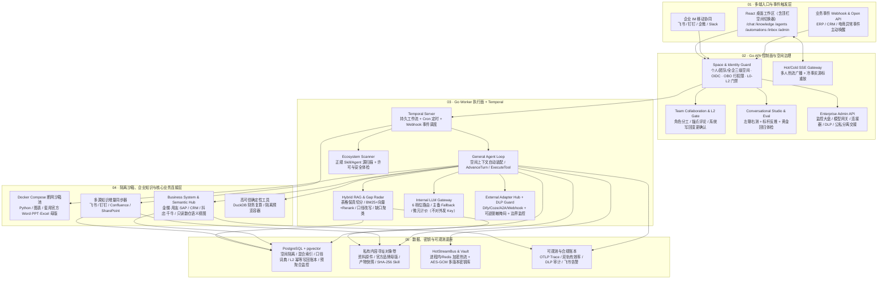

# Agent Alliance vNext 技术架构与工程演进规格

版本：vNext 1.2 · 2026 年 11 月 25 日  
定位：面向企业自部署 Personal Agent 与团队空间协同平台的完整工程架构（对齐 [vNext 产品方案 v1.2](18-vnext-product-ia.md)）  
配套资产：[五层高清系统架构图 (SVG)](architecture/vnext-architecture.svg) · [全栈研发路线图 (22-vnext-roadmap-todo.md)](22-vnext-roadmap-todo.md)

---

## 1. 核心架构演进总览

在已落地的 **通用 Agent Loop、Docker Compose 断网隔离沙箱、内部 6 档位 LLM Gateway、冷热分离 SSE、团队多人协同与生态定期扫描** 基础上，vNext 1.2 针对企业真实生产纵深补齐 **六大企业级底座引擎**：

| 企业纵深领域 | 核心工程痛点 | vNext 1.2 架构解法 |
| :--- | :--- | :--- |
| **空间隔离与资产继承** | 员工私人探索与部门正式资产混杂；员工转岗/离职时要么泄露私聊隐私、要么带走部门配置导致断档 | 建立 **`Personal Space / Team Space / Company Commons` 三级容器模型**；会话自动装配当前空间上下文；离职交接严格执行**个人空间隔离封存 + 团队空间事务级平移** |
| **企业知识库与混合检索** | 单次传附件或单篇文档拉取无法承载企业制度库；跨页表格被切碎、新旧制度打架、不知道员工搜不到什么 | 升级**文件夹/空间级增量同步 + 版面/表格保真切分 + `BM25 + BGE 向量 + Cross-Encoder Rerank` + 实时 ACL/失效阻断 + 知识缺口与冲突雷达** |
| **ERP/CRM/电商与数仓打通** | 大模型裸写 SQL 极易猜错字段算错毛利；共用 AI 易引发越权查他人客户；AI 误写回核心系统风险不可控 | 构建 **Business Connector Hub + 受控业务语义视图（Semantic Layer）+ OBO 用户级行权限透传 + 读 L0 / 写 L2 两阶段变更预览与幂等回执对账** |
| **术语口径与交付格式标准** | 内部黑话缩写搜不到、各部门指标公式不一；沙箱生成的 Word/PPT/Excel 不符合公司红头/VI 模板 | 引入**企业黑话与指标口径中心（Glossary & Metric Hub）**双路注入检索与取数；沙箱只读挂载**官方品牌交付母版库（Brand Kit）**原生套版生成 |
| **业务事件主动唤醒** | 仅有聊天被动响应与固定 Cron 定时，无法在电商差评激增、CRM 大单创建、库存告急时第一时间介入 | 新增 **Event Trigger Gateway**（Webhook 验签 + 防抖去重 + Temporal 唤醒对应团队空间 Agent 备好处置草稿并推飞书拍板） |
| **外部 DLP 脱敏与回归体检** | 打通真实客户与底价数据后，调用外部商业 Agent 存在泄密隐患；切换网关主力模型缺少业务准确性验证 | 在 `policy` 边界内置 **DLP 敏感识别与可逆令牌脱敏网关**（内畅外严）；新增 **Golden Eval 回归体检工作流**护航模型与知识升级 |

---

## 2. 总体系统架构全景

沿用**单企业独立自部署实例**拓扑（Docker Compose 首发，K8s 可选），所有知识、业务连接凭据与审计账本均留在企业内网可控边界内：

---

## 3. 核心子系统技术设计

### 3.1 通用 Agent Loop 与空间上下文自动装配
保留 `harness`（纯决策）与 `runtime`（事务/权限/账本/I/O）分层：
1. **统一模型调用契约**：原生支持 `ModelTier`（`default | fast | reasoning | vision | image | embedding`）、`tool_calls`、`reasoning_content` 与精确微元核算（`PromptTokens / CompletionTokens / CachedPromptTokens / CostMicroCny`）。
2. **空间上下文自动装配（`AdvanceTurnActivity`）**：
   每次进入回合前，按当前会话所属 `space_id` 实时复核成员访问权，并按优先级自动装配上下文：
   `任务短期工作集 → 当前空间（个人知识夹 或 团队共享知识库 + 团队业务数据视图 + 团队术语口径 + 团队红线规则 + 默认交付母版）→ 全企公共底座（Company Commons）`。
3. **停滞检测与安全压缩**：比较 `hash(tool_name + normalized_args + source_revisions + unresolved_objects)` 防死循环；压缩时成对保留 `tool_call/result` 与来源页码锚点，资料或空间撤权后自动触发加密摘要重建。

### 3.2 Docker Compose 断网隔离沙箱与 MCP 层
- **沙箱隔离（`deploy/application.yaml`）**：运行于独立断网网络 `sandbox-internal: internal: true`；只读挂载 `/workspace/inputs:ro` 与当前空间品牌母版 `/workspace/templates:ro`，可写输出 `/workspace/outputs:rw`；只读根、`cap_drop: [ALL]`、零凭据注入、硬限 CPU/RAM/60s 超时。
- **MCP Client Hub**：支持 `Streamable HTTP` 与 `SSE`，工具按空间/团队授权注入，凭据由 `Vault` 代填，区分只读 `L0` 与外部写入 `L2`。

### 3.3 内部全局模型网关（Internal LLM Gateway）
- **职责红线**：仅服务平台内置 Personal Agent、员工自然语言自建 Agent、混合检索重排/向量与构建器推理；**绝不向外部 Agent 签发代理 Key**。
- **核心表结构**：`model_providers`、`model_catalog`（版本化微元单价表）、`model_tier_routes`（6 档主备与 3s 熔断降级）、`budget_policies`（企业 / 团队空间 / 成员三级月度静默扣减与 80%/100% 告警）。

### 3.4 外部 Agent 多协议适配层（Adapter Hub）
- 内置 `openai_compat`（含 **Dify / Coze / FastGPT / LangGraph** 模板）、`a2a_jsonrpc`、`async_webhook` 与 `mcp_server`。
- 动态出站域名白名单 `outbound_host_allowlist` + DNS/IP SSRF 防护；自动注入 `X-Alliance-Run-Id / traceparent` 并解析可选 `usage` / `X-Alliance-Trace-Url`（未上报记 `undisclosed`）。

### 3.5 左聊右测对话式构建器（Conversational Studio）
- Meta-Agent 接收自然语言 + 1–3 份标杆样例（仅提炼大纲/列结构/风格，剥离原始敏感业务行），支持右侧试聊「指哪改哪」生成增量 `Patch Diff`；支持 `personal（零审批即用）/ team（绑定团队空间共享）/ enterprise（冻结依赖清单审批上架）`。

### 3.6 热冷分离 Web SSE 架构
- **冷事实（PostgreSQL）**：关键状态变迁落库并由 `LISTEN/NOTIFY` 唤醒游标重放；
- **热流（`HotStreamBus`：单机进程内 PubSub / 多副本加密 Redis Streams）**：承载 Token/思考 Delta、在线头像栈、行内评论与沙箱日志，零高频轮询写放大。

### 3.7 企业级预聚合监控与双轨成功率
- 采集轻量隐式正向信号（下载/复制/👍/深化追问）计算 `lightweight_effective_rate`，与人工显式审签/L2 确认的 `collab_approval_rate` 分列聚合至 `monitor_agent_hourly_stats` 与 `monitor_model_hourly_stats`，支撑毫秒级大盘、OTel Trace 瀑布流与飞书告警。

### 3.8 团队多人实时协同引擎
- 单人线程零迁移升级多人任务（`task_participants`：`owner / contributor / reviewer / approver`）；共享 Canvas 支持表格行/段落锚点评论（`artifact_comments`）、`@同事` 推飞书待办、`@Agent` 局部重算及 `expected_version` 乐观锁防覆盖。

### 3.9 正规生态定期扫描与受控加载引擎
- `EcosystemScanWorkflow` 定时拉取官方 MCP Registry、主流 `SKILL.md` 仓库、A2A 目录与企业内网 Git，在隔离容器完成许可证分类与静态安全体检；管理员批准后按 **SHA-256** 固化至 `/data/objects/skills/`，支持个人或团队空间自主一键加载。

---

### 3.10 三级空间管理与公私分离交接引擎（v1.2 新增）

1. **核心数据模型**
   - `spaces(id, kind, owner_member_id, team_id, slug, name, description, custom_instructions, default_template_id, archived_at)`：
     - `kind = 'personal'`：每位在职成员自动拥有唯一默认个人空间，严格校验 `actor == owner_member_id`（管理员审计接口亦默认不可读取个人空间会话正文与私有知识夹）；
     - `kind = 'team'`：对应部门或跨部门专项作战室，挂载共享知识库、业务连接器视图、术语口径、母版与共享任务；
     - `kind = 'commons'`：全企唯一公共底座空间，按可见部门范围向全体在职成员提供只读制度、全局术语与公司官方母版。
   - `space_members(space_id, member_id, role, granted_by, created_at)`：支持 `space_admin`（空间自治管理员）、`member`（空间正式成员）、`guest`（跨部门受邀协作者，仅访问授权子集）。
   - **一键流转事务（Promote to Team Space）**：支持将个人空间的草稿成果或私有 Agent 通过拷贝新不可变版本发布至目标 `team` 空间，自动剥离未显式勾选的个人私密对话上下文。
2. **公私分离的岗位交接事务（升级 `identity/offboarding.go`）**
   - 调岗（移出某 `team` 空间）或离职（`departed_at` 置位）时，在同一 PostgreSQL 串行化锁事务中分流处理：
     - **个人空间资产**：立即吊销其登录会话与外部 OBO 令牌，个人空间私聊与个人草稿置为 `sealed_private` 并按企业合规保留期自动清理，不移交给继任同事；
     - **团队空间资产**：将其在目标团队空间名下的 `kb_documents` 维护权、`business_connector_bindings`（切换为继任者或服务账号授权）、`event_triggers`、`automation_schedules`、`team` 级 Agent 及未结审签单原子平移给已在该空间的继任成员。

---

### 3.11 企业知识库、权限感知混合检索与知识缺口雷达（v1.2 新增）

将现有 `knowledge/`、`knowledgesync/` 与 `retrieval/` 升级为完整的企业级 RAG 底座：

1. **多源目录级增量同步与版面保真解析**
   - `kb_collections(id, space_id, name, sync_provider, remote_root_id, sync_cron, acl_mode, last_synced_at)`：将 `knowledgesync` 从单文档 ID 扩展至飞书知识空间/文件夹、钉钉文档库、Confluence Space、SharePoint/S3 前缀的增量树同步（基于远端 `revision / etag` 仅重算变更文档）。
   - `kb_documents(id, collection_id, space_id, title, doc_status, effective_from, effective_until, authority_level, source_acl_principals, current_object_hash)`：明确维护 `active（现行有效）/ archived（历史归档）/ deprecated（已作废）`。
   - **结构与表格保真切分（`kb_chunks`）**：解析器提取章节面包屑路径（如 `采购制度 > 第四章 比价标准 > 4.2 免招标情形`），对跨页表格与多 Sheet Excel 保持表头与行记录结构完整注入切块，扫描件自动走内置 OCR 管线。
2. **三路混合检索 + 术语改写 + 实时 ACL 复核**
   - **检索前改写**：自动匹配当前空间与全企底座的 `enterprise_glossary` 同义词/缩写扩展查询词；
   - **混合召回与重排**：并行执行 PostgreSQL 全文/BM25 检索（精准命中型号、单号、法条号）与 `pgvector` BGE-M3 稠密向量检索，融合 `authority_level` 与生效期衰减（自动排除 `deprecated` 文档），经本地 Cross-Encoder Rerank 输出 Top-K 证据块与精确页码/行号锚点 `citation_anchor`；
   - **双阶段权限门禁**：SQL 召回阶段强制带 `space_id` 与 `source_acl_principals` 过滤；注入模型前再次实时复核源文档未撤权、未作废。
3. **知识缺口与制度冲突雷达（Knowledge Gap & Conflict Radar）**
   - `kb_gap_events` & 定时聚类任务：当知识检索最高 Rerank 分数低于阈值或模型判定“现有知识库无依据”时，对问题做去隐私化清洗（剥离人名/金额/单号）后按语义向量聚类生成 `kb_gap_clusters(space_id, topic_summary, ask_count, sample_masked_queries, assignee_id, status)`；
   - **冲突巡检**：入库或周期扫描时检测同一空间内两份 `active` 文档在同一实体/阈值上的矛盾表述（如两份差旅文件对住宿上限描述不一致），写入 `kb_conflict_alerts` 供空间管理员一键消歧。

---

### 3.12 企业业务系统打通、语义层与 L2 写回对账引擎（v1.2 新增）

1. **统一连接器与四类驱动（`internal/bizconnectors` + `connectors/`）**
   - `business_connectors(id, space_id, category, driver, name, endpoint, auth_mode, vault_secret_id, health_status)`：
     - `saas_pack`：预置 **ERP**（金蝶云星空、用友 BIP、SAP、聚水潭/旺店通）、**CRM**（纷享销客、销售易、Salesforce、飞书客户）、**电商/工单**（抖店、千牛、京东、Shopify、有赞、售后工单）标准读写操作集；
     - `readonly_sql`：支持 MySQL / PostgreSQL / ClickHouse / StarRocks 只读连接，SQL 执行器内置 AST 语法树强校验（仅允许 `SELECT`，强制附加 `LIMIT` 与 `5s` 查询超时，拒绝系统表探测）；
     - `openapi_rest`：导入 Swagger/OpenAPI 3.0 Schema 自动映射受控工具；
     - `browser_rpa_readonly`：内网老系统受控只读表格采集。
2. **受控业务语义层与企业术语口径中心（Semantic Views & Metric Hub）**
   - `enterprise_glossary(id, space_id, term, aliases, definition, metric_formula, verified_by)`：统一管理企业黑话缩写与核心经营指标公式；
   - `semantic_data_views(id, connector_id, space_id, view_name, business_desc, allowed_dimensions, verified_metrics_json, rls_column_mapping)`：向通用 Loop 暴露业务可读的数据视图而非底层百张裸表；每次取数返回结果自动附带结构化 **`QueryProvenance`（数据源、语义视图名、时间范围、注入的行权限与口径公式）** 渲染为对话内「取数口径说明卡」。
3. **身份透传行级权限（OBO / RLS）与 L2 两阶段幂等写回**
   - **读操作（L0 直达）**：支持员工级 OAuth2 On-Behalf-Of 令牌或将平台认证的 `member_email / employee_no / dept_code` 强制绑定到查询过滤谓词（RLS），模型无法篡改过滤条件；
   - **写操作（L2 强制门禁）**：所有写回业务系统的动作统一落入 `pending_system_mutations(id, run_id, space_id, connector_id, action_name, target_record_key, before_snapshot, proposed_after, idempotency_key, status, approved_by, external_receipt_no)`：
     1. Runtime 生成变更对比预览卡并挂起 Workflow；
     2. 有权责任人在桌面或飞书卡片核对“原值 → 新值”后点击确认；
     3. Worker 携带唯一 `idempotency_key` 调用下游 ERP/CRM/电商写接口，记录返回的正式业务单号 `external_receipt_no`（超时未知状态自动走查询对账，绝不重复下单或重复退款）。

---

### 3.13 官方品牌交付母版引擎（Corporate Templates & Brand Kit）

- 新增 `corporate_templates(id, space_id, doc_type, name, object_hash, theme_palette_json, slot_manifest_json, is_default)`（支持 `.pptx` 演示母版、`.docx` 公文/合同红头模板、`.xlsx` 标准财务/比价样表）。
- 沙箱执行文档生成任务时，Runtime 将当前空间默认或用户 `@` 指定的母版文件按只读方式挂载至 `/workspace/templates/`，内置模板渲染辅助库直接基于母版母页（Slide Layouts / Word Styles / Excel 公式表头）填充内容，确保字体、配色、页眉 Logo 与版式 100% 合规。

---

### 3.14 业务事件驱动唤醒网关（Business Event Triggers）

- 新增 `event_triggers(id, space_id, name, connector_id, webhook_path_token, hmac_secret_vault_id, event_filter_cel, dedup_key_expr, cooldown_sec, agent_id, notify_targets, enabled)`。
- **执行链路**：外部 ERP/CRM/电商推送 Webhook → `POST /api/webhooks/events/{token}` 验签校验 → 提取业务事件去重键与冷却时间窗（防风暴刷屏）→ 启动对应团队空间的 `GeneralAgentWorkflow`（自动拉取知识库 SOP 与关联系统详情）→ 产出分析简报或 L2 写回预览单 → 推送飞书/钉钉交互卡片供负责人一键审批。

---

### 3.15 DLP 敏感数据脱敏护栏与企业黄金回归体检（DLP & Eval Suite）

1. **内外分级的 DLP 敏感护栏（扩展 `internal/policy`）**
   - 内置高性能 `DLPScanner`：结合正则校验和（身份证校验位、银行卡 Luhn、手机号、邮箱）、企业自定义敏感词表（底价字段、未公开代号）及知识库/语义视图的密级标签（`public / internal / confidential / secret`）；
   - **执行策略**：发往企业内网自托管/签约专有网关的模型与断网沙箱按空间权限正常流转；一旦目标为 `Purpose == external_agent`（第三方外部商业 Agent）或跨空间公开导出：
     - `confidential` 数据默认启用**可逆占位符脱敏（Reversible Tokenization）**：出站前将敏感实体替换为 `[CUST_NAME_1]`、`[MOBILE_1]`（映射表加密暂存于当前 `run_id` 内存/PG 作用域），外部返回后在平台内还原展示；
     - `secret` 级数据默认直接阻断外发或强制要求管理员 L2 放行，全量记入 `dlp_egress_audit_logs`。
2. **企业黄金回归体检引擎（`internal/evalsuite`）**
   - `eval_suites(id, space_id, agent_id, name)`、`eval_cases(id, suite_id, input_prompt, fixture_files, expected_facts_json, numeric_tolerance)`、`eval_runs(id, suite_id, candidate_model_id, pass_rate, avg_latency_ms, diff_report_json)`；
   - 支持从团队空间真实满意对话一键脱敏转为体检用例；管理员在切换模型网关主模型或大改知识库前，由 Temporal 并发跑批体检并输出回归对比报告。

---

## 4. 分阶段演进路线（承接已完成底座，推进企业纵深）

| 阶段 | 状态 | 核心交付范围 | 关键验收门槛 |
| :--- | :--- | :--- | :--- |
| **Phase 1–4 · Personal Agent 与协同/生态底座** | **核心代码已就位**（持续实测加固） | 内部 6 档位 LLM Gateway、预聚合监控与双轨有效率、仿三巨头桌面工作区、团队拉人协同与行内评论、通用 Agent Loop + Docker Compose 断网沙箱 + MCP、冷热分离 SSE、左聊右测 Studio、多协议外部接入与生态定期扫描市场 | 供应商真实账单对齐、IM 企业租户实测、沙箱断网隔离压测持续通过 |
| **Phase 5 · 三级空间、企业级混合知识库与标准资产库** | **本轮新增规划** | 落地个人/团队/全企三级空间与侧栏切换器、公私分离调岗/离职交接；升级目录级多源知识增量同步、表格保真切分、`BM25+向量+Rerank` 混合检索、页码溯源、知识缺口与冲突雷达；上线企业术语口径库与官方 Word/PPT/Excel 交付母版引擎 | 个人空间私密零越权；跨页表格与制度问答召回准确率 ≥ 90%；撤权/作废毫秒级阻断；沙箱输出 100% 套用公司母版 |
| **Phase 6 · ERP/CRM/电商连接语义层、事件唤醒、DLP 与回归体检** | **本轮新增规划** | 上线金蝶/用友/CRM/抖店/只读数仓连接器与业务数据语义视图、OBO 行级权限、L2 两阶段幂等写回确认卡；上线业务事件 Webhook 主动唤醒；落地外部 Agent 可逆 DLP 脱敏护栏与黄金回归体检集 | 销售 A 零可能查出销售 B 客户数据；L2 写回 100% 幂等无重单；外部调用敏感字段 100% 脱敏留痕；换模型前一键输出体检对比报告 |
