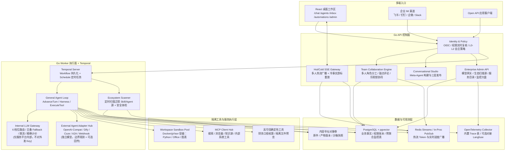

# Agent Alliance vNext 技术架构与工程演进规格

版本：vNext 1.0 · 2026 年 11 月 24 日  
定位：面向企业自部署 Personal Agent 平台的工程演进蓝图（承接 [v0.1.52 已发布基线](archive/11-technical-blueprint.md#platform-implementation-baseline)，对齐 [vNext 产品方案](18-vnext-product-ia.md)）  
约束说明：本阶段仅定版技术架构与接口契约，暂不改动业务代码。

---

## 1. 核心架构诊断与演进目标

对照现有代码基线（Go API + Go Worker + Temporal + PostgreSQL + React 前端），当前工程底座的**安全、权限、版本冻结、幂等账本与恢复能力极强**，但存在 5 个制约 Personal Agent 体验与企业监控能力的关键瓶颈：

| 当前代码瓶颈（v0.1.52） | 业务影响 | vNext 架构解法 |
| :--- | :--- | :--- |
| **按单场景堆砌特化表与特化 Activity**（已有 157 个 SQL 迁移；`lookup_turn`、`lookup_batch`、`office_choice`、`report_choice` 各自独立） | 每加一个 Personal Agent 技能都要写表、写迁移、写专用 Activity，研发成本指数级膨胀 | 收敛为一套**通用有界 Agent Loop（`AdvanceTurn` + `ExecuteTool`）+ 隔离容器沙箱 + 标准 MCP Client** |
| **`resources/model.go` 未原生支持 `tool_calls`、Reasoning 流式及 Token 细项，硬编码 `max_tokens: 1800`** | 无法支撑多轮工具调用、长文档生成与精确费用核算 | 重构为独立 **`llmgateway` 全局模型网关模块**（原生 Tool Calling、逻辑档位路由、Fallback、限流、Input/Output/Cached 精确计价） |
| **外部 Agent 仅支持 A2A JSON-RPC 且强依赖环境变量 `AGENT_ALLOWED_HOSTS`** | 接入内部自研（FastAPI/Dify/Coze/LangGraph）与第三方商业 Agent 门槛极高，加白名单要重启服务 | 构建 **Adapter Hub 多协议适配层** + 管理员界面化域名白名单 + SSRF 防护 + 边界观测与可选用量回传 |
| **桌面 SSE 依赖高频写 PG `project_session_events` 并轮询补读** | 并发人多且流式 Token + 工具状态频繁推送时，PostgreSQL 写放大严重 | 改为**热冷分离流架构**：热流（Token/Thinking Delta）走内存 PubSub/Redis Streams，冷事实（Turn/Observation/Artifact）事务落 PG |
| **监控 `monitor/usage.sql` 仅按人维度实时全表扫描聚合，无 Agent/模型/延迟/趋势维度** | 管理者看不到哪个 Agent 好用/耗时/费钱，数据量大后查询变慢 | 增加**小时/天预聚合指标表**、双轨有效完成率隐式埋点、实时队列视图、异常告警推送与标准 OTel Trace 导出 |

---

## 2. 总体系统架构全景

沿用**单企业独立自部署实例**拓扑，保持部署运维简洁（Docker Compose 首发，K8s Helm 可选）：



---

## 3. 核心子系统技术设计

### 3.1 通用 Agent Loop 与 Harness 升级

保留现有 `backend/internal/harness` 与 `backend/internal/runtime` 的职责分离（Harness 纯决策、Runtime 管事务/权限/账本/I/O），将其从特化场景升级为通用循环：

1. **统一模型调用契约（替换 `resources/model.go` 的简化结构）**
   ```go
   type ChatRequest struct {
       Tier            ModelTier        // default | fast | reasoning | vision | image | embedding
       ExplicitModelID string           // 仅管理员试跑或特殊绑定时指定，业务 Agent 默认按 Tier
       Messages        []ChatMessage    // 支持 system / user / assistant(tool_calls, reasoning) / tool(tool_call_id)
       Tools           []ToolDefinition // 标准 JSON Schema
       MaxTokens       int              // 由模型档位配置动态决定（如 8192/16384），废弃硬编码 1800
       ReasoningEffort string           // none | low | medium | high
       Stream          bool
   }

   type TokenUsage struct {
       PromptTokens       int64
       CompletionTokens   int64
       CachedPromptTokens int64
       ReasoningTokens    int64
       CostMicroCny       int64         // 按单价表精确核算（微元，避免浮点误差）
   }
   ```
2. **仅保留两类通用执行 Activity（由 Temporal Workflow 编排）**
   - `AdvanceTurnActivity`：拉取当前授权工作集（含短期消息、有效个人偏好、适用团队规则、已授权资料索引），调用 `LLM Gateway` 生成决策（回复正文 / `tool_calls` / `delegate_external` / `ask_user` / `finish`），先落冷事实检查点。
   - `ExecuteToolActivity`：先经 `AutonomyPolicy.Evaluate(action, actor, budget)` 判定属于 **L0 / L1 / L2**：
     - **L0**：直接派发至 Sandbox / MCP / Trusted Tool，结果写回对象卷与观察表；
     - **L1/L2**：持久化待办卡片并挂起 Workflow，等待用户从桌面或 IM 确认（复用现有控制修订防并发重放机制）。
3. **停滞检测与上下文压缩（沿用并增强现有设计）**
   - 停滞指纹 = `hash(tool_name + normalized_args + source_revisions + unresolved_objects)`；连续 2 轮无新增观察或证据覆盖时自动跳出循环，给出可读的缺口说明而非空烧 Token。
   - 压缩策略：永远保留 `System Prompt`、最新用户纠偏、未闭合的 `tool_call / tool_result` 配对及来源版本号；超长工具输出先转存对象卷，仅向模型注入摘要 + 行号引用。

### 3.2 隔离沙箱工作区（Workspace Sandbox Pool）与 MCP 层

- **沙箱隔离规格（已确认：基于现有 Docker Compose 实现）**：
  - 在现有 `deploy/application.yaml` 体系内新增受控隔离容器池（独立 `sandbox-internal: internal: true` 内部断网网络，无需强依赖 K8s；支持常驻预热实例保证 `< 1.5s` 响应）。
  - **严格安全边界**：每个 Task 独立只读挂载授权原件目录 `/workspace/inputs:ro`、独立可写输出目录 `/workspace/outputs:rw`；容器默认**无外网权限**（防止 Prompt Injection 外泄企业文件），无宿主机环境变量与任何凭据；硬限制 `CPU 1–2 Core / RAM 1–2 GiB / 单次命令 60s / 总磁盘 512 MiB`。
  - **预装办公与分析套件**：Python 3.12、`pandas`、`openpyxl`、`python-docx`、`python-pptx`、`pypdf`、`matplotlib`、`pillow`、`duckdb`、中文字体包（解决图表中文乱码）。
  - 任务产出落盘至 `/workspace/outputs` 后，由 Runtime 自动扫描内容哈希、登记为受控 Artifact 版本并生成预览（复用现有隔离 `preview` 容器）。
- **MCP Client Hub**：
  - 统一支持 `Streamable HTTP` 与 `SSE` 传输的企业 MCP Server；每个 MCP Tool 在管理员注册时声明风险等级（默认 `read_only -> L0`，`write_external -> L2`）与可见组织范围；凭据由现有 `Vault`（AES-GCM）集中加密存储，运行期由适配层注入，永不暴露给模型上下文。

### 3.3 全局模型资源池与网关（Internal LLM Gateway）

- **定位红线（已冻结决策）**：仅作为企业内部平台底座，**统一为平台内置 Personal Agent、员工自然语言自建 Agent、对话规划与 Meta-Agent 构建器提供模型供给**；**不对外暴露代理端口，也不向外部接入 Agent 签发平台虚拟 Key**。
- **数据模型**：
  - `model_providers`：供应商（`bailian / ark / deepseek / openai / anthropic / gemini / vllm_local`）、Base URL、加密 API Key（复用 `Vault`）、健康状态、探测时间。
  - `model_catalog`：模型标识、所属供应商、上下文窗口、最大输出、能力标签（`tool_call / vision / reasoning / image / embedding`）、**生效版本化单价表**（`input_per_1m_micro_cny`、`output_per_1m_micro_cny`、`cached_per_1m_micro_cny`、`per_image_micro_cny`）。
  - `model_tier_routes`：6 个逻辑档位（`default / fast / reasoning / vision / image / embedding`）各自的主模型、备选 Fallback 列表、权重及熔断参数（连续 3 次 5xx/429 自动降级至备选模型并触发管理员告警）。
  - `budget_policies`：支持 `enterprise / team / member` 三级月度金额与 RPM/TPM 限额；`80%` 触发软告警推送管理员，L0 日常执行静默扣减、触达硬上限或单次高额预估时才触发 L1 弹窗。

### 3.4 外部 Agent 多协议适配层（Adapter Hub）

- **完全解耦边界**：外部 Agent（第三方商业或内部自研）自主管理自身模型、Prompt 与内部编排；平台只负责统一发现、权限校验、协议转换、超时/取消、边界观测与结果版本归档。
- **支持协议与预置框架模板**：
  1. `openai_compat`（含 **Dify / Coze / FastGPT / LangGraph** 预置字段映射模板，支持 SSE 流式与同步回复）；
  2. `a2a_jsonrpc`（完整保留现有 Agent Card、`message/send`、`tasks/get`、`tasks/cancel` 与异步补件契约）；
  3. `async_webhook`（配置 Submit / Poll / Cancel 端点与 JSONPath 字段提取，适配第三方长任务商业 Agent）；
  4. `mcp_server`（按工具集挂载，可被 Personal Agent 自动委派）。
- **出站安全（替代环境变量重启）**：
  - 新增 `outbound_host_allowlist` 表由管理员在 `/admin/integrations` 动态维护；
  - HTTP Transport 层强制解析目标 IP 并拦截所有私有网段（`10.0.0.0/8`、`172.16.0.0/12`、`192.168.0.0/16`、`127.0.0.0/8`、`169.254.169.254`），除非管理员显式标记为“受信任内网自研网段”。
- **边界观测与可选用量回传协议**：
  - 平台每次请求自动附带 `X-Alliance-Run-Id`、`X-Alliance-Turn-Id`、`X-Alliance-User-Id`（脱敏工号/UUID）与 W3C `traceparent`。
  - 响应解析优先读取标准 `usage` 对象或响应头 `X-Alliance-Usage`（JSON：`{prompt_tokens, completion_tokens, cost_cny}`）及 `X-Alliance-Trace-Url`；若外部未返回，则明确记为 `disclosure_status = 'undisclosed'`，绝不伪造费用。
- **两档准入状态机**：`draft → beta（单条连通测试通过，本人/测试组立即可用）→ pending_verify → verified（通过样例/超时/取消验收并由管理员审批，全企上架）`。

### 3.5 对话式构建器（Conversational Studio）与三层发布

- **Meta-Agent 构建流水线**：
  - 接收用户自然语言与可选的 1–3 份标杆文件（经解析提取文档大纲、表头结构、风格要点，**不直接拷贝原始敏感业务数据到指令中**），输出结构化 `AgentSpec` JSON Patch（名称、描述、系统指令、意图能力开关数组、推荐模型档位、开场示例、自检清单）。
  - 右侧试聊沙盒执行「指哪改哪」时，将选中的输出片段 + 用户的纠偏意见作为增量上下文交给 Meta-Agent，生成带前后对比的 `Patch Diff` 供一键采纳。
- **三层发布约束**：
  - `scope = 'personal'`：直接置为 `active`，免审批，仅创建者可见，受个人/主团队预算保护；
  - `scope = 'team'`：要求至少 1 次试聊样例通过，生成不可变修订，团队内立即可用；
  - `scope = 'enterprise'`：锁定 `BuildManifest`（意图能力、绑定的 Skill/外部 Agent 修订），进入 `/admin/releases` 审批队列。

### 3.6 热冷分离 Web SSE 架构（已确认）

彻底替换当前 `session_events.go` 的 300ms PostgreSQL 轮询，解决高并发流式输出下的数据库写放大：
- **冷事实通道（PostgreSQL `project_session_events`）**：仅在关键业务状态变迁时事务写入——`run.started`、`turn.committed`、`tool.started/finished`、`artifact.created`、`wait.created/resolved`、`run.completed/failed`、`access.revoked`。
- **热流通道（抽象 `HotStreamBus`：Docker Compose 默认进程内 PubSub，多副本平滑切换 Redis Streams）**：承载高频 `message.delta`、`thinking.delta`、`presence.updated`、`comment.created`、`sandbox.stdout_chunk`，按 `50ms` 节流合并推送给同任务全部获授权协作成员的活跃 SSE 连接，**不逐字写 PG**。
- **断线重连与撤权一致性**：客户端断线重连携带冷事实游标 `last_event_seq`，API 先实时校验成员项目权限（无权直接发 `access.revoked` 并关闭连接），再补放缺失的冷事实快照；若当前 Turn 仍在流式生成中，补推当前内存缓冲前缀后无缝衔接热流。

### 3.7 企业级监控大盘与双轨成功率数据层

1. **隐式正向信号采集（轻量个人任务有效完成率基础）**
   新增轻量事件上报端点 `POST /api/telemetry/signals`（异步批量写入 `run_quality_signals`）：
   - 正向信号：`artifact_downloaded`、`reply_copied`、`feedback_thumbs_up`、`followup_deepen`（同线程围绕结果继续推进且未触发纠错）；
   - 负向信号：`feedback_thumbs_down`、`reply_regenerated`、`user_cancelled_midway`。
   - **双轨聚合口径**：
     - `lightweight_effective_rate` = 轻量个人任务中（`status = 'completed'` 且存在正向信号或无负向信号）/ 总轻量个人任务数；
     - `collab_approval_rate` = 协作审签任务中（经人工审核通过并交付）/ 总协作审签任务数。
2. **预聚合监控表（替代 `monitor/usage.sql` 实时扫描）**
   - Worker 侧定时聚合任务（每 5 分钟增量 Rollup）写入两张宽表：
     - `monitor_agent_hourly_stats(bucket_hour, team_id, agent_id, source_type, runs_total, runs_succeeded, runs_failed, lightweight_effective, collab_approved, p50_ms, p95_ms, prompt_tokens, completion_tokens, cached_tokens, cost_micro_cny, undisclosed_calls)`；
     - `monitor_model_hourly_stats(bucket_hour, team_id, tier, provider_id, model_id, calls_total, calls_failed, fallback_count, p50_ms, p95_ms, prompt_tokens, completion_tokens, cached_tokens, cost_micro_cny)`。
   - **大盘性能与权限**：所有趋势图、Agent 效能榜单查询走预聚合表（毫秒级响应）；查看 Trace 正文与导出财务明细继续严格复用现有 `management_grants` 独立授权与审计留痕。
3. **主动告警引擎**：每分钟巡检关键规则（外部 Agent 连续失败 ≥ N 次、档位触发主备降级、部门日消耗超均值 3 倍、月预算达 80%/100%），通过飞书/钉钉 Webhook 推送卡片告警并带去重静默期。

### 3.8 团队多人实时协同引擎（Team Collaboration Engine）

复用现有项目权限、审核反馈与并发版本机制，面向“几个人共同完成一项企业任务”重构为轻量高效的协同层：

1. **任务级动态协同升级（Single → Team Zero-Friction Upgrade）**
   - 任意单人对话线程均挂载统一 `task_id`，初始仅含发起人；点击「邀请同事协作」时在 `task_participants(task_id, member_id, role, assigned_scope, joined_at)` 写入协作成员与分工角色（`owner` 发起人、`contributor` 资料/补件人、`reviewer` 指定成果审核人、`approver` 最终交付确认人），**无需重建会话或迁移历史**。
2. **多订阅者热流协同与在线态（Presence）**
   - 同一任务的多个在线成员共用 `HotBus` 房间频道，实时同步三类轻事件：`presence.joined/left`（顶部头像栈）、`comment.created/resolved`（Canvas 行内评论与 `@同事` 提醒）、`artifact.updated`（局部重跑或新版本产出）；
   - 每个 SSE 连接独立绑定当前成员的身份与权限快照，一旦某成员被移出任务或撤权，网关**立即终止其订阅并清空前端受限缓存**。
3. **锚点评论、`@同事 / @Agent` 指派与并发冲突保护**
   - 新增 `artifact_comments(id, task_id, artifact_id, artifact_version, anchor_ref, author_id, assignee_id, body, status, resolved_by)`，支持将评论精准锚定到表格行、文档段落或 PPT 页码；
   - 评论中 `@同事` 自动写入其「待办与审核」并推送飞书/钉钉卡片；`@Agent` 则直接将该锚点上下文作为局部改稿指令投递给执行引擎，仅重算受影响部分；
   - 多人同时修订或审核同一成果时，沿用现有 `expected_version` 乐观锁事务，冲突方收到最新修订对比视图，杜绝后写静默覆盖。

### 3.9 Skill 与 Agent 生态定期扫描与受控加载引擎（Ecosystem Crawler & Curated Registry）

1. **基于 Temporal Schedule 的正规渠道定期扫描**
   - 管理员在 `/admin/integrations` 配置受信任上游扫描源表 `ecosystem_sources(id, kind, name, registry_url, schedule_cron, enabled, last_synced_at)`，内置支持：
     - **官方 MCP Registry**（标准 JSON 清单）；
     - **正规 Skill 仓库**（遵循 `SKILL.md` 规范的官方/认证开源仓库或企业私有 Git）；
     - **A2A Verified Directory**（标准 Agent Card 索引）。
   - Worker 侧由 `EcosystemScanWorkflow` 定期拉取元数据差异，支持全量/增量扫描与管理员手动触发「立即扫描同步」。
2. **自动化安全与合规静态体检（Discovery Quarantine Pipeline）**
   - 扫描器只拉取元数据与包清单进入隔离解析阶段，自动产出结构化体检报告：
     - **许可证识别**：标注 `MIT / Apache-2.0 / BSD`（绿色）与含附加限制/商业条款许可（琥珀色高亮提醒）；
     - **维护健康度**：最近提交时间、发布版本、上游 Star/官方认证标识；
     - **安全扫描摘要**：检测 `SKILL.md` 及附带脚本中是否存在越权路径遍历、隐藏外联 URL、高危 Shell 命令或明文凭据索取，输出 `passed / needs_review / blocked`。
3. **三态分层存储与企业用户自主加载**
   - `ecosystem_catalog`（发现池）：存所有扫描出的正规候选元信息、版本与体检报告，**绝不自动进入运行时**；
   - `enterprise_approved_packages`（企业准入库）：管理员点击「准入并缓存」后，平台将固定版本的 Skill 包按 **SHA-256 哈希**固化至企业私有对象卷 `/data/objects/skills/`，彻底切断运行期对公网源的依赖（内网/离线环境同样稳定可用）；外部 Agent 类条目则在准入后进入多协议向导并复用 UI 出站域名白名单；
   - `user_skill_bindings`（用户自主加载表）：普通员工在市场对**企业已准入项**可一键开关「加载到我的个人助手」或在 Studio 中按需挂载；对**新发现未准入项**点击「申请加载」写入审批队列 `/admin/releases`；
   - **升级隔离**：扫描器发现上游有新版时仅在后台生成「有新版可用 + 变更对比」提示，不自动覆盖正在使用的冻结版本，避免破坏既有业务助手。

---

## 4. 从 v0.1.52 平滑演进路线（不推倒重来）

| 阶段 | 核心交付 | 兼容性保障 | 验收硬门槛 |
| :--- | :--- | :--- | :--- |
| **Phase 1 · 模型网关与监控升级** | 落地 `llmgateway`（6 档位路由/Fallback/精确单价/原生 `tool_calls`）；新增小时预聚合监控表、隐式信号埋点与 `/admin/monitor` + `/admin/models` 接口 | 保留旧 `resources` 模型记录自动迁移为默认档位；旧运行账本只读兼容 | 断主供应商 3 秒内自动切备用无报错；Token Input/Output/Cache 核算误差为 0；大盘 30 天查询 P95 < 200ms |
| **Phase 2 · 前端外壳重构、协同工作台与统一视觉** | 引入 React Router 拆除 `<dialog>` 后台；落地常驻折叠侧栏、动态 Canvas + 团队拉人分工与锚点评论、浅/深双主题、`/admin/*` 全屏监控与模型网关 | 复用现有登录态、项目审核与 SSE 接口，旧深链 URL 自动重定向至 `/chat/:id` | 通过 5–8 名非技术员工 7 场景无引导可用性测试（[UT-01~UT-07](19-vnext-research-addendum.md#42-七个核心走查任务与观测红线)） |
| **Phase 3 · 通用 Loop、隔离沙箱与左聊右测构建器** | 上线通用 `AdvanceTurn` + `ExecuteTool` Activity、Docker/gVisor 沙箱容器池、MCP Client 与多人热冷分离 SSE；落地左聊右测 Studio 与个人私有零审批 | Temporal Workflow 按版本标记路由，历史在途运行继续沿旧步骤完成 | 同题覆盖多表汇总、标杆文件建周报助手、多人并发改稿防覆盖、沙箱断网隔离压测通过 |
| **Phase 4 · 外部接入向导、生态定期扫描市场与定时委托** | 落地 Adapter Hub（Dify/Coze/FastGPT/LangGraph/A2A/Webhook）、UI 白名单、可选用量回传、**正规渠道 Skill/Agent 定时扫描与 SHA-256 缓存加载市场**、Temporal Schedule 定时任务 | 现有 A2A Agent 与内置 Skill 自动归入已准入目录无感延续 | 3 分钟完成 Dify/FastAPI 接入 Beta；定时扫描精准识别许可/风险；已准入 Skill 一键加载即用，未准入项须经审批入库 |
