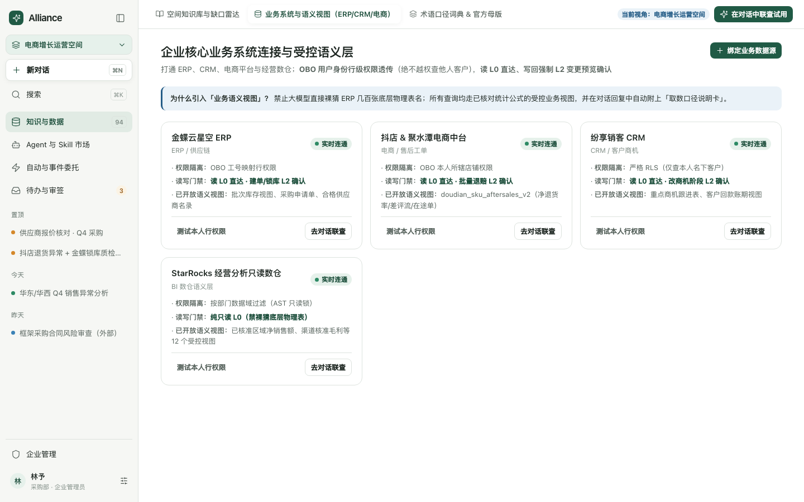
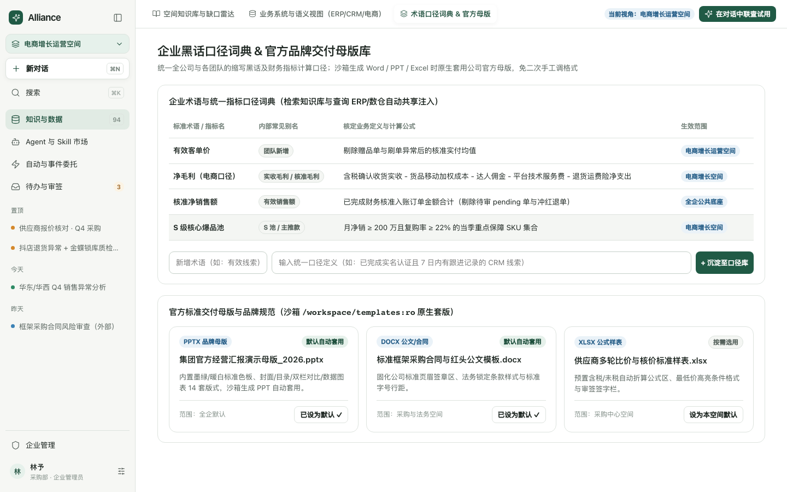
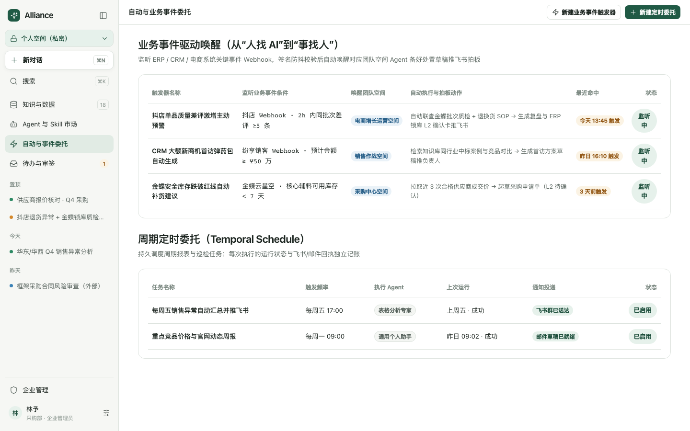
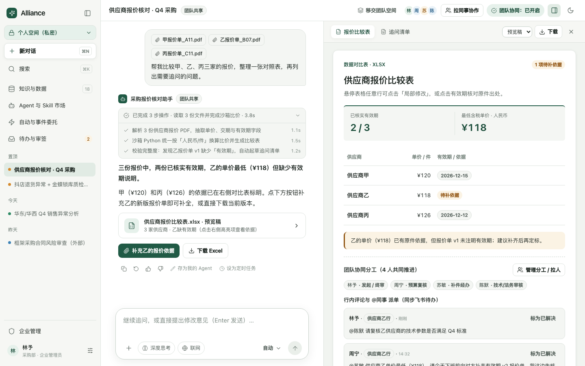
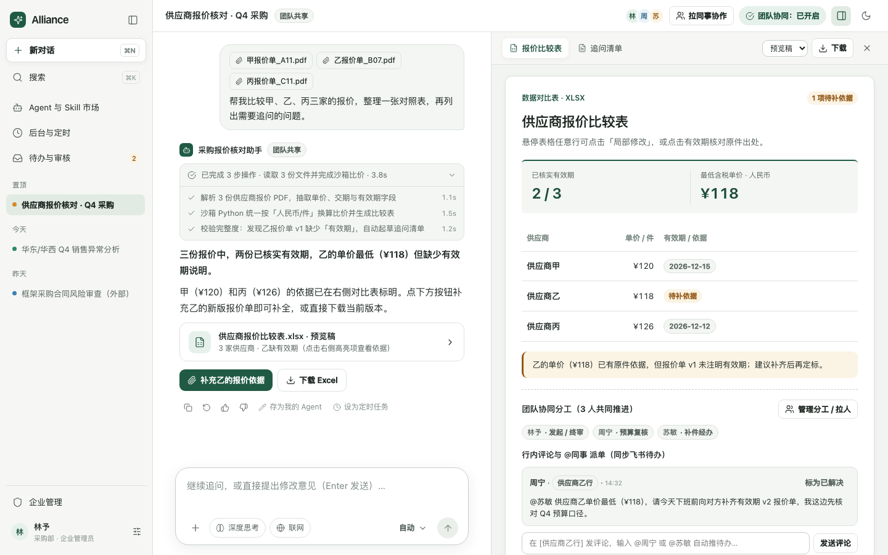
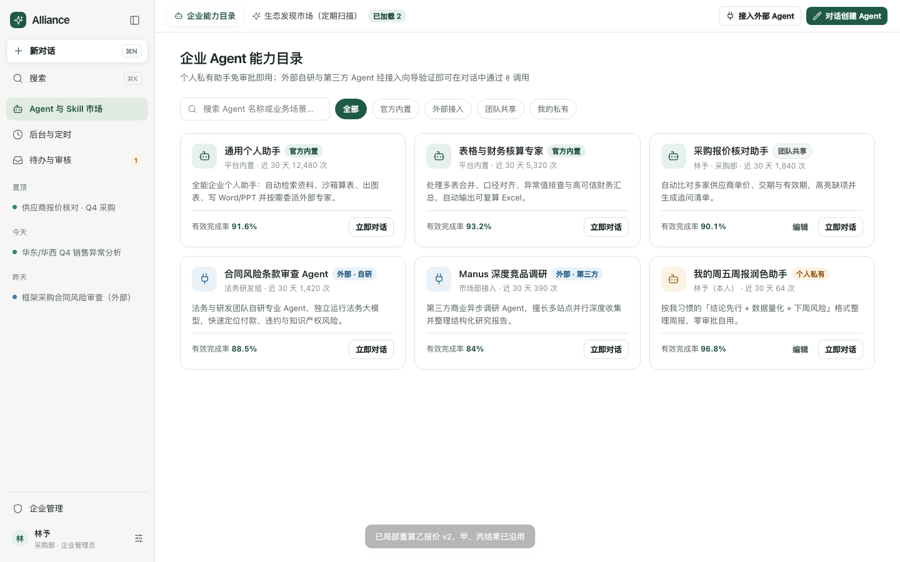
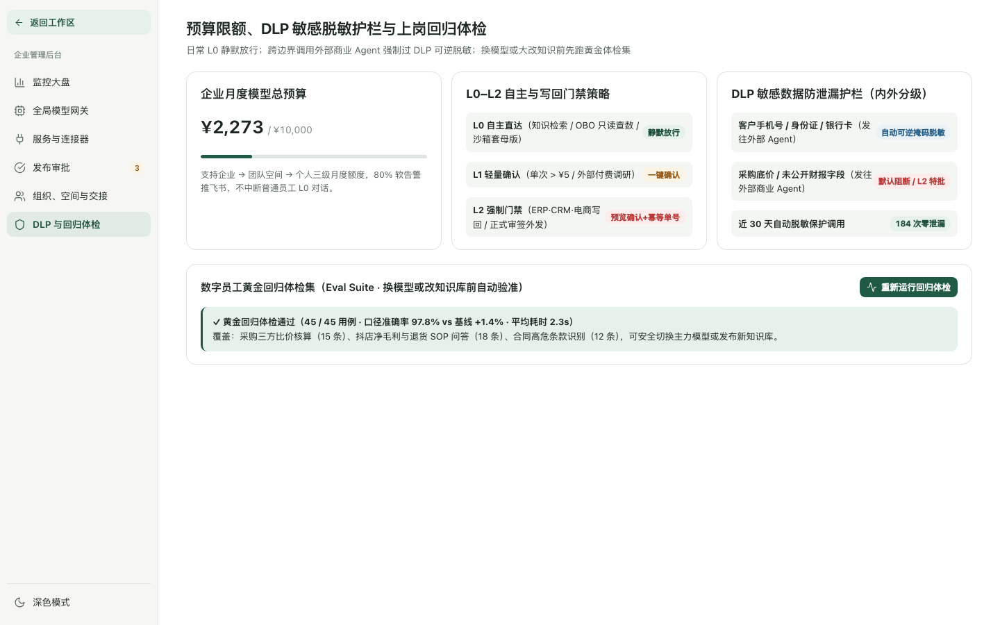
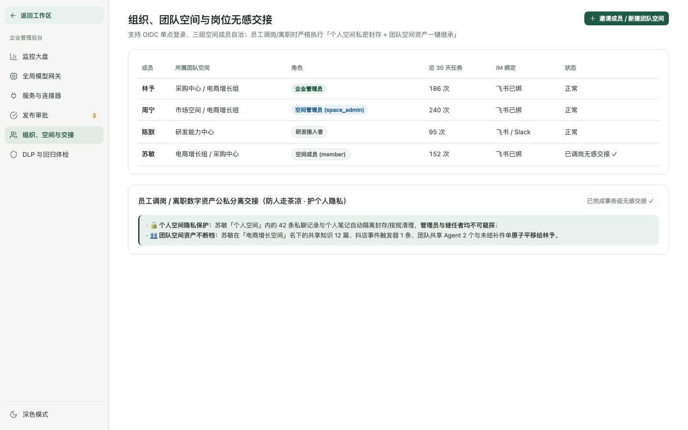
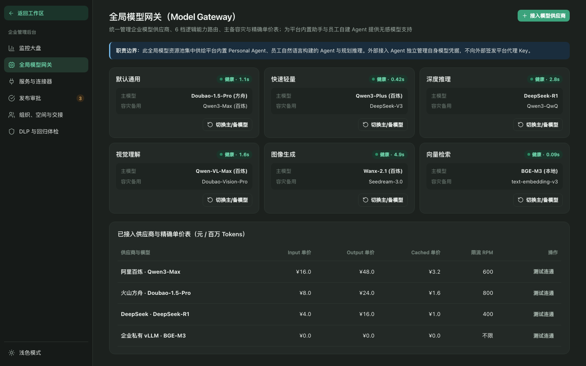
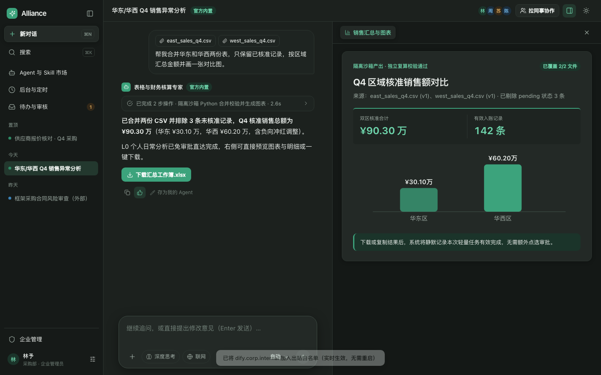

# Agent Alliance vNext 交互与视觉设计规范

版本：vNext 1.2 · 2026 年 11 月 25 日  
对标基准：布局、图标样式与微交互全面仿照 **ChatGPT、Claude、Gemini** 桌面网页版，并以极简方式承载**三级空间管理、企业知识库、ERP/CRM/电商数据打通、统一术语母版、多人协同与企业级治理**。  
视觉定调：**暖灰白纸面 + 深墨绿强调色**，原生支持**一键浅色 / 深色双主题切换**。  
可交互原型：[打开统一高保真原型（零依赖单文件）](uiux/vnext-prototype.html) · [三巨头界面逐帧对照](uiux/desktop-web-references.md)

---

## 1. 设计总原则

1. **三秒上手，空间即上下文**：员工无需每次对话前选模型、传制度、交代表格口径——侧栏顶部一键切入所属**团队空间**（如「电商增长运营空间」），新建对话即自动挂载该空间的共享知识库、业务数据源视图、黑话口径与官方交付母版；切回**个人空间**则回到绝对私密的个人工作台。
2. **默认轻量，治理门禁内嵌且高辨识**：
   - 只读查知识、按本人行级权限查 ERP/CRM/抖店数据、沙箱算表套母版均 **L0 免打扰直达**；
   - 回复内原生提供**可点击页码溯源胶囊**与**取数口径说明卡**；
   - 凡涉及**写回 ERP/CRM/电商系统**，对话内醒目呈现**「L2 系统变更预览确认卡」**（原值 → 拟变更值），人工确认后幂等写入并回填单号；调用外部商业 Agent 触发敏感字段时自动展示 **DLP 脱敏保护提示条**。
3. **重型页面全屏化，高内聚不堆菜单**：将知识库、业务系统连接器、术语口径与官方母版高内聚收拢在单一**「知识与数据」**一级入口的三组 Tab 中，侧栏始终保持清爽。

---

## 2. 统一视觉系统（Design Tokens）

### 2.1 双主题语义色板（浅色暖纸面 / 深色暖炭黑）

| Token 名称 | 浅色模式（Light · 默认） | 深色模式（Dark） | 用途说明 |
| :--- | :--- | :--- | :--- |
| `--bg-rail` | `#f6f7f4` | `#161a18` | 左侧固定导航栏与二级侧栏底色 |
| `--bg-main` | `#ffffff` | `#1c211e` | 主对话区与内容主表面 |
| `--bg-canvas` | `#f1f4f0` | `#141816` | 右侧 Canvas 背景与卡片底层画布 |
| `--bg-surface` | `#ffffff` | `#232926` | 输入框、文档纸面、KPI 卡片、弹窗表面 |
| `--bg-hover` | `#eaefea` | `#2a322e` | 导航项、按钮、表格行悬停态 |
| `--bg-active` | `#e1ebe4` | `#23382e` | 当前选中导航项、空间胶囊与激活底色 |
| `--ink-primary` | `#1d2621` | `#eef2ef` | 主标题、正文与核心数字 |
| `--ink-secondary` | `#55615b` | `#a2b0a8` | 辅助说明、次级标签、元数据 |
| `--ink-muted` | `#7d8a83` | `#73827a` | 占位符、时间戳、禁用文字 |
| `--border` | `#dde3de` | `#2d3631` | 卡片细边框、面板分隔线 |
| `--border-strong` | `#c5d0c8` | `#3e4c44` | 输入框聚焦前边框、次级按钮描边 |
| `--brand` | `#205a45` | `#3ca37c` | 主操作按钮、发送键、激活态文字与下划线 |
| `--brand-soft` | `#e6f1eb` | `#1b342a` | 品牌浅底标签、知识溯源角标、通过标识 |
| `--amber` / `--amber-soft` | `#925715` / `#fbf3e4` | `#eab362` / `#332818` | L2 写回待确认、缺项待补、知识缺口与外部未披露提醒 |
| `--danger` / `--danger-soft` | `#b83737` / `#fdecec` | `#f07474` / `#381f1f` | 报错、冲突制度预警、高密数据外发阻断 |
| `--info` / `--info-soft` | `#255d87` / `#eaf2f8` | `#74b8e8` / `#1a2d3d` | 业务数据语义视图、DLP 脱敏保护条、外部 Agent 徽章 |

### 2.2 字体、圆角与图标规范
- **字体族**：现代无衬线字体栈，所有金额、Token、耗时、库存与百分比统一启用 `font-variant-numeric: tabular-nums`。
- **圆角与图标**：主输入框 `22px`，核心卡片 `14px`，溯源与空间切换胶囊 `10px / 999px`；全站统一 **Lucide 线性图标**（`stroke-width: 1.65`）。

---

## 3. 全局外壳、空间切换器与微交互

### 3.1 常驻可折叠左侧栏 + 顶栏「空间切换器（Space Switcher）」
- **宽屏展开 `248px`**，支持 `⌘\` 折叠为 **`56px` 图标轨**。
- **自上而下排布**：
  1. **品牌与折叠行**：Alliance 标志 + 折叠键；
  2. **空间切换胶囊（Space Switcher）**：清晰显示当前空间图标与名称（如 `🔒 个人空间` 或 `👥 电商增长空间`），点击展开切换浮层：
     - **个人空间**（带「仅自己可见」私密标签）；
     - **我加入的团队空间列表**（附已挂载的知识篇数与业务连接器摘要）；
     - **底部说明条**：`已自动继承：全企公共底座（公司制度·全局口径·官方母版）`；
  3. **核心动作**：`+ 新对话 ⌘N`、`搜索 ⌘K`（跨对话、当前空间知识库、业务数据视图与 Agent 检索）；
  4. **四大工作台入口**：`知识与数据`、`Agent 与 Skill 市场`、`自动与事件委托`、`待办与审签`（含 L2 系统写回确认角标）；
  5. **当前空间的最近对话列表**（切换空间实时联动过滤）；
  6. **底部固定区**：`企业管理`（管理员可见）+ 个人账号条（浅/深色切换、视角演示切换、个人偏好、IM 绑定）。

---

## 4. 七大核心视图交互规格

### 视图 1：新对话首屏（`/chat`）
- 顶栏左上方轻胶囊直观提示当前空间上下文（如 `👥 电商增长空间 · 已挂载 94 篇知识、抖店/金蝶视图与集团 PPT 母版` 或 `🔒 个人空间 · 私密直达`）。
- 居中输入框支持 `+` 选取当前空间知识库/官方母版/本地文件、`@` 点名内置或外部 Agent、开关 `深度思考` 与 `联网`。

### 视图 2：任务对话 + 知识/数据溯源 + L2 写回确认 + 团队协同 Canvas（`/chat/:id`）
- **顶部协同与空间流转条**：支持个人空间对话一键**「移交至团队空间」**；支持**「拉同事协作」**分配角色、开启团队协同审签与切换右侧 Canvas。
- **对话内三大企业增强组件**：
  1. **可点击知识溯源角标**：如 `[电商售后退换货SOP v3 · P.6]`，点击弹出原文段落与生效状态核验；
  2. **业务数据取数口径卡（Query Provenance Bar）**：浅蓝信息条清晰列出本次查询的 `受控语义视图名`、`OBO 身份行权限范围（如：仅本人所辖店铺）` 与 `指标口径说明`，消除“数字怎么算出来的”疑虑；
  3. **L2 业务系统写回变更预览确认卡**：涉及在金蝶 ERP 建单、修改 CRM 商机或电商批量退款时，卡片并列展示 **目标系统、操作类型、关键字段「原状态 → 拟变更值」**，必须人工点击「批准写入系统（幂等执行）」后才落库并原地更新为绿色回执单号；
  4. **DLP 敏感数据保护条**：调用外部商业 Agent 时，顶部自动展示 `DLP 护栏已将手机号/底价做可逆掩码脱敏保护`。
- **右侧动态工作区 Canvas**：预览套用公司官方母版生成的表格/PPT/合同批注，支持表格行局部修改、行内评论与 `@同事` 派单及多成果正式审签交付。

### 视图 3：知识与数据工作台（`/knowledge` · v1.2 新增核心视图）
按当前选中空间（个人空间 / 团队空间 + 全企公共底座继承）展示，顶部采用高内聚 **三 Tab 结构**：
1. **Tab 1 · 知识库与缺口雷达**：
   - 顶部显示多源同步状态（飞书知识库 / 钉钉文档 / Confluence / 本地表格保真解析）与混合检索模式；
   - **空间文档清单表**：展示标题、所属层级（本团队共享 / 全企公共底座 / 个人私夹）、同步来源、状态（`现行有效` 绿标 / `已作废屏蔽` 灰标）、可见权限与原文预览；
   - **知识缺口与制度冲突雷达面板**：左列展示近 7 天高频未命中问题聚类（带询问次数与一键「指派补齐文档」），右列高亮跨文档口径/条款冲突预警。
2. **Tab 2 · 业务系统与数据视图（ERP / CRM / 电商 / 数仓）**：
   - 卡片网格展示已绑定本空间的 **金蝶云星空 ERP、抖店/聚水潭电商中台、纷享销客 CRM、StarRocks 经营数仓只读语义视图**；
   - 每张卡明确标注 **权限模式（OBO 本人行权限 / 部门只读）** 与 **读写门禁（读 L0 直达 · 写回 L2 预览确认）**，支持一键「测试行权限连通」与查看已封装的业务指标视图。
3. **Tab 3 · 术语口径词典与官方交付母版**：
   - **上半区（企业黑话与指标口径库）**：表格管理内部缩写与核心指标公式（如 `净毛利`、`核准 GMV`、`KA 二部`），支持随时新增条目，检索与查数实时共享生效；
   - **下半区（官方品牌交付母版库）**：管理 `.pptx` 品牌演示母版、`.docx` 红头合同模板、`.xlsx` 标准核价样表，支持一键设为空间默认套版。

### 视图 4：Agent 与 Skill 市场（`/agents`）
- 双 Tab：**「企业能力目录」** 与 **「生态发现市场（定期自动扫描正规渠道）」**，展示开源许可证与安全体检摘要，支持将已准入 Skill 一键加载到个人空间或团队空间。

### 视图 5：左聊右测对话式 Agent 构建器（`/agents/studio/:id`）
- 左侧对话构建 + 标杆文件反推 + 意图化开关（含绑定当前团队知识库、ERP/CRM 语义视图与官方母版）；右侧试聊沙盒 + 指哪改哪 Diff；吸底支持 `个人私有免审批 / 共享至当前团队空间 / 申请全企业上架`。

### 视图 6：自动与事件委托（`/automations` · v1.2 增强）
- 上下双区清晰呈现：**① 业务系统事件触发器（Webhook 主动唤醒 · 事找人）**（如抖店差评激增、CRM 大单新建、ERP 安全库存告警自动唤醒空间 Agent 推飞书拍板）与 **② 周期定时委托（Temporal Schedule）**。

### 视图 7：独立全屏企业管理与监控后台（`/admin/*`）
- **监控大盘（`/admin/monitor`）**：KPI、双轨达成率、四阶漏斗、Token 趋势、Agent 效能榜单、Trace 瀑布流，并含知识命中与 DLP 拦截概览；
- **全局模型网关（`/admin/models`）**：6 档能力路由主备切换 + 精确单价表；
- **服务、业务连接器与生态源（`/admin/integrations`）**：管理沙箱池、搜索、全企知识源、ERP/CRM/电商全局连接池、生态扫描源与动态域名白名单；
- **组织、空间与公私分离交接（`/admin/members`）**：成员与团队空间管理，内置**「一键调岗/离职公私分离交接面板」**（预览个人空间隐私自动封存 + 团队空间知识/连接器/触发器原子移交）；
- **预算、DLP 护栏与黄金回归体检（`/admin/governance`）**：三级静默额度、L0–L2 门禁、**外部 Agent DLP 敏感脱敏策略**、以及**黄金回归体检集一键跑批对比**。

---

## 5. 高保真原型渲染预览（1440 × 900 桌面实屏 · 共 17 张）

所有视图均已在 Chromium 离线直开自动化验证通过（0 控制台/页面报错、0 横向溢出、全交互流断言通过）。可直接打开单文件原型体验完整交互：[vnext-prototype.html](uiux/vnext-prototype.html)。

| 视图 | 预览截图 |
| :--- | :--- |
| **1. 新对话首屏（含侧栏顶栏空间切换器 · 浅色）** |  |
| **2. 知识与数据 · 空间知识库、缺口雷达与冲突巡检** |  |
| **3. 知识与数据 · ERP/CRM/电商连接器与受控业务语义视图** |  |
| **4. 知识与数据 · 企业术语口径词典与官方品牌交付母版库** |  |
| **5. 知识溯源 + 抖店/金蝶联查 + 官方母版 + L2 写回确认卡** |  |
| **6. 自动与事件委托 · 业务系统 Webhook 主动唤醒与定时任务** |  |
| **7. 团队多人协同分工与 Canvas 行内 `@同事` 评论** |  |
| **8. 采购比价对话 + 动态分栏 Canvas + 协作审签** |  |
| **9. Agent 企业能力目录** |  |
| **10. Skill 与 Agent 生态发现市场（定期扫描 + 自主加载）** |  |
| **11. 左聊右测对话式构建器（标杆样例 + 指哪改哪）** |  |
| **12. 外部 Agent 3 步多协议接入向导** |  |
| **13. 全屏企业监控大盘（浅色）** |  |
| **14. 企业治理 · 可逆 DLP 脱敏护栏与 45 条黄金回归体检集** |  |
| **15. 组织治理 · 团队空间角色与公私分离调岗/离职交接** |  |
| **16. 全局模型网关（深色模式）** |  |
| **17. 轻量 L0 沙箱分析 + Canvas（深色模式）** |  |
