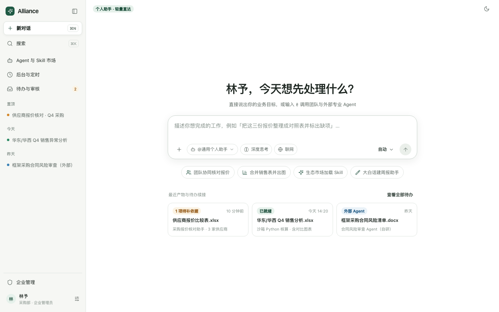
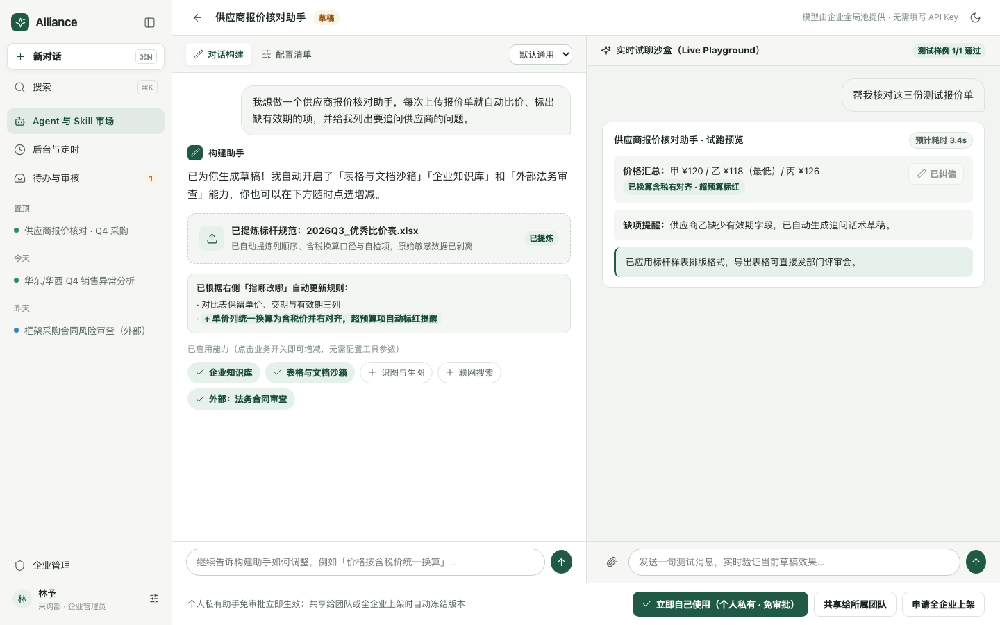
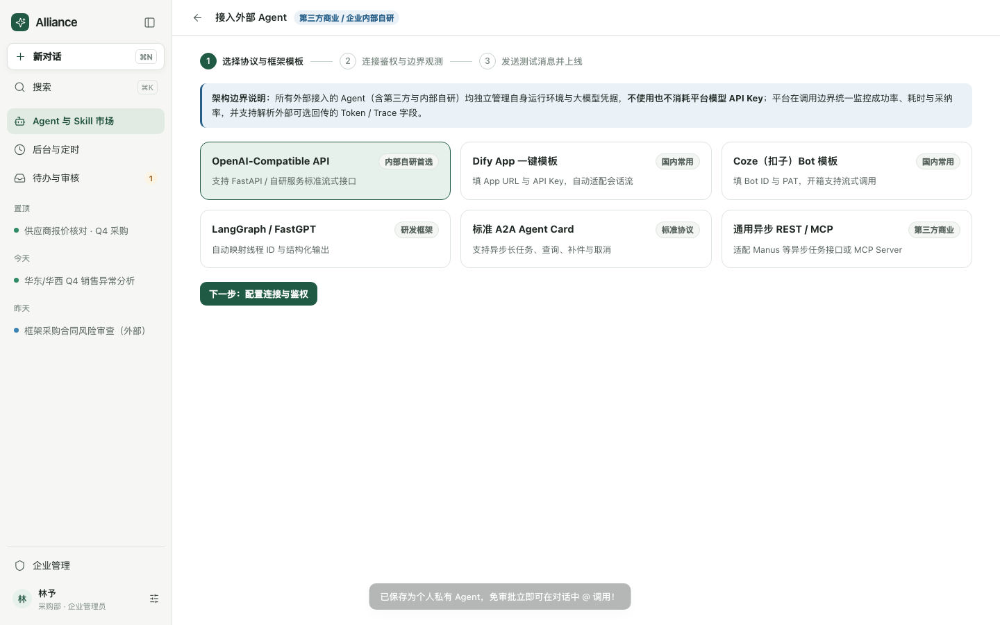
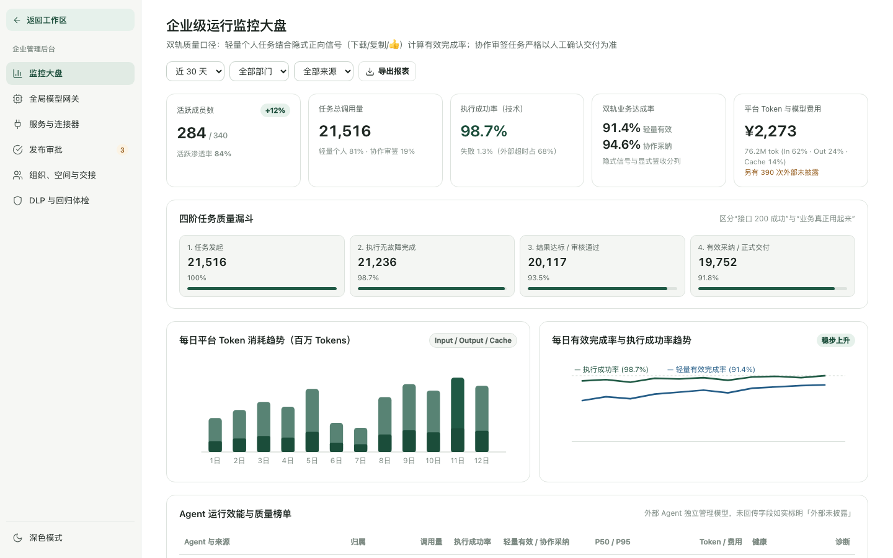
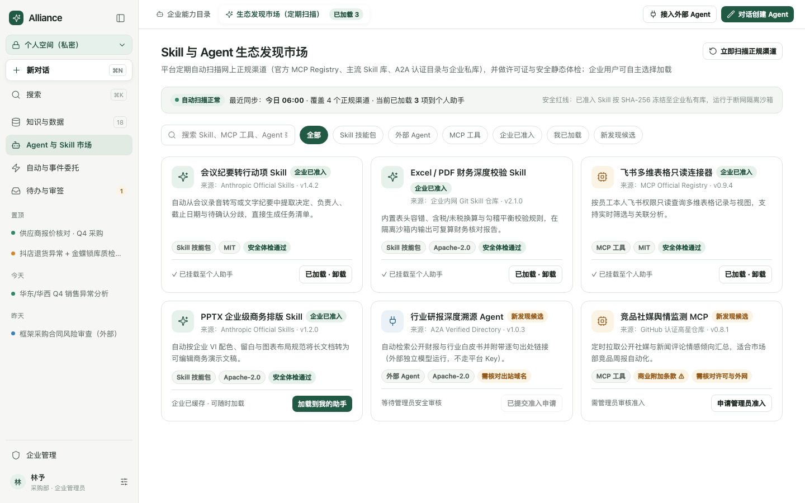

# Agent Alliance vNext 交互与视觉设计规范

版本：vNext 1.0 · 2026 年 11 月 24 日  
对标基准：布局、图标样式与交互行为全面仿照 **ChatGPT、Claude、Gemini** 桌面网页版，并融入企业级 Personal Agent 治理能力。  
视觉定调：**暖灰白纸面 + 深墨绿强调色**（延续 [execution-review.html](archive/uiux/execution-review.html) 质感），**原生支持一键浅色 / 深色双主题切换**。  
可交互原型：[打开统一高保真原型（零依赖单文件）](uiux/vnext-prototype.html) · [三巨头界面逐帧对照](uiux/desktop-web-references.md)

---

## 1. 设计总原则

1. **三秒上手（零 AI 术语门槛）**：普通员工进入即见熟悉的大圆角居中输入框与清晰左侧栏，不需要懂什么是“模型修订”“Prompt”“调用上限”“项目归属团队”就能直接干活。
2. **默认轻量，复杂能力渐进披露**：
   - 简单问答保持单栏居中；生成文档/表格/代码时自动平滑滑出右侧 **Canvas 工作区**；
   - 思考与工具调用实时动态反馈，完成后自动收起为单行折叠胶囊；
   - 日常单人工作免审批，点击顶部「协作审签」才展开版本审核与交付清单。
3. **重型页面独立全屏，绝不用窄弹窗**：Agent 广场、左聊右测构建器、外部接入向导、企业管理与监控大盘均拥有独立全屏路由空间；模态弹窗仅用于 `⌘K` 全局搜索、轻量二次确认与详情抽屉。
4. **状态清晰且克制**：严禁纯黑白灰导致的主次不清，也不做花哨的霓虹渐变；用**文字 + 语义微点**双编码表达运行、成功、待补、告警与未披露状态。

---

## 2. 统一视觉系统（Design Tokens）

### 2.1 双主题语义色板（浅色暖纸面 / 深色暖炭黑）

| Token 名称 | 浅色模式（Light · 默认） | 深色模式（Dark） | 用途说明 |
| :--- | :--- | :--- | :--- |
| `--bg-rail` | `#f6f7f4` | `#161a18` | 左侧固定导航栏与二级侧栏底色 |
| `--bg-main` | `#ffffff` | `#1c211e` | 主对话区与内容主表面 |
| `--bg-canvas` | `#f1f4f0` | `#141816` | 右侧 Canvas 背景与卡片底层画布 |
| `--bg-surface` | `#ffffff` | `#232926` | 输入框、文档纸面、KPI 卡片、弹窗表面 |
| `--bg-hover` | `#eaeFEA` | `#2a322e` | 导航项、按钮、表格行悬停态 |
| `--bg-active` | `#e1ebe4` | `#24392f` | 当前选中导航项与激活胶囊底色 |
| `--ink-primary` | `#1d2621` | `#eef2ef` | 主标题、正文与核心数字 |
| `--ink-secondary` | `#55615b` | `#9ca9a2` | 辅助说明、次级标签、元数据 |
| `--ink-muted` | `#7d8a83` | `#6f7d75` | 占位符、时间戳、禁用文字 |
| `--border` | `#dde3de` | `#2d3631` | 卡片细边框、面板分隔线 |
| `--border-strong` | `#c5d0c8` | `#3d4a43` | 输入框聚焦前边框、次级按钮描边 |
| `--brand` | `#205a45` | `#3ca37c` | 主操作按钮、发送键、激活态文字与下划线 |
| `--brand-hover` | `#174534` | `#4ab88e` | 主按钮悬停态 |
| `--brand-soft` | `#e6f1eb` | `#1b352a` | 品牌浅底标签、文件图标底色 |
| `--amber` / `--amber-soft` | `#925715` / `#fbf3e4` | `#eab362` / `#332818` | 缺项待补、L1 确认、预警告警、外部未披露提示 |
| `--danger` / `--danger-soft` | `#b83737` / `#fdecec` | `#f07474` / `#381f1f` | 失败报错、熔断、高危删除操作 |
| `--info` / `--info-soft` | `#255d87` / `#eaf2f8` | `#6cb0e0` / `#192c3b` | 外部 Agent 来源标识、Beta 试用徽章 |

### 2.2 字体与排版阶梯
- **字体族**：正文、表格、侧栏与监控大盘统一使用现代无衬线字体 `-apple-system, BlinkMacSystemFont, "PingFang SC", "Inter", "Microsoft YaHei", system-ui, sans-serif`；所有金额、Token、耗时、百分比强制启用 `font-variant-numeric: tabular-nums`（等宽对齐数字）。品牌 Wordmark 与首屏问候语可适度使用温润字重与紧凑字距（`-0.03em`），不再在数据表标题使用衬线宋体。
- **字号阶梯**：
  - 首屏问候语：`30px–34px`（`font-weight: 600`）
  - 页面/大盘主标题：`22px`（`font-weight: 650`）
  - KPI 核心数值：`26px–28px`（`font-weight: 650`，`tabular-nums`）
  - 对话正文与输入：`15px`（行高 `1.7`）
  - 侧栏导航 / 表格 / 按钮：`13.5px–14px`
  - 元数据 / 徽章 / 时间戳：`12px`

### 2.3 圆角、间距与图标规范
- **圆角体系**：主输入框 `22px`，核心卡片/面板 `14px`，文件引用卡 `12px`，按钮与导航项 `9px`，胶囊徽章 `999px`。
- **图标体系**：全站严格统一使用 **Lucide 线性图标**（常规 `18px`，胶囊/表格小图标 `15px`，大卡片图标 `20px`，统一 `stroke-width: 1.65`），彻底淘汰旧版自定义菱形/实心点/无边框纯文字堆叠。

---

## 3. 全局外壳与核心微交互

### 3.1 常驻可折叠左侧栏（对标 ChatGPT / Claude）
- **宽屏展开 `248px`**，点击左上角 `PanelLeft` 图标平滑折叠为 **`56px` 图标轨**（hover 显示工具提示）；窄屏（`< 1024px`）自动收敛为图标轨或抽屉。
- **取消顶部厚重通栏**：侧栏通顶；右侧主工作区顶部仅保留 `52px` 轻薄上下文条（透明或主面同色），呈现当前对话标题/所用 Agent，右侧仅放「协作审签开关」与「Canvas 面板开关」。
- **自上而下排布**：
  1. 顶部行：Alliance 品牌标志 + 侧栏折叠键；
  2. 核心动作：`+ 新对话`（主强调轻底按钮）、`搜索 ⌘K`；
  3. 一级功能入口（3 项）：`Agent 广场`、`后台与定时`、`待办与审核`（带未处理角标）；
  4. 最近对话历史：按「置顶 / 今天 / 昨天」分组，单行截断，活跃进行中或阻塞任务带轻状态点；
  5. 底部固定区：**`企业管理` 独立入口（带屏蔽/仪表盘图标，仅管理员可见；点击整屏进入 `/admin`）** + **个人账号条（点击展开轻量菜单：浅/深色切换、视角切换演示、个人偏好、IM 绑定）**。

### 3.2 `⌘K` 全局命令面板
按下 `⌘K` / `Ctrl+K` 或点击侧栏搜索，弹出居中快速检索框，支持一键搜并直达：**历史对话、已授权 Agent（内置/自建/外部）、快捷创建 Agent、切换浅/深主题、以及管理员直达监控/模型页**。

---

## 4. 六大核心视图交互规格

### 视图 1：新对话首屏（`/chat`）
- **居中聚焦（最大宽 `720px`）**：温润问候语（如“林予，今天想先处理什么？”）+ 自适应多行大圆角输入框。
- **输入框左下工具组**：
  - `+` 附件弹出菜单（上传本地文件 / 选取企业知识库 / 上传图片）；
  - **`@ 通用助手 ▾` 胶囊选择器**：点击或输入 `@` 立即弹出模糊搜索菜单，按「内置 / 团队与我的 / 外部接入」分组选 Agent，选中后以浅绿/浅蓝胶囊显示；
  - 两个业务可读轻开关：`深度思考`、`联网搜索`（选中态高亮，无任何技术参数勾选框）。
- **输入框右下操作组**：
  - 极简档位选择：`自动 ▾`（可选 `自动 / 快速 / 深度推理`，由管理员全局模型池支撑，员工不感知底层模型 ID）；
  - 圆形实心墨绿发送键（空态柔和灰，运行中切换为方形停止键 `■`）。
- **输入框下方双轻区**：
  - 第一行：3–4 个带图标的快捷业务场景胶囊（点击直接预填并启动示范任务）；
  - 第二行（仿 Claude 首页）：最多 3 张「最近产物与待办续接」轻卡片，一眼点回昨天未做完的报价表或周报。

### 视图 2：任务对话 + 动态分栏 Canvas + 团队多人协同（`/chat/:id`）
- **顶部协同条（单人默认极简，随时一键升级为团队任务）**：
  - 左侧显示任务标题与当前助手徽章；
  - 右侧常驻**协作成员头像栈 +「拉同事协作」按钮**（点击弹出轻量协同面板：添加部门同事、为每人指定任务角色如「资料补件 / 内容审核 / 最终确认」，随时可移除或交接）、以及「协同审签」与「Canvas 面板开关」。
- **左对话区（分栏时占 `45%`，无产物时单栏居中 `max-width: 760px`）**：
  - 用户消息：靠右圆角浅底气泡（多人协作时气泡上方显示发言同事姓名与部门标签），带附件文件标签；
  - 思考与执行时间线：AI 回复上方嵌入可折叠步骤条（执行中动态滚动 `✓ 读取 3 份报价单 → ⟳ 沙箱 Python 核算比价`，完成后折为 `已完成 3 步操作 · 用时 3.8s ▾`，点击可看每步可读摘要与来源）；
  - AI 正式回复：无气泡左对齐，关键结论清晰排版，底部内嵌**成果文件卡片**（点选切换右侧预览）与**轻量内联操作条**（如缺件时的绿色主按钮「补充乙的依据」）；
  - 回复底部轻量操作栏：`复制`、`重新生成`、`👍`、`👎`（点击即反馈并计入监控隐式/显式质量信号）、`存为我的 Agent`、`设为定时任务`。
- **右动态工作区 Canvas（占 `55%`，按需滑出）**：
  - 顶部栏：多文件 Tab 切换（如 `报价比较表` / `追问清单`）、版本下拉（`v1 / v2`）、`复制`、`下载`、关闭键；
  - **划词/局部修改 + 行内评论与 `@同事` 派单**：悬停表格任意行或文档段落显示「局部修改（叫 Agent 改）」与「评论/`@同事`（派给同事核对）」；
  - **团队协同审签区（开启协同或拉入同事后自动展开）**：展示**任务成员分工条**、**行内协作评论列表（支持 `@同事` 同步发飞书待办并一键标记已解决）**、**交付检查清单（已齐 2/3）**与底部「审核通过此版本 / 确认最终交付」操作栏。

### 视图 3：Agent 与 Skill 市场（`/agents`）
- 全屏顶部采用清晰双 Tab 切换：**「企业能力目录」**（官方内置 / 团队共享 / 外部接入 / 我的私有）与 **「生态发现市场（定期自动扫描）」**；右上角提供醒目主次按钮：**「+ 对话创建 Agent」**与**「接入外部 Agent」**。
- **Tab 1 · 企业能力目录**：分类胶囊筛选 + 3 列卡片网格，清晰展示来源徽章与近 30 天有效完成率，一键「立即对话」或「编辑」。
- **Tab 2 · 生态发现市场（正规渠道自动扫描 · 自主选择加载）**：
  - 顶部信息条展示**最近自动扫描时间**（如「今日 06:00 已同步 4 个正规渠道：MCP Official Registry / Anthropic Skills / A2A Directory / 企业内网库」），按类型筛选（`全部 / Skill 技能包 / 外部 Agent / MCP 工具`）与状态筛选（`企业已准入 / 我已加载 / 新发现候选`）；
  - 每张生态卡片清晰呈现：**类型徽章（Skill / Agent）**、**正规来源认证标签**、**开源许可（如 MIT / Apache-2.0）**、**安全静态体检状态（安全体检通过 / 需核对权限）**与上游版本号；
  - **自主加载交互**：
    - 对**企业已准入**项：员工直接点击主按钮**「加载到我的助手」**（加载后变为「✓ 已加载 · 卸载」，并立即出现在对话与 Studio 的能力开关中）；
    - 对**新发现未准入**项：员工点击**「申请加载」**一键推送至管理员 `/admin/releases` 审核队列，严禁未经核准直接拉取运行。

### 视图 4：左聊右测对话式 Agent 构建器（`/agents/studio/:id`）
- 顶部返回条 + Agent 名称编辑 + 当前发布状态徽章（`草稿` / `个人私有已启用` / `团队已共享`）。
- **左侧 50%（构建与配置区）**：
  - 双 Tab：`对话构建`（默认） / `配置清单`（进阶查看）；
  - 对话区内置 **「拖入 1–3 份标杆样例反推规范」** 快捷卡片，上传后 Meta-Agent 自动列出提炼出的结构与检查清单；
  - 底部常驻**业务可读能力开关区**（`企业知识库`、`表格与文档沙箱`、`识图与生图`、`联网搜索`、`已授权外部 Agent`）与极简**模型档位下拉**（`默认通用 / 快速轻量 / 深度推理`）；
- **右侧 50%（实时试聊沙盒 Live Playground）**：
  - 随时上传测试文件开聊，实时展示当前草稿版本的执行步骤与生成结果；
  - 每条回复旁提供 **「指哪改哪」微调按钮**（点击可直接输入纠偏要求，左侧构建助手自动更新规则并展示绿色增量 Diff）；
- **底部吸底三档发布栏**：
  - `[立即自己使用（个人私有 · 免审批）]` · `[共享给所属团队]` · `[申请全企业上架 / 发布 API]`。

### 视图 5：外部 Agent 3 步多协议接入向导（`/agents/connect`）
- 顶部清晰 3 步进度指示条：`① 选择协议与框架模板 → ② 连接鉴权与观测配置 → ③ 发消息秒测并上线`：
  - **步骤 1**：6 张大卡片一键选择——`OpenAI-Compatible（内部自研首选）`、`Dify App`、`Coze Bot`、`LangGraph / FastGPT`、`标准 A2A Agent Card`、`异步 REST / Webhook & MCP`；明确提示“外部 Agent 独立管理自身模型与凭据，不消耗平台模型额度”。
  - **步骤 2**：服务地址（自动校验管理员配置的允许域名白名单）、鉴权方式（Bearer / API Key / Header）、一句话业务说明、以及开关**「解析外部可选回传的用量与 Trace 字段」**；超时与重试收进折叠的「高级网络策略」。
  - **步骤 3**：内嵌一条即时测试对话框，点击「发送测试消息」实时验证首字节延迟、流式输出与回传字段状态；通过后可一键 **「以 Beta 试用上线（立即给自己/测试组使用）」** 或 **「提交全企业认证审核」**。

### 视图 6：独立全屏企业管理与监控后台（`/admin/*`）
点击工作区左下角「企业管理」整屏进入，采用专属二级侧栏（左上角「← 返回工作区」）：
1. **监控大盘（`/admin/monitor`）**：
   - 顶部联动筛选条：`近 7 / 30 / 90 天` · `全部部门` · `来源（全部/内置/自建/外部）` · `导出报表`；
   - **第一排 KPI 卡片（5 张）**：活跃成员与活跃率、总任务数、**执行成功率**、**双轨有效完成率**（并列显示“轻量有效完成率”与“协作审签采纳率”）、总 Token 与平台费用（单列外部未披露调用数提醒）；
   - **第二排可视化双图**：左图为**四阶质量漏斗 + 每日 Token/费用趋势图**，右图为**每日任务量与有效完成率趋势图**；
   - **第三排核心表格——Agent 运行与效能榜单**：按单个 Agent 展示类型徽章、归属团队、调用量、执行成功率、有效完成率/采纳率、P50/P95 耗时、Token/费用（外部未上报标琥珀色「外部未披露」）、健康状态灯、以及一键展开 **Trace 时间轴瀑布流抽屉**；
   - **第四排 Tab**：`实时运行与阻塞队列` / `主动告警规则与近期触发（飞书/钉钉推送）`。
2. **全局模型网关（`/admin/models`）**：
   - 上半区 **6 张逻辑能力档位路由卡片**（默认通用 / 快速轻量 / 深度推理 / 视觉理解 / 图像生成 / 向量检索），每张卡显示主模型、备选容灾模型、实时延迟/健康灯与「一键切换路由」；
   - 下半区 **供应商接入与精确单价表**（百炼 / 火山方舟 / DeepSeek / OpenAI / Anthropic / 本地 vLLM，展示 Input / Output / Cache 每百万 Token 单价、RPM/TPM 限流与连通测试）。
3. **服务与生态源中心（`/admin/integrations`）**：
   - 分区卡片管理 5 类公共底座：**代码与文档沙箱池、联网搜索服务、企业知识源、企业 MCP Server 目录、IM 渠道与外部出站域名白名单**；
   - 新增**「正规生态市场自动扫描源配置」**面板：展示已接入的上游正规渠道（MCP Official Registry、Anthropic Skills 官方库、A2A Verified Directory、企业内网私有 Git）、扫描周期（每日/每周）、最近同步状态与一键「立即扫描同步」。
4. **准入与发布审核 / 组织成员 / 预算安全（`/admin/releases` · `/admin/members` · `/admin/governance`）**：
   - 审核队列清晰区分三类待批事项：**「员工全企上架申请」**、**「外部 Agent 认证申请」**与**「生态市场 Skill/Agent 加载准入申请」**（展示许可与安全体检报告，批准后自动按 SHA-256 缓存固化）；预算安全页提供企业 → 部门 → 成员多级额度与 L0/L1/L2 自主策略开关。

---

## 5. 键盘快捷键与无障碍（A11y）标准

- **快捷键**：`⌘K` 全局搜索、`⌘N` 新建对话、`⌘\` 折叠/展开左侧栏、`Enter` 发送 / `Shift+Enter` 换行、`Esc` 关闭浮层或抽屉。
- **焦点与对比度**：浅色与深色模式正文对比度均满足 WCAG AA（≥ 4.5:1）；所有交互控件保留清晰的 `:focus-visible` 墨绿描边（`2px solid var(--brand)`）；所有状态变化通过 `aria-live="polite"` 播报。

---

## 6. 高保真原型渲染预览（1440 × 900 桌面实屏）

所有视图均已在 Chromium 离线直开验证通过（0 报错、0 横向溢出、全交互流通过）。完整可点选体验请直接打开单文件原型 [vnext-prototype.html](uiux/vnext-prototype.html)。

| 视图 | 预览截图 |
| :--- | :--- |
| **1. 新对话首屏（浅色）** |  |
| **2. 对话 + 动态分栏 Canvas + 协作审签（浅色）** |  |
| **3. Agent 广场** |  |
| **4. 左聊右测对话式构建器（标杆样例 + 指哪改哪）** |  |
| **5. 外部 Agent 3 步多协议接入向导** |  |
| **6. 全屏企业监控大盘（浅色）** |  |
| **7. 全局模型网关（深色模式）** |  |
| **8. 轻量 L0 沙箱分析 + Canvas（深色模式）** |  |
| **9. 团队多人协同分工与行内 `@同事` 评论** |  |
| **10. Skill 与 Agent 生态发现市场（定期扫描 + 自主加载）** |  |
