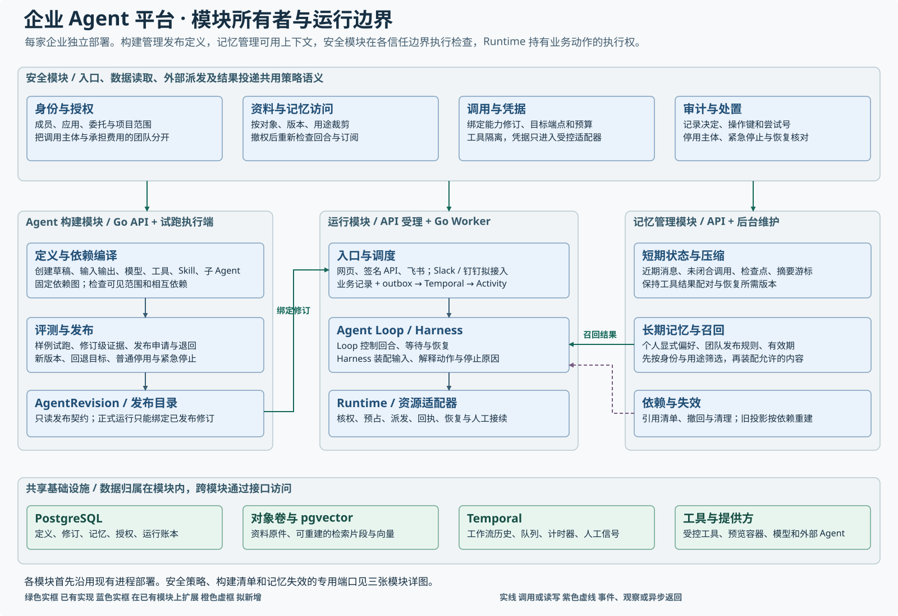
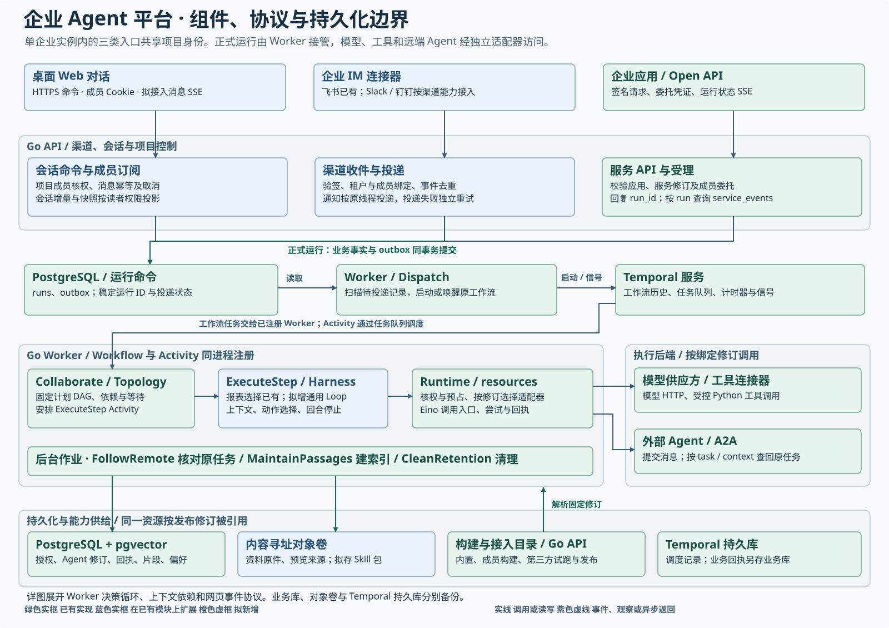
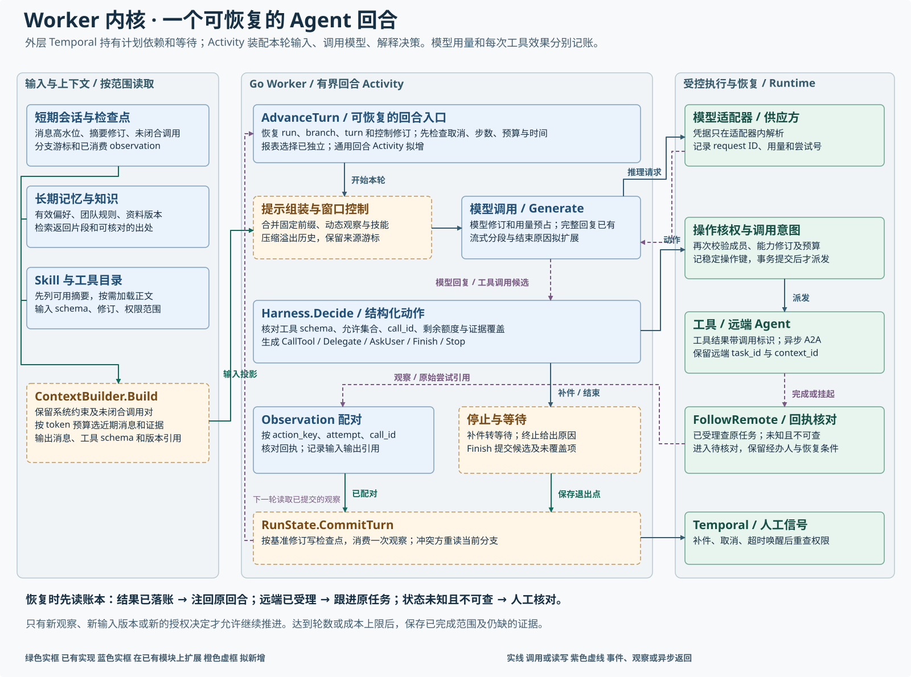
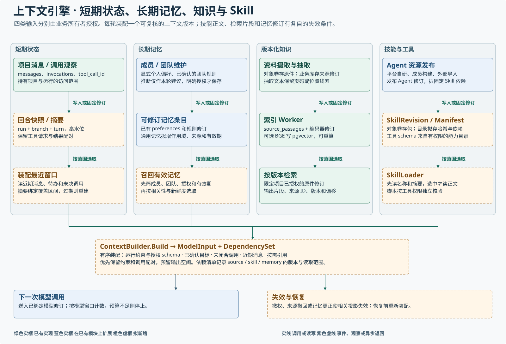
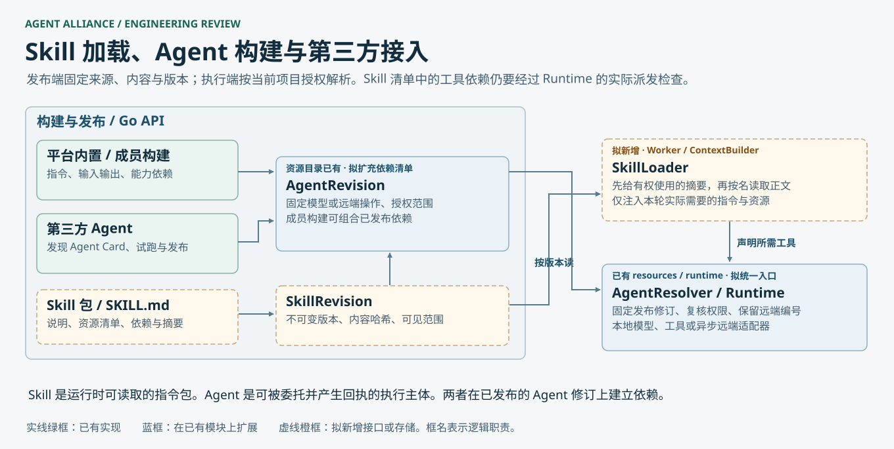
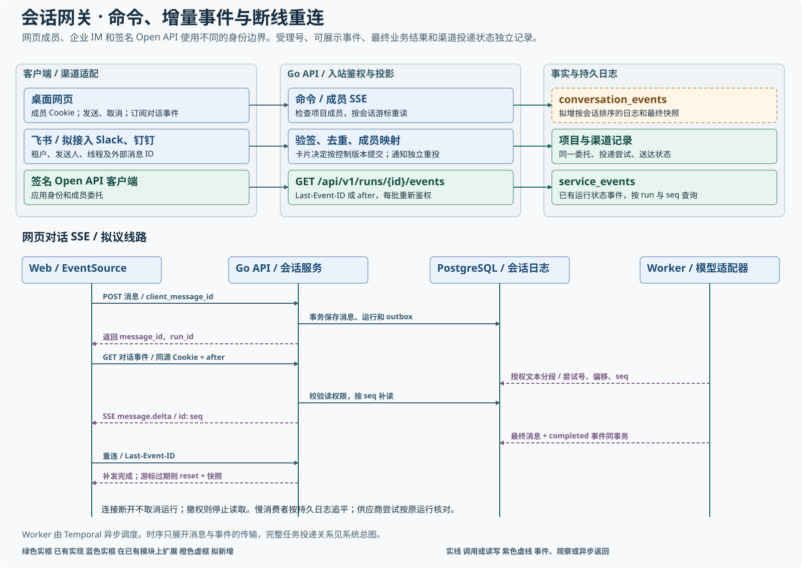

# Personal Agent 内核与企业平台工程架构审查

2026-11-24 · 企业平台单画布全景采用已确认的工程设计。图集保留六个 personal agent 在调研固定修订中的组件关系，以及本平台的局部工程详图。图例记录评审时的建设状态。每张图均可放大，竞品组件可打开对应源文件。[现行工程基线](../../11-technical-blueprint.md#approved-platform-engineering) · [发行版实现与待验收项](../../11-technical-blueprint.md#platform-implementation-baseline) · [必交项与候选证据的交界](../../11-technical-blueprint.md#requirement-evidence-contract)

## 完整架构，一张画布

[打开可搜索、可放大的工程全景](../platform/enterprise-platform.html) · [静态 SVG](../platform/enterprise-platform.svg) · [单页 draw.io](../platform/enterprise-platform.drawio)。选择节点可在原图查看相连组件、接口方向和旧版说明；使用顶部模块选择器可在同一画布内定位。连线上的紫色虚线表示异步回执；带字母的同号端口用于追踪跨区长连接。

| 过去分开的内容 | 在全景中的位置 |
| --- | --- |
| 三条入口、网页 SSE、应用状态流、业务命令与渠道通知 | 顶部「入口、会话与渠道连接」连接安全模块、中央项目调度与下方交付；E1/E2 标出 Worker → 持久事件 → 网页订阅 |
| 三条能力供给、成员构建、第三方 Agent、Skill 包发布与按需加载 | 左侧「Agent 构建与发布」「能力供给、Skill 与第三方接入」；构建清单、操作级试跑证据和运行授权分别有所有者 |
| 固定 DAG、动态 Loop、Harness、模型／工具、逐动作恢复 | 中央从计划到 Runtime；执行端在右，模型回复、待办信号和核对结果有各自的回路 |
| 安全与治理、工作记忆、长期记忆、知识原件、索引与撤权 | 顶部安全横贯三个域；右侧记忆、知识分别提供授权投影与版本化引用，底部说明物理存储 |
| 企业工作能力、跨行业评测、缺项预览、部分交付、最终审核与送达 | 左侧能力评测、下方人工审核与交付；业务接收与通知投递分别记账 |
| 部署、可观测性、异常恢复和原始调研 | 底部运维与基础设施、调研来源；原六个项目的固定版本对照和历次工程详图继续可查 |

维护全景时，在仓库根目录运行 `python3 -B docs/architecture/platform/render.py`，再运行 `node docs/architecture/platform/render_preview.cjs`。前者从同一份组件与契约清单生成 HTML、SVG 和单页 draw.io，并检查原图覆盖；后者用仓库前端的 Playwright 检查文字边界并生成预览。

## 专项审查入口

[Loop 调度与状态](alliance-loop.svg) · [Harness 组件与端口](alliance-harness.svg) · [逐动作恢复](alliance-turn-recovery.svg) · [回合协议、代码走查与验收](loop-harness.md)

[安全架构](alliance-security.svg) · [独立 Agent 构建模块](alliance-builder.svg) · [记忆管理模块](alliance-memory.svg) · [三个模块的接口、数据、故障行为与验收](platform-domains.md)

[放大主图](alliance-components.svg) · [十二页可编辑工程图源文件（draw.io）](alliance-architecture.drawio) · [部署拓扑](alliance-overview.svg) · [执行宿主组件](alliance-host-components.svg) · [Worker 内核](alliance-kernel.svg) · [上下文引擎](alliance-data.svg) · [会话网关](alliance-stream.svg) · [Skill 与第三方 Agent 发布详图](alliance-extensions.svg)

**OpenClaw 给我们的启发是把连接方与执行方分开画。** 官方 Gateway 架构区分消息渠道、操作者客户端和声明能力的节点，连接图又区分受理回包、运行中的事件和最终结果。本平台沿用这个分界。成员网页、签名 API、IM 各自验权。运行 ID 跨渠道稳定，订阅和投递各有游标或回执。移动端由飞书、Slack、钉钉等第三方渠道承接，具体已接入操作以发行基线为准。[OpenClaw 官方 Gateway 架构及连接图](https://docs.openclaw.ai/concepts/architecture#connection-lifecycle-single-client) · [发行基线](../../11-technical-blueprint.md#platform-implementation-baseline)

**Hermes 给我们的启发是把 AIAgent 再展开一层。** 官方总图把提示组装与压缩、供应方解析与协议适配、工具分派与注册并列；会话存储和实际工具后端位于内核之外。我们的 Worker 详图用同一粒度展示三个可独立测试的端口，加入企业版的固定修订、权限、预算、观察落账与恢复边界。按企业部署的数据库、对象卷和 Temporal 仍由本项目的代码和部署文件决定。[Hermes 官方系统总图](https://hermes-agent.nousresearch.com/docs/developer-guide/architecture#system-overview) · [循环内部](https://hermes-agent.nousresearch.com/docs/developer-guide/agent-loop) · [提示组装](https://hermes-agent.nousresearch.com/docs/developer-guide/prompt-assembly)

| 审查问题 | 沿图怎样验证 |
| --- | --- |
| 谁可以改变下一轮动作？ | 在内核图中从模型回复追到 Harness.Decide。模型可选的工具由已发布修订、项目授权和本轮可见 schema 限定，Runtime 在派发时再次核验。纯决策可用录制输入做离线测试。[报表决策实现](../../../backend/internal/harness/report_choice.go) · [活动入口](../../../backend/internal/runtime/runtime.go) |
| 两个浏览器重连、两个 Worker 争取同一动作时分别怎样去重？ | 网关用事件 seq 重组展示；运行用 action_key / attempt 核对外部效果，拟增的分支检查点按基准修订只消费一次观察。两个序号服务于不同的并发边界。[已有签名状态流](../../../backend/internal/services/lifecycle_api.go) · [已有尝试核对](../../../backend/internal/runtime/submission.go) |
| 哪些状态能恢复，哪些仅用于查找？ | 对象卷保留原件，业务库持有修订与回执；索引可重建，Temporal 管调度恢复。拟增的 DependencySet 记下本轮引用，用于在删记忆、撤来源权限或 Skill 升级后判断能否沿用上下文。[检索实现](../../../backend/internal/knowledge/retrieval.go) · [Worker 装配](../../../backend/cmd/worker/main.go) |

## 一、六个 personal agent 的架构切面

| 组件图 | 审查时值得看的差异 |
| --- | --- |
| [OpenClaw 与 Hermes Agent](references-1.svg) | OpenClaw 的 Gateway 统一接入和流式事件，按会话控制写者，工作区文件承载长期记忆。Hermes 的多个入口共用 AIAgent，SQLite 会话历史、持久记忆、技能阅读各有接口。 |
| [nanobot 与 OpenManus](references-2.svg) | nanobot 将渠道队列、会话存储、记忆归档、技能可用性拆开。OpenManus 给出最容易沿代码验证的循环骨架，包含步数、工具派发与按调用编号回填结果。 |
| [CowAgent 与 QwenPaw](references-3.svg) | CowAgent 以 Agent 和会话定位执行实例，主题知识有独立工作区服务。QwenPaw 把渠道管理、会话、ReMe 记忆作业、工具策略以及 Agent 的模型输入准备分开。 |

**直接影响本平台的取舍。** 渠道会话键适合路由，业务权限需要项目、成员与委托共同确定。个人工作区文件能直观表达“可阅读、可编辑的记忆”，在多人环境还需修订、范围和删除传播。工具结果与调用配对、技能按需加载可以直接借鉴。网页流式传输协议与 Agent 内核解耦，例如 OpenClaw 的客户端经 WebSocket 接 Gateway；本平台桌面聊天选单向 SSE，用户命令走 HTTPS。竞品图表达静态依赖；“相关子系统”“共享工作区”等边线只表示所标关系。下表给出可复核的一手入口。

| 项目 / 修订 | 源码或随仓维护者文档 |
| --- | --- |
| OpenClaw · `6e113fecbf` | [网关及事件传输](https://github.com/openclaw/openclaw/blob/6e113fecbf30fdc33caae336139dc785b6dc1489/docs/concepts/architecture.md) · [循环和会话写者](https://github.com/openclaw/openclaw/blob/6e113fecbf30fdc33caae336139dc785b6dc1489/docs/concepts/agent-loop.md) · [记忆文件](https://github.com/openclaw/openclaw/blob/6e113fecbf30fdc33caae336139dc785b6dc1489/docs/concepts/memory.md) · [技能加载](https://github.com/openclaw/openclaw/blob/6e113fecbf30fdc33caae336139dc785b6dc1489/docs/tools/skills.md) |
| Hermes Agent · `2de9f51b80` | [调用循环](https://github.com/NousResearch/hermes-agent/blob/2de9f51b8008a7d49a49221c184f2f11cbfc4af1/run_agent.py) · [会话数据库](https://github.com/NousResearch/hermes-agent/blob/2de9f51b8008a7d49a49221c184f2f11cbfc4af1/hermes_state.py) · [记忆工具](https://github.com/NousResearch/hermes-agent/blob/2de9f51b8008a7d49a49221c184f2f11cbfc4af1/tools/memory_tool.py) · [技能摘要与全文](https://github.com/NousResearch/hermes-agent/blob/2de9f51b8008a7d49a49221c184f2f11cbfc4af1/tools/skills_tool.py) |
| nanobot · `db0306b404` | [消息总线](https://github.com/HKUDS/nanobot/blob/db0306b404954e48ffb82ceae70cbf6f73094348/nanobot/bus/queue.py) · [会话数据库适配](https://github.com/HKUDS/nanobot/blob/db0306b404954e48ffb82ceae70cbf6f73094348/nanobot/session/manager.py) · [技能装载器](https://github.com/HKUDS/nanobot/blob/db0306b404954e48ffb82ceae70cbf6f73094348/nanobot/agent/skills.py) · [记忆归档](https://github.com/HKUDS/nanobot/blob/db0306b404954e48ffb82ceae70cbf6f73094348/nanobot/agent/memory.py) |
| OpenManus · `3309bf4e41` | [步数与停止](https://github.com/FoundationAgents/OpenManus/blob/3309bf4e416fb1c74b008f3e86494439a31bad53/app/agent/base.py) · [单步循环](https://github.com/FoundationAgents/OpenManus/blob/3309bf4e416fb1c74b008f3e86494439a31bad53/app/agent/react.py) · [调用与结果配对](https://github.com/FoundationAgents/OpenManus/blob/3309bf4e416fb1c74b008f3e86494439a31bad53/app/agent/toolcall.py) |
| CowAgent · `51ffe5a8df` | [会话路由和模型适配](https://github.com/zhayujie/CowAgent/blob/51ffe5a8df75295a5c063d5bc32a055c643a2599/bridge/agent_bridge.py) · [技能装载](https://github.com/zhayujie/CowAgent/blob/51ffe5a8df75295a5c063d5bc32a055c643a2599/agent/skills/loader.py) · [知识服务](https://github.com/zhayujie/CowAgent/blob/51ffe5a8df75295a5c063d5bc32a055c643a2599/agent/knowledge/service.py) |
| QwenPaw · `b02e17b8cf` | [Agent 与上下文](https://github.com/agentscope-ai/QwenPaw/blob/b02e17b8cf3fdde484f33c6981321280a0417232/src/qwenpaw/agents/react_agent.py) · [渠道管理](https://github.com/agentscope-ai/QwenPaw/blob/b02e17b8cf3fdde484f33c6981321280a0417232/src/qwenpaw/app/channels/manager.py) · [记忆管理](https://github.com/agentscope-ai/QwenPaw/blob/b02e17b8cf3fdde484f33c6981321280a0417232/src/qwenpaw/agents/memory/reme_light_memory_manager.py) · [工具策略接口](https://github.com/agentscope-ai/QwenPaw/blob/b02e17b8cf3fdde484f33c6981321280a0417232/src/qwenpaw/runtime/tool_guard.py) |

## 二、平台的组件与部署

首期沿用每家企业一套实例。Go API 承载桌面会话、渠道身份、资源注册、资料和成员权限，保留已有的规划、试跑入口。Go Worker 承载任务调度、受控调用、远端任务跟进及索引维护。两侧使用同一业务库与对象卷。Temporal 服务保存工作流进展；独立工具连接器、隔离预览容器和可选 BGE 编码器分别部署。文中拟议接口首先作为包内边界，无须新增微服务。模型和远端 Agent 在各自适配器后面，生产调用所需凭据由受控执行端解析。[API 装配](../../../backend/cmd/api/main.go) · [Worker 装配](../../../backend/cmd/worker/main.go) · [应用部署](../../../deploy/application.yaml) · [可选检索](../../../deploy/retrieval.yaml)

## 三、Agent Loop 与 Harness

详见[分支状态机与调度](loop-harness.md#loop)、[Harness 输入输出](loop-harness.md#harness)、[操作身份与恢复](loop-harness.md#recovery)和[报表／采购走查](loop-harness.md#example)。

Temporal 的 Collaborate / scheduleDAG 推进已确认计划，ExecuteStep 处理普通固定步骤。现有 internal/harness 负责报表选择和原文问答的结构解释。文本和证据回合已有回包检查点，指定原件补查可按观察继续。下表说明通用分支的目标端口，实际活动名称和开放路径按发行基线核对。[工作流与 Activity](../../../backend/internal/runtime/runtime.go) · [报表决策](../../../backend/internal/harness/report_choice.go) · [证据回合](../../../backend/internal/runtime/focused_evidence.go) · [发行基线](../../11-technical-blueprint.md#platform-implementation-baseline)

| 拟议端口（名字供讨论） | 输入与输出 | 所有者 |
| --- | --- | --- |
| ContextBuilder.Build | 接收有授权范围的 actor/project、固定修订、当前回合及剩余 token；输出分区消息、技能摘要、工具 schema、版本化引用、预算统计 | 输入装配。检索与记忆读取先经各自所有者过滤 |
| ModelAdapter.Generate / Stream | 接收模型修订、消息和工具定义；返回文本或结构化工具调用、使用量、完成原因。可展示增量另走事件投影 | Activity 内的资源适配器。取消、超时、限流、用量结算均带 attempt ID |
| Harness.Decide | 根据模型输出、允许动作集、调用配对及进展计数，产生 CallTool、Delegate、AskUser、Finish 或 Stop | 纯决策逻辑。输入可录制再回放；自由文本无法生成新增权限 |
| Runtime.Execute | 接收动作、控制修订、操作键与预算；核验后派发，返回 observation ID、远端任务引用、等待或未知状态 | Runtime 独占执行事务、凭据与调用账本 |
| RunState.CommitTurn | 接收基准修订、回合号、已消费观察与新检查点；返回下一个可恢复位置 | 采用乐观版本比较。一次观察只能推进同一分支一次；竞争失败方重新读取 |

**一轮实际怎么跑。** 外层 DAG 给一个步骤固定目标、输入版本和预算。内层每次从检查点取已提交的工具观察并装配上下文。调用模型前，Runtime 单独核验模型修订、凭据和预算，并为本次推理登记尝试及预占；回包记用量，再由 Harness 解释结构化动作。工具调用另行预占和结算。CallTool 先将规范化参数、输入版本、稳定操作键和尝试号入账，再派发。返回观察后将其配回原 tool call ID，下一轮才能据此选择。Delegate 额外绑定子运行或远端任务、额度与允许的能力；AskUser 持久化所缺字段并让 Workflow 等待信号；Finish 生成候选和证据，由交付校验判定是否齐备。Stop 带明示的预算、权限、停滞或取消原因。

**时间边界。** 首批按“一次有界模型回合一个可重试 Activity”设计，Workflow 编排回合、计时器与人工信号。模型与工具 I/O 留在 Activity；把正文放进对象存储，工作流历史只保存小型引用。远端已受理时跟进原 task ID。派发后进程失联且无法查询时进入待核对，使用原幂等键或供应商查询协议确定状态后再决定是否派发。恢复时核查当前授权、取消修订、账本及预算，可把已落账的观察注回同一回合。[现有远端跟进](../../../backend/internal/runtime/remote.go) · [已有尝试核对](../../../backend/internal/runtime/submission.go)

**停止、压缩和并发。** 强制设置每次模型窗口、每步最大回合、累计 token／费用、墙钟时限和委派深度。每轮比较动作、规范化参数、输入版本与新证据；重复读取同版同段且没有新增覆盖时停止，分页得到新来源时继续。写入按运行分支单写者提交；独立分支可并行，预算预占及结果归并各自幂等。压缩时保留最近窗口、未闭合的 tool call / result 对、待补事项和来源版本；摘要记录覆盖到哪条消息，能从授权原文重建。具体轮数和窗口配比使用基准任务调优。

## 四、记忆、知识与数据层

| 数据 | 写入、读取、过期与重建 |
| --- | --- |
| 短期记忆 | PostgreSQL 已有项目 messages、计划、运行与 invocations。拟增每分支的 turn_checkpoint 和摘要修订，保存消息高水位、未完成调用、来源引用和已消费观察。ContextBuilder 装配顺序为系统约束、已确认目标与工具、待处理观察、近期消息、经授权的参考片段。预留模型输出空间，超窗先截取可回查的大型工具回包，再压缩旧轮次。 |
| 长期记忆 | 复用 preferences、团队规则的修订和生命周期；通用 memory_entry / revision 拟保存 scope、subject、source_ref、confidence、valid_until 和撤销依据。明确“以后都这样”的成员请求按授权写偏好；从一次执行推断出的规律只作本轮建议；明确授权后才保存为个人偏好，团队规则走既有维护与发布程序。召回先筛作用域与有效期，再排相关性与新鲜度。更正产生新修订，删除或撤权使派生缓存失效；下一回合重新检查已记录依赖。 |
| 企业知识 | 原件按内容 hash 保存于 /data/objects。资料来源、修订、项目绑定和出处在 PostgreSQL；抽取文本按版本切段，保留位置。启用语义检索时，BGE 编码后写入同库 pgvector，召回时限定已授权原件版本，按片段引用回看原文。索引待建或编码服务不可用时，采用已支持的文本匹配或呈现待索引状态，保留覆盖缺口。资料更新从新修订重建，撤回的旧版从可见集合剔除。 |
| 操作、回放与观测 | PostgreSQL 中的操作账本和业务决定是核对依据，Temporal 持久库负责调度恢复。Trace 记录 run/turn/attempt、耗时与错误类型，内容依可见范围裁剪。调试回放使用有权访问的版本化输入和已记录观察，默认隔离真实外部动作。 |

成员说“金额保留两位”可写个人偏好；某会议同意的报价有效期要附带原件版本与引文；本轮正在等供应商 B 的有效期属于短期状态。三种信息可以同轮使用，分别由不同的数据所有者修改和撤回。[项目与运行表](../../../backend/internal/database/schema/003_projects.sql) · [资料版本与偏好](../../../backend/internal/database/schema/004_knowledge.sql) · [偏好生命周期](../../../backend/internal/database/schema/037_preference_lifecycle.sql) · [对象存储](../../../backend/internal/knowledge/objects.go) · [检索实现](../../../backend/internal/knowledge/retrieval.go)

## 五、Skill 加载、Agent 构建与第三方接入

**Skill 的加载契约（提案）。** 一个包包含 SKILL.md、资源清单、相对路径资源及可选脚本声明。发布时检查名称与描述、入口、依赖、工具范围、版本及内容哈希，拒绝越界路径和循环依赖；包正文入对象卷，目录和访问范围入 PostgreSQL。Agent 修订引用精确的 skill_id@revision。启动时只列当前项目可用的名称、摘要与调用条件；显式点名优先，其余按任务匹配选出有界候选。选中时校验哈希和依赖，再读正文；引用的样例、脚本按需读取。与项目约束冲突时记录冲突并采用已确认约束。指令内声明的脚本仍须作为独立已授权工具，通过受控连接器执行。按哈希缓存不可变内容，每次使用前重新核验授权。升级发布新修订，在途运行仍固定旧修订，撤销授权即时生效。

**三条 Agent 供给路径。** 内置能力登记契约和验收器；成员用构建器组合允许使用的模型、工具、技能和其他 Agent，声明输入输出、维护人及测试样例；第三方导入 Agent Card，登记端点与凭据引用。三者经试跑、授权、发布、项目绑定后形成固定的 AgentRevision。每个远端操作单独声明并验证提交、查询、补件、取消及幂等能力；本仓库已有 message/send、tasks/get、tasks/cancel 适配。远端只回传可验证的任务状态、产物和观察；允许查询而无法取消的供应商在能力目录中明确标记。子委托传递最小作用域和剩余额度。发布、灰度、退回都保留依赖版本与在途运行的原始账本。[Agent Card 与远端操作](../../../backend/internal/resources/external.go) · [试跑](../../../backend/internal/resources/remote_trial.go) · [发布](../../../backend/internal/resources/release.go) · [已有成员工作流模板](../../../backend/internal/projects/workflow_templates.go)

## 六、渠道、Web SSE 与事件协议

**已有基础。** 签名 Open API 按运行号订阅状态，逐批复核应用、委托与项目，按序读取 `service_events`。桌面从 `/api/projects/{id}/session-events` 订阅项目变更及发起成员本人获准读取的草稿。项目序号和授权范围进入不透明游标，游标过期或者授权范围变化时发送 `session.snapshot`。桌面按步骤、尝试及偏移合并草稿，完整回复进入候选审核。下表记录后续扩展。[Open API 状态 SSE](../../../backend/internal/services/lifecycle_api.go) · [桌面会话订阅](../../../backend/internal/projects/session_events.go) · [会话日志](../../../backend/internal/database/schema/122_project_session_events.sql)

| 拟议接口或边界 | 具体实现 |
| --- | --- |
| 入站与取消 | 目标协议中，网页 POST 以客户端请求键重复取回原受理决定。成员取消通过独立命令更新控制修订。各 IM 连接校验来源，以企业连接及原事件身份去重，再解析当前成员、会话或线程与项目。0.1.45 的 Slack 和钉钉已共用单聊收件、项目映射及投递处理，飞书沿用既有服务和任务卡路径。 |
| 生产增量 | 适用的成员文本步骤已有流式草稿。目标投影增加其他模型适配、动作摘要、补件请求和消息终态。工具参数、原始模型推理及内部凭据留在受控边界。小片段按时间或大小聚合，非流式模型使用完整回复。若中断，草稿仍归原尝试，后续尝试使用独立标识。 |
| 持久化与顺序 | 沿用 `project_session_events`。扩展事件种类和消息引用。写者在短事务内分配项目序号并插入事件，生产端按稳定事件键去重。业务终态与最终消息或成果引用一起提交。API 实例从同一日志补读；先采用有界批量查询，再根据负载评估 PG NOTIFY 唤醒。 |
| 网页订阅 | 沿用同源 `/api/projects/{id}/session-events` 的登录 Cookie、项目成员授权和不透明游标。重连及每批读取前复核授权。使用 SSE 的 `id`、`event`、`data` 和空行，分批 Flush，心跳使用注释，代理关闭缓冲。POST 命令使用现有成员写入防护。 |
| 前端归并与背压 | 后续事件类型涵盖消息增量、工具状态、待办和终态。以项目序号去重，按消息、实际尝试及文本偏移归并。使用有界写入，慢客户端断开后从游标追平；游标超出保留窗口或可见范围变化时，用授权快照替换旧投影，并从快照高水位续读。撤权后结束订阅。订阅中断不取消后台运行。 |
| IM 投递 | 渠道懂各自的卡片和消息长度。只将已授权的状态、待办或成果摘要投递到原线程；按投递键重试。两人在网页和卡片同时答复时，以业务对象、控制版本和幂等键提交一次，另一方得到最新决定。消息送达与业务动作执行各自有账本。 |

可在一次断网测试中验证整条设计。浏览器看到第三个文本分段后断开，Worker 仍提交后续分段与终态；重新连接后显示同一条完整消息，供应商调用次数保持一次。若其间用户被移出项目，重新订阅应被拒绝。HTTP 事件帧和重连语义依据 HTML 标准。[WHATWG Server-sent events](https://html.spec.whatwg.org/multipage/server-sent-events.html) · [飞书入站和绑定](../../../backend/internal/channels/feishu.go) · [飞书任务卡片](../../../backend/internal/channels/task_cards.go)

## 七、实施与验收顺序

本节记录初次工程拆分的验证路径。分批实施及发行版进度以技术方案第 26 节为准。[现行实施与验收顺序](../../11-technical-blueprint.md#enterprise-platform-master)

| 顺序 | 可以独立评审和交付的改动 | 必须观察到的结果 |
| --- | --- | --- |
| 1 · 可恢复的单步 Loop | 给一个只读检索 Agent 接入 Decide、Observation、检查点和终止条件；保持旧的固定步骤入口 | 发票核对、采购报价、研究资料三个样例均能区分“找到证据、需补件、重复无进展”；在已记账但未推进时重启，供应商有效调用次数不增加 |
| 2 · 对话事件与桌面订阅 | 有授权的运行状态先接网页 SSE，再为一个支持 Stream 的文本模型提供增量 | 中途撤权、取消、游标过期、双标签重连和慢客户端有确定结果。量首段延迟、末段延迟、重复/缺失事件、并发订阅及每会话数据库写入量 |
| 3 · 记忆和 Skill | 为同一 Agent 接入有限的短期摘要、显式长期偏好和一个有版本的 Skill；经验提炼先作本轮建议，持久保存须有明确授权 | 偏好更正可见、不同项目同名资料不串、撤回后摘要失效；技能升级可复现旧运行，正文无法扩大工具权；比较任务正确率、上下文占用和成本 |
| 4 · 扩展供给与渠道 | 使用同一验收样例替换为成员构建 Agent 或第三方 Agent；接各渠道的签名、身份、卡片和重投适配器 | 外部接收后失联只查询原任务；相同待办从不同入口只消耗一次；按渠道单列真实租户验证和供应商能力缺口 |

通用 Loop、统一会话事件、Skill 按需装载及记忆派生内容的失效传播按全景验收。初版以 PostgreSQL、对象卷和现有 Worker 承载上述能力。根据压测结果决定独立流服务、向量库及队列拆分。[全景验收标准](../../13-acceptance-spec.md#approved-platform-evals)
