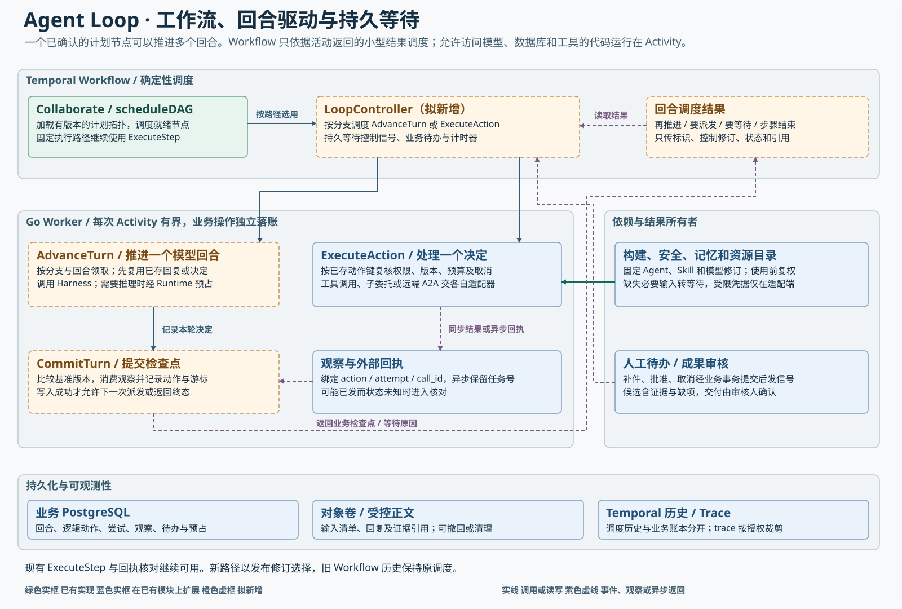
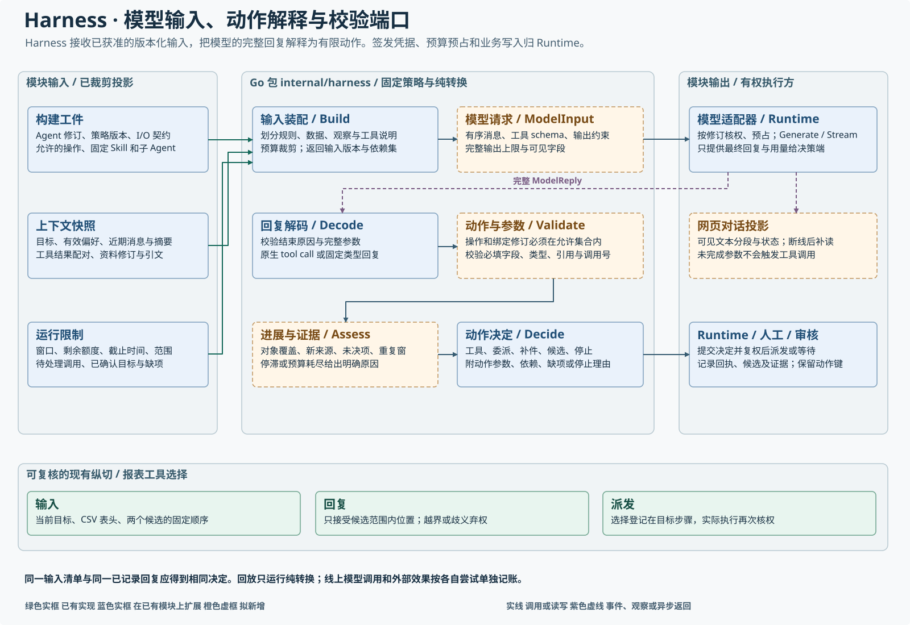
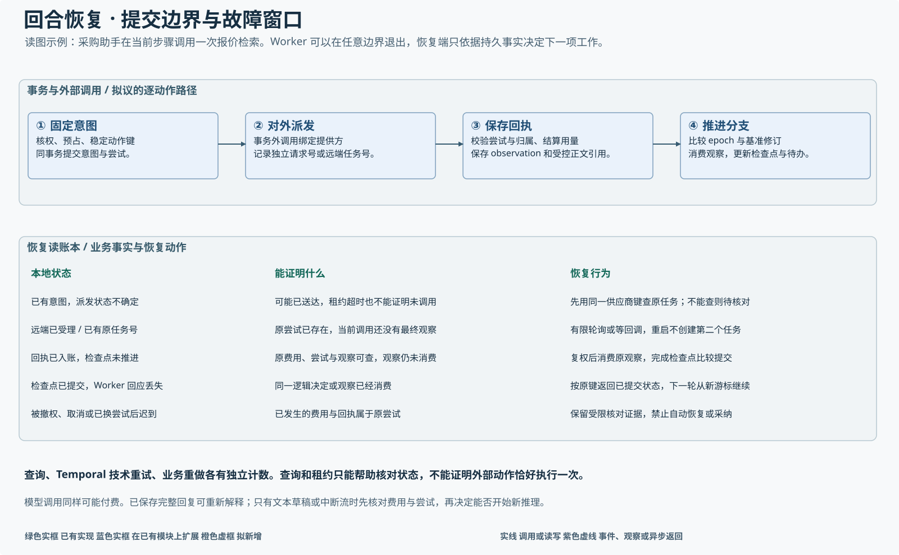

# Agent Loop 与 Harness 工程设计

2026-11-24 · 供工程审查。[回合驱动架构](alliance-loop.svg) · [Harness 组件](alliance-harness.svg) · [动作提交与恢复](alliance-turn-recovery.svg) · [可编辑图源](alliance-architecture.drawio)

**设计决定。** 已确认的项目计划仍由 Temporal 调度。需要根据观察动态选下一步的节点，内部使用有界 Agent Loop。Loop 对“该分支下一次能够做什么”负责；Harness 对“在这些输入和限制下，怎样构造模型请求、解释回复并提出一个动作”负责；Runtime 对“这次动作是否允许、是否已做过、产生了什么效果”负责。下文的通用端口、状态名和表键为提案。

| 现有入口 | 已经能沿源码验证的行为 | 本次设计的延伸 |
| --- | --- | --- |
| Collaborate / scheduleDAG | 0.1.22 按每个节点的完成回执调度后继。后台远端回执定向唤醒对应节点，执行中收到的提示留到该步骤返回检查时消费。运行级信号让等待中的分支重新核验状态，终止时收尾已派发的调用。Temporal 版本标记保留旧历史的活动顺序。 | 后续为分支扩展可恢复观察、外部子任务与独立授权，动态步骤的回合号与项目 DAG 节点序号分开。[调度实现](../../../backend/internal/runtime/dag.go) |
| ExecuteStep / Eino | 锁定运行、核对既有提交与授权，提交调用意图，事务外经 Eino 调用 Model.Generate；回包事务核对尝试，按远端受理、未知、输入拒绝或完成处理 | 拆出有界 AdvanceTurn 与单动作 ExecuteAction 两类 Activity；所有 I/O 保留在 Activity。已登记原任务的远端 Agent 以一个异步动作挂接，供应商的内部循环不在本地展开。[执行入口](../../../backend/internal/runtime/runtime.go) · [远端核对](../../../backend/internal/runtime/remote.go) |
| internal/harness / ReportOptions | 按候选原顺序组织目标、文件名和 CSV 表头，严格解释选择回复。Runtime 用独立步骤消费路由选择 | 让准备输入、回复解码、候选校验、进展判定可单独回放。报表协议的原提示、候选顺序及弃权语义继续有效。[已实现策略](../../../backend/internal/harness/report_choice.go) · [运行接线](../../../backend/internal/runtime/tool_choice.go) |
| 原文复核回合 | 已用加密回包检查点、已授权片段和观察游标验证有界补查。0.1.48 固定了服务必交项及实际产出步骤。 | 在最终产出步骤把有验证依据的提示按必交项交给成果模块，保持原审核与确认的角色边界。[回包检查点](../../../backend/internal/runtime/text_checkpoint.go) · [逐项证据契约](../../11-technical-blueprint.md#requirement-evidence-contract) |

OpenClaw 的运行说明区分会话写入、模型／工具事件和消息流；Hermes 将回合处理、提示装配和工具分派拆开。这里借鉴其模块边界，企业权限、费用核对、对象级验收与灾备依据仍由本平台持有。Temporal 对可能重试的 Activity 推荐幂等设计，因此恢复依据必须落在业务账本。[OpenClaw Agent loop](https://docs.openclaw.ai/concepts/agent-loop) · [Hermes Agent Loop Internals](https://hermes-agent.nousresearch.com/docs/developer-guide/agent-loop) · [Temporal Activity 定义](https://docs.temporal.io/activity-definition)

## 一、Loop 的调度、状态与停止条件

**执行单位。** 一个 step 对应计划的一个节点，一个 branch 对应该节点的一条执行分支，一个 turn 对应基于一个输入快照的一次决策。一次 turn 可以产生零次或一次待执行的业务动作；调用模型本身是单独的计费操作。初版每个分支同时最多一个未决动作。独立 DAG 分支仍可并行，子委托有自己的 run/branch 和上限，父分支只等待可核验的子结果。

**组件接口。**

| 所有者 | 输入 | 可持久化输出 |
| --- | --- | --- |
| LoopController / Workflow | 节点绑定的模式与协议版本、run、branch、上次 Activity 的小型返回值、Temporal 信号或计时器 | 调度下一 Activity、持久等待或结束该节点。工作流不用网络、数据库、模型、随机 ID 或本机时钟决定分支 |
| AdvanceTurn / Activity | run、step、branch、turn、expected_checkpoint、控制修订 | 从已存决定恢复，或装配输入并取得一份最终模型回复，再解释为一个决定。提交后返回 Dispatch(action_ref)、Wait(wait_ref)、Continue(cursor) 或 End(step_outcome) |
| ExecuteAction / Activity | 已提交的 action_ref、当前授权、预算及尝试记录 | 新观察、远端等待、可纠正输入或待核对。新派发前登记意图和费用预占；重复 Activity 先查询原动作状态 |
| Wake / 业务模块与调度 | 回执、人工答复、预算批准、取消或到期；均有业务对象与修订 | 先保存决定或回执，再发唤醒提示。Loop 重读事实，重复、迟到或超前到达的信号不造成第二次推进 |
| CommitTurn / 业务事务 | 预期分支版本、控制修订、已消费观察、输出引用及下一状态 | 比较版本后单次推进游标，将决定、待办或终态与待投递记录一并提交。竞争失败方重读，不沿过期快照继续派发 |

**状态机。** 拟用下列状态表示单分支的推进；它们不直接覆盖现有 runs.status。控制台可以从分支状态聚合项目进展，既有固定步骤继续返回现有 Result。

| 分支状态 | 进入条件 | 离开条件、下一所有者 |
| --- | --- | --- |
| Ready | 输入可读；新节点、已处理观察或已完成补件 | AdvanceTurn 先检查缓存决定、控制修订、预算与依赖。锁定输入后进入 Deciding；必要资料缺失走 WaitingInput |
| Deciding | 已固定输入清单和模型操作键 | 完整回复经 Harness 解析。CallTool / Delegate 写 PendingAction；AskUser 写 WaitingInput；Finish 写 Candidate；Stop 归档理由。付费调用状态不明转 Reconciling |
| PendingAction / WaitingRemote | 已存动作决定；或提供方已返回任务号 | Runtime 按原键执行或跟进。收到可信观察后只消费一次，带新上下文回到下一轮 Ready；不明回执转 Reconciling |
| WaitingInput / Paused | 缺字段、需要审批、预算不足或人为暂停 | 等待期间不循环调模型。答复须匹配待办 ID、对象与控制修订；恢复再查权限、版本和余额，得到新输入才推进 |
| Reconciling | 可能已发生付费或外部效果，缺可靠最终回执 | 有原任务号则有限查询，收到迟到回执则归原尝试。无查询依据时保留未知与费用风险，交有权者处理 |
| Candidate / Stopped / Cancelled | 对象证据可送审；失去进展或到达上限；取消已提交 | Candidate 保存具体成果版本与缺项给审核。Stopped 保存已完成范围、原因和接续条件。取消阻止新派发，已发生的尝试继续记账 |

**回合推进规则。** 每次派发前同时检查最大回合数、模型／工具调用次数、token 与费用余额、总期限、子委派深度，以及当前的暂停／取消状态。硬限制来自平台与项目，构建者只能收紧；默认业务重试沿用技术方案第 16 节的上限和前提。查询远端任务有独立频率、时间窗与预算。自动重试、一次新的业务决定和人工授权重做分别计数。并行分支从同一预算原子预占，结束后按实际用量结算或等待核对。

**怎么识别停滞。** 比较能力修订、规范化参数、输入版本、待覆盖业务对象与新增证据。如果同一输入与动作再次返回相同原文位置且覆盖没有改变，达到本策略的重复窗后给出具体缺项，转补件或停止。翻到新页、收到新版本或得到不同的可核验字段可以构成进展。仅更换措辞、生成新的调用 ID 或重复心跳都不增加覆盖。语义指纹只用于检测停滞；平台操作键标识一次实际意图，两者不能互换。

## 二、Harness 的输入、输出和扩展契约

**包边界。** ContextBuilder 从记忆、知识和技能模块取得已授权内容并附上版本和用途；Harness 只处理传入的投影，按固定策略构造消息与可用工具声明。模型提供方的选择、凭据、预占、调用和结算由 Runtime／资源适配器完成。结果解释阶段的输入是同一份已固定的上下文与最终 ModelReply。需要修正回复时，由 Loop 登记新的有界决策，再走模型计费路径。

| 纯转换端口（拟议） | 消费与产物 | 失败语义 |
| --- | --- | --- |
| Build(snapshot, manifest, limits) | 有序装配稳定规则、已确认目标、允许的能力与 schema、未闭合调用、最新观察和带出处的数据；返回 ModelInput 与 DependencySet | 优先保留硬约束、未闭合调用配对与输出保留量。优先缩短可回取的长回包，再压缩已闭合历史；仍超窗时返回明确缺口 |
| Decode(finalReply, responseContract) | 提供方适配器先归一文本、原生 tool call、完成原因、用量和请求号；Harness 再按该策略契约解析。文本增量仅供 UI | 参数未闭合、截断、拒绝、重复键、未知标签或未知 schema 版本均不派发。固定报表沿用原弃权；新策略可明确是否允许一次计费修正 |
| Validate(proposal, offeredOperations, snapshot) | 检查动作种类、精确修订、调用关联、字段类型、参数大小、数据引用与目的地。输出规范化动作及它需要的安全复核条件 | 单动作策略下，多项工具调用作为一个不适配的提案处理，不能执行一部分后才拒绝其余部分。不要从自然语言中猜出额外工具、身份、端点或批准 |
| Assess(proposal, observationSet, requiredObjects) | 更新业务对象覆盖表、未决字段和进展指纹。核对引文、来源修订、工具回执或可独立验证的产物 | 有文件但缺对象证据时列出缺口；超限或无进展时阻止继续调用。模型自述成功不足以改变对象覆盖 |
| Decide(assessment, controls) | 产生一个带类型的 CallTool、Delegate、AskUser、Finish 或 Stop；含 reason_code、visible_summary 和关联引用 | 候选不在集合内时返回该策略声明的弃权／补件结果。所有决定先落账，Runtime 才可据此核权并派发 |

**跨模块的最小数据形状（提案）。**

| 对象 | 核心字段与约束 |
| --- | --- |
| TurnSnapshot | run / step / branch / turn、base_checkpoint、control_revision、manifest_hash、policy_revision、允许操作修订、已消费观察、高水位与依赖引用。数据库句柄、供应商凭据与可变全局状态不传入纯函数 |
| ModelInput / ModelReply | 输入记录有序角色消息或受控引用、schema 修订、输出保留量和上下文哈希。回复保存最终文本或工具参数的受控引用、finish_reason、request_id、用量和尝试号；流式草稿单独投影 |
| Decision | CallTool 指明 capability@revision、参数与被引用资料；Delegate 指明 agent@revision、有限任务、最小作用域与额度；AskUser 指明业务对象、缺失字段、可答角色和待办键；Finish 指明候选版本、对象覆盖、引文与缺项；Stop 指明限制、已完成范围及接续条件 |
| Observation | 内含 observation_id、平台 action_key、attempt_id、提供方 call_id / task_id、状态、输出引用、证据覆盖、用量与错误分类。原始文档及工具返回按不可信数据处理，正文使用适用的访问／保留规则 |

**扩展方式。** 初版由平台登记有限的策略实现，Agent 修订绑定策略类型、提示与 schema 版本、停止规则、允许的 Skill／能力清单。构建者配置固定输入输出、样例和收紧后的限额。新策略先离线回放，再使用试跑凭据逐操作验收。Skill 可以提供已批准的指令与示例，第三方 Agent 可自行运行其内部循环；两者均不能替换企业的权限、预算与派发端口。运行中途升级继续绑定原策略，紧急撤权在真实读取和调用时立即复核。[安全、构建和记忆接口](platform-domains.md)

## 三、操作身份、费用与崩溃恢复

现有 invocations 以 (run_id, ordinal) 为主键，能承接固定步骤及明确重做。动态步骤可能出现“模型 → 工具 → 模型”，须分别识别三次操作，否则在重启时无法判断该复用哪份回复。建议以附加记录支持新路径，旧运行仍沿用原主键。[现有运行表](../../../backend/internal/database/schema/003_projects.sql) · [迟到回执处理](../../../backend/internal/runtime/submission.go)

| 标识或记录 | 拟定唯一性 | 它解决的问题 |
| --- | --- | --- |
| 分支检查点 | (run, step, branch, revision)，受当前 writer_epoch 与控制修订约束 | 同一基线只允许一个后继提交。过期 Worker 可以交回原尝试的证据，不能推进分支 |
| 逻辑动作 | 平台分配持久 action_key；(run, step, branch, turn, slot) 唯一，分别用 inference 与 effect 槽。重放同一槽复用同一键 | 两个内容相同但业务意图不同的动作可以独立发生；相同动作不能因重新调度而换键 |
| 实际尝试与用量 | (action_key, attempt_no)；每次预占和最终计费都与实际尝试关联 | 网络重投不重复预占。实际费用可能高于预估或迟到，保留原归属；未知期间保留待核对金额 |
| 观察与消费 | 远端事件按提供方、任务及事件身份去重；分支内 (branch_key, observation_id) 一次消费 | 厂商重复回调不产生新动作。受理、进展、完成是不同事件；支持同一任务经过多个状态 |
| 人工决定 | 待办绑定 run、业务对象、所需角色、控制修订和决定键 | 网页和飞书同时作答只提交一次。迟到的旧审批不能替换新修订的待办 |

**事务切面。** 先在业务库锁定或比较基准，写意图与预算预占并提交；事务外调用提供方。完整响应先保存受控正文，再将摘要引用、费用和观察写入业务库。随后在一次业务事务中消费观察、写检查点及待投递事件。对象卷与 PostgreSQL 之间没有跨存储事务：未被引用的对象可回收；检查点读不到正文时停在可解释的阻塞状态。Temporal 历史只携带小型标识、原因与引用。

**模型中断和重复执行。** 有完整、已落账的模型回复时，可以在原策略上重新 Decode，无须再调用供应商。只有 SSE 草稿时，不能把它补成可执行参数。如果可能已经产生费用但无完整回包，先核对原请求；可靠幂等与查询保证需按提供方、操作和保留窗口验证。同一次模型逻辑调用的技术重试沿用原动作键；人明确授权承担未知风险后的重做登记为关联的新业务意图。模型和工具分别遵守这条规则。

**回执与控制竞争。** 接到信号先对账本与控制修订做条件读取。取消先提交则冻结后续动作，迟到结果归原尝试，不自动成为候选；结果先入账但尚未采纳时，仍需当前权限才能采纳。权限或记忆已失效时寻找未含失效内容的安全检查点，只用仍合法的资料重新装配；不能可靠重建就停在补件／复权。独立分支的已完成观察与原尝试保留。

## 四、用两条任务走查边界

**已有路径：按部门汇总核准额。** 确认计划给选择步骤两个固定修订，位置 1 按地区、位置 2 按部门。Runtime 从有权的 CSV 文件投影第一行，支持 BOM 和带引号表头，构造包含 Goal、Headers、Candidates 的 JSON。Harness 按原协议接受 `{"choice":2}`；多出字段、重复 choice、非法位置或明确弃权均返回 0。Runtime 把选择写到目标步骤，目标随后再次核验授权与输入；未选中时阻塞，允许发起人在原候选范围内接续。选择“按部门”与真正执行汇总是两个可分别检查的动作。[候选装载／登记](../../../backend/internal/runtime/tool_choice.go) · [回复回归测试](../../../backend/internal/harness/report_choice_test.go) · [CSV 表头投影测试](../../../backend/internal/runtime/tool_choice_test.go)

**目标路径：从三份采购报价整理可复核的有效期。** 以下为设计走查，暂无通用 Loop 的真实执行结果。

| 回合边界 | 负责方和持久结果 |
| --- | --- |
| 第 1 轮需要证据 | ContextBuilder 固定三份报价修订，Harness 提出在这些来源内检索有效期。Runtime 预占工具费用，登记 action A，检索返回甲、丙的引文和乙的缺项，保存观察 O1 |
| 第 2 轮还缺对象 | AdvanceTurn 消费 O1，覆盖表为 2/3。相同来源和查询不会新增证据，若不存在尚可查的页或获准来源，Harness 提出 AskUser，问题精确到乙的有效期，Workflow 持久等待 |
| 等待期间有新输入 | 采购员上传乙的新修订，网页重发同一决定只记录一次。系统复核成员、文件和读取范围，保留甲、丙已有证据，仅对发生变化的乙继续 |
| 第 3 轮检索后退出 | 第二次检索的动作键 B 绑定乙的新修订，返回 O2。下一次决定根据 O1 与 O2 生成带三条来源引用的候选，交审核。若乙始终缺失，默认等待；只有原委托允许部分交付，才可将已有项目及剩余负责人送审 |

## 五、怎样验证与上线

| 验收情形 | 可判定的结果 |
| --- | --- |
| 固定输入和记录回复离线回放 | 给定同一 manifest、策略和检查点，得到相同动作类型、规范化参数、关联引用及原因。禁用供应商 I/O，模型与工具调用数均为零 |
| 残缺流、歧义 JSON、越权工具和资料变更 | 残缺回复只形成可见草稿；无任何效果派发；候选外参数被拒。动作提交后、派发前撤回资料或权限时，Runtime 提供受限结果且不发新业务请求 |
| 两个 Worker、重复信号、取消和迟到回执 | 同一分支基准只提交一个后继；同一观察消费一次；两个入口的补件只处理一次。迟到结果保留原归属，取消后无新增派发 |
| Worker 在意图、供应商受理、回执入账、游标提交四处退出 | 分别命中可证明未执行、查询／核对、注入既有观察、返回既有状态四类恢复路径；对状态不可知的提供方不宣称可自动重做 |
| 无进展与合法翻页 | 连续相同读取被识别；新页含新增引文时可继续。停滞原因指出仍缺哪些对象，达到预算／时限后不再请求模型 |
| 供应商与委派 | 单独核对推理、工具和远端查询的尝试数、费用及延迟。子 Agent 等输入时保留原 task_id；子结果只是父回合的一条观察，不会自行批准交付 |
| 质量与产能 | 按任务记录对象覆盖、错误完成率、补件后完成率、每成功交付费用、回合数、首段／整轮时延、等待年龄、重复派发和撤权后新调用。按相同模型与输入版本对照固定步骤基线；通用 Loop 数据使用相应真实或明确标记的模拟提供方 |

**迁移与回退。** 先冻结报表选择的原输入与输出，作为纯函数回放样本。再用一个只读检索能力在已录回执上影子运行新策略，比较对象覆盖、停止点与行动建议，影子路径不再付费。下一阶段才为新发布修订开启真实回合，按工作流版本与兼容 Worker 路由。旧的 ExecuteStep 和已开始的历史继续可恢复。关闭新入口只影响新绑定；在途分支保留相应的执行器与 schema，直至终结或人工迁移，不把未知调用迁成一个新动作。

报表选择及只读检索已有 Harness。0.1.28 中原文补查和引文金额核算通过 `AdvanceObservedTurn` 登记决定、`ExecuteAction` 保存观察、`CommitLocalObservation` 复核状态并提交。观察以运行、步骤和尝试编号定位，加密正文在提交或撤销时清除。Temporal 版本标记为历史工作流保留原活动序列。通用多动作回合、逐动作账本和委派仍按全景设计验证。[只读回合恢复测试](../../../backend/internal/runtime/lookup_turn_db_test.go) · [当前实现与后续验收](../../11-technical-blueprint.md#platform-implementation-baseline)

0.1.29 加入 `AdvanceBatchedLookup`。Harness 接受同一份模型回复中的两至三组互不重复搜索词。`ExecuteAction` 按运行、步骤、尝试和组号保存独立观察，`CommitLocalObservation` 合并已核对的引用并推进游标。一次无进展的组仍可接续另一个已授权的查询；达到六条新增引文或用完全部分组时结束。整个步骤只在最终提交时向后继开放结果。[分组与游标实现](../../../backend/internal/runtime/lookup_batch.go) · [历史与恢复验证](../../../backend/internal/runtime/lookup_turn_db_test.go)

0.1.30 为原文问答增加固定额度内的可选复核阶段。方案将两次可能的续答绑定到 `review_evidence` 和 `synthesize` 节点，各用现有调用意图、回执及预算记录。复核可直接回答、指出具体资料缺口，或提出有界只读补查。第二次续答只读取复核阶段新增且仍可访问的证据。项目以最后一个节点的产物满足该业务步骤的必交条件。[阶段扩展](../../../backend/internal/projects/lookup_plan.go) · [调用与证据测试](../../../backend/internal/runtime/lookup_synthesis_db_test.go)
