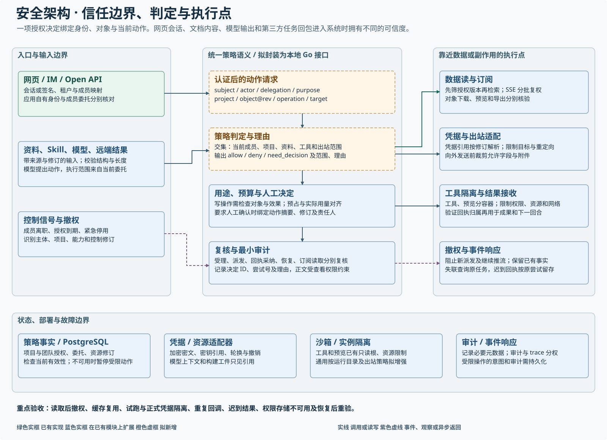
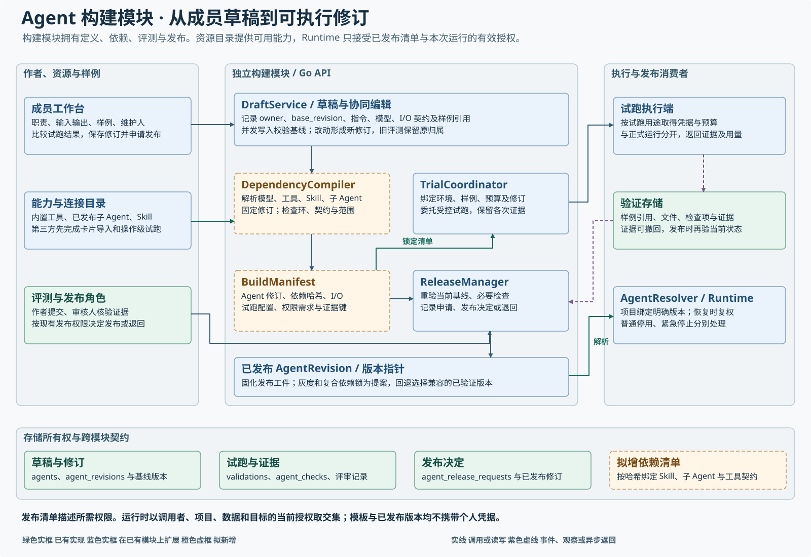
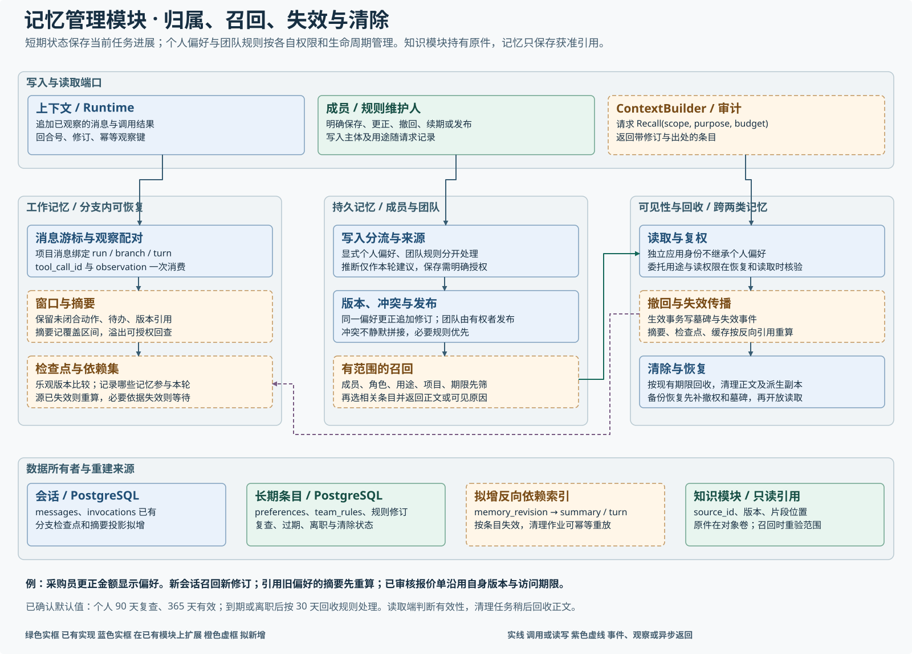

# 安全、Agent 构建与记忆管理的工程边界

2026-11-24 · 工程设计供审查。[平台主图](alliance-components.svg) · [十二页可编辑图源](alliance-architecture.drawio)

| 模块 | 拥有的业务事实 | 对其他模块提供的主要契约（拟议名称） |
| --- | --- | --- |
| 安全 | 主体与委托的有效范围、数据用途、授权决定与审计依据。现有授权事实继续由身份、项目及资源模块持有 | Decide、CheckAtUse、ResolveCredential、RecordDecision。返回允许的操作、对象范围、可见字段和必需的人为决定 |
| Agent 构建 | 草稿、声明、锁定依赖、验收样例与证据、发布决定、当前发布指针 | SaveDraft、Compile、RunTrial、RequestRelease、Publish、ResolvePublished。跨给 Runtime 的唯一构建产物是固定修订的 Agent 定义 |
| 记忆管理 | 工作记忆投影、明确保存的个人偏好、团队规则、修订、有效期、撤回以及派生引用 | AppendObservation、Recall、SaveExplicit、Correct、Revoke、InvalidateDependents。返回正文或受限原因、出处、修订和生命周期 |
| Runtime 与知识 | Runtime 拥有预算预占、尝试和业务动作效果；知识模块拥有资料原件、片段和来源 ACL | Runtime 接收构建清单并核权后执行；知识按引用返回当前可读版本。记忆模块不能替代任一方作业务决定 |

三个模块先作为同一企业实例内的独立逻辑模块。构建模块部署在 Go API，试跑通过受控执行适配器；安全判定在 API 和 Worker 的执行点复用；记忆的读写端口服务于 API 与 Worker，压缩和清理可交给后台作业。接口名、建议数据实体及异步作业是设计稿，仓库已有实现逐项列在各节。

## 一、安全模块

**四条信任边界。** 外部渠道事件进入企业实例时验证来源并绑定企业成员。项目资料、工具结果、技能说明和第三方回包进入模型时保留来源和信任级别；其中的自然语言作为内容处理。模型向工具或外部服务提出动作时，Runtime 根据固定能力清单与当前授权决定能否派发。成果、网页 SSE、通知和导出离开业务模块时，再按实际接收者裁剪。OpenClaw 分开讨论网关信任和工具沙箱；本平台还要逐项目、逐版本判定，工具容器隔离只是其中一个执行点。[OpenClaw 网关安全](https://docs.openclaw.ai/gateway/security) · [OpenClaw 沙箱](https://docs.openclaw.ai/gateway/sandboxing)

| 执行点 | 判定输入与持久依据 | 拒绝、等待或异常时的行为 |
| --- | --- | --- |
| 入口认证与代理身份 | 网页使用当前成员会话或已配置的 OIDC；飞书核对签名、租户与绑定；Open API 区分应用主体、代理成员、委托和服务修订。项目、团队及 actor 通过服务端记录解析 | 未绑定或签名不满足要求时拒绝命令。有效登录但缺少委托时不接受需要成员身份的动作。渠道事件按租户与外部事件号去重 |
| 对象读取与检索 | Decide(subject, actor, delegation, purpose, project, object@revision, op, target) 返回允许范围、字段掩码、决定理由和策略版本。先限定企业、项目和资料版本，再做向量或关键词匹配。对象下载、缓存命中和结果订阅同样复核 | 找不到与不可见向无权读者返回同等信息。权限撤回时抛弃未发送的缓冲；可选资料移除后重组上下文，必要依据不可用时等待补件 |
| 动作与人工决定 | 取企业允许操作、发布清单、项目授权、委托用途及实际数据接收范围的交集。审批绑定动作、目标、数据版本、用途和控制修订；额度预占在业务事务内完成 | 越界拒绝；可补全的授权返回 need_decision。批准后参数、目标或修订发生有意义的变更时重新判定。模型生成的“已同意”不能当作人工决定 |
| 凭据、网络与隔离 | 构建和记忆只保存凭据引用；适配器按当前修订与凭据代次解析。已有资源 Vault 使用带 scope 关联数据的 AES-GCM，远端 Agent 有允许端点检查，提供方客户端限制重定向。拟按目的地裁剪可携带字段、附件与数据等级 | 凭据失效、未知目的地或受限数据不允许发送时停止该调用；保留可见原因。按企业轮换凭据并清理旧代次，运行恢复读取当前可用引用。通用 Skill 脚本须走已登记工具 |
| 执行与输出 | 工具与预览容器已有只读根、资源上限和降权，预览另有内部网络。拟再以运行标识隔离临时文件及出站权限。外部工具回包验证任务归属和结构，网页按可展示字段编码，附件按有权版本下载 | 对未知回执按原 operation/attempt 核对。关闭订阅或停止采纳后续结果不掩盖已发生的用量或外部效果。无法确认的副作用交经办人核对 |
| 审计、响应和恢复 | 记录决定 ID、真实主体、代理成员、对象修订、操作键、尝试、结果和最小理由。操作意图与准入记录随业务事务写入；诊断 trace 单独脱敏、控权和保留 | 授权依据不可读时暂停受限动作；只读读板可在自己现有权限内显示既有状态。紧急停止、离职和撤权先切断新使用，再传播缓存／投影失效；灾备恢复先对齐最新撤权与删除记录 |

**授权时效。** 可缓存不可变的规则内容与发布定义；允许决定必须携带主体、用途、对象修订、授权代次和到期点。发起模型调用、派发工具、恢复等待任务、采纳远端结果以及向读者分批发送 SSE，各自检查适用条件。外部调用无法与本地数据库保持原子提交；授权生效与外部调用相邻发生时，记录已经开始的尝试，阻止下一笔新派发，返回内容进入受限回执处理。权限库故障不能把旧的允许决定延长成新的授权。

**已有落点与本轮提案。** 身份与项目授权、远端端点、凭据保护、容器限制及 Open API 和桌面项目 SSE 分批鉴权均有代码。后续扩展统一决定接口、按数据分类的出站字段裁剪、更多派生依赖的失效处理及按运行的隔离。安全模块复用现有数据库事务中的授权依据。[运行委托](../../../backend/internal/identity/run_scope.go) · [项目 Agent 授权](../../../backend/internal/database/schema/077_project_agent_grants.sql) · [资源凭据](../../../backend/internal/resources/model.go) · [远端端点](../../../backend/internal/resources/external.go) · [传输策略](../../../backend/internal/resources/transport.go) · [容器边界](../../../deploy/application.yaml) · [桌面项目 SSE](../../../backend/internal/projects/session_events.go) · [应用状态流](../../../backend/internal/services/lifecycle_api.go)

## 二、Agent 构建模块

成员在对话或能力缺口中创建 Agent。构建器接收职责、输入输出、合格样例、所需能力与维护团队。平台自研和第三方是能力的供给来源；成员构建的 Agent 可以组合两种来源。第三方连接器负责协议、端点、凭据和操作级试跑，构建器负责选择已验证操作、固定依赖并发布组合。运行中读取 SKILL.md 属于装载器；将哪一版 Skill 装进哪个 Agent 属于构建器。[现有草稿编辑](../../../frontend/src/draft-instructions.tsx) · [现有试跑入口](../../../frontend/src/draft-trial.tsx) · [A2A 接入](../../../backend/internal/resources/external.go)

| 子模块 | 工程契约与所有权 |
| --- | --- |
| DraftService / 定义编辑 | SaveDraft(agent_id, base_revision, patch) 验作者与团队。保存指令、schema、输入输出、失败／补件行为、维护人及样例引用。基线已改变时返回当前修订供比较；新改动形成新修订，旧证据保持原关联。已有指令修订和独立试跑样例 |
| DependencyCompiler / 依赖编译 | 拟解析模型、工具、Skill、子 Agent、来源和规则，生成去重后的有向依赖图，逐边记录用途、修订、输入输出兼容性、预算上限和必需／可选。检测缺失修订、循环委派、入参不匹配、不可共享的私人样例和超过委托范围的操作；错误定位到具体依赖路径 |
| BuildManifest / 可复现工件 | 拟以 (agent_id, revision, manifest_hash) 标识清单，包含定义 hash、依赖锁、操作 schema 及运行契约版本、验证集和环境指纹。样例正文与证明材料留在有权对象存储内；工件仅带引用和可读范围。凭据按环境绑定，导入模板时重查授权 |
| TrialCoordinator / 独立试跑 | 每次试跑固定清单与样例版本、模型修订、操作、预期输出及预算。优先使用试跑环境，真实供应商调用须按试跑凭据和授权执行。保存全部尝试、错误、费用与证据，区分模拟、真实远端、业务审核三类证据。单元或模拟通过不能替代声明的真实供应商能力 |
| ReleaseManager / 发布治理 | 申请发布和最终决定均重验当前草稿与必要证据；返工或撤回证据后更新可发布状态。现行实现由有权限的管理员决定发布／退回。提案在同一事务校验 manifest_hash、基线及证据有效性，再写决定与发布指针，事件通过 outbox 投递。重复提交按申请号返回既有决定 |
| Registry / 运行解析 | ResolvePublished(project, agent, revision, actor) 返回允许读取的固定定义。运行一开始持久化实际清单；运营灰度只影响新绑定；正常停用与紧急停止按已确认产品规则处理。回退选择旧的兼容修订，当前已撤销的权限、依赖与证据仍需重查 |

**变更影响。** 修改描述但不改输入输出，重验受到指令影响的样例；改变远端目标、权限、工具 schema、关键依赖或来源，失效相关操作的既有证据。若依赖在发布后被撤，目录标记受影响修订，Resolver 阻止新增不合格调用；已存在远端尝试进入正常核对路径。构建协同的基线冲突、试跑证据撤回和用户已开跑的版本分别处理。

**已有落点与本轮提案。** 继续复用资源修订、冻结的计划依赖、工作流模板、试跑、验收项和发布请求。独立构建模块拟通过现有事务函数收口现有功能，再加入复合依赖编译、清单与影响分析。项目计划 DAG 管执行顺序，构建依赖图管版本和能力类型，二者的校验目的不同。[指令与样例](../../../backend/internal/resources/instructions.go) · [验证与证据撤回](../../../backend/internal/resources/checks.go) · [远端试跑](../../../backend/internal/resources/remote_trial.go) · [发布校验](../../../backend/internal/resources/release.go) · [发布请求并发约束](../../../backend/internal/database/schema/097_agent_release_requests.sql) · [工作流模板](../../../backend/internal/projects/workflow_templates.go)

## 三、记忆管理模块

**先按所有者区分四种输入。** 项目里的“还差乙供应商的一份附件”属于这一分支的短期工作记忆；“以后给我的表保留两位小数”在成员明确保存后成为个人偏好；“本团队报价须有有效期”由维护人起草、有权者发布为团队规则；“乙的报价有效至月底”要回到原件版本核对，由知识模块保管。Hermes 的持久记忆也区分面向用户的偏好和跨会话笔记。企业版增加作用域、授权用途、生命周期和派生内容的删除责任。[Hermes 持久记忆](https://hermes-agent.nousresearch.com/docs/user-guide/features/memory) · [产品已确认的记忆规则](../../11-technical-blueprint.md#memory-domain-baseline)

| 子模块 | 写入与读取 | 并发、边界与恢复 |
| --- | --- | --- |
| WorkingSet / 回合工作集 | AppendObservation(run, branch, call_id, attempt, observation_ref) 只追加已归属的观察。保存目标、未决事项、最近消息、调用配对和读取高水位 | 拟用分支基准修订比较提交，同一观察一次消费。长任务挂起时保存可恢复位置，迟到的旧尝试进入原账本；短期工作集按运行及项目的保留期处理 |
| SummaryManager / 窗口压缩 | 根据模型窗口、保留的输出预算、有界最近轮次选历史区段。保存 summary_revision、覆盖区间、源引用集合、未闭合的动作及未解决对象。过长原文保留受控引用 | 先移除可回取的大型回包，再压缩已闭合的历史。必需工具调用对保持完整。摘要缺失、权限改变、压缩失败或语义覆盖不足时回到有权的原回合重建；仍不能满足预算时报告具体缺口 |
| ExplicitMemory / 显式写入 | SaveExplicit(actor, scope, purpose, body, source_ref, valid_until, expected_revision)。成员请求清楚且已授权时可立即保存并反馈；模型推断只在本轮提示，持久化须有明确意图。团队规则由维护者拟定、有权者发布 | 幂等写入键避免重复保存；并发更正比较内容与生命周期修订。有分歧的同类条目显示冲突，不把两个版本合成貌似确定的事实 |
| Recall / 召回 | 输入企业、项目、主体、委托用途、查询意图与 token 预算。先过滤作用域、权限、有效期和撤回状态，再按是否适用、相关性和修订选取；输出 content_ref、来源、修订和权限依赖 | 明确项目约束与必需团队规则优先于展示偏好。若必要受限规则不可用，给出可见影响与处理人并等待；可选偏好失效则移除。应用独立执行不继承个人偏好。每轮把实际用到的条目登记到 DependencySet |
| Lifecycle / 更正与失效 | 同一事务置停用／删除／修订、写最小审计及失效事件。拟用反向依赖查询涉及该条目的摘要、运行投影、索引、缓存和检查点 | 先阻止新的读取与恢复，后台再幂等清理。清理尚未完成时同步读取依赖仍须检查当前有效性。移除原条目后不得从旧对话重新提炼其正文。只有仍获授权的内容可用于重新装配 |
| Retention / 清理与备份 | 首期个人偏好默认 90 天复查、365 天有效；到期或离职停止新使用，进入既定的 30 天回收／隔离规则。团队规则 90 天提醒，是否失效由其有效期与实际状态决定 | 已最终清除的偏好按已确认基线执行最长 30 天备份保留；恢复时先补最新墓碑和撤权，验证后开放正文。审计只保留必要追溯元数据。独立业务成果继续服从其自身范围与期限 |

**建议的数据键。** 已有 messages、preferences、team_rules、rule_versions 和来源版本继续由原模块维护。拟增 turn_checkpoint(run, branch, turn, base_revision, cursor, unresolved_refs)、memory_revision(scope, subject, entry_id, revision, source_ref, lifecycle_revision)、context_dependencies(projection_id, dependency_type, entry_id, revision) 和 invalidation_jobs(event_id, projection_id, state)。一项依赖可关联多个摘要；清理去重键用事件与投影的组合。通用记忆向量召回可后置，基础版本可直接按范围、类型、适用对象和有效期召回显式条目。现有资料的 pgvector 索引继续属于知识模块。

**已有落点与扩展。** 已有个人偏好与团队规则的范围和生命周期管理。0.1.9 的工作集按运行、步骤和尝试记录采用的资料及记忆修订、补件水位和上游尝试，后续使用再核验。扩展工作包括分支观察、可验证摘要、按用途召回与派生失效清理。[偏好生命周期](../../../backend/internal/database/schema/037_preference_lifecycle.sql) · [规则有效性](../../../backend/internal/database/schema/040_rule_validity.sql) · [工作集](../../../backend/internal/database/schema/116_run_working_memory.sql) · [限定范围检索](../../../backend/internal/knowledge/retrieval.go)

## 四、跨模块验收与迁移

| 场景 | 可检查的结果与责任模块 |
| --- | --- |
| 成员发布一个报价比较 Agent，引用授权资料和远端条款提取能力 | Builder 给出固定清单与样例结果；Security 校验调用者与资料外发用途；Memory 只返回适用规则。Runtime 在账本记录实际修订、目标、用量及远端任务号 |
| 草稿并发编辑；旧评测证据在发布前被撤回 | 并发编辑者收到基线冲突，工作仍可核对；发布事务重查后拒绝旧清单。目录的当前可用版本与在途运行保持原绑定。证据不得被另一修订借用 |
| 客服投诉中夹入一段要求把附件发到新目标的文字 | 文本可作为分类证据；目标地址和权限仍从当前发布操作与委托中解析。未获准的发送不会被派发，审核台能看到缺失的授权，日志无附件正文 |
| 工作中途成员撤回个人偏好，后台清理暂时积压 | 读取与恢复立即排除失效条目。反向依赖命中旧摘要，重组时只读取其他有权材料；已正式确认的成果仍按自身生命周期访问。重复失效事件产生同一结果 |
| 某版本普通停用，另一个版本紧急停止，已有一次远端提交在等待 | 新绑定按目录状态拒绝；普通停用下已受理的运行仍受实时权限约束；紧急停止阻止后续新调用，允许核对原尝试。已发动作的效果与费用有据可查 |
| 知识来源撤权、网页断线后重连、灾备从较早快照恢复 | 活跃订阅与续接先查读者权限；资料检索与缓存按当前范围裁剪；灾备恢复补齐最新墓碑和撤权再开放入口。不可访问的数据不会由旧摘要或缓存重新出现 |

验收同时记录未授权派发数、错用旧修订数、撤回后仍可读的派生内容数、策略判定延迟与失效积压。前三项应为零，性能阈值在企业负载基准中确定。实施按技术方案第 26 节分批推进，现有只读回合、Skill 包和工作集用作对照。[实施与验证](../../11-technical-blueprint.md#enterprise-platform-master)
