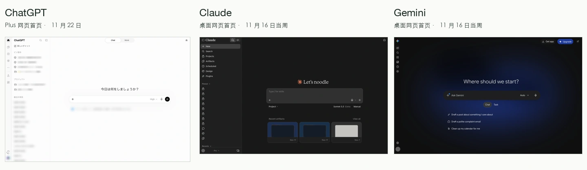

# ChatGPT、Claude 与 Gemini 桌面网页全链路界面对照（vNext 增补版）

更新日期：2026 年 11 月 24 日（在 11 月 23 日首屏对比基础上，补齐**侧栏历史、思考与工具过程态、Canvas/Artifacts 动态分栏、自定义助手构建**四大动态界面拆解）。  
配套规范：[vNext 交互与视觉设计规范](../21-vnext-uiux-spec.md) · [统一高保真交互原型](vnext-prototype.html)

---

## 1. 首屏对比与实测比例（保留基线）

| 产品（桌面网页） | 首屏结构特点 | 输入框宽度占比 | Alliance vNext 吸收点 |
| :--- | :--- | :--- | :--- |
| **ChatGPT** ([大图](previews/execution/chatgpt-web.webp)) | 左侧可折叠导航+历史；顶部无厚重通栏；输入区居中大圆角横条，左下 `+` 与工具胶囊，右下语音/发送圆键 | ~61%（约 730px） | 取消贯穿全屏的厚重顶条；输入区居中、最大宽 `720px`、左下能力入口与右下发送键对称排布 |
| **Claude** ([大图](previews/execution/claude-web.webp)) | 左侧常驻深/浅对比侧栏；居中问候语 + 高质感多行输入卡；左下附件/样式，右下模型选择与发送；下方单排「最近产物」缩略卡片 | ~52%（约 668px） | 借鉴温润纸面留白、左下工具与右下档位极简排布，以及首屏下方的「最近产物/待办续接」轻量入口 |
| **Gemini** ([大图](previews/execution/gemini-web.webp)) | 左侧可收起为纯图标轨；主区清晰聚焦于大标题 + 胶囊输入框 + 模式切换（Chat/Task）+ 短句任务建议 | ~52%（约 660px） | 宽屏折叠为 `56px` 图标轨；输入区下方提供 3–4 个直接可点选发起的高频业务短句建议 |

---

## 2. 四大高频动态界面逐项拆解与 Alliance vNext 落地取舍

首屏只占用户 5% 的停留时间；真正决定非技术员工“觉得好用、像三巨头”的，是进入对话后的四大动态交互状态。

### 2.1 左侧导航与对话历史组织

| 对比维度 | ChatGPT | Claude | Gemini | Alliance vNext 采纳设计 |
| :--- | :--- | :--- | :--- | :--- |
| **侧栏默认态** | 桌面宽屏默认展开（~260px），可一键收起 | 默认展开，收起为窄图标轨 | 默认图标轨，悬停或点击展开 | **默认展开 `248px`，点击折叠为 `56px` 图标轨**；与主区通过轻底色差（`#f6f7f4` vs `#ffffff`）区分，不画厚重阴影 |
| **顶部功能区** | 新对话、搜索、Explore GPTs、Projects | `+ New`、Search、Projects、Artifacts、Scheduled | 新对话、搜索、Gems | 顶部固定 **`+ 新对话`**、**`搜索 ⌘K`**；中部 3 项清晰直达：**`Agent 广场`**、**`后台与定时`**、**`待办与审核（角标）`** |
| **历史记录分组** | 按「今天 / 昨天 / 7 天内 / 30 天内」分组，hover 显示 `...`（置顶/重命名/删除） | Pinned 置顶 + Recents 最近，选中项整行柔和底色 | 最近对话列表 + 置顶 | **置顶区 + 按时间分组（今天 / 昨天 / 更早）**；每条单行截断，仅在有活跃阻塞/进行中任务时带一枚轻状态点；hover 出现轻量操作 |
| **底部账号与管理** | 左下角个人头像菜单（设置/主题/退出），不放右上角孤立图标 | 左下角头像与 Workspace 切换 | 左下角设置与帮助 | **左下角固定「企业管理」入口（仅管理员/授权主管可见，点击切全屏 `/admin`）+ 个人头像条（内置一键浅/深色切换、偏好设置、IM 绑定）** |

### 2.2 思考与工具调用过程态（Reasoning & Tool Execution）

非技术员工对“干转圈卡住”最焦虑，也最讨厌看到原始 JSON 参数或技术报错堆栈。

| 产品范式 | 典型交互表现 | Alliance vNext 采纳设计 |
| :--- | :--- | :--- |
| **ChatGPT（Thinking / Search / Code）** | 回复上方显示一行灰色动态状态（`正在思考…` / `正在搜索 4 个来源`），完成后折成 `已思考 12 秒 ▾`，点击展开自然语言步骤与代码/来源列表 | **可折叠执行时间线胶囊**：执行中展开当前 1–3 步自然语言进展（如 `✓ 读取 3 份报价单 → ⟳ 沙箱 Python 核算比价`），完成后自动收起为单行摘要（`已完成 3 步操作 · 用时 4.2s ▾`），绝不把原始 SQL/JSON 吐给业务员 |
| **Claude（Thinking + Tool Use）** | 思考块带柔和竖线缩进、低饱和字色；工具调用以圆角小条呈现“做了什么、读了哪个文件”，与最终回答有清晰视觉分层 | 工具步骤用**轻底圆角卡片 + Lucide 线性小图标**，与正式回复正文严格分层；遇到缺资料或需要 L1/L2 确认时，直接在对话流底部嵌入**内联操作卡**（主色绿按钮 + 清晰原因） |
| **Gemini（Task Progress）** | 复杂任务展示带步骤序号的勾选清单，逐项打勾推进 | 长任务或协作任务支持展开步骤清单，完成项自动打勾，阻塞项用琥珀色徽章指出“缺什么、点哪里补” |

### 2.3 动态分栏 Canvas / Artifacts 与局部修改

这是 Personal Agent 交付文档、表格、PPT、代码与对比报告的核心战场。

| 对比维度 | ChatGPT Canvas | Claude Artifacts | Alliance vNext 动态工作区 Canvas |
| :--- | :--- | :--- | :--- |
| **唤起时机** | 普通问答单栏；写长文/代码时自动平滑分栏（左对话 ~40% + 右文档 ~60%） | 生成结构化文档/组件/图表时在对话流嵌入 Artifact 卡片，点击或自动在右侧滑出独立纸面 | **默认单栏居中（最大宽 `760px`）；一旦触发多步执行或产出文档/表格/PPT/图表，右侧 Canvas 平滑滑出（左 46% / 右 54%）**，支持随时收起或全屏 |
| **对话内锚点** | 对话流中保留一张轻量文件卡，点击可重新打开或切回对应版本 | 嵌入带图标、标题与版本号的圆角卡片，点选即切换右侧视图 | 对话流内保留**成果引用卡**（图标 + 文件名 + 简短状态如 `3 家供应商 · 1 项待补`），多文件可在右侧顶部 Tab 栏自由切换 |
| **局部修改交互** | 支持在右侧文档直接选中段落弹出「询问/修改此处」浮条，无需把整篇重写要求打进主框 | 支持切换版本 `v1 / v2`、复制、下载、重新生成 | **融合两者**：右侧 Canvas 顶部支持 **`v1 / v2` 版本切换**、一键下载与复制；支持**选中行/段落发起「局部修改」**，把上下文带回左侧输入框精准修订 |
| **企业独有增强** | 无多人审签与原件溯源 | 无多人审签 | 顶部提供轻开关**「开启协作审签」**——关闭时是极简个人 Canvas；开启后右侧增加「原件依据定位」「交付清单核对」与「审核通过/确认交付」动作栏 |

### 2.4 自定义助手构建器（非研发自然语言创建）

| 产品范式 | 布局与交互特点 | 局限性 | Alliance vNext「左聊右测」改良 |
| :--- | :--- | :--- | :--- |
| **ChatGPT GPT Builder** | 经典左右 50/50 分屏：左侧 `Create（对话构建） / Configure（表单清单）` 双 Tab，右侧 `Preview` 实时试聊 | 表单项仍偏开发者（Actions OpenAPI Schema）；缺少“拖入标杆文件反推规范”和“划出不满意输出直接纠偏” | 保留经典左右分屏与 `对话构建 / 配置清单` 双 Tab；**新增“拖入 1–3 份标杆样例反推规则”**；右侧试聊支持**“指哪改哪”增量更新左侧规则** |
| **Claude Projects & Skills** | 极简知识区 + 自定义指令 + 能力开关；不强迫用户选复杂参数 | 缺少面向企业团队的发布版本控制与审批分级 | 底部明确三档发布：**个人私有（零审批即用） / 团队共享（自测通过即用） / 企业上架（提交审批）** |
| **Gemini Gems** | 简洁自然语言描述 + 一键 AI 润色指令 + 右侧即时预览 | 能力与企业工具生态绑定较浅 | 提供业务可读的**意图化能力开关**（企业知识库 / 表格与文档沙箱 / 识图生图 / 联网 / 已授权外部 Agent），隐藏底层模型版本与工具协议 |

---

## 3. Alliance vNext 交互行为一致性清单（防跑偏红线）

1. **禁止将重型页面塞进 `<dialog>` 弹窗**：Agent 广场、构建器、外部接入向导、企业管理监控后台一律为独立全屏路由视图；弹窗仅用于轻量二次确认、快捷键搜索（`⌘K`）和单条原件/Trace 抽屉。
2. **禁止在输入框堆叠技术勾选框**：不再出现“最多两次模型调用”“允许按原文金额求和或算差额”“模型修订选择”等工程师控件。
3. **统一动效与响应反馈**：输入框支持 `Enter` 发送 / `Shift+Enter` 换行；发送后按钮切换为方形停止键；AI 回复底部统一提供 `复制 / 重试 / 👍 / 👎 / 存为 Agent / 设为定时` 轻操作栏；全站支持 `⌘K` 全局跳转与一键浅/深色切换。
